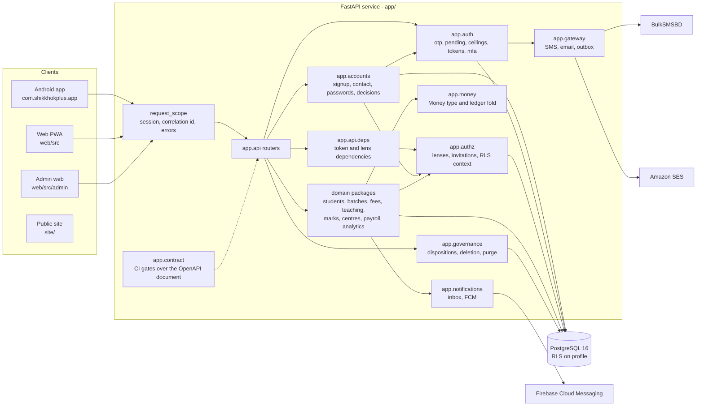
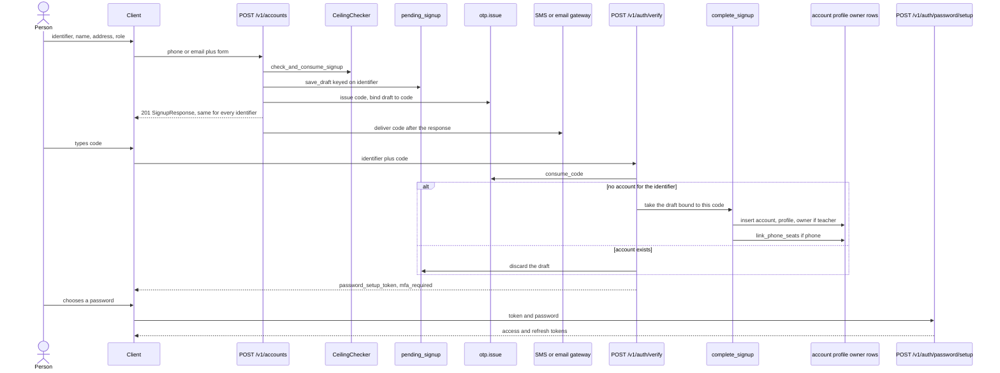
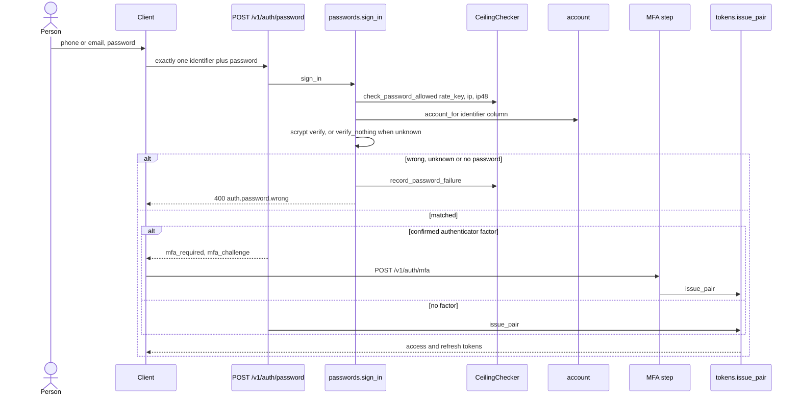
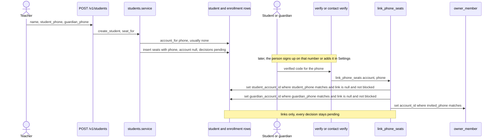
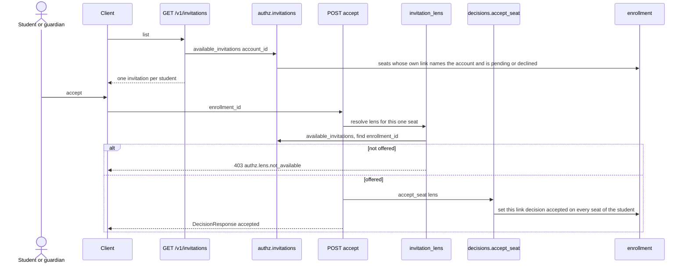
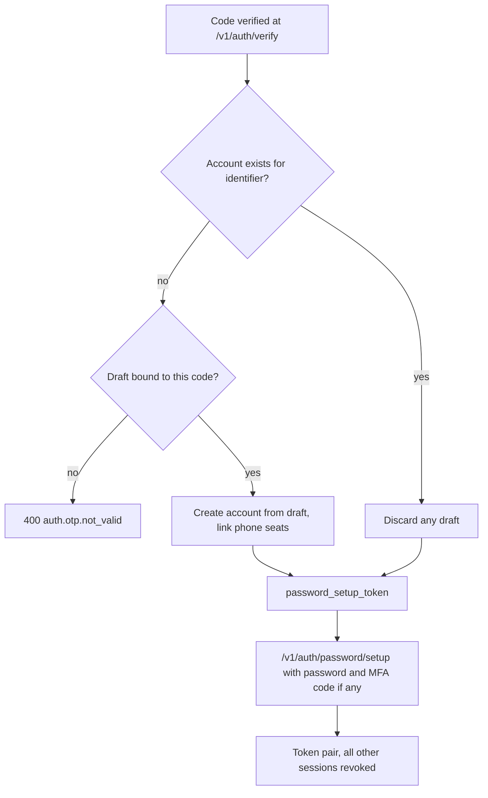

# Architecture — ShikkhokPlus

Full rescan, 2026-11-13, commit `cb20fd1`. Verified in code unless marked *inferred*. Component detail lives in `component-inventory.md`; endpoint detail in `api-documentation.md`.

## Architecture Analysis

### System Overview

One FastAPI service over one PostgreSQL 16 database, consumed by an Android app and a React PWA (plus a separate admin build of the PWA and a static public site). The backend is a **modular monolith**: one deployable image (`Dockerfile`, `python:3.12-slim-bookworm` pinned by digest), packages per domain under `app/`, boundaries enforced by CI gates rather than by process separation.

### Architectural Style

Modular monolith with layered packages, evidence:

- One application object (`app/main.py:create_app`) registers 27 routers from `app/api/` plus a staging-only router (`app/api/staging.py`, registered only when `outbox_enabled()`).
- Domain packages (`app/fees`, `app/teaching`, `app/marks`, ...) hold services; `app/api/*` holds thin route handlers; `app/schemas/*` holds wire models; `app/db/models.py` describes the schema the migrations own.
- Boundaries are **contracts because a violation fails CI** (team.md Corrections, 2026-10-18): money import boundary (Ruff banned-api + AST test), route-enumeration lens gate, schema-wide privacy gate, money-schema gate, schema-diff gate on `openapi.json`, schema-parity test between models and migrations.

Hosting (from `infra/`, `deploy/README.md`): an EC2 host behind CloudFront, replaced on every deploy by an instance refresh (`deploy/roll.sh`), RDS PostgreSQL 16 with storage encryption (`infra/modules/database/main.tf`), Amazon SES for email, S3 + CloudFront for the web app, admin app and site, ECR for the immutable SHA-tagged image, a seeder Lambda for non-production hosts. Secrets in SSM. *Inferred from the README and module names; the Terraform was skimmed, not traced resource by resource.*

### Component Relationships

Text fallback: the three clients call the FastAPI service. Each request passes the request scope (session and correlation id), then a router, whose dependencies authenticate the bearer token and resolve a lens through `app.authz`. Routers call `app.accounts` and `app.auth` for identity work and the domain packages for everything else; domain money arithmetic goes through `app.money`. Codes go out through `app.gateway` (SMS via BulkSMSBD, email via SES); push goes through FCM. All packages read and write the one PostgreSQL database, where `profile` is protected by row-level security. `app.contract` is not on the request path: it is a set of CI gates that walk the generated OpenAPI document and the registered routes. The public site is static and calls nothing.

### Data Flow

1. **Request scope** (`app/main.py:_register_request_scope`, `app/request_scope.py`): a SQLAlchemy session per request on `request.state.session`, a correlation id, and one exception handler mapping the closed five-class taxonomy (`app/errors`) to the error envelope (`code`, `retryable`, `message_key`).
2. **Authentication** (`app/api/deps.py`): `token_subject` verifies the HS256 access token (signature, expiry, `iss`, `aud`; `app/auth/tokens.py`); `authenticated_account` also requires the account row to exist.
3. **Authorization**: a lens dependency (`teacher_lens`, `student_lens`, `guardian_lens`, `invitation_lens`, ...) resolves from data at that moment — one SQL statement returning three EXISTS booleans plus scoping ids, memoized on `request.state` only (`app/authz/resolve.py`). The handler receives the lens and scopes every query by it.
4. **Profile reads/writes** bind `app.account_id` transaction-locally (`app/authz/rls.py`, `set_config(..., true)`) so the `profile_owner_only` policy admits only the owner's row.
5. **Writes** commit in the handler or service; external side effects (SMS, email, FCM) run after commit or after the response (`app/auth/delivery.py`, `app/notifications/fcm.py`).

### Key Design Decisions

| Decision | Where | Consequence for this intent |
|---|---|---|
| No role column; lens computed per request [BR1.1, TC-11] | `app/db/models.py` Account, `app/authz/resolve.py` | A username is identity, not authorization; it must not become a role carrier |
| Verify-first sign-up [C-07] | `app/auth/pending.py`, `app/accounts/service.py:complete_signup` | A chosen username would have to travel in the draft and be created atomically in the verify transaction |
| Passwords sign in; codes only recover [0032] | `app/accounts/passwords.py`, `app/api/auth.py` | Username sign-in is a new resolution path into `sign_in`, which today resolves through `otp.account_for(Identifier)` |
| Identifier is a closed two-channel type | `app/accounts/identifier.py` (`Channel`, `column`, `rate_key`) | A username is not an OTP destination; extending `Channel` would make it one. A separate sign-in resolver is the smaller change (*inferred*) |
| One answer for every failure; no existence oracle [BR2.7] | `app/auth/otp.py`, `app/accounts/passwords.py` | A username availability check discloses existence by design and needs its own ceilings, like `already-added` |
| Privacy boundary in three layers [TC-13, D-5, D-7] | separate tables by writer, RLS on `profile`, `OWNER_PRIVATE_FIELDS` gate | A pre-authentication username lookup cannot read `profile` under RLS; a username on `account` is protected by the schema gate only |
| Linking is not accepting [BR5.1, ADR-013] | `_LINK_*_SEATS` set links, never decisions | Matching on email must keep the same absence |
| Public routes are an asserted allowlist | `app/contract/routes.py` (`PUBLIC_ROUTES`, 14) | Any public availability route is a counted, reviewed addition |
| Governance manifest per table | `app/governance/dispositions.py` | A reserved-username table needs a disposition and retention class |

### Improvement Opportunities

- Correct the stale "dormant account" prose (`app/db/models.py:452-454`, `app/auth/otp.py` "Activate if dormant") before a design reads it as current behaviour.
- `app.auth` holds the sign-in path and is not a mypy strict island, while `app.accounts` is.
- Teacher-recorded contact is phone-only end to end (models, schemas, link statements, lookup, centre invitations); every link statement would need an email twin, which argues for one matching function rather than parallel SQL (*inferred*).
- Dependabot and a backend SBOM remain unbuilt (see `code-quality-assessment.md`).

## Interaction Diagrams

### 1. Sign-up (verify-first), today

Text fallback: the client posts the form to `POST /v1/accounts`; signup ceilings are consumed, a draft is stored keyed on the phone or email, a code is issued and bound to that draft, and the same 201 is returned for every identifier while the code is sent after the response. When the person types the code, `POST /v1/auth/verify` consumes it. If no account exists for the identifier, the draft bound to that code becomes the account, profile and (for a teacher) owner row, and, for a phone, the seats and centre invitations recorded against it are linked; if an account exists, the draft is discarded. Verify returns a password-setup token; `POST /v1/auth/password/setup` sets the password and returns the session.

### 2. Password sign-in, today

Text fallback: the client sends exactly one of phone or email with a password. `sign_in` first checks the per-identifier, per-/64 and per-/48 password-failure ceilings, then resolves the account by the identifier's column, then runs scrypt (or an equal-cost dummy when there is nothing to check). Any failure is recorded against the ceilings and answered with one refusal. A match returns tokens, or an MFA challenge when the account has a confirmed authenticator factor.

### 3. Claiming what a teacher recorded (the "dormant account" path, as built)

There is no dormant account row. "Claiming" is the linking step at account creation or at contact addition.

Text fallback: a teacher records a student with a student number and a guardian number. The service looks for an account on each number (usually none) and writes seats carrying the numbers with null account links and pending decisions. Later, when someone proves that number — by signing up on it, or by adding it in Settings — `link_phone_seats` fills the null student and guardian links on every seat recorded with that number (skipping links blocked by an earlier erasure) and links centre invitations sent to it. Decisions stay pending. An email proved the same way links nothing, because nothing is recorded by email.

### 4. Invitation accept

Text fallback: the invitation list is resolved from the authenticated account by its own statement (each link's decision paired with its own account column; pending and declined both offered). Accept resolves an invitation lens for the one seat in the path, refusing with 403 if that seat is not offered, then writes `accepted` to that holder's link on every seat of the same student. Only then do the student and guardian lenses grant access.

### 5. Flow: which path a code takes

Text fallback: a verified code either completes a sign-up (no account, a bound draft exists), authenticates an existing account (any draft is discarded), or is refused (no account and no bound draft). The first two yield a password-setup token, which becomes a session at `/v1/auth/password/setup`, revoking every other session.
