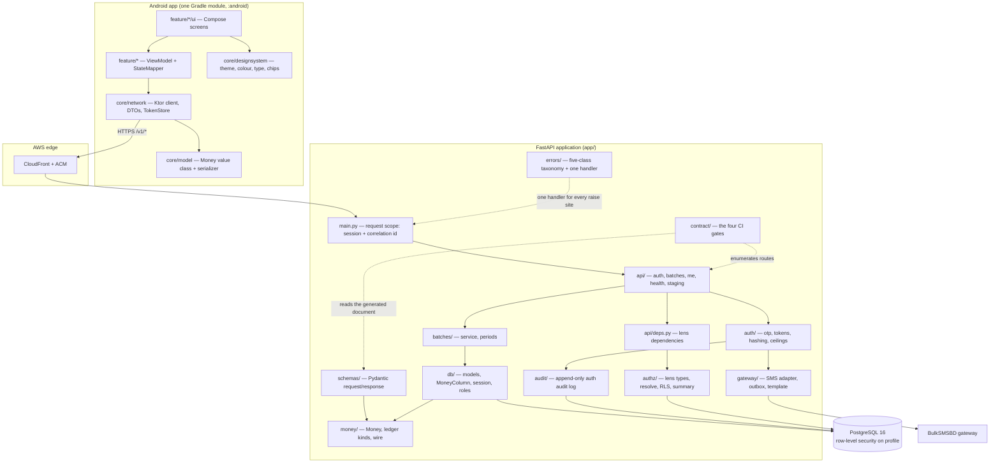
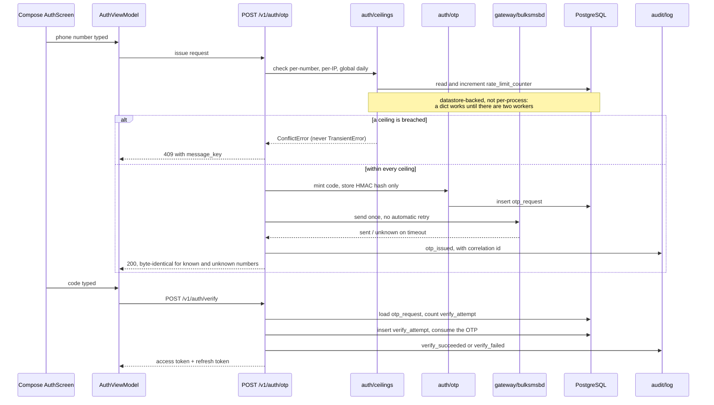
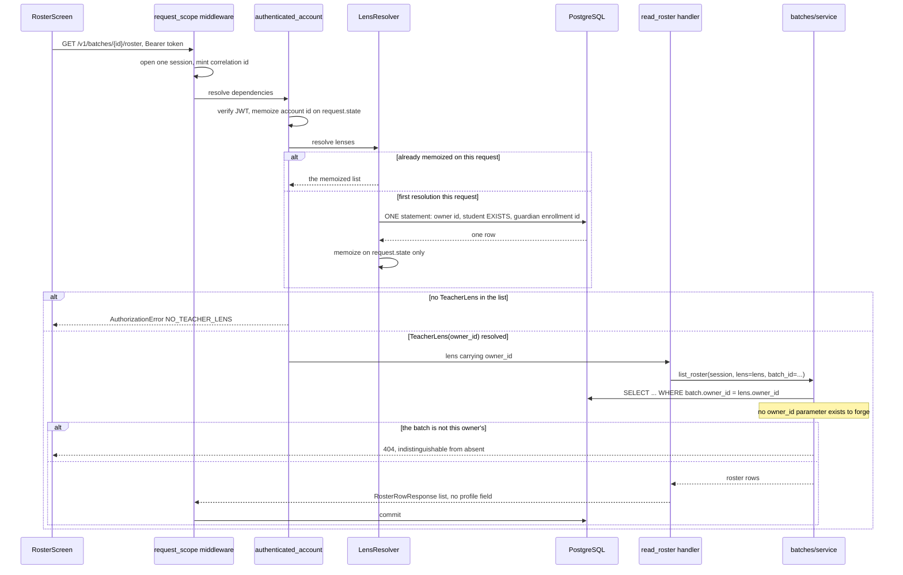

# Architecture Analysis

## System Overview

Two deployed artifacts and one contract between them.

A **modular monolith** in Python 3.12 serves a versioned HTTP API from a
single FastAPI application (`app/main.py`), backed by one PostgreSQL 16
database. An **Android application** in Kotlin and Jetpack Compose is the
only client. The committed `openapi.json` at the repository root is the
contract, regenerated by `make openapi` and compared byte-for-byte against a
freshly generated document by a CI gate.

The backend is a monolith by deliberate choice and the choice is visible in
the infrastructure: one EC2 instance per environment, PostgreSQL running in a
container on the same host, no load balancer, no NAT gateway, no service
mesh. The root Terraform module states the reasoning for each omission and
prices it against the USD 50/month ceiling.

## Architectural Style

**Modular monolith, layered inside, with three of its module boundaries
mechanically enforced.** The evidence is specific, and the distinction
between *enforced* and *conventional* is the single most useful thing this
document can record, because it tells the next author which lines they can
cross by accident and which ones will stop them.

### Boundaries that are enforced — a violation reddens CI

| Boundary | Mechanism | Where |
|---|---|---|
| Nothing outside `app/money` does decimal arithmetic | Ruff `flake8-tidy-imports` banned-api on `decimal` and `decimal.Decimal`, with `app/money/**` carrying an explicitly **empty** ignore list so its permission comes from being the carve-out, not from an exemption | `pyproject.toml` `[tool.ruff.lint.flake8-tidy-imports.banned-api]` |
| `app.money` imports nothing from `app.api`, `app.db`, `app.repositories`, `app.authz` or `app.schemas` | An AST-walking pytest gate, plus a committed violation fixture proving the gate fires, plus a configuration-scope assertion proving the carve-out resolves to exactly `app/money/**` and never a parent | `tests/gates/test_import_gates.py` |
| Every route resolves a lens | Route enumeration over the real application object, matching on the dependency's **return annotation** being a `Lens` subtype rather than on its name, with two separate explicit allowlists | `app/contract/routes.py`, `tests/contract/test_route_lenses.py` |
| No teacher-facing response schema carries an owner-private profile field or an account identifier | Recursive walk of the generated OpenAPI document from every teacher-lensed route's response model, through `$ref`, `items`, `allOf`/`anyOf`/`oneOf`, with a cycle guard | `app/contract/privacy.py`, `tests/contract/test_privacy_schema.py` |
| Every money property in the contract references the one shared `Money` component | `$ref` predicate, plus two name-matched backstops catching a money-named property emitted as a JSON number or as an unconstrained string | `app/contract/money_schema.py` |
| The committed contract matches the generated one | Byte comparison, with generation run in a **subprocess** so a fresh hash seed can observe any set-derived ordering instability | `tests/contract/test_schema_diff.py`, `app/contract/emit.py` |
| Every live table carries a deletion disposition and a retention class | A test iterating the **migrated schema**, so a table added by a later migration cannot arrive undeclared | `app/governance/dispositions.py`, `tests/db/test_governance.py` |
| The release APK/AAB declares exactly one permission and references no device identifier | Two Gradle tasks finalising `bundleRelease`, parsing the **merged** manifest as XML and scanning the **R8-minified** DEX byte table for whole-identifier matches | `android/release-gates.gradle.kts` |
| The coverage floor's explicit package list matches what is on disk | A test asserting the `--cov=` list against the filesystem, checking top-level modules as well as packages | `tests/gates/test_coverage_scope.py` |
| Named-test obligations resolve to tests that exist | Manifest in `tests/named_tests.toml` checked by AST parse | `tests/test_named_test_manifest.py` |

Four of these ship a **committed violation fixture** (`tests/contract/fixtures/`
holds `leaky_app.py`, `money_app.py`, `unlensed_app.py`) whose only purpose
is to prove the gate can fail. `tests/contract/test_fixtures_fire.py` and
`tests/contract/test_no_gate_walks_app_routes.py` keep the fixture and the
real gate calling one function rather than two implementations that drift.

### Boundaries that are conventional — nothing stops a violation

- The **API / service / persistence split** inside the backend. `app/api/`
  holds routers, `app/batches/service.py` holds the batch and roster
  operations, `app/db/models.py` holds the ORM. Nothing prevents a router
  importing `app.db.models` directly and several reasonably do.
- **Where a business rule lives.** The project rule puts every rule
  server-side; on the backend side nothing checks which backend module it
  lands in.
- The **Android layering** — ViewModel holds UI state, repository holds data
  access, composables render. There is no detekt, no ktlint and no custom
  lint rule in the build, so this layer is enforced by review alone. See
  `code-quality-assessment.md`; this is the largest gap between the written
  practice and the built state.

## Component Relationships

Text fallback: the Compose UI reads from ViewModels, which call repositories
in `core/network`, which decode DTOs carrying the `Money` value class. HTTPS
requests reach CloudFront and then the FastAPI application. A middleware
opens one database session and mints one correlation id per request. Routers
in `app/api` depend on lens dependencies in `app/api/deps.py`, which call the
resolver in `app/authz`. The batch service and the ORM reach PostgreSQL; the
auth module reaches the SMS gateway and writes the audit log. The money
module is imported by the schemas and the column type but imports nothing
back. The contract gates read the generated document and the registered
routers from outside.

## Data Flow

### Authorization as a data dependency

This is the structurally unusual decision in the system, and everything else
is arranged around it.

A lens is **not** a guard that returns nothing. `TeacherLens` carries
`owner_id`; `GuardianLens` carries an optional `child_enrollment_id`. A
handler cannot compile a teacher-scoped query without `owner_id`, and
`owner_id` arrives only inside the lens object — so forgetting the dependency
means having nothing to scope on, rather than producing an endpoint that
works perfectly and authorizes nothing. `app/batches/service.py` makes this
explicit: no function in it takes an `owner_id` parameter, so there is no
value to forge.

Resolution runs on **every request** against `owner` and `enrollment`, as a
**single SQL statement** returning the owner id, a student `EXISTS` and the
guardian enrolment id (`app/authz/resolve.py` `_LENS_QUERY`). It is memoized
on `request.state` only, and `app/authz/resolve.py` contains no module-level
dict and no `lru_cache`; `tests/authz/test_memoization.py` asserts their
absence rather than trusting a reading of the file.

### Privacy, in three layers

1. **Table design.** `profile` holds only what its own account wrote
   (`self_name`, `photo_ref`) and is keyed by `account_id`.
2. **PostgreSQL row-level security.** Migration `0001` runs
   `ENABLE ROW LEVEL SECURITY` *and* `FORCE ROW LEVEL SECURITY` on `profile`,
   creates the `profile_owner_only` policy reading the session variable
   `app.account_id`, and creates a restricted non-superuser role
   `shikkhok_app` that the application and the test suite connect as. The
   session variable is set with `set_config(..., true)` — transaction-local,
   so a pooled connection cannot carry one request's account id into the
   next (`app/authz/rls.py`).
3. **Response schemas.** No teacher-facing schema may carry a field in
   `OWNER_PRIVATE_FIELDS` or `FORBIDDEN_ACCOUNT_ID_FIELDS`, asserted by
   walking the whole generated document rather than per endpoint.

The test suite connects as the restricted role and a meta-test
(`tests/privacy/test_rls_meta.py`) asserts that `current_user` is not a
superuser, that `row_security` is on and that the policy exists — ordered
first by two independent mechanisms, because a privacy probe suite run as a
superuser does not fail, it passes.

### Money, as a type with two chokepoints

`app/money/Money` is a frozen value object wrapping a `Decimal`, quantized to
two places at construction, with `ROUND_HALF_UP` declared once. Construction
from a `float` or a `bool` raises. There is no `__float__` and no `__int__`.
Multiplication is a named `apply_rate`, not `__mul__`, so rounding is never
anonymous. Division is not exposed.

Every money value must pass one of exactly two chokepoints:

- **the wire**: `app/schemas/money.py` `Money` is a Pydantic `RootModel[str]`
  — deliberately a root model and not an `Annotated` alias, because an alias
  inlines into every property and leaves no component for the `$ref`
  predicate to check;
- **storage**: `app/db/money_type.py` `MoneyColumn` is a SQLAlchemy
  `TypeDecorator` mapping `Money` onto `NUMERIC(12,2)` with
  `asdecimal=True`, refusing a bare `Decimal` or `int` at bind time.

### Error handling

A closed five-class hierarchy in `app/errors/_classes.py` —
`ValidationError`, `AuthorizationError`, `ConflictError`, `TransientError`,
`FatalError` — each mapping to one caller behaviour. Retryability is a
property of the class chosen at the raise site, never a judgement at the call
site. One FastAPI handler maps the hierarchy to responses, with an
`assert_never` over the five classes so adding a sixth is a type error rather
than a runtime surprise.

The envelope is `{"error": {"code": ..., "retryable": ..., "message_key":
...}}`. `message_key` rather than `message`, so a Bangla-first client
localizes from `strings.xml` instead of displaying server English.

`AuthorizationError` carries `Literal[401, 403, 404]`. The **404 is an
authorization status here, not a routing one**: a 403 for a real id and a 404
for an invented one is an existence oracle, so a refusal is made
indistinguishable from absence. `app/errors/codes.py` goes further and holds
a single `NOT_AVAILABLE` code covering both cases, with a test asserting the
registry contains no `X_NOT_FOUND`/`X_NOT_YOURS` pair.

## Interaction Diagrams

### Sign in: OTP issue and verify

Text fallback: the client posts a phone number. The ceiling module checks the
per-number, per-IP and global daily SMS limits against datastore-backed
counters and refuses with a `ConflictError` if any is breached — retrying
into a cost ceiling is wrong, so it is deliberately not a transient error. On
success a code is minted, only its HMAC hash is stored, one SMS is attempted
with no automatic retry, and an audit row is written. The issue response is
byte-identical whether or not the number is known. Verification counts prior
attempts, consumes the OTP, writes an audit row and returns a token pair.

### An authenticated teacher reads a roster

Text fallback: the middleware opens one session and one correlation id per
request. The dependency chain verifies the bearer token, memoizes the account
id, then resolves all three lenses in one SQL statement, memoized on the
request object. Absence of a teacher lens is a 403. With a teacher lens, the
handler passes it to the service, whose query scopes on the lens's own
`owner_id` because no parameter exists to supply a different one. A batch
belonging to another teacher returns 404, deliberately indistinguishable from
one that does not exist. The middleware commits at the end of the request;
no repository method commits on its own.

## Key Design Decisions

| Decision | Why it was made this way | Where it lives |
|---|---|---|
| Role is computed per request, never stored | A stored role is a second copy of a fact that can disagree with the first; one account is routinely all three | `app/authz/resolve.py` |
| Lens is a value, not a guard | A forgotten guard produces a working, unauthorized endpoint; a forgotten value produces a query that will not compile | `app/authz/lenses.py`, `app/api/deps.py` |
| One transaction per request, committed by the middleware | A repository that committed on its own makes a partial money write possible | `app/main.py` `request_scope` |
| Shared components published explicitly into the document | FastAPI emits a component only when a route references it, and no route carries money yet — the `Money` and `ErrorEnvelope` definitions would be absent from the committed contract and a regression in them invisible | `app/main.py` `_publish_shared_components` |
| Routers recorded on `app.state.included_routers` as they are included | `isinstance(route, APIRoute)` over `app.routes` matched **nothing** in this FastAPI version, so both the route gate and the privacy gate passed against zero routes. The gates now enumerate what was actually registered, and a test cross-checks the count against the generated document | `app/main.py`, `app/contract/routes.py` `_api_routes` |
| Two separate allowlists, `PUBLIC_ROUTES` and `LENS_EXEMPT_AUTHENTICATED` | With one combined list, whoever first hits a failing authenticated route takes the cheapest green edit and makes it public | `app/contract/routes.py` |
| Ktor rather than Retrofit on the client | KSP could not parse eight files on this Kotlin/AGP pairing; Ktor needs no annotation processor and reuses the serialization plugin already present | `gradle/libs.versions.toml` |
| One Gradle module with `core/*` and `feature/*` packages | The reference sample uses roughly forty modules; replicating that multiplies build configuration for a solo two-surface project | `settings.gradle.kts` |
| `allowBackup="false"` | Auto Backup would copy children's-adjacent data to the user's Google Drive with no disclosure covering it | `android/src/main/AndroidManifest.xml` |
| No ALB, no NAT gateway, no RDS in Phase 1 | Each priced against the USD 50 ceiling in the root module's header, with the reasoning recorded so the absence does not read as an oversight | `infra/main.tf` |

## Improvement Opportunities

These are observations about the architecture as built; they are not
instructions.

1. **The service layer exists for one feature only.** `app/batches/service.py`
   is the only service module; the auth endpoints call `app/auth/*` directly
   and `app/api/me.py` calls `app/authz/summary.py` directly. The three
   remaining feature areas (fees, sessions, insights) have no established
   pattern to copy, and the fee work is the largest of them. Whether a
   `app/fees/service.py` mirrors `batches` or whether the money work needs a
   different shape is an open architectural question with no precedent in the
   tree.

2. **`app/authz` is named in `team.md` as a mypy strict island and is not
   configured as one.** `pyproject.toml` configures `app.money.*` (strict +
   `disallow_any_explicit`) and `app.schemas.*` (strict), and the comment
   says `app.authz.*` "stays unconfigured until U3 creates its resolvers".
   U3 has shipped and the resolvers exist; the override was not added. See
   `code-quality-assessment.md`.

3. **`PUBLIC_ROUTES` allowlists two routes that do not exist.**
   `("GET", "/account-deletion")` and `("POST", "/account-deletion")` are in
   the frozenset and asserted by `tests/contract/test_route_lenses.py:86-87`,
   but no handler is registered anywhere. The comment above the set says
   "exactly five, and the count is asserted" while the set holds six entries.
   This is pre-declared scope for the unbuilt deletion unit rather than a
   live hole — nothing is reachable — but it does mean the allowlist is
   currently wider than the application.

4. **Lens resolution and lens summary are two statements over the same
   tables.** `app/authz/resolve.py` and `app/authz/summary.py` each issue
   their own single query. `GET /v1/me` uses the summary and resolves no
   lens; every other authenticated route uses the resolver. The duplication
   is reasoned about in both docstrings and is not a defect, but a third
   consumer would be the point at which it needs a decision.

5. **There is no established pattern for a student-lensed or
   guardian-lensed write.** Every write built so far is teacher-lensed. The
   payment-claim submission in the plan is the first student and guardian
   write, and the response-schema-separation rule — a teacher-lens endpoint
   returning a student-private model should be a type error — currently has
   no example in the tree to follow.

## Sources

- [code] `app/main.py`, `app/api/`, `app/authz/`, `app/contract/`,
  `app/errors/`, `app/money/`, `app/db/`, read 2026-10-22 at `b14b1fa`
- [code] `migrations/versions/0001_initial_identity_schema.py` lines 223-281
  (role creation, RLS enable/force, policy)
- [code] `android/build.gradle.kts`, `settings.gradle.kts`,
  `android/release-gates.gradle.kts`
- [code] `infra/main.tf`, `infra/versions.tf`
- [verified] `python3 -m pytest tests` — 615 passed, 2026-10-22
