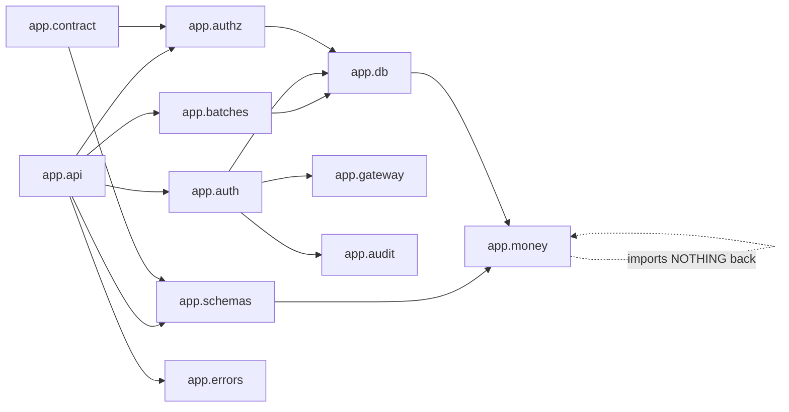

# Code Structure

## Repository layout

A single repository holding two source surfaces, their shared contract, the
database migrations, the infrastructure and the design assets.

```
shikkhok-plus/
├── app/                   Python backend — 6,207 lines across 48 modules
├── tests/                 pytest suite — 70 files, 12,260 lines
├── migrations/            Alembic, 3 revisions
├── android/               Kotlin/Compose client, one Gradle module
├── infra/                 Terraform: root + 5 modules + bootstrap
├── deploy/                staging compose file and its README
├── scripts/               release_notes.py
├── docs/                  delivery/vertical-slices.md, legal/PRIVACY.md
├── claude_design/         5 HTML artboards (design system, teacher,
│                          student, guardian screens)
├── store_listing/         Play assets: icon, feature graphic,
│                          screenshots at 4 form factors, explainer video
├── openapi.json           the committed contract (36 KB)
├── pyproject.toml         Ruff, mypy, coverage, pytest — all config here
├── Makefile               `make check` — the one entrypoint
├── alembic.ini
├── settings.gradle.kts    one module: `:android`
├── gradle/libs.versions.toml
├── docker-compose.yml     local stack
├── Dockerfile
├── message-keys.json      the error message-key registry
├── CONTRACT.md            how the contract is changed
└── .github/workflows/     check.yml, deploy.yml, release-android.yml
```

Build-output and cache directories are present on disk and were **not
opened**: `android/build/`, `build/`, `.gradle/`, `.terraform/`,
`.mypy_cache/`, `.ruff_cache/`, `.pytest_cache/`, `.hypothesis/`,
`__pycache__/`, `.kotlin/`.

## Backend: `app/`

Organised **by concern**, with the concern that must not leak isolated
first. Thirteen packages:

```
app/
├── main.py            the application object, middleware, router registration
├── config.py          the production startup refusal
├── api/               HTTP surface: auth, batches, me, health, staging, deps
├── authz/             lens types, per-request resolution, RLS, summary,
│                      annotation resolution
├── auth/              OTP, tokens, hashing, the four ceilings
├── money/             the Money type, ledger kinds and fold, wire form
├── schemas/           Pydantic request/response models
├── db/                ORM models, MoneyColumn, session, roles, staging seed
├── contract/          the four CI gates over the generated document
├── errors/            five-class taxonomy, code registry, one handler
├── gateway/           SMS: protocol, real adapter, null adapter, outbox,
│                      template
├── audit/             append-only authentication audit log
├── governance/        per-table deletion dispositions and retention classes
└── batches/           batch and roster service, calendar-period arithmetic
```

### Module-size profile

The largest modules, and none is a god file:

| Module | Lines | What it is |
|---|---|---|
| `db/models.py` | 579 | 13 mapped classes, each with a substantial docstring |
| `batches/service.py` | 478 | 7 operations plus 2 private scoping helpers |
| `api/batches.py` | 299 | 6 routes plus wire conversion |
| `money/_money.py` | 324 | the value type |
| `auth/otp.py` | 323 | issue and verify |
| `auth/tokens.py` | 302 | issue, verify, rotate |
| `money/_ledger.py` | 270 | the seven-kind fold |
| `auth/ceilings.py` | 262 | the four counters |
| `gateway/bulksmsbd.py` | 246 | the real SMS adapter |
| `governance/dispositions.py` | 211 | the two manifests |

The high line counts are **documentation, not complexity**. Ruff's `D`
rules are selected across the whole backend, so every module, class and
function carries a Sphinx-style docstring with `:param:`, `:return:` and
`:raises:`. Many of these docstrings also record *why* an obvious
alternative was rejected — the `db/money_type.py` module docstring is a
representative example, running 26 lines before the first import.

### File classification

| Category | Where |
|---|---|
| **Model/Entity** | `db/models.py` (13 classes), `authz/lenses.py`, `money/_money.py`, `money/_kinds.py` |
| **Controller/Handler** | `api/auth.py`, `api/batches.py`, `api/me.py`, `api/health.py`, `api/staging.py` |
| **Service/UseCase** | `batches/service.py`, `auth/otp.py`, `auth/tokens.py`, `auth/ceilings.py`, `authz/resolve.py`, `authz/summary.py`, `money/_ledger.py` |
| **Repository/DAO** | None as a distinct layer — services issue SQLAlchemy statements directly against the request-scoped session |
| **Utility/Helper** | `money/wire.py`, `money/_rounding.py`, `batches/periods.py`, `authz/annotations.py`, `contract/serialize.py`, `contract/money_names.py` |
| **Configuration** | `config.py`, `db/session.py`, `db/roles.py`, `db/base.py` |
| **Middleware** | `main.py` `request_scope`, `errors/handler.py`, `api/deps.py` |
| **Migration** | `migrations/versions/0001`–`0003`, `migrations/env.py` |
| **Gate / build check** | `contract/routes.py`, `contract/privacy.py`, `contract/money_schema.py`, `contract/emit.py` — production modules whose consumers are tests |
| **Test** | `tests/` (70 files) |
| **Static/Asset** | `android/src/main/res/`, `store_listing/`, `claude_design/` |

The **gate** category is worth naming as its own kind: these modules ship in
the application package but their only callers are tests and `make openapi`.
Putting them in `app/` rather than `tests/` is what lets the committed
violation fixtures and the real gates call *one* function.

### Import direction



Text fallback: the API layer depends on authz, the batch service, auth,
schemas and errors. The service and auth layers depend on the database
layer; auth also depends on the SMS gateway and the audit log. The schemas
and the database layer both depend on the money module. The contract gates
depend on authz and schemas. The money module imports from nothing in the
application — only `decimal` and its own siblings.

That last edge is the only one checked: `tests/gates/test_import_gates.py`
walks the AST and asserts `app.money` imports nothing from `app.api`,
`app.db`, `app.repositories`, `app.authz` or `app.schemas`. Every other edge
in the diagram is convention.

## Tests: `tests/`

70 files, 12,260 lines, **615 tests, all passing** (verified 2026-10-22).
The test tree mirrors the source tree and adds three directories that have
no source counterpart.

```
tests/
├── conftest.py              postgres_url, migrated_url, restricted session
├── named_tests.toml         36 named obligations with acceptance criteria
├── test_named_test_manifest.py
├── money/        6 files — arithmetic, construction, ledger, wire,
│                 a Hypothesis property test, an uncovered-paths file
├── auth/         5 files — otp, tokens, hashing, ceilings, endpoints
├── authz/        5 files — resolve, annotations, memoization,
│                 dual_role_cost, me_endpoint
├── batches/      8 files — endpoints, cross-teacher isolation,
│                 every_write_is_scoped, guardian_reachability,
│                 inactive_from, query_count, removal, role_restricts_writes
├── contract/     11 files + fixtures/ — schema diff, money schema,
│                 privacy schema, route lenses, error contract,
│                 message keys, money allowlists, no_gate_walks_app_routes
├── db/           8 files — governance, migration runs / from head /
│                 rollback_is_total / fold_guard, money_type,
│                 startup_configuration, unit_boundaries
├── privacy/      conftest + test_rls_meta + test_profile_probes
├── gates/        3 files — import gates, coverage scope, design column drift
├── gateway/      2 files — gateway, staging outbox
└── audit/        1 file
```

### Four organising ideas in the test layout

**1. `tests/contract/fixtures/` holds deliberately broken applications.**
`leaky_app.py` (a teacher-facing response carrying a profile field),
`money_app.py` (a money field emitted wrongly) and `unlensed_app.py` (a route
with no lens). `test_fixtures_fire.py` asserts each gate *fails* on its
fixture, and `test_no_gate_walks_app_routes.py` asserts the fixture and the
real gate call the same function rather than two implementations that drift.

**2. `tests/privacy/conftest.py` makes the meta-test a gate, not a
sibling.** Two mechanisms: `pytest_collection_modifyitems` puts
`test_rls_meta` first by name rather than relying on alphabetical collection,
and an autouse session fixture re-checks that `current_user` is not a
superuser, that `row_security` is on and that the policy exists — erroring
the whole package if any has slipped. A privacy probe run as a superuser does
not fail; it passes, which is why this is belt and braces.

**3. `tests/named_tests.toml` is a manifest of 36 obligations.** Coverage
measures whether branches *executed*, never whether the right tests *exist* —
a missing named test whose branches another test already covers is invisible
to it. Each entry states its acceptance criterion, so a trivially-asserting
test shows up to a reader as a mismatch.

**4. `tests/gates/` checks the checks.** `test_coverage_scope.py` asserts the
Makefile's explicit `--cov=` package list against what is on disk, including
top-level modules — its own first version globbed only `*/__init__.py`, so
`app/config.py` fell outside the floor and the gate passed, reproducing
inside the gate the exact failure it exists to prevent.
`test_import_gates.py` checks each gate three ways: that it passes on the
real tree, that it fails on a violation, and that its *configuration* still
covers what it is supposed to.

### Integration tests are real

`tests/conftest.py` starts a **PostgreSQL 16 container** via testcontainers
and migrates it with **Alembic from zero**, not from a schema dump — which
gives the migration path continuous exercise at no extra cost. SQLite is
never used: row-level security, `NUMERIC(12,2)`, `ON CONFLICT DO NOTHING`
and partial indexes are the behaviours under test and SQLite emulates none
of them faithfully.

The suite connects as the restricted non-superuser role `shikkhok_app`. It
skips with a module-level message when no Docker daemon is reachable;
**Docker was available during this scan and the integration suites ran** —
115 tests across `tests/privacy`, `tests/db` and `tests/batches` passed in
15 seconds.

## Migrations: `migrations/`

Three Alembic revisions, linear, forward-only.

| Revision | What it creates |
|---|---|
| `0001_initial_identity_schema` | `account`, `profile`, `otp_request`, `verify_attempt`, `refresh_token`, `rate_limit_counter`, `auth_audit_log`, `owner`, `enrollment`; the restricted role `shikkhok_app` with its grants; `ENABLE` **and** `FORCE ROW LEVEL SECURITY` on `profile`; the `profile_owner_only` policy |
| `0002_batches_and_enrollment` | Reshapes `enrollment` to put the student and guardian links on one row (deleting the old guardian rows, with the docstring recording that the honest rollback for this revision is a restore from the pre-deploy dump); adds `batch`, `batch_subject`, `schedule_slot`, `hidden_batch_preference`; the indexes |
| `0003_staging_sms_outbox` | The staging outbox table |

`FORCE` matters: RLS does not otherwise apply to a table's owner, so without
it the policy would be inert for exactly the connection that runs migrations.

Four tests cover the migration path: it runs from zero, it runs from head,
its rollback is total, and a fold guard prevents revisions being squashed in
a way that loses a step.

## Android: `android/`

One Gradle module (`:android`), with the reference sample's package shape
inside it rather than its ~40 modules.

```
android/
├── build.gradle.kts         compileSdk/targetSdk 36, minSdk 24, R8 on release
├── release-gates.gradle.kts the two verification tasks
├── proguard-rules.pro
└── src/
    ├── main/
    │   ├── AndroidManifest.xml   INTERNET only; allowBackup="false"
    │   ├── kotlin/com/shikkhokplus/app/
    │   │   ├── MainActivity.kt
    │   │   ├── core/
    │   │   │   ├── model/         Money + MoneySerializer
    │   │   │   ├── network/       ApiClient, DTOs, 2 repositories, TokenStore
    │   │   │   ├── designsystem/  8 files
    │   │   │   ├── format/        Numerals
    │   │   │   └── ui/            CreateForms
    │   │   └── feature/
    │   │       ├── auth/          ViewModel, UiState, StateMapper,
    │   │       │                  MessageKeys, LensHint, ui/AuthScreen
    │   │       ├── batches/       ViewModel, UiState, ui/BatchesScreen
    │   │       └── roster/        ViewModel, UiState, StateMapper,
    │   │                          ui/RosterScreen
    │   └── res/
    │       ├── values/strings.xml      53 strings
    │       ├── values-bn/strings.xml   53 strings
    │       ├── drawable/, mipmap-anydpi-v26/
    └── test/kotlin/...      14 test files
```

Three structural notes:

- **Every feature folder splits `ViewModel` / `UiState` / `ui/` inside
  itself**, so "is this feature complete" is answerable by looking at one
  folder. Two of the three also carry a separate `StateMapper` — the mapping
  function the tests target, rather than an untargeted "the ViewModel".
  `batches` keeps its mapper as an object inside `BatchesViewModel.kt`.
- **There is no navigation library.** `MainActivity.kt` selects between
  `AuthScreen`, `BatchesScreen` and `RosterScreen` with a `when` over state.
  Three screens is below the threshold where that hurts; the plan adds
  roughly a dozen more, at which point it will not be.
- **Both string bundles are complete and equal in size** (53 each). The
  Bangla bundle is not a stub.

## Infrastructure: `infra/`

```
infra/
├── main.tf          composes 5 modules; terraform_data budget guard
├── versions.tf      terraform >= 1.10 < 2.0, aws ~> 5.70, S3 backend
│                    with use_lockfile (S3-native locking, no DynamoDB)
├── variables.tf, outputs.tf, import.tf
├── terraform.tfvars.example
├── REGION-MIGRATION.md
├── modules/
│   ├── network/     VPC, subnets, security groups — no NAT gateway
│   ├── registry/    ECR, separate lifecycle for tagged vs untagged
│   ├── app/         the host; instantiated TWICE (production + staging);
│   │                user_data.sh.tftpl, deployment_state.tf
│   ├── cdn/         CloudFront + ACM in us-east-1
│   └── database/    Phase 1 container; Phase 2 RDS path written, disabled
└── bootstrap/       the S3 state bucket and the CI deploy role — the one
                     thing run from a laptop
```

`infra/.terraform/` (provider binaries) and the committed
`infra/bootstrap/terraform.tfstate` were not opened.

## Recurring code patterns

Five patterns recur often enough to be worth naming, because the six
remaining units will either follow them or deliberately break them.

1. **The gate ships with a fixture that proves it fires.** Four gates, four
   fixtures, plus a test that the fixture and the gate share one function.
2. **The configuration of a check is itself checked.** The money carve-out
   must resolve to exactly `app/money/**`; the coverage list must match the
   filesystem; the `PUBLIC_ROUTES` count is asserted.
3. **A decision is a value the server sends, not a comparison the client
   makes.** `_roster_status()` returning `dormant`/`active`/`inactive` is the
   worked example.
4. **The scoping value lives inside the authorization object.** No function
   in `batches/service.py` takes an `owner_id` parameter.
5. **Docstrings record the rejected alternative.** `money_type.py` on why
   the `TypeDecorator` lives under `app/db` and not `app/money`;
   `schemas/money.py` on `RootModel` versus an `Annotated` alias;
   `contract/routes.py` on why `app.routes` could not be enumerated
   directly. This is the repository's main form of design documentation, and
   it is unusually dense.

## Sources

- [code] directory walk and `wc -l` across `app/`, `tests/`, `android/src/`,
  `migrations/`, `infra/`, 2026-10-22 at commit `b14b1fa`
- [code] `tests/conftest.py`, `tests/privacy/conftest.py`,
  `tests/named_tests.toml`, `tests/gates/test_import_gates.py`
- [code] `migrations/versions/0001`–`0003`
- [verified] `python3 -m pytest tests` — 615 passed in 35 s
- [verified] `python3 -m pytest tests/privacy tests/db tests/batches` —
  115 passed in 15 s against a real PostgreSQL 16 container
