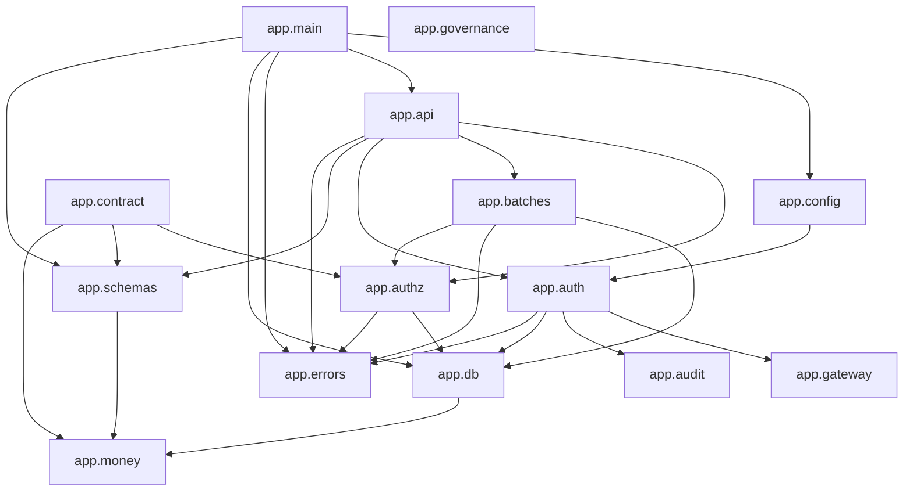
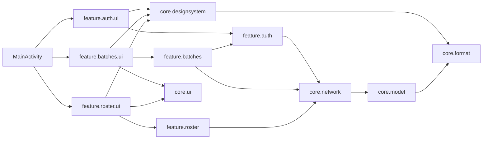

# Dependencies

Versions are listed in `technology-stack.md`. This file covers how
dependencies are declared, resolved and verified; how the internal packages
depend on each other; and where the supply-chain posture departs from what
the project set out to do.

---

## External dependencies

### Python — declared as lower bounds, resolved at install time

`pyproject.toml` declares **8 runtime** dependencies (the `api` extra) and
**6 development** dependencies, every one as a lower bound (`>=`) with no
upper pin.

Runtime (`api`): `fastapi`, `pydantic`, `sqlalchemy`, `alembic`,
`psycopg[binary]`, `pyjwt`, `httpx`, `uvicorn[standard]`.
Development (`dev`): `pytest`, `pytest-cov`, `hypothesis`, `mypy`, `ruff`,
`testcontainers[postgres]`.

The base `[project] dependencies` list is deliberately **empty** — the API
dependencies live behind an extra, so a tool that only needs the money
module or the contract gates does not pull a web framework.

> **Finding — no lockfile on the Python side.** There is **no `uv.lock`, no
> `requirements.txt`, and no compiled pin file of any kind** in the
> repository. The deployment practice is explicit that resolution must be
> locked on both surfaces, "because otherwise the scanners scan a version
> range rather than the build", and names `uv.lock` or a `uv pip compile`
> output as the mechanism. Neither exists.
>
> The consequence is measurable right now. `pyproject.toml` asks for
> `mypy>=1.11`; the installed version is **2.4.0** — a major version the
> declaration admits and nobody chose. Likewise `fastapi>=0.115` resolved to
> 0.143.5 and `sqlalchemy>=2.0` to 2.1.5. Two installs a month apart produce
> different builds, and a dependency scan describes a range rather than what
> shipped.
>
> `.github/workflows/check.yml` compounds this: the step is **labelled**
> "Step 2. Lockfile verification, Python side" and its body is
> `python -m pip install -e ".[dev,api]"` — an unpinned resolve. The label
> describes a control that is not there.

One further note: **`pytest-mock` 3.14.1 is installed and not declared.**
Nothing in `tests/` appears to use it, so this is most likely ambient in the
author's environment rather than an undeclared dependency — but on an
unlocked project the distinction cannot be read off the repository.

### Kotlin — a version catalogue, resolved at build time

`gradle/libs.versions.toml` is the single place every Android version is
declared, which is what makes a version bump a reviewable one-line diff.
Sixteen libraries plus four plugins. The Compose BOM pins every Compose
artifact from one version, so a mismatched pair cannot arrive through a
transitive bump.

> **Finding — no Gradle dependency locking and no checksum verification.**
> There is **no `gradle.lockfile`, no `android/gradle.lockfile`, and no
> `gradle/verification-metadata.xml`.** No build script calls
> `dependencyLocking`.
>
> The practice names both and is specific about why the second matters:
> `dependencyVerification` checksums are "the only control we have that
> detects a tampered or substituted artifact in the Gradle supply chain, and
> it costs one generated file." Neither is present.
>
> A version catalogue pins **direct** versions but not transitive ones, and
> it verifies no artifact. For a project whose central Android control is a
> scan for what a *transitive* SDK might read, this is the more consequential
> of the two lockfile gaps.

One dependency is at a **non-stable version**: `androidx.security-crypto`
`1.1.0-alpha06`. It is accepted deliberately — plain `SharedPreferences`
would leave a 30-day refresh token readable via adb on a rooted phone — and
it is the only alpha in the tree.

### Terraform — properly locked

The one surface where locking is in place. `infra/versions.tf` pins
`terraform >= 1.10, < 2.0` and `aws ~> 5.70`, and `infra/.terraform.lock.hcl`
is committed, recording provider 5.100.0 with its checksums. The reasoning
in the file is the same one the Python side states and does not act on: "an
unpinned provider means `terraform apply` can behave differently on two
machines a week apart, which is the same class of defect as an unpinned
Python dependency."

### Container images

| Image | Pin | Where |
|---|---|---|
| `python:3.12-slim-bookworm` | tag, not digest | `Dockerfile` (build and runtime stages) |
| `postgres:16-alpine` | tag, not digest | `docker-compose.yml`, test container |

Tag-pinned rather than digest-pinned, so a rebuild can pick up a different
base layer. Application images themselves are tagged by commit SHA and
`latest` is never deployed, which is the control that makes a deployed
artifact identifiable.

### External services at runtime

| Service | Reached by | Failure posture |
|---|---|---|
| **BulkSMSBD** | `app/gateway/bulksmsbd.py` over httpx | `https` asserted in the constructor; **one attempt, no automatic retry**; a timeout is recorded as `unknown` rather than `failed`, because the SMS may have been delivered; the daily ceiling is checked **before** the call and a breach is a `ConflictError` |
| **PostgreSQL** | SQLAlchemy + psycopg | one transaction per request, committed by the middleware; a connection failure is not retried inside a request |
| **AWS** (ECR, S3, CloudFront, Route 53, EC2, SSM) | Terraform and the deploy workflow | CI authenticates by **OIDC**, not long-lived keys |
| **Google Play** | the release workflow | |

No analytics, crash-reporting, ads, push or attribution SDK is present on
either surface — which is a forbidden-dependency rule, not an oversight.

---

## Supply-chain controls, as built

| Control | Practice says | Built state |
|---|---|---|
| Secrets scanning | Gitleaks, blocking every push | **Present.** `check.yml` runs `gitleaks/gitleaks-action@v2` with `fetch-depth: 0`, preceded by a step that **asserts the clone is deep enough** — because in a shallow clone Gitleaks logs "no leaks found in partial scan" having read 0 bytes. Guarding the guard is the right instinct and is rare |
| Python lockfile | `uv.lock` or compiled pins | **Absent** |
| Gradle dependency locking | required | **Absent** |
| Gradle checksum verification | required | **Absent** |
| Dependency CVE scanning | annotate every push, block at the release gate | **Absent.** No Dependabot config, no `pip-audit`, no `osv-scanner`, no `gradle dependencyCheck` in any workflow |
| `.security-exceptions.md` | dated written exceptions at the release gate | **Absent** — the file does not exist, which is consistent, since nothing generates findings to except |
| Grouped weekly dependency PRs | required | **Absent.** No `.github/dependabot.yml` |
| SBOM per release build | Syft, attached to the Play release | **Present**, in `release-android.yml` only. No SBOM for the backend image |
| Trivy on the release image | at the release gate | **Absent** |
| Semgrep project-specific rules | a small set encoding this project's invariants | **Absent** as Semgrep. Four of the invariants it was to encode are enforced instead by Ruff banned-api, the pytest import gate, the route-enumeration gate and the Kotlin value class — arguably better than a Semgrep rule would have been. The one it named that is **not** otherwise covered is `TelephonyManager` in Kotlin, which the DEX scan catches at release but nothing catches at commit time |
| ZAP baseline DAST | before the Play internal-track promotion | **Absent** |

Reading the row set as a whole: the controls that are **present are
unusually well built** — Gitleaks has a precondition assertion, the DEX scan
refuses to pass on an empty read, the manifest gate parses XML rather than
grepping. The gap is not quality, it is **coverage of the dependency
surface specifically**. Nothing in this repository would notice a known CVE
in a direct or transitive dependency, on either surface, at any point
between commit and store.

---

## Internal dependencies

### Backend package graph

Text fallback: `app.main` is the composition root, depending on the config
check, the API routers, the error handler, the database session and the
schemas. The API layer depends on authz, the batch service, auth, schemas
and errors. Auth depends on the gateway, the audit log, the database and
errors. The batch service depends on the database, errors and the lens types.
Authz depends on the database and errors. Both the schemas and the database
layer depend on the money module. The contract gates depend on authz,
schemas and money. The money module is a sink: nothing in the application
is imported by it.

**No circular imports were found.** Three module-level cycles are avoided by
deliberate construction rather than by luck:

- `app/main.py` imports its routers **inside** `_register_routes` rather
  than at module scope, so a router importing `app.main` (as
  `app/contract/emit.py` does) does not cycle.
- `app/api/health.py` imports `get_session` from `app.api.auth` rather than
  from `app.api.deps`, which is a small inconsistency but not a cycle.
- `app/db/money_type.py` lives under `app/db` and not inside `app/money`,
  explicitly so that the strict island does not acquire a SQLAlchemy
  dependency — which would destroy both the layering test and the 100%
  branch-coverage target that depends on the module having no I/O.

### The one enforced internal boundary

`app.money` imports nothing from `app.api`, `app.db`, `app.repositories`,
`app.authz` or `app.schemas`, asserted by an AST walk in
`tests/gates/test_import_gates.py`. The complementary rule — nothing outside
`app/money/**` imports raw `decimal` — is enforced by Ruff's
`flake8-tidy-imports` banned-api list.

The two point in **opposite directions** and neither catches the other's
case: the first would pass while a route handler did decimal arithmetic; the
second would pass while the money module acquired a database session. Both
have been present from the first commit rather than added after a violation,
and each ships a fixture proving it fires plus a configuration-scope
assertion proving the carve-out has not widened to a parent.

### Android internal graph

Text fallback: the single Activity hosts three feature UI packages, each
backed by its own ViewModel package, each calling `core.network`, which
decodes into `core.model`. All three UI packages use the design system,
and two use the shared create-form composables. `core.format` is used by
the design system and the model for digit rendering.

One edge is worth flagging: **`feature.batches` imports `AuthResult` from
`feature.auth`** (`BatchesViewModel.kt` imports
`com.shikkhokplus.app.feature.auth.AuthResult`). A cross-feature import of a
result type belongs in `core` — it is a small thing now, and it is the shape
that spreads once there are a dozen features each needing the same type.
Nothing in the build would stop it spreading.

**No Kotlin dependency-direction check exists.** With no detekt and no
module boundaries, the Android layering is enforced by review alone.

---

## Dependency risk summary

| Risk | Severity | Evidence |
|---|---|---|
| No lockfile on either application surface; two installs produce different builds | **High** — it also nullifies any future CVE scan, which would scan a range | absence of `uv.lock`, `gradle.lockfile`, `verification-metadata.xml` |
| No CVE scanning anywhere, at any speed | **High** | no Dependabot, no `pip-audit`, no Trivy, no `osv-scanner` in any workflow |
| CI step labelled "Lockfile verification" performs an unpinned resolve | **Medium** — a label describing a control that is not there is worse than no label | `.github/workflows/check.yml:88-90` |
| mypy resolved to 2.x against a `>=1.11` declaration | **Medium** | `pip list` versus `pyproject.toml` |
| Container bases pinned by tag, not digest | **Low** | `Dockerfile`, `docker-compose.yml` |
| One alpha dependency (`security-crypto`) | **Low**, deliberate and reasoned | `gradle/libs.versions.toml` |
| Cross-feature import `batches → auth` on the client | **Low** now, shape-of-a-problem later | `BatchesViewModel.kt` |

## Sources

- [code] `pyproject.toml`, `gradle/libs.versions.toml`,
  `infra/versions.tf`, `infra/.terraform.lock.hcl`, `Dockerfile`,
  `docker-compose.yml`, read 2026-10-22 at commit `b14b1fa`
- [code] `.github/workflows/check.yml`, `deploy.yml`,
  `release-android.yml`
- [code] `tests/gates/test_import_gates.py` — the enforced internal boundary
- [verified] `pip list` against the declared bounds, 2026-10-22
- [verified] absences confirmed by direct `ls` and by `grep` for
  `dependencyLocking`, `dependencyVerification`, `trivy`, `syft`,
  `semgrep`, `schemathesis`, `zap` across all build scripts and workflows
