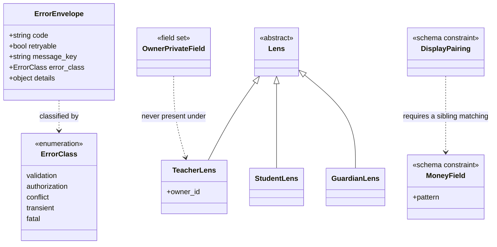

# Functional Specification — `api-contract` (U2)

**Stage**: functional-design (3.1)
**Phase**: Construction
**Unit**: U2 `api-contract` — `spec`, S
**Bolt**: B2 `b2-api-contract`

> **Nothing here runs in production.** This Unit produces a committed
> contract and four CI gates. Its behavioural specification is therefore
> about *what the build does*, not about what a request does — with one
> exception, the error handler, which is runtime code every later Unit
> depends on.

## Sources

- [stage] `functional-design-questions.md` — all seven answers
- [upstream] `construction/api-contract/functional-design/rules.md` — BR1.1–BR4.3
- [upstream] `construction/api-contract/functional-design/entities.md`
- [upstream] `inception/contract-design/contract-summary.md`
- [upstream] `inception/units-generation/unit-of-work.md` — U2 is `spec`, S
- [upstream] `inception/units-generation/unit-of-work-story-map.md` — US9.2, US10.1
- [upstream] `inception/requirements-analysis/requirements.md` — NFR14, NFR16
- [upstream] `inception/domain-design/components.md`
- [team] `## Code Style`, `## Testing Posture`
- [project] `## Forbidden` / `## Mandated`

---

## 1. What this Unit delivers

| # | Deliverable | Runs at | Fails when |
|---|---|---|---|
| 1 | The committed OpenAPI 3.1 document | — | Never; it is the artifact |
| 2 | Five exception classes + one handler | Runtime | — |
| 3 | Schema-diff gate | CI | Committed ≠ generated |
| 4 | Money-pattern + `*_display` assertion | CI | A money field is not a patterned string, or a display field has no sibling |
| 5 | No-profile-field assertion | CI | A teacher-lens response declares an owner-private field |
| 6 | Route-enumeration harness | Test collection | A route resolves no lens and is not allowlisted |
| 7 | Four violation fixtures | CI | **When they stop failing** |

Deliverable 7 is the one most likely to be mistaken for ceremony. It is not:
items 4, 5 and 6 all iterate sets that are **empty in B2**.

---

## 2. Operations

### 2.1 Raise a taxonomy error

1. The failing code chooses **one of five classes** [BR1.1] by what the
   caller should do next, not by where the failure happened.
2. It supplies a stable `code` and a `message_key`. It supplies **no**
   `retryable` and **no** English message.
3. It raises. No layer between the raise site and the handler catches it.

> There are exactly two sanctioned `except Exception` sites in the whole
> backend: this handler, and the scheduled job's top level where a crash must
> not kill a daily run. Everywhere else catches the specific exception and
> re-raises as a taxonomy class.

### 2.2 Convert an exception to a response

1. Receive any of the five classes at the single handler.
2. Read the HTTP status and `retryable` from **one class-to-behaviour
   table** [BR1.2]. The raise site has no say in either.
3. Emit the envelope: `code`, `retryable`, `message_key`, optionally
   `error_class` and typed `details`.
4. Emit **no** `message` field [BR1.3]. The envelope declares
   `additionalProperties: false`, so this is structural rather than a
   convention somebody maintains.

### 2.3 Resolve a resource the lens may not reach

1. Resolve the lens. Scope the lookup by the value the lens carries.
2. If the resource is not reachable **or** does not exist, return a
   **byte-identical 403** in both cases [BR1.4] — same status, same `code`,
   same `message_key`, same (absent) `details`, same headers.
3. The `code` is a single value covering both cases [BR1.5]. No code in the
   registry distinguishes them.

> **The status is the incidental half of this rule; the body is the
> substantive one.** An earlier draft settled only the status and described
> the two cases as "identical" in prose while requiring sameness of nothing
> else. Two 403s carrying `BATCH_NOT_FOUND` and `BATCH_NOT_YOURS` leak
> everything the uniform status hid — and each code reads as good practice
> on its own, which is why BR1.5 names the failure rather than trusting
> judgement.
>
> On the status itself: the upstream contract argues both sides. Line 133
> states normatively that "404 is deliberately not in the taxonomy", and the
> schema's Forbidden response agrees; one prose note calls it "the
> 404-instead-of-403 rule", mis-titling the rule it points at. 403 wins on
> two normative statements against one mis-titled cross-reference, and
> because 404 is honest to nobody — a teacher who mistyped their **own** id
> would be told it does not exist.
>
> **That decision contradicted five downstream artifacts** — B2's own DoD,
> the confidence hypotheses of B3, B7 and B9, and the B3 checkpoint
> criterion in `risk-and-sequencing-rationale.md` — each asserting 404 as a
> falsification criterion, so a correct implementation would have failed
> them. B3's is the walking skeleton's privacy hypothesis, read at a human
> checkpoint. BR4.3 records the obligation; **all five have since been
> amended** (2026-10-18) to require a byte-identical 403. The fifth was
> found by sweeping the record for `404` rather than working from the
> review's list, which named four.

### 2.4 Assert the money contract over the schema

1. Generate the OpenAPI document.
2. For every property that **`$ref`s the shared `Money` component**: the
   pattern is carried by the component and needs no per-property assertion
   [BR2.2].
3. Assert that **no property declares an inline money-shaped type** instead
   of referencing the component — that is the violation worth catching.
4. For every property named `<x>_display`: assert a sibling `<x>` exists and
   references the component [BR2.3]. The display string is **not**
   pattern-matched — it is presentation, and its content is OQ-B1-1's.
5. Fail the build on any violation.

> **An earlier draft of this check was circular.** It said "every property
> *carrying money* is a string matching the pattern" — but "carrying money"
> is not decidable from a generated document. Selecting by the pattern
> checks the pattern on properties chosen for having it; selecting by name
> misses by design. And the defect this check exists to catch — a money
> value typed as a free-form string — is precisely what a pattern-based
> selector cannot see.
>
> `$ref` to the declared component is the decidable predicate, and it
> inverts what the check asserts: not "does this match the pattern" but
> "does this reference the single definition". That is still the half of the
> money boundary an import rule cannot see.

### 2.5 Assert the privacy boundary over the schema

1. Generate the document.
2. For every **teacher-lens** response schema, assert no declared field is in
   the owner-private profile set **or** is `student_account_id` or any other
   account id [BR2.4]. **Two field sets, one mechanism.**
3. Fail the build on any violation.

> The second set is ADR-001's, and an earlier draft omitted it. An account
> id is a **global** key; an enrollment id is scoped to one owner. A
> teacher-facing response carrying `student_account_id` hands teacher A a
> stable handle on a student also enrolled with teacher B — the exact
> cross-teacher traversal ADR-001 exists to prevent, through the gate
> ADR-001 explicitly nominated to catch it ("gains one more forbidden field
> set rather than a new mechanism").
>
> Iteration, not enumeration. A per-endpoint test covers the endpoints
> someone remembered; this covers the one added in B9 after everyone stopped
> thinking about it. It is also the assertion a conformance tool cannot make
> — a response wrongly carrying either set matches its own declaration
> perfectly [BR4.2].

### 2.6 Resolve a lens hint

1. Read `X-Lens-Hint` if present. It affects **navigation and UI shaping
   only** and is never trusted for authorization.
2. Re-derive the available lenses from owned batches and enrollments on
   **every** request. The hint selects among lenses the account already
   has; it never creates one.
3. If a hint was sent and the hinted lens **has no data behind it**, refuse
   with **403 `LENS_NOT_AVAILABLE`** [BR1.7]. Do not fall back.
4. If no hint was sent: resolve the account's single available lens, or
   refuse with **400 `LENS_HINT_REQUIRED`** when more than one is available
   and the route is lens-ambiguous.
5. Name the resolved lens in the response's `lens` field, so the response
   is self-describing and the client renders from it rather than from the
   hint it sent.

> **Two upstream sources contradict each other here, and this Unit now
> reconciles them rather than picking one silently.** `stories.md`
> AC10.1.6 says the server "ignores it and resolves the lens from owned
> batches and enrollments"; `contract-summary.md` §B.4 says it "refuses
> with 403 `LENS_NOT_AVAILABLE`". An earlier draft of this Unit carried
> B.4's behaviour in `entities.md` while `rules.md` said nothing about
> hints at all — so the contradiction was resolved by accident, in the
> artifact least likely to be read as normative.
>
> FR1.4 settles it: *"only the lenses that have data are offered."* An
> unsupported hint therefore cannot come from a client that followed the
> contract — it is a stale client, a bug, or a crafted request. Silent
> fallback serves all three under a lens the caller did not name, which is
> the shape of the AC10.1.8 failure this story set exists to prevent, and
> it turns a probe into a success.
>
> The two readings **agree on the half carrying the security property** —
> the hint grants nothing and the lens is always re-derived — which is why
> this is a wording conflict rather than a vulnerability. AC10.1.6's
> "ignores it" is true of *authorization* and was written before B.4 fixed
> the refusal shape.

### 2.7 Enumerate routes and check their lenses

1. Load the **real application object** at test collection time.
2. For each route, walk `dependant` **recursively** — a lens may be nested
   inside a composed dependency.
3. Resolve each return annotation with `typing.get_type_hints` against its
   own module [BR3.2]. A union counts only when **every** member is a `Lens`
   subtype; `Annotated` and generic aliases are unwrapped. Never match on a
   name.
4. A resolution failure **fails the build naming the route**. It is never
   swallowed.
5. A route resolving no lens fails, unless it is in `PUBLIC_ROUTES` (exactly
   five entries) or `LENS_EXEMPT_AUTHENTICATED` (exactly one) [BR3.1].

> **Two sets, not one.** `PUBLIC_ROUTES` holds the genuinely public routes —
> OTP issue, OTP verify, health, the external deletion route. `POST
> /v1/auth/refresh` is **not** public: it authenticates by the refresh token
> itself and resolves no lens, so it lives in a separate set, "so the
> route-enumeration test does not need a hole in its main allowlist".
>
> An earlier draft had one open-ended allowlist "empty in B2 and growing".
> The failure that invites is concrete: the implementer who first hits a
> failing refresh route takes the cheapest green edit and adds it to
> `PUBLIC_ROUTES`, where nothing then records that it must stay
> authenticated. "Exactly five" is also the stronger control — a sixth entry
> is a diff against a stated number.
>
> Step 4 matters more than it looks. Three annotation shapes defeat a naive
> `issubclass`: string annotations (which this project's own lint rules
> encourage), unions like `TeacherLens | GuardianLens` for the dual-lens
> account, and `Annotated` wrappers. The damage is not the false negative —
> it is the implementer who hits the error, wraps the call and returns
> `True` on failure, after which every route passes and none is checked.

### 2.8 Prove each gate fires

1. For each of §2.4, §2.5, §2.7: load a committed fixture that **violates**
   it.
2. Assert the gate refuses the fixture [BR4.1].
3. A fixture that stops failing is itself a failure.

---

## 3. Why §2.8 is not ceremony

**B2 has no routes and no money endpoint.** Run the gates as delivered and
every one passes:

| Gate | Set it iterates in B2 | Result |
|---|---|---|
| Money pattern | Money properties: **none** | passes |
| `*_display` pairing | Display properties: **none** | passes |
| No profile field | Teacher-lens responses: **none** | passes |
| Route lens | Routes: **none** | passes |

Four green checks, none of which has looked at anything. Without fixtures,
B2 would record a passing contract suite that has never once exercised a
real case — and the first real money field or unlensed route arrives in a
later Bolt, where the failure would be attributed to that Bolt's work rather
than to a gate that never worked.

This is not hypothetical. B1 shipped its import gates with fixtures for
exactly this reason, and a later review still found a real bypass in them
(`importlib`) that the fixtures had not covered. Fixtures are the floor, not
the ceiling.

---

## 4. The contract types — derived diagram

Derived from `entities.md`, which is the source of truth.

**Text fallback.** `ErrorClass` is a closed enumeration of five values, each
naming one caller behaviour. `ErrorEnvelope` is the single error response
shape and is classified by an `ErrorClass`; it carries a stable code, a
server-derived `retryable` boolean and a client string key, and never an
English message. `Lens` is an abstract base with three subtypes — teacher,
student and guardian — of which the teacher lens carries the owner identifier
every teacher-scoped query is rooted at; this Unit defines the types and the
identity Unit resolves them. `MoneyField` and `DisplayPairing` are schema
constraints, the latter requiring that any display field have a sibling
matching the former. `OwnerPrivateField` is a field set that must never
appear in any response produced under a teacher lens.

---

## 5. Boundary cases

| Case | Behaviour | Rule |
|---|---|---|
| Resource absent, lens would reach it | 403, identical to unreachable | BR1.4 |
| Resource present, lens does not reach it | 403, identical to absent | BR1.4 |
| Two raise sites, same class, different `retryable` | Impossible — derived at the handler | BR1.2 |
| An endpoint adds a field to the error body | Fails schema validation and the diff gate | BR1.3 |
| A money field typed `string` with no pattern | Build fails | BR2.2 |
| `outstanding_display` with no `outstanding` | Build fails | BR2.3 |
| A nested lens inside a composed dependency | Found — the walk is recursive | BR3.2 |
| A lens dependency renamed | Still found — matched on annotation | BR3.2 |
| A new public endpoint | Fails until added to `PUBLIC_ROUTES` | BR3.1 |
| A fixture that stops failing | Itself a failure | BR4.1 |

---

## 6. Rules summary — derived

Derived from `rules.md`, which is the source of truth.

| Group | Covers | Rules |
|---|---|---|
| **BR1.x** | The error taxonomy, its envelope, the non-disclosure rule, and the lens-hint contract | BR1.1–BR1.7 |
| **BR2.x** | The committed schema and its assertions | BR2.1–BR2.4 |
| **BR3.x** | The route harness | BR3.1–BR3.2 |
| **BR4.x** | Gates that would otherwise pass trivially, and what this stage owes other Bolts | BR4.1–BR4.3 |

---

## 7. Why there is no frontend component specification

This Unit has **no UI**. It is a specification and a set of build gates. The
contract it defines shapes what later Units' screens receive, but it renders
nothing and has no screen, component or interaction flow.

`frontend-components.md` is therefore **not produced**, which is also what
the stage's per-kind applicability prescribes for a `spec` unit.

---

## Assumptions & Open Questions

**Carried from B1, unchanged**: OQ-B1-1, the Bangla money rendering. It
determines what a `*_display` string contains. BR2.3's pairing rule is
structural and testable now regardless.
