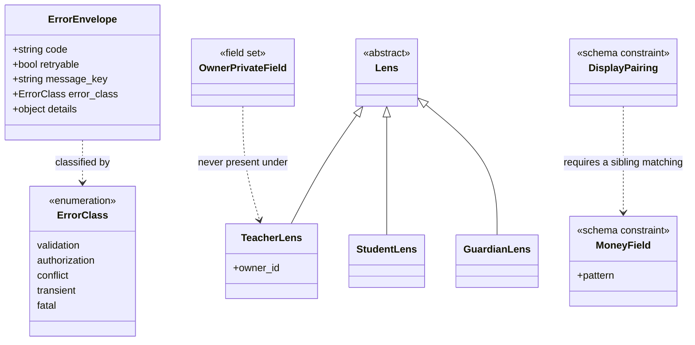

# Functional Specification — `api-contract` (U2)

**Stage**: functional-design (3.1)
**Phase**: Construction
**Unit**: U2 `api-contract` — `spec`, S
**Bolt**: B2 `b2-api-contract`

> **Nothing here runs in production.** This Unit produces a committed
> contract and four CI gates. Its behavioural specification is therefore
> about *what the build does*, not about what a request does — with one
> exception, the error handler, which is runtime code every later Unit
> depends on.

## Sources

- [stage] `functional-design-questions.md` — all seven answers
- [upstream] `construction/api-contract/functional-design/rules.md` — BR1.1–BR4.2
- [upstream] `construction/api-contract/functional-design/entities.md`
- [upstream] `inception/contract-design/contract-summary.md`
- [upstream] `inception/units-generation/unit-of-work.md` — U2 is `spec`, S
- [upstream] `inception/units-generation/unit-of-work-story-map.md` — US9.2, US10.1
- [upstream] `inception/requirements-analysis/requirements.md` — NFR14, NFR16
- [upstream] `inception/domain-design/components.md`
- [team] `## Code Style`, `## Testing Posture`
- [project] `## Forbidden` / `## Mandated`

---

## 1. What this Unit delivers

| # | Deliverable | Runs at | Fails when |
|---|---|---|---|
| 1 | The committed OpenAPI 3.1 document | — | Never; it is the artifact |
| 2 | Five exception classes + one handler | Runtime | — |
| 3 | Schema-diff gate | CI | Committed ≠ generated |
| 4 | Money-pattern + `*_display` assertion | CI | A money field is not a patterned string, or a display field has no sibling |
| 5 | No-profile-field assertion | CI | A teacher-lens response declares an owner-private field |
| 6 | Route-enumeration harness | Test collection | A route resolves no lens and is not allowlisted |
| 7 | Four violation fixtures | CI | **When they stop failing** |

Deliverable 7 is the one most likely to be mistaken for ceremony. It is not:
items 4, 5 and 6 all iterate sets that are **empty in B2**.

---

## 2. Operations

### 2.1 Raise a taxonomy error

1. The failing code chooses **one of five classes** [BR1.1] by what the
   caller should do next, not by where the failure happened.
2. It supplies a stable `code` and a `message_key`. It supplies **no**
   `retryable` and **no** English message.
3. It raises. No layer between the raise site and the handler catches it.

> There are exactly two sanctioned `except Exception` sites in the whole
> backend: this handler, and the scheduled job's top level where a crash must
> not kill a daily run. Everywhere else catches the specific exception and
> re-raises as a taxonomy class.

### 2.2 Convert an exception to a response

1. Receive any of the five classes at the single handler.
2. Read the HTTP status and `retryable` from **one class-to-behaviour
   table** [BR1.2]. The raise site has no say in either.
3. Emit the envelope: `code`, `retryable`, `message_key`, optionally
   `error_class` and typed `details`.
4. Emit **no** `message` field [BR1.3]. The envelope declares
   `additionalProperties: false`, so this is structural rather than a
   convention somebody maintains.

### 2.3 Resolve a resource the lens may not reach

1. Resolve the lens. Scope the lookup by the value the lens carries.
2. If the resource is not reachable **or** does not exist, return
   **authorization (403)** — identically, with no observable difference
   between the two cases [BR1.4].

> **This is the rule an implementer will try to undo**, because the upstream
> contract argues both sides of it: the schema section specifies 403 for
> both, and the implementer notes call it "the 404-instead-of-403 rule".
>
> The leak comes from **splitting**, not from either status. Teacher A probes
> ids; a 403 that means "exists but not yours" is a hit, and A enumerates
> teacher B's batches across the owner boundary. A uniform answer — either
> one — closes it.
>
> 403 wins because the schema section is normative (it generates the document
> the diff gate compares against), because 404 is not in the taxonomy so the
> envelope would have nothing to carry, and because 403 is honest to a
> teacher who mistyped their **own** id.

### 2.4 Assert the money contract over the schema

1. Generate the OpenAPI document.
2. For every property carrying money: assert `type: string` and the canonical
   pattern [BR2.2].
3. For every property named `<x>_display`: assert a sibling `<x>` exists and
   matches the money pattern [BR2.3]. The display string itself is **not**
   pattern-matched — it is presentation, and its content is OQ-B1-1's.
4. Fail the build on any violation.

> This is the half of the money boundary an import rule cannot see. A money
> value typed as a free-form string imports nothing and violates nothing
> lexically; only the schema knows it was meant to be money.

### 2.5 Assert the privacy boundary over the schema

1. Generate the document.
2. For every **teacher-lens** response schema, assert no declared field is in
   the owner-private set [BR2.4].
3. Fail the build on any violation.

> Iteration, not enumeration. A per-endpoint test covers the endpoints
> someone remembered; this covers the one added in B9 after everyone stopped
> thinking about it. It is also the assertion a conformance tool cannot make
> — a response wrongly carrying profile fields matches its own declaration
> perfectly [BR4.2].

### 2.6 Enumerate routes and check their lenses

1. Load the **real application object** at test collection time.
2. For each route, walk `dependant` **recursively** — a lens may be nested
   inside a composed dependency.
3. A dependency counts as a lens when its **return annotation** is a `Lens`
   subtype [BR3.2]. Never when its name looks like one.
4. A route resolving no lens fails, unless it is in `PUBLIC_ROUTES`.

> `PUBLIC_ROUTES` is an explicit frozenset — **empty in B2** — and grows only
> by someone editing a list in a test. That is the load-bearing half: making
> an endpoint public becomes a deliberate, reviewable act rather than an
> omission.

### 2.7 Prove each gate fires

1. For each of §2.4, §2.5, §2.6: load a committed fixture that **violates**
   it.
2. Assert the gate refuses the fixture [BR4.1].
3. A fixture that stops failing is itself a failure.

---

## 3. Why §2.7 is not ceremony

**B2 has no routes and no money endpoint.** Run the gates as delivered and
every one passes:

| Gate | Set it iterates in B2 | Result |
|---|---|---|
| Money pattern | Money properties: **none** | passes |
| `*_display` pairing | Display properties: **none** | passes |
| No profile field | Teacher-lens responses: **none** | passes |
| Route lens | Routes: **none** | passes |

Four green checks, none of which has looked at anything. Without fixtures,
B2 would record a passing contract suite that has never once exercised a
real case — and the first real money field or unlensed route arrives in a
later Bolt, where the failure would be attributed to that Bolt's work rather
than to a gate that never worked.

This is not hypothetical. B1 shipped its import gates with fixtures for
exactly this reason, and a later review still found a real bypass in them
(`importlib`) that the fixtures had not covered. Fixtures are the floor, not
the ceiling.

---

## 4. The contract types — derived diagram

Derived from `entities.md`, which is the source of truth.

**Text fallback.** `ErrorClass` is a closed enumeration of five values, each
naming one caller behaviour. `ErrorEnvelope` is the single error response
shape and is classified by an `ErrorClass`; it carries a stable code, a
server-derived `retryable` boolean and a client string key, and never an
English message. `Lens` is an abstract base with three subtypes — teacher,
student and guardian — of which the teacher lens carries the owner identifier
every teacher-scoped query is rooted at; this Unit defines the types and the
identity Unit resolves them. `MoneyField` and `DisplayPairing` are schema
constraints, the latter requiring that any display field have a sibling
matching the former. `OwnerPrivateField` is a field set that must never
appear in any response produced under a teacher lens.

---

## 5. Boundary cases

| Case | Behaviour | Rule |
|---|---|---|
| Resource absent, lens would reach it | 403, identical to unreachable | BR1.4 |
| Resource present, lens does not reach it | 403, identical to absent | BR1.4 |
| Two raise sites, same class, different `retryable` | Impossible — derived at the handler | BR1.2 |
| An endpoint adds a field to the error body | Fails schema validation and the diff gate | BR1.3 |
| A money field typed `string` with no pattern | Build fails | BR2.2 |
| `outstanding_display` with no `outstanding` | Build fails | BR2.3 |
| A nested lens inside a composed dependency | Found — the walk is recursive | BR3.2 |
| A lens dependency renamed | Still found — matched on annotation | BR3.2 |
| A new public endpoint | Fails until added to `PUBLIC_ROUTES` | BR3.1 |
| A fixture that stops failing | Itself a failure | BR4.1 |

---

## 6. Rules summary — derived

Derived from `rules.md`, which is the source of truth.

| Group | Covers | Rules |
|---|---|---|
| **BR1.x** | The error taxonomy and its envelope | BR1.1–BR1.4 |
| **BR2.x** | The committed schema and its assertions | BR2.1–BR2.4 |
| **BR3.x** | The route harness | BR3.1–BR3.2 |
| **BR4.x** | Gates that would otherwise pass trivially | BR4.1–BR4.2 |

---

## 7. Why there is no frontend component specification

This Unit has **no UI**. It is a specification and a set of build gates. The
contract it defines shapes what later Units' screens receive, but it renders
nothing and has no screen, component or interaction flow.

`frontend-components.md` is therefore **not produced**, which is also what
the stage's per-kind applicability prescribes for a `spec` unit.

---

## Assumptions & Open Questions

**Carried from B1, unchanged**: OQ-B1-1, the Bangla money rendering. It
determines what a `*_display` string contains. BR2.3's pairing rule is
structural and testable now regardless.
