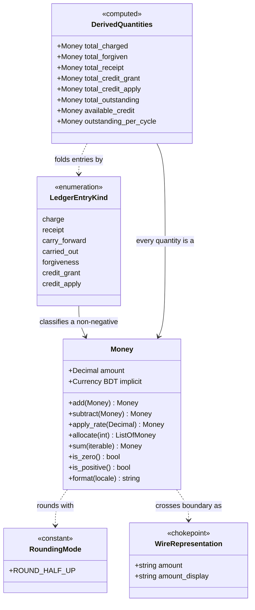

# Functional Specification — `money-core` (U1)

**Stage**: functional-design (3.4)
**Phase**: Construction
**Unit**: U1 `money-core` — `library`, M
**Bolt**: B1 `b1-money-core`

> Source of truth for this Unit's **operations and worked arithmetic**.
> `entities.md` carries the value semantics and `rules.md` the decision
> logic; the diagram and rules summary below are **derived** views of those,
> included for readability.

## Sources

- [stage] `functional-design-questions.md` — all eight answers; Q8 records
  AC5.2.2 as deferred to U7 rather than covered here
- [upstream] `inception/units-generation/unit-of-work.md` — U1
- [upstream] `inception/delivery-planning/bolt-plan.md` — B1 DoD, confidence hypothesis
- [upstream] `inception/domain-design/decisions.md` — ADR-002
- [upstream] `inception/contract-design/contract-summary.md` — §B.5, §E.1
- [upstream] `inception/requirements-analysis/requirements.md` — FR5.1, FR5.2, FR5.9, NFR9
- [team] `## Code Style`, `## Testing Posture`
- [project] `## Forbidden`, `## Mandated`

---

## 1. What this Unit is, and what it is not

A **library**. It has no I/O, no session, no transport and no persistence of
its own. It is buildable and fully testable before any endpoint exists, which
is the property that makes 100% branch coverage achievable here and nowhere
else in the system.

It provides three things: the `Money` value type and its arithmetic; the
single declared rounding mode; and both serialization chokepoints. It also
carries two build-time boundary checks and the property test that verifies the
ledger identity.

**No state machine applies to this Unit.** It owns no lifecycle entity — no
row, no status column, nothing that transitions. `Money` is an immutable value
and `LedgerEntryKind` is a closed enumeration; neither has states. The fee
cycle and the payment claim *do* have lifecycles, and those state machines
belong to U7 and U8 respectively, specified in their own functional designs.
Inventing one here would be decoration.

---

## 2. Operations

Each operation is given as a numbered step sequence. These are behavioural
specifications, not implementations.

> **Every "refuse", "reject" and "raise" below means the same thing: a
> validation failure.** This module raises exactly one error class, on every
> path, without exception — see §5.6 for the full table and BR1.8 for why
> three of the five taxonomy classes are structurally unreachable here. The
> class is stated once, here, rather than repeated at each of the nine refusal
> sites, so there is one place to change it and no opportunity for two sites
> to drift apart.

### 2.1 Construct a money value

1. Receive a candidate amount as a fixed-point decimal, a string, or an
   integer.
2. **If the candidate is a binary floating-point number, refuse and raise.**
   No coercion, no rounding into acceptability. [BR1.1]
3. Interpret the candidate as an exact decimal. A string is parsed exactly; an
   integer is a whole number of Taka. [BR1.2]
4. Quantize to exactly two decimal places using the module's single declared
   rounding mode. [BR1.3, BR3.1]
5. If the quantized magnitude exceeds the storage contract of ten integer
   digits, refuse. [BR1.7]
6. Return an immutable value with Bangladeshi Taka implicit. [BR1.4, BR1.5]

### 2.2 Add

1. **If the operand is not a money value, fail at build time.** [BR2.1]
2. Add the two amounts exactly. Both are already at two places, so the result
   is exact and no rounding occurs. [BR3.2]
3. Return a new money value. [BR1.5]

### 2.3 Subtract

1. **If the operand is not a money value, fail at build time.** [BR2.1]
2. Subtract exactly. The result **may be negative** — this is permitted, and
   is relied on by the per-cycle outstanding computation. [BR2.7]
3. Return a new money value.

### 2.4 Apply a rate (the named multiplication)

1. Receive a rate as an exact decimal. A binary floating-point rate is
   **refused** on the same grounds as a float amount — it is already wrong
   before it is multiplied. [BR2.2, BR2.10]
2. **A negative rate is refused.** [BR2.10] Rates in this system express
   proportions of an obligation — a discount, a part-period charge, a share —
   and none of them is meaningfully negative. Permitting one would silently
   manufacture a negative `Money` that BR2.7 then permits to propagate, which
   is precisely the class of defect the sign rules exist to prevent. A
   reduction is a compensating entry [BR4.1], never a negative rate.
3. **A rate above one is permitted**, and deliberately so: a late fee or a
   multi-month catch-up charge is a rate above one, and refusing it would push
   that arithmetic outside the module. A rate of zero is permitted and yields
   zero.
4. Multiply the amount by the rate at full precision, without rounding yet.
5. Quantize the product to two decimal places using the module's single
   declared rounding mode. [BR3.1]
6. Return a new money value.

> There is no multiplication operator. The operation is named so that every
> rounding in the system sits at a call site somebody wrote deliberately.
> [BR2.2, BR3.2]

### 2.5 Allocate into n parts

1. Receive a part count. A count below one is **refused** as a validation
   failure — it is a caller error, not an empty result. [BR2.8]
2. Express the amount as a whole number of its smallest unit (paisa).
3. **Allocate on the magnitude, then restore the sign.** Take the absolute
   value of the paisa quantity for steps 4–5 and apply the original sign to
   every resulting part. [BR2.9]
4. Divide by the part count, giving a base quantity and a remainder.
5. Distribute the remainder one smallest-unit at a time across the leading
   parts, so the first *remainder* parts receive one extra unit each.
6. Return the parts as money values.
7. **Their sum equals the original exactly.** This is a property of the
   operation, asserted by its named test, not an expectation of the caller.
   [BR2.3]

Computed examples, verified:

| Amount | Parts | Result | Sum |
|---|---|---|---|
| 1000.00 | 3 | 333.34, 333.33, 333.33 | 1000.00 |
| 100.00 | 7 | 14.29 ×4, 14.28 ×3 | 100.00 |
| 0.05 | 3 | 0.02, 0.02, 0.01 | 0.05 |
| 0.01 | 2 | 0.01, 0.00 | 0.01 |
| −0.05 | 3 | −0.02, −0.02, −0.01 | −0.05 |

The 0.05 and 0.01 cases are the ones a naive independent-rounding split gets
wrong, losing or gaining a paisa.

**Why step 3 exists, and why the exact-sum test cannot replace it.** Negative
money values are permitted [BR2.7, MONEY-INV-4], and the exact-sum property
holds under *every* reasonable reading of a negative split — floor division
gives `−0.02, −0.02, −0.01` while truncating division gives `−0.01, −0.02,
−0.02`, and both sum to exactly −0.05. BR2.3's named test therefore passes
against either, so two implementers could diverge permanently without any
check failing. Allocating on the magnitude fixes the answer: the largest part
comes first in absolute terms, matching the positive case. Without this step
the operation is genuinely undefined, not merely unstated.

### 2.6 Sum a collection

1. Start from the zero constant, never a bare zero. [BR2.4, BR2.5]
2. Add each element in turn. [BR2.2]
3. Return the accumulated value; an empty collection returns zero.

### 2.7 Compare

1. **If the operand is not a money value, fail at build time.** [BR2.4]
2. Compare the two amounts. Both are at two places, so comparison is exact and
   consistent with equality and hashing. [BR1.3]
3. For a zero test or a sign test, use the type's predicates rather than a
   hand-rolled comparison. [BR2.6]

### 2.8 Format for a locale

1. **Receive the locale as an explicit argument.** It is never read from
   configuration, from a request context, from an environment variable or
   from a process-wide default. [BR5.6]
2. Produce a human-readable string: digit rendering and separator placement
   per that locale, which for a Bangla locale is a real decision and not a
   pass-through. [BR5.4]
3. Return the formatted string **as a distinct value from the canonical
   amount.** The canonical amount is never mutated into its presentation.
4. The response carries both; the client renders the formatted string and
   never formats the canonical one. [BR5.4, BR5.5]

> **Why step 1 is a rule and not a convention.** This is the one operation in
> the Unit that could plausibly acquire a dependency on settings, and the
> Unit's three load-bearing claims all rest on it not doing so: no settings
> import [BR6.1], 100% branch coverage, and "buildable and fully testable
> before any endpoint exists" [B1 DoD]. A locale read from configuration would
> break all three at once — the module would need settings to construct, and
> its formatting branches would only be reachable by mutating global state in
> a test.
>
> Taking the locale as an argument keeps the module pure: the *decision* about
> which locale a given response uses belongs to the caller that knows the
> request, and the *rendering* belongs here. Digit-shaping data itself comes
> from the language runtime's own locale facilities or a pinned data table
> declared as an ordinary dependency of the module — not from application
> configuration, and not from a service lookup. The supported locale set is
> finite and known (Bangla and English [TC-15, D-43]), so every formatting
> branch is reachable by passing a value.

### 2.9 Serialize across the API boundary

1. Take the money value at the module's single annotated API type — the only
   path out. [BR5.3]
2. Render the amount as a string: exactly two decimal places, no currency
   symbol, no thousands separator, Latin digits only. [BR5.1]
3. **A negative value cannot be serialized; the attempt raises a validation
   failure.** [BR5.7, BR1.8] The canonical wire pattern admits no sign, so
   there is no representation to emit.
4. Emit it as a **JSON string**. A JSON number is never emitted for a money
   field, by construction rather than by per-field discipline. [BR5.1, BR5.3]

> **This is a consistency check, not a limitation.** Negative `Money` is
> permitted *inside* the module [BR2.7] — a subtraction result, or the
> per-cycle outstanding expression before its floor — but every quantity that
> crosses the API is one the sign rules already forbid to be negative: a
> ledger entry amount [BR4.1], an outstanding total [BR4.4], an available
> credit [BR4.5], a charged or approved amount. So a negative value reaching
> serialization means a sign rule was violated upstream and the floor was
> missed. Refusing at the boundary turns that into a loud failure at the point
> of emission rather than a `-500.00` string the client cannot parse against
> the contract's own pattern, or — worse — a silently dropped sign that
> displays a debt as a credit.

### 2.10 Deserialize at the API boundary

1. Read the incoming field.
2. **If it is a JSON number rather than a string, reject loudly.** No silent
   coercion. A lenient decoder that quietly converts is the actual failure
   mode and it passes a happy-path test on both sides. [BR5.2]
3. If it is a string, parse it exactly and construct a money value through
   §2.1, which re-applies every construction rule.
4. If the string is not of the canonical form, reject.

### 2.11 Cross the storage boundary

1. Take the money value at the module's single storage type mapping — the only
   path to a column. [BR5.3]
2. Map to a fixed-point decimal column of twelve total digits and two decimal
   places.
3. On read, reconstruct through §2.1.

> No model declares a money column independently. That is how one eventually
> declares too few digits or a floating-point type. [BR5.3]

---

## 3. Worked scenarios

Every scenario below was **computed**, not asserted. Each gives the entry
sequence and the resulting derived quantities with numbers, and each is
checked against the identity

```
total_charged − total_forgiven − (total_receipt + total_credit_grant)
  == total_outstanding − available_credit
```

together with `available_credit >= 0`, `total_outstanding >= 0`, and
`sum(carry_forward) == sum(carried_out)`.

### S1 — Plain charge, paid in full

| Kind | Cycle | Amount |
|---|---|---|
| charge | Mar | 1000.00 |
| receipt | Mar | 1000.00 |

Derived: charged 1000.00, forgiven 0.00, receipt 1000.00, credit grant 0.00,
credit apply 0.00. Per-cycle: Mar 0.00. **Total outstanding 0.00, available
credit 0.00.**

Identity: `1000 − 0 − (1000 + 0) = 0` and `0 − 0 = 0`. **Balances.**

### S2 — Partial payment, shortfall standing

| Kind | Cycle | Amount |
|---|---|---|
| charge | Mar | 1000.00 |
| receipt | Mar | 600.00 |

Per-cycle: Mar 400.00. **Total outstanding 400.00, available credit 0.00.**

Identity: `1000 − 0 − (600 + 0) = 400` and `400 − 0 = 400`. **Balances.**

### S3 — Partial payment, shortfall waived

| Kind | Cycle | Amount |
|---|---|---|
| charge | Mar | 1000.00 |
| receipt | Mar | 600.00 |
| forgiveness | Mar | 400.00 |

Per-cycle: Mar 0.00. **Total outstanding 0.00, available credit 0.00.**

Identity: `1000 − 400 − (600 + 0) = 0` and `0 − 0 = 0`. **Balances.**

> The waived 400 leaves the identity on the forgiven term, separately from
> cash in — which is what lets analytics exclude waivers from a collection-rate
> denominator while still balancing.

### S4 — Single two-sided carry-forward

March's 1000 is unpaid and carried into April, which also charges 1000.

| Kind | Cycle | Amount |
|---|---|---|
| charge | Mar | 1000.00 |
| carried_out | Mar | 1000.00 |
| carry_forward | Apr | 1000.00 |
| charge | Apr | 1000.00 |

Per-cycle: Mar 0.00 (relieved), Apr 2000.00. **Total outstanding 2000.00,
available credit 0.00.** Carry balance: 1000.00 == 1000.00.

Identity: `2000 − 0 − (0 + 0) = 2000` and `2000 − 0 = 2000`. **Balances.**

Neither carry kind appears in the identity, and the total is 2000 — the two
charges — rather than 3000. A one-sided carry would read **3000**, because
March's 1000 would still stand while April's carried-in 1000 counted it again.

### S5 — Multi-period carry (the double-counting case)

Three periods, each charging 1000, nothing paid, each period's balance carried
on.

| Kind | Cycle | Amount |
|---|---|---|
| charge | Mar | 1000.00 |
| carried_out | Mar | 1000.00 |
| carry_forward | Apr | 1000.00 |
| charge | Apr | 1000.00 |
| carried_out | Apr | 2000.00 |
| carry_forward | May | 2000.00 |
| charge | May | 1000.00 |

Per-cycle: Mar 0.00, Apr 0.00, May 3000.00. **Total outstanding 3000.00,
available credit 0.00.** Carry balance: 3000.00 == 3000.00.

Identity: `3000 − 0 − (0 + 0) = 3000` and `3000 − 0 = 3000`. **Balances.**

> **Why a multi-period case is required and a single one is not enough.** A
> single carry can pass against a model that double-counts, because the error
> is still small enough to look plausible. Over three periods the one-sided
> model reads **4000** against a true 3000, and the gap grows with every
> period.

**The illustrative figures, and one place they are still stale.** ADR-002 and
B1's confidence hypothesis both state the carry illustration correctly: a
one-sided carry of 1000 into a second 1000 charge reads **3000** owed against
a true **2000**. That matches the computed table:

| Case | Two-sided (correct) | One-sided (the bug) |
|---|---|---|
| 1000 charged, unpaid, carried into a second 1000 charge | **2000.00** | **3000.00** |
| 1000 charged, 500 paid, 500 carried into a second 1000 charge | **1500.00** | **2000.00** |

An earlier form of the illustration paired "2500" with "1500", which
reproduces under neither reading — 1500 is the two-sided answer to the
*500-carried* case while 2500 is the one-sided answer to neither, so the pair
mixed two different cases and made the hypothesis unfalsifiable as literally
written. That figure was corrected in `decisions.md` and `bolt-plan.md` during
this stage. **It is still present in `team.md` under `## Corrections`**, which
is an affirmed-practice file and can only be changed at the learnings gate, not
by direct edit — so the correction is carried there at this stage's end rather
than here. Recorded in the spec because a reader who consults `team.md` first
will otherwise meet the stale pairing with no indication that it is stale.

### S6 — Overpayment producing credit

March charges 1000; an approved payment of 1200 arrives.

| Kind | Cycle | Amount |
|---|---|---|
| charge | Mar | 1000.00 |
| receipt | Mar | 1000.00 |
| credit_grant | Mar | 200.00 |

Per-cycle: Mar 0.00. **Total outstanding 0.00, available credit 200.00.**

Identity: `1000 − 0 − (1000 + 200) = −200` and `0 − 200 = −200`. **Balances.**

> **This is the scenario that killed the first correction attempt.** It read
> `charged + carried − received − forgiven == outstanding − credit`, giving
> `1000 + 0 − 1000 − 0 = 0` on the left against `0 − 200 = −200` on the
> right. The cause: a receipt records only the **applied** part, so the 200
> that physically arrived as a credit grant never reached the received side.
> Cash in is receipts **plus** credit grants. Note also that both sides here
> are legitimately negative — the identity is an equality between signed
> quantities, and only `outstanding` and `available_credit` individually carry
> a non-negativity rule.

### S7 — Credit applied to a later cycle

Continuing S6: April charges 1000, the held 200 credit is applied
automatically, and 800 is paid.

| Kind | Cycle | Amount |
|---|---|---|
| charge | Mar | 1000.00 |
| receipt | Mar | 1000.00 |
| credit_grant | Mar | 200.00 |
| charge | Apr | 1000.00 |
| credit_apply | Apr | 200.00 |
| receipt | Apr | 800.00 |

Derived: charged 2000.00, receipt 1800.00, credit grant 200.00, credit apply
200.00. Per-cycle: Mar 0.00, Apr 0.00. **Total outstanding 0.00, available
credit 0.00.**

Identity: `2000 − 0 − (1800 + 200) = 0` and `0 − 0 = 0`. **Balances.**

> April's per-cycle figure needs its credit-applied term: `1000 − 800 − 200 =
> 0`. Without that term it computes 200 outstanding on a fully settled cycle —
> which is the second error recorded against the earlier attempt. Note also
> that the credit counts as received **in April**, the period whose charge it
> settles, not in March where it arrived. [BR4.7]

### S8 — Credit exceeding the next charge

March charges 1000; an approved payment of 2500 arrives. April charges 1000.

| Kind | Cycle | Amount |
|---|---|---|
| charge | Mar | 1000.00 |
| receipt | Mar | 1000.00 |
| credit_grant | Mar | 1500.00 |
| charge | Apr | 1000.00 |
| credit_apply | Apr | 1000.00 |

Derived: charged 2000.00, receipt 1000.00, credit grant 1500.00, credit apply
1000.00. Per-cycle: Mar 0.00, Apr 0.00. **Total outstanding 0.00, available
credit 500.00.**

Identity: `2000 − 0 − (1000 + 1500) = −500` and `0 − 500 = −500`. **Balances.**

> The apply is `min(available_credit, amount_owed) = min(1500, 1000) = 1000`,
> and 500 remains held against the enrollment for a later cycle. This is why
> available credit is non-negative **by construction** rather than by a floor
> — a floor would have discarded 500 and broken the equality. [BR4.5]

### Scenario coverage summary

| # | Scenario | Outstanding | Available credit | Identity |
|---|---|---|---|---|
| S1 | Plain, paid in full | 0.00 | 0.00 | balances |
| S2 | Partial payment | 400.00 | 0.00 | balances |
| S3 | Partial + waiver | 0.00 | 0.00 | balances |
| S4 | Single carry-forward | 2000.00 | 0.00 | balances |
| S5 | Multi-period carry | 3000.00 | 0.00 | balances |
| S6 | Overpayment → credit | 0.00 | 200.00 | balances |
| S7 | Credit applied | 0.00 | 0.00 | balances |
| S8 | Credit exceeds charge | 0.00 | 500.00 | balances |

**Verification beyond the worked cases.** The eight above were computed term
by term, then the identity was checked against **20,000 randomized enrollment
histories** composing charge, receipt, under- and over-payment, waiver,
two-sided single and multi-period carry, credit grant and credit apply in
arbitrary order across one to six periods. **Zero failures.** This is a
precondition of the Unit, not an optional extra: the identity was wrong twice
before randomized testing settled it, and an unverified invariant standing
behind 100% branch coverage certifies the arithmetic it was meant to check.
[BR4.8]

---

## 4. Value types and ledger kinds — derived diagram

Derived from `entities.md`, which is the source of truth.



**Text fallback.** `Money` is a value type carrying an amount with Bangladeshi
Taka implicit, exposing addition, subtraction, a named rate application, exact
allocation, typed summation, sign predicates and locale formatting. It rounds
using a single module-level half-up constant. `LedgerEntryKind` is a closed
enumeration of seven values — `charge`, `receipt`, `carry_forward`,
`carried_out`, `forgiveness`, `credit_grant`, `credit_apply` — each
classifying a non-negative `Money` amount, with the sign carried by the kind
rather than the amount. The eight derived quantities are computed by folding
ledger entries grouped by kind, and every one of them is a `Money` value. A
`Money` value crosses the API boundary as a canonical two-decimal-place JSON
string, accompanied where a screen needs it by a separately formatted display
string. Neither `Money` nor `LedgerEntryKind` is persisted by this Unit.

---

## 5. Boundary cases

The practice requires a documented boundary case per money input. Each below
was computed.

### 5.1 Period boundaries

Fee periods are calendar months with a due day, clamped to the last day of
months that lack it [FR5.2]. **This Unit does not compute periods** — it holds
no calendar knowledge and no notion of a due date; that belongs to U7. The
boundary case that *is* this Unit's is the **per-cycle attribution of a
credit**: a credit granted in one period and applied in another counts as
received in the period whose charge it settles, not the period it arrived
[BR4.7, AC8.3.4]. S7 is the worked case. The arithmetic consequence is that a
period's received total is not the sum of payments that physically arrived
during it, and any analytics reading it must know that.

> **Carried forward as a known-unsettled input**: the collection-rate
> definition downstream is annotated open to correction, and the credit
> attribution rule postdates it. When it settles, this module's property test
> is extended to cover it. Flagged here because this Unit's test is where that
> extension lands.

### 5.2 Rounding at the half

Computed, half-up against banker's rounding:

| Input | Half-up (ours) | Half-even (the ambient default) |
|---|---|---|
| 0.005 | **0.01** | 0.00 |
| 0.015 | 0.02 | 0.02 |
| 0.025 | **0.03** | 0.02 |
| 1.005 | **1.01** | 1.00 |
| 2.675 | 2.68 | 2.68 |

The modes genuinely diverge, at three of five sampled halves. A teacher
checking arithmetic by hand expects a half to round up, which is why the mode
is declared rather than inherited [BR3.1]. Note that `2.675` agrees between
the two modes only because its exact decimal value is above the half — a
reminder that this is decimal arithmetic, not float arithmetic where that
value is famously below.

Worked rate application: `333.33` at a rate of `0.5` gives exactly `166.665`,
which quantizes half-up to **`166.67`**. Under banker's rounding it would be
`166.66`. On a single value the one-paisa difference is invisible; across a
ledger it is a reconciliation discrepancy nobody can explain.

### 5.3 Zero

- The zero constant exists so no caller writes a bare zero in a comparison
  [BR2.4].
- A zero charge is representable and legal. It folds into the identity as
  zero and changes nothing — a cycle charging zero has zero outstanding.
- Summation over an empty collection returns zero, not a failure [BR2.5].
- Allocating zero into *n* parts returns *n* zeros, which sum to zero exactly.
- Applying any rate to zero gives zero, with no rounding ambiguity.
- A zero-amount ledger entry is permitted by the type but is semantically
  empty; whether to append one is U7's judgement, not this Unit's.

### 5.4 Negative

The precise statement is in [BR2.7], and the precision is the point.

- **Permitted**: a subtraction result, and the per-cycle outstanding
  expression *before* its floor. S6 and S8 show the identity itself evaluating
  to a legitimately negative figure on **both** sides.
- **Forbidden**: a ledger entry amount [BR4.1], a per-cycle or total
  outstanding [BR4.4], an available credit [BR4.5], and any charged, claimed
  or approved amount.
- A correction that reduces a charge is a **compensating entry of the
  appropriate kind**, never a negative amount on the original kind [BR4.1].
  This is what keeps every derived quantity a plain sum of non-negative values.

### 5.5 An approved amount exceeding the claimed amount

Three distinct amounts exist and are routinely conflated: what was **charged**
(the obligation), what was **claimed** (an assertion by the payer), and what
was **approved** (the teacher's decision). The arithmetic consequences:

- **The ledger is driven by the approved amount.** A claim is an assertion and
  carries no arithmetic weight; nothing in the identity reads it.
- **A shortfall is measured against what was charged, not what was claimed**
  [AC6.3.3]. Charge 1000, claim 900, approve 700: the shortfall is **300**,
  not 200. That shortfall is then either carried forward two-sided or forgiven
  — the teacher's choice — and both paths balance (S3 and S4 are the worked
  forms).
- **An approved amount exceeding the charge produces a credit, never a
  negative balance** [BR4.7, AC6.3.7]. Charge 1000, approve 1200: a receipt of
  1000 for the applied part and a credit grant of 200 for the excess. S6.
- **An approved amount exceeding the claimed amount is arithmetically
  unremarkable** — it is simply an approval, and only its relationship to the
  *charge* matters. Charge 1000, claim 600, approve 1200 produces exactly S6's
  entries. Whether approving more than was claimed should be *allowed* is a
  policy question for U8; this Unit states only that if it happens, the
  arithmetic is well-defined and balances.

---

## 5.6 How this Unit refuses

**Every refusal in this Unit raises the same single error class: a validation
failure.** That is not a simplification — it is a structural consequence of
what this Unit is, and stating it as a rule is what keeps it true.

| Refusal | Class | Why |
|---|---|---|
| Construction from a binary float [BR1.1] | `ValidationError` | The input is wrong. Resubmitting the same value never succeeds. |
| Magnitude beyond ten integer digits [BR1.7] | `ValidationError` | The value cannot be represented, and will not become representable. |
| Mixed-type arithmetic (`Money` + a bare number) [BR2.1] | `ValidationError` | A caller error, caught by the type checker before runtime wherever types are checked. |
| A float or negative rate [BR2.10] | `ValidationError` | The argument is out of domain. |
| An allocate part count below one [BR2.8] | `ValidationError` | Out of domain, not an empty result. |
| A negative ledger entry amount [BR4.1] | `ValidationError` | The sign belongs to the kind; a negative amount is malformed. |
| A non-canonical or JSON-number wire value [BR5.2] | `ValidationError` | Malformed input at the boundary. |
| Serializing a negative value [BR5.7] | `ValidationError` | No canonical representation exists for it. |

**Why there is exactly one class, and why that is the right answer rather than
an omission.** The five-class taxonomy `team.md` defines distinguishes errors
by what the *caller* should do next. Three of its five classes require
something this Unit does not have:

- A **conflict** means a well-formed operation that the current *state*
  forbids — refetch and decide. **This module holds no state.** It has no
  session, no repository, no stored balance; every operation is a pure
  function of its arguments. There is no world that can change underneath a
  caller, so nothing here can be state-forbidden.
- A **transient** failure means retrying may succeed. Nothing here does I/O
  [BR6.1, BR6.2], so nothing here can fail in a way a retry would fix.
- A **fatal** failure means a bug. That is an assertion, not a raise site.

What remains is the input being wrong, which is the whole of this module's
failure surface.

> **The credit case, and why it is not a conflict.** An earlier reading of
> this design listed "a credit application exceeding available credit" as a
> state-forbidden refusal. It is not, and cannot be: BR4.5 specifies the
> applied amount **as** `min(available_credit, amount_owed)`, so an
> over-application is not refused — it is *unrepresentable*, because the
> amount is computed rather than supplied. S8 is the worked case: 1500
> available against 1000 owed applies 1000 and retains 500, successfully. The
> `min` is load-bearing for the ledger identity, as S8's note records — a
> floor would discard the 500 and break the equality — so it stays, and the
> refusal that would have accompanied it does not exist. A raise on that
> condition would be **dead code**, and under this module's 100% branch
> coverage obligation an unreachable branch makes the target unmeetable.

**What this means for U2.** `api-contract` owns the five-class taxonomy, the
envelope, the `code` strings, the `retryable` boolean, the `message_key` and
every HTTP status. It should expect from this module exactly one class, always
non-retryable. If a future change to this Unit introduces a refusal that is
*not* a validation failure, that is a signal worth stopping on: it almost
certainly means state or I/O has entered a module whose import boundary exists
to keep both out. [BR1.8, BR6.1]

---

## 6. Rules summary — derived

Derived from `rules.md`, which is the source of truth.

| Group | Covers | Rules |
|---|---|---|
| **BR1.x** | Construction, representation and the error classes | BR1.1–BR1.8 |
| **BR2.x** | Arithmetic operations | BR2.1–BR2.10 |
| **BR3.x** | Rounding | BR3.1–BR3.2 |
| **BR4.x** | The ledger identity and derived quantities | BR4.1–BR4.8 |
| **BR5.x** | Serialization, formatting and the boundary | BR5.1–BR5.7 |
| **BR6.x** | The import boundary | BR6.1–BR6.4 |

The four load-bearing ones, for a reader with limited time:

- **BR4.3** — the ledger identity in its verified form. Cash in is receipts
  **plus** credit grants.
- **BR4.6** — carry-forward is two-sided and nets to zero. A one-sided carry
  double-counts.
- **BR3.1** — half-up rounding, declared once. Not banker's rounding.
- **BR6.1/BR6.2** — the import boundary, checked from the first commit by two
  independent mechanisms.

---

## 7. Why there is no frontend component specification

This Unit has **no UI**. It is a library: a value type, a rounding mode, two
serialization chokepoints, two import checks and a property test. It renders
nothing and has no screen, no component and no interaction flow. The
client-side money value type it specifies is a shared model type that other
Units' screens consume; it is not itself a surface.

`frontend-components.md` is therefore **not produced** for this Unit, which is
also what the stage's per-kind applicability prescribes for a `library` unit.
