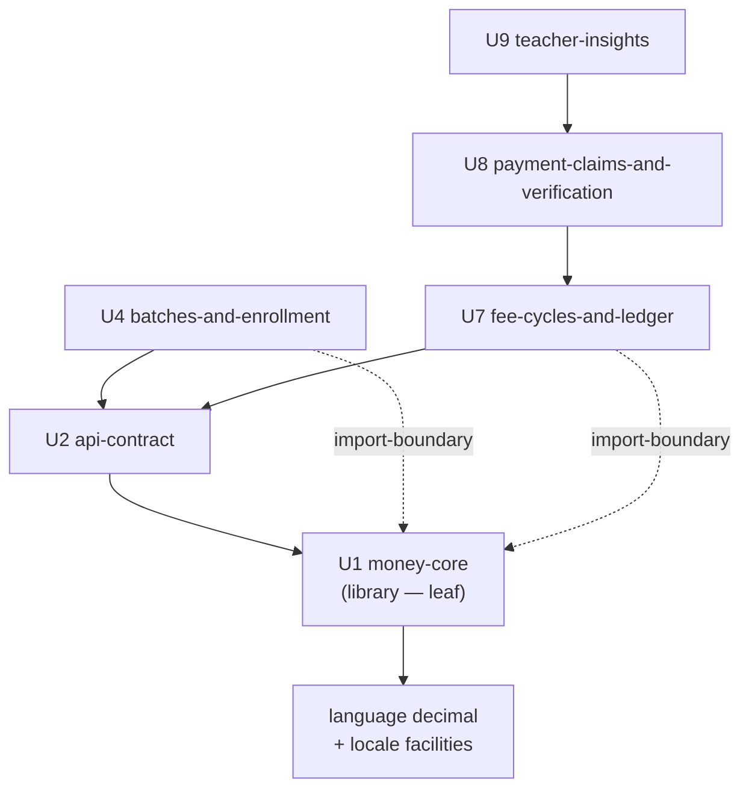

# Logical Components — `money-core` (U1)

**Stage**: nfr-design (3.3)
**Phase**: Construction
**Unit**: U1 `money-core` — `library`, M
**Bolt**: B1 `b1-money-core`

> This stage's usual content is infrastructure components, failure domains and
> scaling units. A library has none of those. What it does have — and what
> this document records — is a **blast radius**, and it is the largest in the
> product: every money value in every Unit passes through this module. That
> fact is the justification for controls that would otherwise look
> disproportionate for roughly two hundred lines of arithmetic.

## Sources

- [stage] `nfr-design-questions.md` — Q6
- [upstream] `construction/money-core/nfr-design/security-design.md`
- [upstream] `construction/money-core/functional-design/functional-spec.md` —
  §7 (why there is no frontend component specification)
- [upstream] `inception/units-generation/unit-of-work.md` — U1, and the Units
  that depend on it
- [upstream] `inception/units-generation/unit-of-work-dependency.md`
- [upstream] `inception/contract-design/contract-summary.md` — §B.5, §E.1

---

## A. Logical position

**Text fallback.** `money-core` is a **leaf**: it depends only on the
language's own decimal arithmetic and locale facilities, and on nothing else
in the system. Three Units declare a direct edge to it in the dependency DAG —
`api-contract` for the annotated wire type, and `batches-and-enrollment` and
`fee-cycles-and-ledger` for the import boundary. The latter two are
**redundant through `api-contract`** as transport edges and are declared
anyway, because `Batch.default_fee`, `Enrollment.fee_amount` and every ledger
amount are Money values whose owning components depend on this module
structurally rather than by transport. `payment-claims-and-verification` and
`teacher-insights` reach it transitively.

No arrow points outward from `money-core` into the system, and that is
enforced rather than observed [Gate 1, NFR9.4].

**Why the leaf position is load-bearing.** Three of this Unit's properties
depend on it directly and would all fail together if an outward edge were
added: 100% branch coverage would stop being reachable (an I/O branch needs a
mock), the module would stop being buildable before any endpoint exists
(B1 could not be first), and strict type checking would start admitting
unchecked values from the un-strict region.

---

## B. Blast radius

| Property | Value |
|---|---|
| **Scope of impact** | Every money value in the product — fees, ledger entries, payments, balances, analytics |
| **Consumers** | U2, U4, U7 directly; U8 and U9 transitively — five of eleven Units handle money, and all five resolve through this module |
| **Failure mode** | **Silent wrong arithmetic.** Not an outage |
| **Detection latency without controls** | Potentially months — until a teacher reconciles by hand and disagrees |
| **Recovery** | Expensive. The ledger is append-only and is the record of record; a wrong balance that has been acted on (a payment accepted, a waiver granted) cannot simply be recomputed |

**This is why the controls are sized the way they are.** A service with a
large blast radius and a *loud* failure mode — an outage — needs redundancy
and fast rollback. This module's blast radius is comparably large but its
failure mode is **silent**, so redundancy buys nothing and the entire
investment goes into detection before release: 100% branch coverage, two
import gates with committed failing fixtures, a property test over randomized
histories, a named-test manifest, and seven hand-written per-kind expectations.

Each of those would be hard to justify for two hundred lines of arithmetic in
isolation. Together they are proportionate to "every money value in the
product, failing silently".

---

## C. Isolation properties

What makes this module's controls achievable rather than aspirational:

| Property | Consequence |
|---|---|
| **No I/O** | Every branch is reachable without a mock, so 100% branch coverage is real |
| **No state** | No conflict or transient error class is possible, so there is no unreachable error branch [BR1.8] |
| **No configuration** | The locale arrives as an argument [BR5.6], so no branch needs global state mutated in a test |
| **No outward imports** | Strict type checking is genuinely local and effective, not decorative |
| **Deterministic** | The same inputs give the same outputs, always — which is what makes property-based testing meaningful here |

These five are not independent conveniences; they are one architectural
decision (a pure leaf) seen from five angles, and Gate 1 is what holds it.

---

## D. What this Unit does NOT have

| Usual logical-component content | Status | Why |
|---|---|---|
| Service boundary | **None** | Not a service. No process, no port, no deployment artefact of its own |
| Failure domain | **None** | Shares the process of whatever imports it. It cannot fail independently |
| Scaling unit | **None** | A pure function has no scale dimension. Scaling is a property of the service that calls it |
| Shared resource | **None** | No connection pool, no cache, no file handle, no lock |
| Health check | **None** | Nothing to probe. Its correctness is established before release, not observed at runtime |
| Circuit breaker / retry policy | **None** | Nothing to break or retry — no refusal here is transient [BR1.8] |
| Blue/green or rollback unit | **Inherited** | Rolls back with the image that contains it; it is not independently deployable |

> Each row is "none" for the same structural reason, and recording them
> individually rather than as one blanket statement is deliberate: a reader
> checking whether this Unit needs a health check should find the answer and
> its reason, not an absence they must interpret.

---

## E. Hand-off to Infrastructure Design

What a later infrastructure stage needs from this Unit, and what it does not:

**Needs:**
- The storage column type (`NUMERIC(12,2)`), because the database the
  infrastructure provisions must support exact fixed-point arithmetic. This
  disqualifies no candidate at the chosen scale, but it is a real constraint
  and is recorded rather than assumed.
- Nothing else.

**Does not need:**
- No compute sizing — this module adds no measurable runtime weight.
- No network policy, no security group, no ingress rule.
- No separate deployment, no separate scaling policy, no separate monitoring
  target.

**One constraint flows the other way**: NFR10 requires children's data
encrypted at rest, which disqualifies any database tier without storage
encryption. This Unit defines the *mapping* that lands in that column; the
encryption is the infrastructure's obligation, and the two must not be
confused for each other.

---

## Assumptions & Open Questions

None. OQ-B1-1 is recorded against `security-design.md`, where the formatting
design lives; it has no logical-component consequence.
