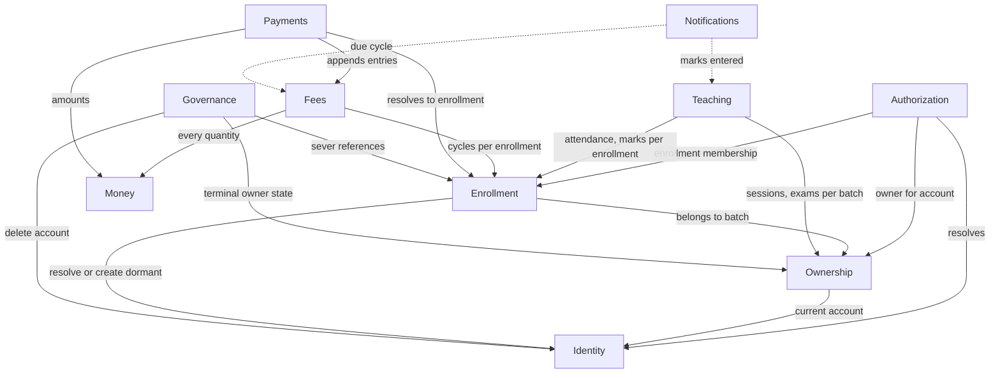

# Component Catalogue — ShikhokPlus

**Stage**: domain-design (2.6)
**Phase**: Inception
**Date**: 2026-10-18

Logical building blocks — **code we write**, not infrastructure we deploy.
PostgreSQL, the SMS gateway and FCM are `external_dependencies`, never
components. Deployment topology belongs to Units Generation; types, constraints
and cardinality belong to Functional Design.

Entities are captured at **ownership and shape** only: which component owns
each, its identifier, its attribute names, and cross-component references.

---

## Part A — Catalogue

```yaml
components:
  - name: Identity
    summary: Accounts, authentication, and the per-request lens inputs.
    behaviour: >
      The ONLY component permitted to query the account table by phone number.
      Every other component reaches people through Enrollment. This is the
      structural form of the enumeration-resistance rule: an unscoped
      find-account-by-phone exists exactly once, inside this boundary, and an
      import rule keeps it there. OTP issue and verify perform identical work
      and return identical responses whether or not the number has an account,
      asserted as a structural property rather than a timing bound. OTPs are
      stored hashed and never logged. Refresh tokens rotate, and presenting a
      rotated-out token invalidates the whole family. Role is never stored:
      this component supplies the facts, Authorization computes the lens.
    responsibilities:
      - Account lifecycle, keyed on a permanent phone number
      - OTP issue and verify, with the seven abuse controls
      - Token issue, rotation and reuse detection
      - The owner-private profile
      - The append-only authentication audit log
    depends_on: []
    dependents:
      - component: Authorization
        interaction: supplies the account identity a lens is computed for
      - component: Enrollment
        interaction: resolves or creates a dormant account when a teacher enrolls a number
      - component: Ownership
        interaction: resolves the account an Owner currently belongs to
      - component: Governance
        interaction: deletes an account, its profile and its credentials
    external_dependencies:
      - name: PostgreSQL
        kind: database
        purpose: account, credential and audit storage
      - name: SMS gateway (BTRC-approved)
        kind: third-party-api
        purpose: OTP delivery, with a per-purpose budget ceiling
    entities:
      - name: Account
        identifier: id
        attributes: [id, phone, created_at, activated_at, deleted_at]
      - name: Profile
        identifier: account_id
        attributes: [account_id, self_name, photo_ref]
        references:
          - entity: Account
            owned_by: Identity
            relationship: each Profile belongs to exactly one Account, visible only to its owner
      - name: OtpRequest
        identifier: id
        attributes: [id, phone, otp_hash, purpose, issued_at, expires_at, consumed_at]
      - name: VerifyAttempt
        identifier: id
        attributes: [id, otp_request_id, attempted_at, succeeded]
      - name: RefreshToken
        identifier: id
        attributes: [id, account_id, token_hash, family_id, issued_at, expires_at, rotated_at, reuse_detected_at]
      - name: RateLimitCounter
        identifier: id
        attributes: [id, scope_kind, scope_value, window_start, count]
      - name: AuthAuditLog
        identifier: id
        attributes: [id, account_id, event, occurred_at, correlation_id]

  - name: Ownership
    summary: Who owns batches, and the batches themselves.
    behaviour: >
      Batch ownership is indirected through Owner so an organisation can own
      batches later without migrating any batch row. Owner carries the
      subscription anchor — a plan and a validity date that V1 writes once and
      reads nowhere — so the V2 subscription table attaches by foreign key to a
      row that already exists. Owner also carries a lifecycle state: a deleted
      teacher's Owner moves to a terminal deleted state, which makes its
      batches permanently read-only without destroying anyone's records. The
      teacher's display name is deliberately denormalized onto Batch, because a
      student's history saying which teacher taught them must survive that
      teacher's account deletion.
    responsibilities:
      - The Owner indirection and its lifecycle state
      - Batch definition, subjects and weekly schedule slots
      - The teacher's collection number, deliberately visible to their students
      - The subscription attachment point
    depends_on:
      - component: Identity
        interaction: resolves the account an Owner currently belongs to
        style: sync
      - component: Money
        interaction: Batch.default_fee is a Money value and passes through Money's chokepoints
        style: sync
    dependents:
      - component: Enrollment
        interaction: an enrollment belongs to a batch
      - component: Teaching
        interaction: sessions and exams belong to a batch
      - component: Authorization
        interaction: reads which Owner an account controls, to resolve the teacher lens
      - component: Governance
        interaction: moves a deleted teacher's Owner to its terminal state
    external_dependencies:
      - name: PostgreSQL
        kind: database
        purpose: owner and batch storage
    entities:
      - name: Owner
        identifier: id
        attributes: [id, kind, account_id, state, plan, plan_valid_to, deleted_at]
        references:
          - entity: Account
            owned_by: Identity
            relationship: a teacher Owner points at one Account; an organisation Owner will not
      - name: Batch
        identifier: id
        attributes: [id, owner_id, name, teacher_display_name, collection_number, collection_channel, default_fee, fee_due_day, marksheet_visible, active, created_at]
        notes: >
          `default_fee` is a Money value — the batch-level fee anchor FR5.1
          describes — and carries the same obligations as every other money
          attribute: the Money TypeDecorator in storage, Money's serialization
          chokepoints in transit, never a float and never a bare Numeric.
          `collection_number` is a teacher-typed payment destination, not money.
      - name: BatchSubject
        identifier: id
        attributes: [id, batch_id, name]
      - name: ScheduleSlot
        identifier: id
        attributes: [id, batch_id, weekday, start_time, end_time]

  - name: Enrollment
    summary: The pivot of the privacy design — a person's membership of one batch.
    behaviour: >
      An enrollment is the ONLY way a teacher reaches a person. Teacher-facing
      reads and writes are keyed on enrollment_id and never on an account id,
      which is what prevents teacher A pivoting from a shared student to
      teacher B's records. The display name and guardian phone are
      teacher-typed strings that happen to look like account keys: they are
      never joined to account. An enrollment is dormant until the person first
      authenticates, and a mistyped number stays dormant forever, which is
      correct behaviour rather than an error. Marking inactive takes a date,
      not a flag: the period containing that date still generates a fee cycle.
    responsibilities:
      - Enrollment lifecycle: dormant, active, inactive-from-a-date
      - The teacher-authored display name and guardian phone
      - The per-enrollment fee override
      - The owner-scoped add-student lookup
      - The student's and guardian's own hide-batch preference
    depends_on:
      - component: Ownership
        interaction: an enrollment belongs to a batch
        style: sync
      - component: Identity
        interaction: resolves or creates a dormant account for a typed number
        style: sync
      - component: Money
        interaction: Enrollment.fee_amount is a Money value and passes through Money's chokepoints
        style: sync
    dependents:
      - component: Teaching
        interaction: attendance and marks are recorded per enrollment
      - component: Fees
        interaction: fee cycles are generated per enrollment
      - component: Payments
        interaction: a claim resolves through a batch to an enrollment
      - component: Authorization
        interaction: reads enrollment membership to compute the student and guardian lenses
      - component: Governance
        interaction: severs account references while retaining the record
    external_dependencies:
      - name: PostgreSQL
        kind: database
        purpose: enrollment storage, with row-level security keyed on the owning Owner
    entities:
      - name: Enrollment
        identifier: id
        attributes: [id, batch_id, student_account_id, guardian_account_id, display_name, guardian_phone, fee_amount, joined_on, inactive_from, relink_blocked_at, created_at]
        notes: >
          `fee_amount` is a Money value — the per-enrollment fee anchor that
          overrides `Batch.default_fee` — and carries the same obligations as
          every other money attribute. These two anchors are what fee-cycle
          generation charges, so an untyped column here would put a float at
          the head of the whole fee model.
        references:
          - entity: Batch
            owned_by: Ownership
            relationship: each Enrollment belongs to exactly one Batch
          - entity: Account
            owned_by: Identity
            relationship: an Enrollment points at the student's and optionally the guardian's Account, and those ids never appear in a teacher-facing response
      - name: HiddenBatchPreference
        identifier: id
        attributes: [id, account_id, batch_id, hidden_at]

  - name: Teaching
    summary: Classes, attendance, exams and marks.
    behaviour: >
      Sessions carry an attendance version for optimistic concurrency, because
      the mid-class path queues offline and a queued roster can arrive hours
      after someone corrected the same session elsewhere. A queued write whose
      base version no longer matches is refused and reported, never merged and
      never silently applied: merging would mean inventing a rule for a student
      the two rosters disagree about, which is a business decision a sync layer
      must not make. A roster is written in one atomic operation, never one
      write per student. A mark distinguishes four states — a number, absent,
      not yet entered, and joined after the exam — because a shared marksheet
      makes conflating them visible to everyone.
    responsibilities:
      - Session instances from the batch's weekly recurrence, plus ad-hoc sessions
      - The topic log
      - Attendance per session per enrollment, written atomically
      - Exams and marks, with four distinguishable result states
      - Batch announcements
      - The optimistic-concurrency rule for both queued paths
    depends_on:
      - component: Ownership
        interaction: sessions and exams belong to a batch
        style: sync
      - component: Enrollment
        interaction: attendance and marks are recorded against an enrollment
        style: sync
    dependents:
      - component: Notifications
        interaction: entered marks trigger a notification
    external_dependencies:
      - name: PostgreSQL
        kind: database
        purpose: session, attendance, exam and mark storage
    entities:
      - name: Session
        identifier: id
        attributes: [id, batch_id, date, start_time, subject, topic, status, attendance_version, topic_version]
      - name: Attendance
        identifier: id
        attributes: [id, session_id, enrollment_id, present, recorded_at, client_mutation_id]
        references:
          - entity: Enrollment
            owned_by: Enrollment
            relationship: each Attendance row is one enrollment's presence at one session
      - name: Exam
        identifier: id
        attributes: [id, batch_id, subject, title, date, total_marks]
      - name: Mark
        identifier: id
        attributes: [id, exam_id, enrollment_id, marks, result_state, recorded_at, superseded_by_id]
      - name: Announcement
        identifier: id
        attributes: [id, batch_id, body, created_at, edited_at, deleted_at]

  - name: Money
    summary: The money type. No persisted entity, no I/O.
    behaviour: >
      Money is a type, not a number. A frozen value object wrapping a Decimal
      with BDT implicit, quantized at construction, with no float conversion
      and construction from a float raising. Multiplication is a named method
      that states its rounding; division is not exposed until a requirement
      needs it. This component owns the single rounding mode and both
      serialization chokepoints — the Pydantic annotated type and the
      SQLAlchemy type decorator — so a money value physically cannot enter or
      leave the system without passing through it. It imports nothing but
      decimal and its own value types: no ORM, no session, no settings.
    responsibilities:
      - The Money value type and its arithmetic
      - The single declared rounding mode
      - Both serialization boundaries
    depends_on: []
    dependents:
      - component: Ownership
        interaction: Batch.default_fee is a Money value
      - component: Enrollment
        interaction: Enrollment.fee_amount is a Money value
      - component: Fees
        interaction: every ledger quantity is a Money value
      - component: Payments
        interaction: claimed and approved amounts are Money values
    external_dependencies: []
    entities: []

  - name: Fees
    summary: The append-only money ledger and fee-cycle generation.
    behaviour: >
      The ledger is append-only: a correction appends a compensating entry and
      marks the original superseded, never updates in place. Every quantity is
      derived from entries, so a sixth quantity is a new kind value rather than
      a migration — which matters because this model is already on its second
      revision. Amounts are always non-negative and the sign lives in the kind,
      so a correction cannot be expressed two ways. A thin fee-cycle row exists
      only to carry the idempotency constraint and the period's identity:
      generation inserts it with ON CONFLICT DO NOTHING and appends the charge
      only when the insert took, which is what makes concurrent generation
      produce exactly one charge. Credit belongs to the enrollment rather than
      to a cycle, so an overpayment in March is found by April's generation
      wherever it came from. Carry-forward is two-sided — a `carried_out` entry
      relieves the originating cycle and a `carry_forward` entry charges the
      receiving one — because a one-sided carry counts the same debt in both
      cycles and overstates what the student owes.
    responsibilities:
      - Fee-cycle generation, idempotent by database constraint
      - The append-only ledger and every derived quantity
      - Credit grant and application
      - Server-computed fee status
      - The cross-batch dues query, scoped to one Owner
      - Earnings, trend and collection-rate aggregates
    depends_on:
      - component: Money
        interaction: every quantity is a Money value
        style: sync
      - component: Enrollment
        interaction: cycles are generated per enrollment
        style: sync
    dependents:
      - component: Payments
        interaction: an approved verification appends ledger entries through this component's API
      - component: Notifications
        interaction: a due cycle triggers a reminder
    external_dependencies:
      - name: PostgreSQL
        kind: database
        purpose: ledger storage; the unique constraint that makes generation idempotent
    entities:
      - name: FeeCycle
        identifier: id
        attributes: [id, enrollment_id, period, due_date, status, created_at]
        references:
          - entity: Enrollment
            owned_by: Enrollment
            relationship: each FeeCycle belongs to one Enrollment, unique per period
      - name: LedgerEntry
        identifier: id
        attributes: [id, enrollment_id, fee_cycle_id, kind, amount, occurred_at, actor_account_id, source_payment_claim_id, superseded_by_id, created_at]
        notes: >
          `kind` is one of charge, receipt, carry_forward, carried_out,
          forgiveness, credit_grant, credit_apply. `amount` is a Money value
          and is always non-negative; the sign lives in the kind. Money-typed
          attributes pass through the Money component's serialization
          chokepoints and never cross a boundary as a float or a JSON number.

  - name: Payments
    summary: Claims submitted by students and guardians, verified by teachers.
    behaviour: >
      Separate from Fees because the writer differs, and that difference is the
      privacy boundary in table form: students and guardians write claims,
      teachers write verifications. A claim records which channel was used from
      a server-supplied list, so adding one later is a data change rather than
      an app release. Approving more than was charged produces a credit rather
      than a negative balance. The shortfall on a partial approval is measured
      against what was charged, not what was claimed, because a claim is an
      assertion and the charge is the obligation. This component never inserts
      a ledger row directly — it calls Fees.
    responsibilities:
      - Payment claim submission from the student and guardian lenses
      - Teacher verification: approve, approve less, reject
      - The carry-forward-or-waive choice on a partial approval
      - Recording who verified and when
    depends_on:
      - component: Fees
        interaction: an approved verification appends ledger entries
        style: sync
      - component: Money
        interaction: claimed and approved amounts
        style: sync
      - component: Enrollment
        interaction: a claim resolves through a batch to an enrollment
        style: sync
    dependents: []
    external_dependencies:
      - name: PostgreSQL
        kind: database
        purpose: claim and verification storage
    entities:
      - name: PaymentClaim
        identifier: id
        attributes: [id, fee_cycle_id, submitted_by_account_id, channel, transaction_id, claimed_amount, submitted_at, client_mutation_id, status]
        notes: >
          `claimed_amount` is a Money value, passing through the Money
          component's chokepoints like every other money-typed attribute.
      - name: PaymentVerification
        identifier: id
        attributes: [id, payment_claim_id, approved_amount, disposition, verified_by_account_id, verified_at, superseded_by_id]
        notes: >
          `approved_amount` is a Money value. An approved amount exceeding the
          claim's charge becomes a credit_grant rather than a receipt (FR5.9).

  - name: Notifications
    summary: Push delivery and the reminder event log.
    behaviour: >
      Reminders are recorded as events, not as a flag on a cycle, so a second
      channel is a new kind value rather than a migration — and the V1 push
      writes those events, which makes the reminded/not-reminded state
      derivable from real V1 data with no SMS capability at all. Delivery is
      best-effort and never fails the operation that triggered it: dispatch
      happens after commit, outside the request transaction, and a failure is
      logged rather than surfaced. An unregistered response is a signal to
      delete the stored token, not an error. No advertising or device
      identifier is ever transmitted.
    responsibilities:
      - Push dispatch for fee reminders and entered marks
      - Device token lifecycle
      - The reminder event log, channel-agnostic
    depends_on:
      - component: Fees
        interaction: a due cycle triggers a reminder
        style: event
      - component: Teaching
        interaction: entered marks trigger a notification
        style: event
    dependents: []
    external_dependencies:
      - name: FCM
        kind: third-party-api
        purpose: push delivery, using app-instance-scoped installation ids
      - name: PostgreSQL
        kind: database
        purpose: token and reminder-event storage
    entities:
      - name: ReminderEvent
        identifier: id
        attributes: [id, enrollment_id, fee_cycle_id, channel, sent_at, sent_by_account_id, outcome]
      - name: DeviceToken
        identifier: id
        attributes: [id, account_id, token, registered_at, last_seen_at]

  - name: Authorization
    summary: Lens resolution and scoping. Owns no entity.
    behaviour: >
      A lens is a data dependency, not a guard: it returns the scoping value
      the query needs, so a handler cannot compile a query without one and a
      forgotten lens fails rather than silently authorizing nothing. The
      teacher lens carries owner_id and never an account id — the single
      invariant that keeps one teacher out of another's records for a student
      they share. The lens also sets the request-scoped database setting that
      row-level security reads, so the boundary survives a forgotten WHERE
      clause. It carries one entitlement value, always full in V1, which is the
      single place a subscription check will ever go. Request-scoped
      memoization is permitted; caching across requests is not, because that
      would be a stored role.
    responsibilities:
      - Resolving teacher, student and guardian lenses per request
      - Owner-scoping every teacher-lens query
      - Setting the row-level-security context
      - The single entitlement decision point
      - The route-enumeration guarantee and its public-route allowlist
    depends_on:
      - component: Identity
        interaction: the authenticated account
        style: sync
      - component: Ownership
        interaction: which Owner an account controls
        style: sync
      - component: Enrollment
        interaction: which enrollments name this account as student or guardian
        style: sync
    dependents: []
    external_dependencies: []
    entities: []
    # Authorization has no dependents in the calling sense. Ownership,
    # Enrollment, Teaching, Fees and Payments do not CALL it: the lens is
    # resolved by the request pipeline and handed to a handler as a data
    # dependency, carrying the scoping value the query needs. That relationship
    # is "is scoped by", which the depends_on/dependents pair cannot express
    # without asserting a call that does not exist. Recorded in the Rationale
    # table and enforced by the route-enumeration test rather than by an edge.

  - name: Governance
    summary: Deletion dispositions and retention policy as declarative data. Owns no entity.
    behaviour: >
      Holds two manifests — a deletion disposition per table and a retention
      period per data class — as structured data rather than scattered logic.
      Three consumers read them: the deletion endpoints, the scheduled purge,
      and the privacy-policy generator. That single source is what stops the
      published policy drifting from the implementation, which is the failure
      this component exists to prevent. One test iterates the schema and
      asserts every table appears in both manifests, so a table added in a
      later Bolt reddens CI until someone decides its disposition.
    responsibilities:
      - The deletion disposition manifest
      - The retention policy manifest
      - Both account-deletion paths, in-app and the external web route
      - The scheduled purge, idempotent and chunked
      - Generating the privacy-policy retention text
    depends_on:
      - component: Identity
        interaction: deleting an account and its credentials
        style: sync
      - component: Ownership
        interaction: moving a deleted teacher's Owner to its terminal state
        style: sync
      - component: Enrollment
        interaction: severing account references while retaining the record
        style: sync
    dependents: []
    external_dependencies:
      - name: PostgreSQL
        kind: database
        purpose: the purge operates across every table
    entities: []
```

---

## Part B — Human view

### Component diagram



Dotted edges are event-style; the rest are synchronous calls. The graph is
acyclic.

**Authorization's edges point the way they do deliberately.** It *reads* from
Identity, Ownership and Enrollment to resolve a lens. The other five components
are **scoped by** the lens but never call it — the request pipeline resolves it
and hands it to a handler as a data dependency carrying the scoping value the
query needs. That is why Authorization has no dependents: an edge there would
assert a call that does not exist. The relationship is enforced by the
route-enumeration test instead.

### Component summary

| Component | Purpose | Depends on | Dependents | Entities owned |
|---|---|---|---|---|
| Identity | Accounts, auth, lens inputs | — | Authorization, Enrollment | Account, Profile, OtpRequest, VerifyAttempt, RefreshToken, RateLimitCounter, AuthAuditLog |
| Ownership | Owner indirection, batches | Identity, Money | Enrollment, Teaching, Authorization | Owner, Batch, BatchSubject, ScheduleSlot |
| Enrollment | Batch membership — the privacy pivot | Ownership, Identity, Money | Teaching, Fees, Authorization | Enrollment, HiddenBatchPreference |
| Teaching | Classes, attendance, exams, marks | Ownership, Enrollment | Notifications | Session, Attendance, Exam, Mark, Announcement |
| Money | The money type | — | Ownership, Enrollment, Fees, Payments | *(none — a type, not a table)* |
| Fees | Append-only ledger, generation | Money, Enrollment | Payments, Notifications | FeeCycle, LedgerEntry |
| Payments | Claims and verifications | Fees, Money, Enrollment | — | PaymentClaim, PaymentVerification |
| Notifications | Push and reminder events | Fees, Teaching | — | ReminderEvent, DeviceToken |
| Authorization | Lens resolution and scoping | Identity, Ownership, Enrollment | Ownership, Enrollment, Teaching, Fees, Payments | *(none)* |
| Governance | Dispositions, retention, deletion | Identity, Ownership, Enrollment | — | *(none)* |

### Entity ownership

| Entity | Owning component | Identifier | Key attributes | References |
|---|---|---|---|---|
| Account | Identity | id | phone, created_at, activated_at, deleted_at | — |
| Profile | Identity | account_id | self_name, photo_ref | Account |
| OtpRequest | Identity | id | phone, otp_hash, purpose, expires_at | — |
| VerifyAttempt | Identity | id | otp_request_id, succeeded | — |
| RefreshToken | Identity | id | token_hash, family_id, reuse_detected_at | — |
| RateLimitCounter | Identity | id | scope_kind, scope_value, window_start | — |
| AuthAuditLog | Identity | id | event, occurred_at, correlation_id | — |
| Owner | Ownership | id | kind, state, plan, plan_valid_to | Account |
| Batch | Ownership | id | teacher_display_name, collection_number, default_fee, fee_due_day, marksheet_visible | — |
| BatchSubject | Ownership | id | name | — |
| ScheduleSlot | Ownership | id | weekday, start_time, end_time | — |
| Enrollment | Enrollment | id | display_name, guardian_phone, fee_amount, inactive_from, relink_blocked_at | Batch, Account |
| HiddenBatchPreference | Enrollment | id | account_id, batch_id | — |
| Session | Teaching | id | date, subject, topic, status, attendance_version | — |
| Attendance | Teaching | id | present, client_mutation_id | Enrollment |
| Exam | Teaching | id | subject, title, date, total_marks | — |
| Mark | Teaching | id | marks, result_state, superseded_by_id | — |
| Announcement | Teaching | id | body, edited_at, deleted_at | — |
| FeeCycle | Fees | id | period, due_date, status | Enrollment |
| LedgerEntry | Fees | id | kind, amount, occurred_at, superseded_by_id | — |
| PaymentClaim | Payments | id | channel, transaction_id, claimed_amount, client_mutation_id | — |
| PaymentVerification | Payments | id | approved_amount, disposition, verified_by_account_id | — |
| ReminderEvent | Notifications | id | channel, sent_at, outcome | — |
| DeviceToken | Notifications | id | token, last_seen_at | — |

### External dependencies

| Component | Dependency | Kind | Purpose |
|---|---|---|---|
| Identity | PostgreSQL | database | Account, credential, audit storage |
| Identity | SMS gateway | third-party-api | OTP delivery, per-purpose budget |
| Ownership | PostgreSQL | database | Owner and batch storage |
| Enrollment | PostgreSQL | database | Enrollment storage with row-level security |
| Teaching | PostgreSQL | database | Session, attendance, exam, mark storage |
| Fees | PostgreSQL | database | Ledger storage and the idempotency constraint |
| Payments | PostgreSQL | database | Claim and verification storage |
| Notifications | FCM | third-party-api | Push delivery, app-instance-scoped ids |
| Notifications | PostgreSQL | database | Token and reminder-event storage |
| Governance | PostgreSQL | database | Purge across every table |

### Rationale

| Component | Why it is a separate building block |
|---|---|
| Identity | **Distinct concern and a containment boundary.** Being the only place that may query by phone is what makes enumeration resistance a structural property rather than a habit |
| Ownership | **Distinct lifecycle.** An Owner outlives the account that created it — that is precisely what keeps a deleted teacher's batches readable |
| Enrollment | **Distinct data ownership, and the privacy pivot.** Teacher-authored data about a person, deliberately separate from that person's account |
| Teaching | **Distinct change rate and one shared mechanism.** Sessions, attendance, exams and marks share the batch shape and the same optimistic-concurrency rule |
| Money | **Distinct concern with an enforced boundary.** Already mandated: no I/O, import-checked, 100% branch coverage, and reachable only through its own two serialization chokepoints |
| Fees | **Distinct data ownership.** The only writer of ledger entries, which is what makes the append-only guarantee enforceable rather than conventional |
| Payments | **Distinct writer.** Students and guardians write claims; teachers write verifications. That split *is* the privacy boundary, so it gets a boundary |
| Notifications | **Distinct lifecycle and failure semantics.** Best-effort, post-commit, outside the transaction — the one component whose failure must not fail its caller |
| Authorization | **Distinct cross-cutting concern.** Owns no data; owns the rule every other component is scoped by |
| Governance | **Distinct concern, single source.** Dispositions and retention drive three consumers, and one source is what stops the published policy drifting from the code |

### Component-boundary options considered

Two decompositions had more than one viable shape.

**Fees and Payments: one component or two?**

- *Option A — one "Billing" component.* Fewer boundaries, one transaction, no cross-component call for a verification.
- *Option B — Fees and Payments separate.* One more boundary and one API call.
- **Chosen: B.** The writer differs, and the difference *is* the privacy boundary — students and guardians write claims, teachers write verifications. Merging them would put both sides of the boundary in one module and make "never write a ledger row directly" a convention rather than a boundary. Reversible: merging later is easy; splitting after they are entangled is not.

**Teaching: one component or three (Sessions, Exams, Announcements)?**

- *Option A — three components.* Finer boundaries; attendance and marks genuinely differ.
- *Option B — one Teaching component.* Coarser, but they share the batch shape, the same optimistic-concurrency mechanism and the same change rate.
- **Chosen: B.** Splitting would duplicate the concurrency rule across two components, and a rule implemented twice is a rule that drifts. Reversible: the entities are already distinct, so splitting later is mechanical.

**Alternatives rejected** are recorded in `decisions.md`.

---

## Cross-component invariants

Five rules that span components and are mechanically checked. Each exists
because the alternative is a convention someone eventually forgets.

| Invariant | Enforcement |
|---|---|
| **No component except Identity queries `account` by phone** | Import-boundary rule, in the same spirit as the money module |
| **No teacher-facing response schema carries an account id** | Schema-wide OpenAPI iteration, extending the existing no-profile-fields check |
| **No component except Fees writes `LedgerEntry`** | Import-boundary rule |
| **Every teacher-lens query is rooted at `owner_id`** | Route-enumeration test plus row-level security on the enrollment-rooted tables |
| **Every table appears in both Governance manifests** | A test iterating the schema; a new table reddens CI until its disposition is decided |

---

## Assumptions & Open Questions

- Component boundaries are *logical*. Whether they become one deployable
  service or several is Units Generation's decision, and nothing here presumes
  it. [assumption]
- `Money` owns no entity, which makes it unusual in this catalogue. It is a
  component because it has enforced boundaries and owns behaviour, not because
  it owns rows. [assumption]
- `Authorization` and `Governance` likewise own no entities. Three of ten
  components owning no table is high; the alternative is scattering their
  rules, which is what the project's practices explicitly reject. [assumption]
- `Batch.collection_number` is the one teacher-authored field deliberately
  exposed to students and guardians. The payment flow cannot work without it.
  [FR6.12, FR6.13] [assumption]
- `Enrollment.guardian_phone` surviving a guardian's account deletion is
  uncomfortable and deliberate: it is the teacher's own contact record, the
  same category as the display name. The privacy policy must say so plainly.
  [assumption]
- The attendance-conflict rule needs FR11.4 amended and NFR5.1 extended with a
  fourth queue state. Both are recorded in `decisions.md` ADR-006 and flagged
  for the gate. [assumption]
- The team's recorded Hypothesis invariant is incomplete — it omits
  carry-forward and predates credit. The corrected form is in ADR-002; changing
  an affirmed practice goes through the learnings gate, not a direct edit.
  [assumption]

## Sources

- [FR*], [NFR*] `inception/requirements-analysis/requirements.md`
- [US*], [AC*] `inception/user-stories/stories.md`
- [architecture §8a–§8f] `ideation/feasibility/architecture-proposal.md`
- [team], [project] the affirmed practices and permanent rules
- [Q1]–[Q6] the six deferred decisions, recorded in `decisions.md`

---

## Appendix A — Deletion Disposition Manifest

Closes the gap ADR-003 left open: a disposition per entity, per deleting actor.
This is the data the Governance component holds, the deletion endpoints execute,
the purge honours, and the privacy policy is generated from [RC-5].

**Two tables because the answer genuinely differs by actor.** A row can be
`hard_delete` when the teacher deletes and `retain_with_basis` when the student
does, and collapsing that into one column is exactly the error that produced the
missing table.

Dispositions are `hard_delete` | `anonymize_in_place` | `retain_with_basis`.
Retention clocks [ADR-004] run independently and afterwards: a
`retain_with_basis` row is retained *until its clock expires*, never
indefinitely.

**Actor vocabulary.** `teacher` = an Account that controls an `Owner`.
`student` / `guardian` = an Account named by an `Enrollment`. An Account may hold
more than one of these at once; see **Note 1**.

---

### Table 1 — Teacher's deletion

Settled by ADR-003: the teacher's own identity goes, the teaching record stays.

| Entity | Disposition | Basis (privacy-policy text) | What survives |
|---|---|---|---|
| Account | `hard_delete` | — | nothing; phone number and all sign-in ability removed |
| Profile | `hard_delete` | — | nothing |
| OtpRequest | `hard_delete` | — | nothing |
| VerifyAttempt | `hard_delete` | — | nothing |
| RefreshToken | `hard_delete` | — | nothing |
| RateLimitCounter | `hard_delete` | — | nothing (see **Note 2**) |
| AuthAuditLog | `anonymize_in_place` | "We keep a record that sign-ins happened, with your identity removed, for up to 13 months, so we can answer a complaint that someone's account was misused." | cleared: `account_id` → NULL. kept: `event`, `occurred_at`, `correlation_id` |
| Owner | `retain_with_basis` | "Your batches stay readable to your students after you delete your account. The record of who owned them stays, with your personal details removed, so that history still makes sense." | moves to terminal `state = deleted`, `deleted_at` set, `account_id` → NULL. Batches become permanently read-only [ADR-003] |
| Batch | `retain_with_basis` | "Your students keep the record of the classes they attended with you, including your name as they knew it, because it is their own history." | all columns, including `teacher_display_name` [ADR-003] and `default_fee`. **Except** `collection_number` → NULL, `collection_channel` → NULL (see Reasoning R1) |
| BatchSubject | `retain_with_basis` | "Subject names stay with the batch so a student's record of what they studied stays readable." | all |
| ScheduleSlot | `retain_with_basis` | "The weekly timetable stays with the batch so past sessions still make sense." | all |
| Enrollment | `retain_with_basis` | "Your students' enrollments are not deleted when you delete your account; they are the students' own record of having studied with you." | all. Student's and guardian's `account_id` untouched — they are not the deleting party |
| HiddenBatchPreference | `retain_with_basis` | "A student's choice to hide a batch is theirs, not yours, so it stays." | all (owned by the student, not the teacher) |
| Session | `retain_with_basis` | "Class records stay for up to 3 years because they are your students' attendance history." | all; 3y academic clock [ADR-004] |
| Attendance | `retain_with_basis` | "Attendance stays for up to 3 years because it is the student's own record." | all; 3y clock |
| Exam | `retain_with_basis` | "Exam records stay for up to 3 years because students' marks are attached to them." | all; 3y clock |
| Mark | `retain_with_basis` | "Marks stay for up to 3 years because they are the student's own record." | all; 3y clock |
| Announcement | `retain_with_basis` | "Announcements you posted to a batch stay with the batch's history." | all; follows the batch's academic clock (3y from `created_at`) |
| FeeCycle | `retain_with_basis` | "Fee records stay for up to 6 years so that a payment dispute can still be settled." | all; 6y financial clock |
| LedgerEntry | `anonymize_in_place` | "Money records stay for up to 6 years so a payment dispute can still be settled. Where an entry recorded that you were the person who made the change, your identity is removed." | cleared: `actor_account_id` → NULL where it is the deleting teacher. kept: every money column — `kind`, `amount`, `occurred_at`, `enrollment_id`, `fee_cycle_id`, `source_payment_claim_id`, `superseded_by_id` |
| PaymentClaim | `retain_with_basis` | "Payments your students told you about stay for up to 6 years, because the money record would not add up without them." | all; written by the student, not the teacher |
| PaymentVerification | `anonymize_in_place` | "Where you approved or rejected a payment, the decision and the amount stay for up to 6 years, with your identity removed." | cleared: `verified_by_account_id` → NULL. kept: `approved_amount`, `disposition`, `verified_at`, `payment_claim_id`, `superseded_by_id` |
| ReminderEvent | `anonymize_in_place` | "A record that a fee reminder was sent stays for up to 6 years, with your identity removed." | cleared: `sent_by_account_id` → NULL. kept: `enrollment_id`, `fee_cycle_id`, `channel`, `sent_at`, `outcome` |
| DeviceToken | `hard_delete` | — | nothing; rows for the deleting account only |

---

### Table 2 — Student's or guardian's deletion

FR11.1 settles the shape; this fixes it column by column. **The governing
decision is `anonymize_in_place` on `Enrollment`, not `retain_with_basis`** —
see Reasoning R2. Everything downstream of Enrollment keys on `enrollment_id`
and inherits de-identification from that one row, which is what makes the
manifest implementable as a single `UPDATE` rather than 24 bespoke rules.

| Entity | Disposition | Basis (privacy-policy text) | What survives |
|---|---|---|---|
| Account | `hard_delete` | — | nothing; phone number and all sign-in ability removed |
| Profile | `hard_delete` | — | nothing. This is the student's/guardian's own private data and no teacher ever saw it [TC-13] |
| OtpRequest | `hard_delete` | — | nothing |
| VerifyAttempt | `hard_delete` | — | nothing |
| RefreshToken | `hard_delete` | — | nothing |
| RateLimitCounter | `hard_delete` | — | nothing (see **Note 2**) |
| AuthAuditLog | `anonymize_in_place` | "We keep a record that sign-ins happened, with your identity removed, for up to 13 months, so we can answer a complaint that someone's account was misused." | cleared: `account_id` → NULL. kept: `event`, `occurred_at`, `correlation_id` |
| Owner | `n/a` | — | not applicable unless the same person is also a teacher (**Note 1**) |
| Batch | `n/a` | — | not the deleting person's record |
| BatchSubject | `n/a` | — | — |
| ScheduleSlot | `n/a` | — | — |
| Enrollment | `anonymize_in_place` | "If you delete your account, your teacher keeps the class record they wrote about you — attendance, marks and fees — because it is their own business record. The link to your account is removed, and the name and guardian number your teacher typed in stay, because the teacher wrote those themselves and they are the teacher's own contact record." | cleared: `student_account_id` → NULL (on student deletion), `guardian_account_id` → NULL (on guardian deletion). kept: `display_name`, `guardian_phone` [ADR-003, FR2.6], `fee_amount`, `joined_on`, `inactive_from`, `batch_id`. Enrollment reverts to dormant [FR11.1] |
| HiddenBatchPreference | `hard_delete` | — | nothing; it is purely the deleting person's own UI preference and no teacher ever sees it |
| Attendance | `retain_with_basis` | "Your attendance record stays with your teacher for up to 3 years because it is the record they kept of their own class. It no longer links to your account." | all; identity reaches it only through the now-severed Enrollment |
| Session | `retain_with_basis` | "Class records belong to the teacher and are not affected by your deletion." | all; not keyed to the person at all |
| Exam | `retain_with_basis` | "Exam records belong to the teacher and are not affected by your deletion." | all |
| Mark | `retain_with_basis` | "Your marks stay with your teacher for up to 3 years because they are the teacher's record of their own exam. They no longer link to your account." | all; de-identified via Enrollment |
| Announcement | `n/a` | — | teacher-authored, batch-scoped, no personal reference |
| FeeCycle | `retain_with_basis` | "Fee records stay with your teacher for up to 6 years so a payment dispute can still be settled. They no longer link to your account." | all; de-identified via Enrollment |
| LedgerEntry | `anonymize_in_place` | "Money records stay with your teacher for up to 6 years so a payment dispute can still be settled, with your identity removed." | cleared: `actor_account_id` → NULL where it is the deleting person. kept: every money column (see Reasoning R3) |
| PaymentClaim | `anonymize_in_place` | "If you told your teacher you had paid, that payment record stays for up to 6 years, because the money record would not add up without it. Your identity is removed from it." | cleared: `submitted_by_account_id` → NULL. kept: `fee_cycle_id`, `channel`, `transaction_id`, `claimed_amount`, `submitted_at`, `status`. [ADR-003] (see Reasoning R4 — `transaction_id`) |
| PaymentVerification | `retain_with_basis` | "Your teacher's decision on a payment stays for up to 6 years. It is the teacher's own record." | all; teacher-authored, reaches the person only via the severed claim/enrollment |
| ReminderEvent | `retain_with_basis` | "A record that your teacher sent a fee reminder stays for up to 6 years. It no longer links to your account." | all; de-identified via Enrollment |
| DeviceToken | `hard_delete` | — | nothing. Also unregistered from FCM |

---

### Reasoning — the contested rows

**R1. `Batch.collection_number` is cleared on teacher deletion, although the
rest of Batch is retained.** ADR-003 explicitly lists the collection number
among what a teacher's deletion removes, and it is right to: it is the
teacher's live mobile-money destination, it is the one teacher-authored field
deliberately exposed to students [FR6.13], and leaving it readable on a
read-only batch after the teacher is gone means students can keep sending money
to an account nobody is reconciling. `teacher_display_name` stays and
`collection_number` goes, and the split is principled — the name is the
student's record of their past, the number is a live payment instruction.

**R2. The central tension: `Enrollment` is `anonymize_in_place`, not
`retain_with_basis`.** This is the row the whole manifest turns on, and
`retain_with_basis` would be the wrong answer even though FR11.1's prose sounds
like it.

The tension is real: attendance and marks are simultaneously the teacher's
professional record and the child's personal data. The resolution that is both
regulator-defensible and implementable is **de-identification at the single
pivot, not deletion of the records and not retention of the link**:

- Enrollment is the only path from an Account to any academic or financial row
  (`components.md`: "an enrollment is the ONLY way a teacher reaches a person").
  Severing `student_account_id` and `guardian_account_id` therefore de-identifies
  Attendance, Mark, FeeCycle, PaymentClaim and ReminderEvent in one write. That
  is why the downstream rows can honestly be `retain_with_basis`: after the
  sever, none of them links to a living data subject.
- Under GDPR-K Art. 17(3)(b)/(e) and the teacher's legitimate business interest,
  the teacher keeps the content; under storage limitation, the child's *link* to
  it is removed immediately rather than waiting 3 or 6 years. A regulator asking
  "what identifies this child after erasure?" gets a bounded answer: only the
  display name and guardian phone the teacher typed, held on the teacher's own
  legal basis.
- It is implementable and testable: the deletion test asserts no row anywhere
  carries the deleted `account_id`, which is one query per table, exactly the
  schema-iterating shape the Governance component already requires.

**The residue is honest and must be disclosed.** `display_name` and
`guardian_phone` stay. They are personal data about the child and the guardian,
and they are retained — not because erasure does not apply, but because the
teacher authored them as their own contact record [FR2.6, ADR-003] and erasure
of someone else's record of you is not an absolute right. The privacy-policy
clause in the table above says this in plain words. **This is the single
sentence a regulator will test the whole design against**, which is why it is
written for a parent and not for a lawyer.

**R3. `LedgerEntry` — the 6-year financial record keyed to a child.** The brief
is right that this is the hardest case, but it dissolves once R2 lands.
`LedgerEntry.enrollment_id` points at an Enrollment that no longer links to an
Account. The money history is preserved intact (it must be: it is append-only,
the carry-forward identity depends on every entry, and a hole in it breaks the
ledger invariant the money module's property test asserts) while the subject
link is gone. The only remaining direct identifier is `actor_account_id`, which
is why `LedgerEntry` is `anonymize_in_place` rather than `retain_with_basis` in
*both* tables: a student who submitted a claim that became a `receipt` appears
there by account id, and that column must be cleared on their deletion.

**No money column is ever cleared, in either direction.** Clearing an `amount`
or a `kind` would silently falsify a balance a teacher is still acting on, and
would break `charged - forgiven - (receipt + credit_grant) == outstanding -
available_credit`. Anonymization touches actor columns only.

**R4. `PaymentClaim` — ADR-003 already decided `anonymize_in_place`; this adds
what is cleared.** Clearing `submitted_by_account_id` is necessary and
sufficient for the account link. **`transaction_id` is kept, and it should not
be.** It is a mobile-money reference the student typed; it is the one column
that could re-identify a person through an external system (a bKash/Nagad
reference traces to a sending number). It is also the only thing that makes a
6-year-old payment dispute resolvable, which is the entire basis for retaining
the row. Kept, with the tension recorded under **Still undecided U2** rather
than silently resolved.

**R5. `AuthAuditLog` is anonymized, not deleted, in both directions.** Deleting
it would be the easy answer and is wrong: the team practice holds this log
precisely so the project can answer "was this child's data accessed
improperly", which is the question COPPA and GDPR-K assume is answerable and
which a parent complaint will ask. The log already holds no OTP, no token and
no child name, so clearing `account_id` leaves nothing identifying. The 13-month
clock then expires it.

**R6. Nothing here leaks a student's or guardian's writing to a teacher.**
Checked explicitly against the permanent rule. Two candidates and why they pass:

- `Profile` is `hard_delete` in both directions and was never teacher-visible —
  it stays behind row-level security while it lives and is gone afterwards.
- `HiddenBatchPreference` is `hard_delete` on the student's deletion and
  `retain_with_basis` on the teacher's. In neither case does a teacher gain
  visibility: it is not in any teacher-lens response schema and the OpenAPI
  schema-wide invariant keeps it out.
- `PaymentClaim` anonymization is the one place a student-written row survives
  into a teacher-readable surface — but that is already true before deletion
  (the teacher must see a claim to verify it, FR6.x), so anonymization *reduces*
  what the teacher sees rather than creating new residue. No new exposure.

**R7. `RateLimitCounter` is `hard_delete` but will usually already be gone.**
Its `scope_value` holds a phone number or an IP prefix, so it is in scope for
deletion; its 7-day clock means there is rarely a row to delete. Listed as
`hard_delete` rather than omitted, because the Governance test asserts every
table appears in the manifest and silence would redden CI — correctly.

---

### Resolved after review

The manifest above was produced with five items left open. Four are settled
here, because each changes what the release-blocking deletion test asserts and
so cannot ship undecided. The fifth is genuinely a product question and is
carried forward as a named open question rather than invented.

**U1 — a multi-role Account. RESOLVED: apply every matching actor predicate,
most-destructive-wins per column.** An Account is a teacher where it controls an
`Owner` and a student or guardian where an `Enrollment` names it, and the
per-request lens [TC-11, D-2] means both can be true at once — a tutor who is
also a parent is ordinary here, not a corner case. Deletion therefore evaluates
**both tables**, each against the rows its actor predicate matches.

The mechanism is **row-set separation, not column arbitration**: the rows a
person authored as a teacher and the rows naming them as a student or guardian
are different rows, so the two tables rarely meet on the same one. Where they do
— the account's own authentication rows, which both tables hard-delete — they
already agree. A priority order (`hard_delete` > `anonymize_in_place` >
`retain_with_basis` > `n/a`) is the tie-break **if a future entity ever
produces a genuine same-row conflict**; no entity in this catalogue does, and
stating the priority as the primary rule would overstate what is doing the work.
Two consequences worth stating: the person's own `Enrollment` rows are anonymized
(Table 2) while the enrollments *they authored as a teacher* are retained
(Table 1), which is correct because those are different rows; and `Owner` still
moves to the terminal `deleted` state, because their students' access does not
depend on which other hats they wore. This also makes FR11.1 and FR11.2 — both
written as though an account holds exactly one role — a single coherent
procedure rather than two that collide.

**U3 — re-linking after erasure. RESOLVED: deletion sets a no-relink tombstone.**
FR11.1 reverts the enrollment to dormant, and a dormant enrollment resolves to
an account on first authentication, so without a tombstone an erased student
whose number returns is silently re-attached to their own erased history — which
defeats the erasure and does so invisibly. The anonymized `Enrollment` carries
`relink_blocked_at`, and dormant-enrollment resolution skips any row that
carries it. The teacher may still enroll that number again, which creates a
**new** enrollment with no link to the old one; what cannot happen is the old
record silently reattaching. The deletion test asserts both halves: no row
carries the deleted account id, and re-authenticating the same number does not
restore it.

**U4 — `Announcement` retention. RESOLVED: 3 years from `created_at`**, the
academic clock, matching the batch it belongs to. It is teacher-authored,
batch-scoped and holds no personal reference, so nothing turns on the choice
beyond the Governance test requiring an entry per table. ADR-004's table is
amended rather than left to inference.

**U5 — clocks after deletion. RESOLVED: unchanged.** De-identification happens
immediately and the content then expires on its normal schedule. A shortened
post-deletion clock is arguably more proportionate under storage limitation, but
it would mean two clocks per table and a purge that has to know which applies,
and the proportionality argument is already carried by severing the link on the
day of the request rather than years later.

### Still undecided — facts nobody has decided

One item remains genuinely open, because the deciding fact is a product and
legal judgement nobody has made rather than a design choice.

**U2 — Whether `PaymentClaim.transaction_id` is retained after the claimant's
deletion.** The two defensible answers are genuinely in tension (R4) and the
deciding fact is a product/legal one not yet established: how long a teacher
realistically needs the external reference to settle a dispute. If the honest
answer is "weeks, not years", the right disposition is to clear
`transaction_id` at deletion and keep the amount and date, which removes the
last external re-identification path at near-zero cost to the stated basis. The
manifest currently keeps it; a decision should overrule or confirm that.

### Notes

**Note 1 — multi-role Accounts.** See U1. Until that rule is decided, the
manifest is correct for the single-role case and underspecified for the
overlap.

**Note 2 — `RateLimitCounter` and `OtpRequest` are keyed on a phone number, not
an account id.** Deletion must match on `phone` from the Account row *before*
the Account is hard-deleted, or the rows become unreachable orphans that the
7-day purge removes anyway but the deletion test cannot assert against. An
ordering constraint for the implementer, not a disposition question.

**Note 3 — `n/a` means "no row of this entity references the deleting person".**
It is not a fourth disposition. The Governance manifest should still carry the
entity with an explicit `n/a` so the schema-iterating test is satisfied and a
future column that *does* reference a person reddens CI.
