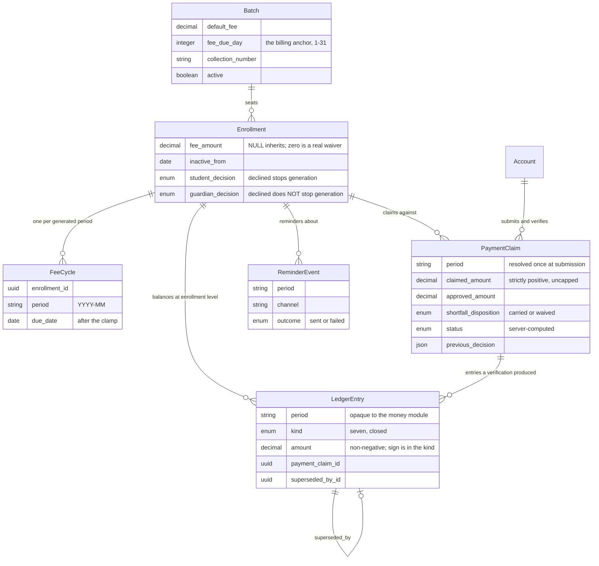

# Entities — D3 `collecting-fees`

**Stage**: functional-design (3.1)
**Phase**: Construction
**Unit**: D3 `collecting-fees`
**Record**: 261022-remaining-slices

> **D3 creates three tables and the arithmetic already exists.**
> `app/money/_ledger.py` holds `LedgerEntry` as a *value shape*, `derive()`,
> `carry_forward()` and `apply_credit()`, at 100% branch coverage with a
> property-based test on the invariant. **D3 does not restate or reimplement
> any of it.** What D3 adds is the half the money module deliberately refuses
> to hold: persistence, identity, supersession, the calendar, and the API.
>
> The split is stated in that module's own docstring — *"This module persists
> nothing. It owns no table, no row, no identifier and no supersession."* —
> and `LedgerEntry.period` is an opaque string there precisely because
> **period arithmetic is D3's** [BR2.1, BR2.2].

## Sources

- [upstream] `inception/units-generation/unit-of-work.md` — D3's scope
- [upstream] `inception/units-generation/unit-of-work-story-map.md` — US1.14
  belongs wholly to D3; US5.x and US6.x map here
- [upstream] `inception/requirements-analysis/requirements.md` — FR0.1, FR0.2
- [upstream] `inception/domain-design/components.md` — `Enrollment`'s decision
  columns, which D3 reads and never writes
- [prior] `261016-.../inception/domain-design/decisions.md` — **ADR-002**, the
  seven kinds, two-sided carry-forward, credit, and the corrected invariant
- [prior] `261016-.../inception/requirements-analysis/requirements.md` —
  FR5.1–FR5.9, FR6.1–FR6.13, FR7.2, FR9.1–FR9.3, FR10.3
- [prior] `261016-.../inception/user-stories/stories.md` — AC5.1.x–AC5.4.x,
  AC6.1.x–AC6.4.x
- [upstream] `inception/user-stories/stories.md` — AC1.14.1 through AC1.14.4
- [code] `app/money/_ledger.py`, `app/money/_kinds.py`, `app/db/models.py`,
  `app/schemas/batches.py`, read 2026-10-23

---

```yaml
entities:

  # ======================================================================
  # Created by this unit.
  # ======================================================================

  - name: FeeCycle
    description: >
      One enrollment's obligation for one period. Deliberately thin: it
      exists ONLY to carry the idempotency constraint and the period's
      identity [ADR-002]. It holds NO money column of any kind — not
      charged, not paid, not outstanding, not a status. Every one of those
      is derived from LedgerEntry rows. A money column here would be a
      second source of truth that drifts from the entries producing it.
    status: new
    owned_by_this_unit: true
    attributes:
      - name: id
        type: uuid
        required: true
        unique: true
      - name: enrollment_id
        type: uuid
        required: true
        references: Enrollment.id
        on_delete: cascade
      - name: period
        type: string
        required: true
        max_length: 7
        constraints:
          - 'Calendar month as `YYYY-MM`. Fixed width, sorts lexically in
            chronological order, and is the opaque key `LedgerEntry.period`
            carries into the money module.'
      - name: due_date
        type: date
        required: true
        description: >
          The computed due date for this period, after the short-month
          clamp [BR2.2]. Stored rather than recomputed so that a later
          change to the batch's anchor day does not retroactively move a
          due date a student has already been shown.
      - name: created_at
        type: timestamp
        required: true
    entity_constraints:
      - 'UNIQUE (enrollment_id, period). This is the whole idempotency
        mechanism [FR5.4, AC5.1.2]. Generation inserts with ON CONFLICT DO
        NOTHING and the conflict is the SUCCESS path, never an error
        [AC5.1.6, BR1.3]. An application-level "has this run?" guard is
        forbidden: it passes a sequential test and fails with two workers.'
      - 'No money column may be added to this table. Enforced as a rule
        [BR1.2] and by a test asserting the column set.'
    relationships:
      - 'Enrollment 1 — 0..* FeeCycle (one per period the seat generates)'
      - 'FeeCycle 1 — 0..* LedgerEntry (by (enrollment_id, period), not by a
        foreign key to the cycle row — see LedgerEntry.period)'

  - name: LedgerEntry
    description: >
      One append-only movement of money against an enrollment. The
      persisted counterpart of the value shape in `app/money/_ledger.py`,
      whose semantics this table implements and does not restate. Amounts
      are ALWAYS non-negative; the sign lives in the kind [BR4.1]. Rows are
      never updated and never deleted: a correction appends a compensating
      entry and marks the original superseded [BR6.1].
    status: new
    owned_by_this_unit: true
    attributes:
      - name: id
        type: uuid
        required: true
        unique: true
      - name: enrollment_id
        type: uuid
        required: true
        references: Enrollment.id
        on_delete: cascade
        description: >
          The ledger balances at the ENROLLMENT level, which is why credit
          belongs here and not to a cycle [ADR-002].
      - name: period
        type: string
        required: true
        max_length: 7
        description: >
          The period this entry sits in, as `YYYY-MM`. A plain column rather
          than a foreign key to FeeCycle.id, because a `carry_forward` lands
          on a period whose cycle row may not exist yet, and because this is
          the opaque key the money module folds on.
      - name: kind
        type: enum
        required: true
        allowed_values:
          - charge
          - receipt
          - carry_forward
          - carried_out
          - forgiveness
          - credit_grant
          - credit_apply
        constraints:
          - 'Exactly these seven, closed. An eighth kind is not a data
            change: it must be assigned a side of the balance identity, and
            the fold in `app/money/_kinds.py` is exhaustive so that adding
            one without extending the fold fails the type check.'
      - name: amount
        type: decimal
        required: true
        precision: 12
        scale: 2
        min: 0
        constraints:
          - 'NUMERIC(12,2), never a float, in storage, in transit or in
            memory. Crosses the API as a JSON string [FR5.7, TC-7, D-20].'
          - 'Non-negative. A negative amount would invert a term of the
            identity silently [BR4.1].'
      - name: payment_claim_id
        type: uuid
        required: false
        references: PaymentClaim.id
        description: >
          Set on the receipt, credit_grant, forgiveness and carry pair that
          a verification produced, so a guardian can be shown what happened
          to their specific payment [AC6.4.2].
      - name: superseded_by_id
        type: uuid
        required: false
        references: LedgerEntry.id
        description: >
          Set when a correction compensates this entry [BR6.1]. The derived
          balance folds every row INCLUDING superseded ones and their
          compensations, because a compensating pair sums to zero; this
          column drives what a teacher SEES, not what the balance IS.
      - name: created_by_account_id
        type: uuid
        required: false
        references: Account.id
        description: >
          Who caused this entry. NULL for entries the generation job
          created, which is the honest value: nobody did.
      - name: created_at
        type: timestamp
        required: true
    entity_constraints:
      - 'Append-only. No UPDATE and no DELETE on amount, kind, period or
        enrollment_id. Only `superseded_by_id` is ever written after insert.'
      - 'A carry is written as a PAIR in one transaction — a carried_out on
        the origin and a carry_forward of equal amount on the receiver — so
        sum(carry_forward) == sum(carried_out) holds structurally [BR3.1].'
    relationships:
      - 'Enrollment 1 — 0..* LedgerEntry'
      - 'PaymentClaim 1 — 0..* LedgerEntry (the entries one verification
        produced)'
      - 'LedgerEntry 0..1 — 0..1 LedgerEntry (superseded_by)'

  - name: PaymentClaim
    description: >
      An assertion by a student or guardian that they paid out of band, and
      the teacher's verification of it. There is no payment gateway: the
      system records the claim and the decision only [FR6.10]. A claim is an
      ASSERTION and a charge is the OBLIGATION — which is why a shortfall is
      measured against the charge and never against the claim [BR5.3].
    status: new
    owned_by_this_unit: true
    attributes:
      - name: id
        type: uuid
        required: true
        unique: true
      - name: enrollment_id
        type: uuid
        required: true
        references: Enrollment.id
        on_delete: cascade
      - name: period
        type: string
        required: true
        max_length: 7
        description: >
          The period the claim resolved to at submission — the oldest
          unpaid cycle [BR5.1]. Resolved once and stored, not recomputed,
          so the claimant and the teacher are looking at the same cycle.
      - name: claimed_amount
        type: decimal
        required: true
        precision: 12
        scale: 2
        min: 0.01
        constraints:
          - 'Strictly positive. Zero and negative are refused before the
            claim is recorded [AC6.1.6, BR5.2].'
          - 'NOT capped at the outstanding balance. Over-claiming is
            accepted because money may genuinely have been overpaid out of
            band; the teacher decides at verification [AC6.1.7].'
      - name: channel
        type: string
        required: true
        max_length: 32
        description: >
          Which service the money moved through. SERVER-supplied data, not
          a client-side list, so adding one is a data change rather than an
          app release [FR6.11]. V1 values: bKash, Nagad, Rocket, cash.
      - name: transaction_id
        type: string
        required: false
        max_length: 64
        description: >
          The reference the claimant quotes. **Nullable regardless of OQ-1's
          answer**, which is what makes this schema answer-agnostic: if the
          human later decides it does not survive the claimant's deletion,
          D6 nulls it in place rather than migrating the table.
      - name: submitted_by_account_id
        type: uuid
        required: true
        references: Account.id
      - name: submitted_at
        type: timestamp
        required: true
      - name: status
        type: enum
        required: true
        allowed_values: [pending, approved_full, approved_partial, rejected]
        default: pending
        description: >
          What the claimant is shown [AC6.4.1]. Server-computed at
          verification, never client-derived [BR7.3].
      - name: approved_amount
        type: decimal
        required: false
        precision: 12
        scale: 2
        min: 0
        description: >
          What the teacher actually accepted. NULL while pending.
      - name: shortfall_disposition
        type: enum
        required: false
        allowed_values: [carried, waived]
        description: >
          The teacher's choice on approving less than was CHARGED [FR6.8,
          AC6.3.3]. NULL when there is no shortfall, and required when there
          is [BR5.4].
      - name: verified_by_account_id
        type: uuid
        required: false
        references: Account.id
        description: Who approved or rejected it [FR6.7, AC6.3.5].
      - name: verified_at
        type: timestamp
        required: false
      - name: previous_decision
        type: json
        required: false
        description: >
          The prior verification, retained when a teacher corrects one, and
          visible to the teacher AND to that student and guardian — never
          hidden from either party [FR9.2, FR9.3, AC6.3.6, AC6.4.3].
    entity_constraints:
      - 'A claim resolves to exactly one (enrollment_id, period) at
        submission and that resolution is never recomputed [BR5.1].'
      - 'status, approved_amount, shortfall_disposition and verified_* move
        together in one transaction with the ledger entries the
        verification produces [BR5.5].'
    relationships:
      - 'Enrollment 1 — 0..* PaymentClaim'
      - 'Account 1 — 0..* PaymentClaim (as submitter, and as verifier)'
      - 'PaymentClaim 1 — 0..* LedgerEntry'

  - name: ReminderEvent
    description: >
      One fee reminder, recorded as an EVENT and not as a flag [FR10.3]. The
      teacher-facing "reminded 3 days ago" / "Never reminded" state is
      derived as the latest event per (enrollment, period). A boolean or a
      `last_reminded_at` column cannot express channel, a failed send, or a
      second reminder.
    status: new
    owned_by_this_unit: true
    attributes:
      - name: id
        type: uuid
        required: true
        unique: true
      - name: enrollment_id
        type: uuid
        required: true
        references: Enrollment.id
        on_delete: cascade
      - name: period
        type: string
        required: true
        max_length: 7
      - name: channel
        type: string
        required: true
        max_length: 32
        description: 'V1 ships `push` only; the column exists so a second
          channel is data rather than a migration.'
      - name: sent_at
        type: timestamp
        required: true
      - name: sent_by_account_id
        type: uuid
        required: true
        references: Account.id
      - name: outcome
        type: enum
        required: true
        allowed_values: [sent, failed]
        description: >
          A failed send is RECORDED, not swallowed. Delivery is best-effort
          and never fails the operation that triggered it [FR10.2, BR7.5] —
          but "best-effort" means the failure is logged and visible, not
          that it is invisible.
    relationships:
      - 'Enrollment 1 — 0..* ReminderEvent'

  # ======================================================================
  # Read by this unit, created elsewhere. Stated because D3's behaviour
  # depends on what these columns MEAN, which cannot be read from a diff.
  # ======================================================================

  - name: Enrollment
    description: >
      A student's seat in a batch. D3 READS it and never writes it. Four of
      its columns decide whether and what D3 generates.
    status: exists
    owned_by_this_unit: false
    changed_by_this_unit: false
    attributes:
      - name: id
        type: uuid
        required: true
        unique: true
      - name: batch_id
        type: uuid
        required: true
        references: Batch.id
      - name: fee_amount
        type: decimal
        required: false
        precision: 12
        scale: 2
        description: >
          This seat's fee, or NULL to inherit `Batch.default_fee`. **Zero is
          a real fee of zero**, which is a permanent waiver and not a
          missing value — so the inheritance test is NULL, never falsiness
          [BR2.4].
      - name: inactive_from
        type: date
        required: false
        description: >
          The date after which no cycle generates. The period CONTAINING
          this date always generates in full; only periods beginning
          strictly after it do not [FR5.3, FR5.6, BR1.5].
      - name: student_decision
        type: enum
        required: true
        allowed_values: [pending, accepted, declined]
        description: >
          D1 owns the transition. D3 owns its money consequence: a `declined`
          student link stops generation [AC1.14.1, BR1.6].
      - name: guardian_decision
        type: enum
        required: true
        allowed_values: [pending, accepted, declined]
        description: >
          A `declined` guardian link does NOT stop generation. The student
          owes the fee; a guardian's refusal to oversee the enrollment does
          not cancel the student's obligation [AC1.14.1a, BR1.7].

  - name: Batch
    description: >
      The teacher's class, carrying the fee defaults enrollments inherit.
      D3 reads it and never writes it.
    status: exists
    owned_by_this_unit: false
    changed_by_this_unit: false
    attributes:
      - name: default_fee
        type: decimal
        required: false
        precision: 12
        scale: 2
        description: The fee an enrollment inherits when it sets none.
      - name: fee_due_day
        type: integer
        required: false
        min: 1
        max: 31
        description: >
          **The billing anchor day**, set by the teacher at batch creation
          [FR2.1] and already built — validated `ge=1, le=31` in
          `app/schemas/batches.py` and present in the committed schema. Days
          29–31 clamp at generation [FR5.2]; the clamp does NOT degrade the
          stored anchor [BR2.2]. NULL means the teacher set none, and the
          fallback is specified rather than left to the implementer [BR2.3].
      - name: collection_number
        type: string
        required: false
        description: >
          Where payments are sent. The one teacher-authored field
          deliberately exposed to students and guardians, because the
          payment flow cannot work without it [FR6.12, FR6.13]. Optional:
          where unset, the payment form omits the destination step [BR5.6].
      - name: active
        type: boolean
        required: true
        description: False collapses the batch to read-only history.
```

---

## The entity set, in prose

**Four tables are created and the arithmetic is not.** That sentence is the
whole shape of this unit. `app/money/_ledger.py` already folds a sequence of
entries into every derived quantity, caps a credit application at
`min(available, owed)`, and refuses a carry larger than the origin owes. It is
at 100% branch coverage with a property-based test on the invariant. D3 writes
rows, reads them back, and hands them to that fold.

**`FeeCycle` is thin on purpose and the discipline is load-bearing.** It
carries an id, an enrollment, a period, a due date and a timestamp — and
nothing that is money. Every balance is a query. ADR-002 names the cost
(a fold rather than a column read) and the mitigation if it ever bites
(a materialized rollup, which append-only makes safe). What the thinness buys
is that a sixth quantity becomes a new `kind` value rather than a migration —
and this model is already on its second revision, so that is not hypothetical.

**`LedgerEntry.period` is a plain string, not a foreign key to `FeeCycle.id`,**
and the reason is a real case rather than a preference: a `carry_forward` lands
on the receiving period, and at the moment a teacher approves a short payment
in January the February cycle row does not exist yet. Keying the entry to a
cycle row would force generation to run before a carry could be written, which
inverts the dependency. It is also the shape the money module already expects —
`period` is opaque there, with no calendar knowledge at all.

**The three money-shaped tables all cascade from `Enrollment`.** That is D6's
problem to state a disposition for, and D3's obligation is the standing one:
a governance row per new table, verified by the schema-iterating test, which
fails on a live table with no disposition and retention class.

### A fifth table: `job_heartbeat`

**D3 creates five tables, not four, and this one is easy to miss because it
arrived from a different stage.** `FeeCycle`, `LedgerEntry`, `PaymentClaim`
and `ReminderEvent` are specified above. `job_heartbeat` is specified in
`nfr-design/observability-design.md` § 1.1 as the mechanism behind the
absence-of-success alert [NFR25.9]: one row per job name, upserted by the job
itself after its last enrollment-period commits, holding `last_success_at`
and the three per-run counts.

It is a table rather than a file or a counter in a worker **because the
instance is replaced on every deploy** — the exact event the alert exists to
survive.

**It needs a disposition and a retention class like any other live table.**
`tests/db/test_governance.py` iterates `pg_tables` and asserts both, in both
directions, so a fifth table with neither is a red `make check` rather than a
documentation gap. Its content makes both easy and neither is a judgement
call of the kind `ledger_entry`'s is:

| field | value | why |
|---|---|---|
| Disposition | hard delete | Operational telemetry about a job. It names no person, holds no identifier, and references no enrollment |
| Retention | bounded, small | One row per job name forever. It does not grow with users, students or time |

**It is deliberately out of the privacy boundary**, which is why this is a
footnote rather than a decision: it is the only D3 table that is not
enrollment-scoped and carries nothing a person wrote.

**`PaymentClaim` holds both the claim and its verification** rather than
splitting them across two tables. One claim has at most one verification, the
verification is a decision about that claim, and FR9.2 requires the previous
decision to be retained and visible — which is a column on the thing corrected,
not a second row. `previous_decision` is `json` because it holds a *decision*
(amount, disposition, actor, timestamp) and not a scalar.

**`transaction_id` is nullable regardless of how OQ-1 is answered.** This is
the one place where an unresolved open question touches the schema, and
nullability is the answer-agnostic choice: if the human decides the reference
does not survive the claimant's deletion, D6 nulls it in place. The question
still needs answering — see `functional-spec.md` — but it does not block D3.

## Entity-relationship view

The diagram is a **derived view**. The YAML block above is the source of truth.



**Text fallback.** A `Batch` holds many `Enrollment` seats. Each `Enrollment`
has many `FeeCycle` rows (one per generated period), many `LedgerEntry` rows
(the ledger balances at enrollment level, which is why credit lives here), many
`PaymentClaim` rows and many `ReminderEvent` rows. A `PaymentClaim` produces
the `LedgerEntry` rows its verification wrote. A `LedgerEntry` may be
superseded by exactly one other. An `Account` both submits and verifies claims.

## Assumptions & Open Questions

- **`Batch.fee_due_day` is the billing anchor, and this is upstream fact rather
  than an assumption.** FR2.1 has the teacher setting a fee due day at batch
  creation; FR5.2 has periods clamped to the last day of months that lack it;
  the column exists, is validated 1–31, and is in the committed schema. What
  was genuinely unspecified is only the clamp's *persistence* semantics, which
  BR2.2 now settles.
- **Assumption, and the human should confirm it: a NULL `fee_due_day` means the
  last day of the period** [BR2.3]. The column is nullable and no upstream rule
  says what a null means. The alternative defaults — day 1, or refusing to
  generate — are both defensible. Last-day is chosen because it is the only one
  that cannot make a fee due before the month it pays for has been taught, and
  because it degrades to the same behaviour as an anchor of 31. **This changes
  when teachers who set no due day get paid**, so it is flagged rather than
  quietly defaulted.
- **OQ-1 is open and is the human's**: does `PaymentClaim.transaction_id`
  survive the claimant's account deletion? D3 ships it nullable, which is
  answer-agnostic. The delivery plan wants it closed before D6 and ideally
  before D3 so this schema is not revisited.
- **OQ-4 is posed in one document and decided in another, and the adapter is
  shared with D4.** It is **asked** at
  `261016-shikhokplus-tuition-app/inception/contract-design/contract-summary.md`
  § G, where the owning Unit is left "latent — U6 or U7, whichever is built
  first", a Delivery Planning sequencing decision deliberately left open
  because the dependency artifact declined a `U6 -> U7` edge rather than lose
  a parallel set. It is **answered** by this record's
  `inception/units-generation/unit-of-work.md:134`, whose D3 scope line reads
  "Owns the FCM adapter per OQ-4". U7 `fee-cycles-and-ledger` is D3's
  ancestor; U6 `exams-and-marksheets` maps forward to **D4
  `teaching-and-recording`** — so D3 owns the adapter and **D4 consumes the
  same one rather than building its own**. The failure OQ-4 names is two
  adapters with two different `UNREGISTERED` behaviours. `ReminderEvent` is
  designed from FR10.1–FR10.4, which remain the behavioural source.
