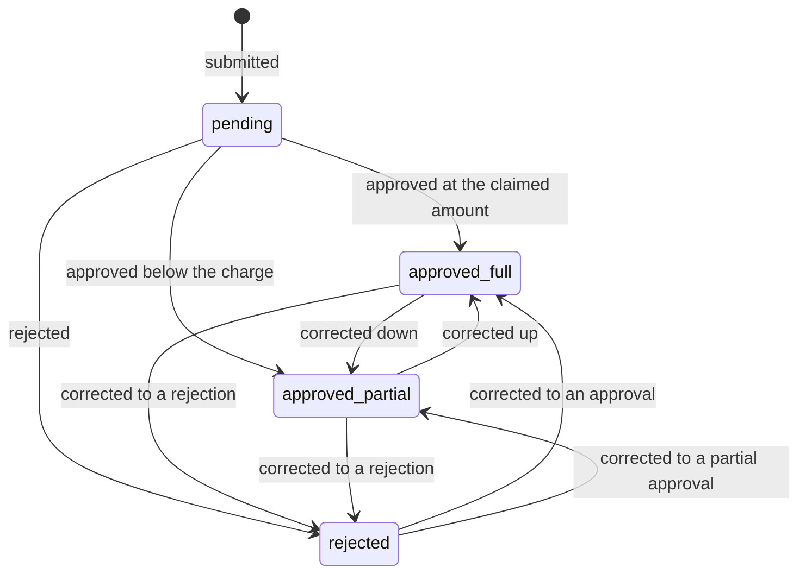
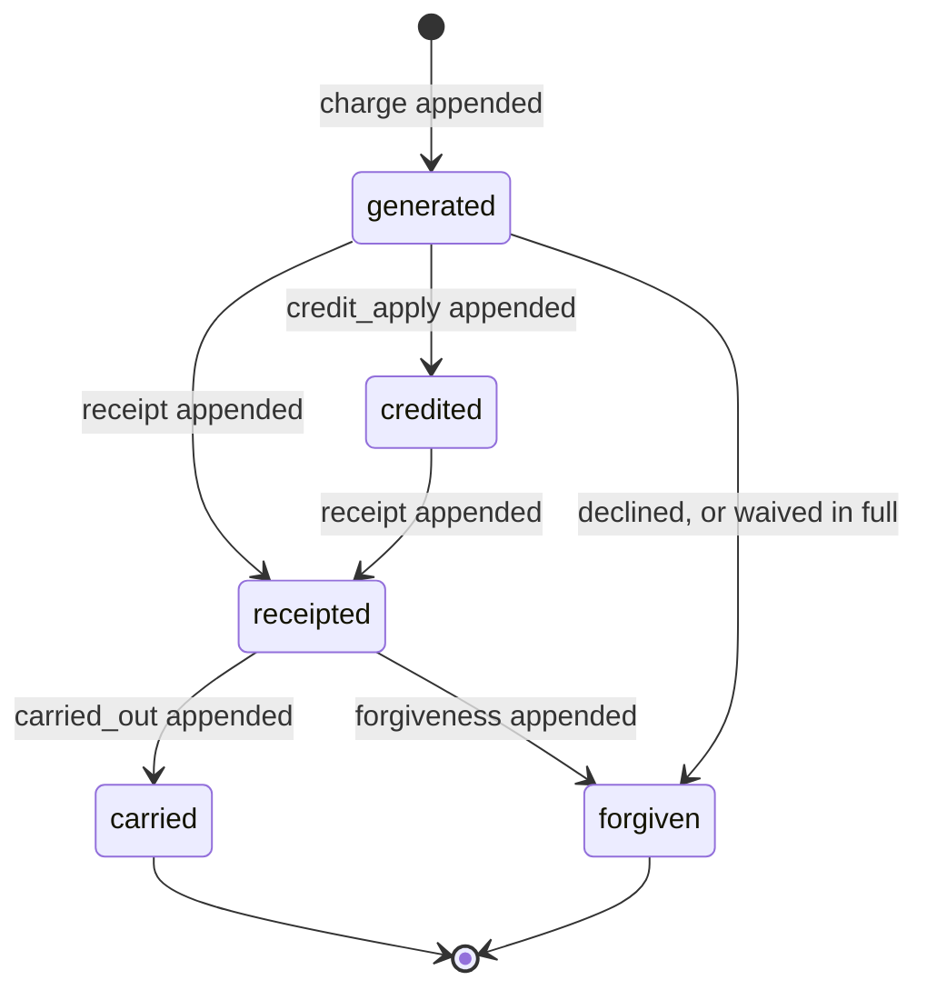

# Functional Specification — D3 `collecting-fees`

**Stage**: functional-design (3.1)
**Phase**: Construction
**Unit**: D3 `collecting-fees`
**Record**: 261022-remaining-slices

> **This file is the source of truth for workflows and state machines.**
> `entities.md` holds the data shape and `rules.md` holds the decision logic;
> neither captures ordered behaviour or a lifecycle transition. The
> entity-relationship diagram in `entities.md` and the rules summary in
> `rules.md` are derived views of their own YAML blocks.
>
> **Every money figure below is computed output.** The fold in
> `app/money/_ledger.py` was re-implemented in a scratch script and each case
> run against the corrected invariant from ADR-002. No figure here is
> asserted from reading. Team memory records why that distinction is not
> pedantry: a carry-forward example with a wrong number reached four files
> before anyone computed it.

## Sources

- [upstream] `inception/units-generation/unit-of-work.md` — D3's scope and
  Definition of Done
- [upstream] `inception/units-generation/unit-of-work-story-map.md` — US1.14
  wholly D3; US5.x and US6.x map here
- [upstream] `inception/user-stories/stories.md` — AC1.14.1 through AC1.14.4
- [prior] `261016-.../inception/user-stories/stories.md` — AC5.1.x–AC5.4.x,
  AC6.1.x–AC6.4.x
- [prior] `261016-.../inception/requirements-analysis/requirements.md` —
  FR5.x, FR6.x, FR7.2, FR9.x, FR10.x
- [prior] `261016-.../inception/domain-design/decisions.md` — ADR-002
- [code] `app/money/_ledger.py`, `app/money/_kinds.py`, `app/db/models.py`,
  `app/schemas/batches.py`, `app/errors/_classes.py`,
  `tests/auth/test_ceilings.py`,
  `android/.../core/format/Numerals.kt`, read 2026-10-23

---

## 1. What this unit is, and what it is not

**The arithmetic is built. D3 builds everything around it.**

`app/money/_ledger.py` already holds `LedgerEntry` as a value shape,
`derive()`, `carry_forward()` and `apply_credit()`, at 100% branch coverage
with a property-based test on the invariant. Its docstring states the boundary
it keeps: *"This module persists nothing. It owns no table, no row, no
identifier and no supersession."*

D3 supplies exactly that missing half:

| The money module holds | D3 holds |
|---|---|
| The fold from entries to balances | The tables the entries live in |
| `min(available, owed)` for credit | When credit is granted and applied |
| The carry as an inseparable pair | The transaction that commits the pair |
| `period` as an opaque string | The calendar: months, anchors, the clamp |
| Refusal of a negative amount | The API, the lenses, the status enum |

**D3 does not restate the arithmetic and does not reimplement it.** Where a
rule in `rules.md` looks like a restatement — BR3.1, BR3.2, BR3.4 — it is
constraining the *persisted rows* rather than the fold, because a row inserted
by a migration or a repair script never passes through the value type.

## 2. The ledger model, in the form a developer needs it

### 2.1 Seven kinds, closed

`charge · receipt · carry_forward · carried_out · forgiveness · credit_grant ·
credit_apply`. **Amounts are always non-negative; the sign lives in the kind**
[BR3.4]. An eighth kind is not a data change: it must be assigned a side of the
balance identity, and the fold is exhaustive so adding one without extending it
fails the type check.

### 2.2 The invariant in force

This is the **corrected** form from ADR-002, not the superseded
`charged − received − forgiven == outstanding` still recorded in team memory.
The superseded form omits carry-forward and predates credit; it fails on its
first carry-forward.

```
per cycle:       outstanding == max(0, charged + carried_in
                                       − received − forgiven
                                       − credit_applied − carried_out)
                 outstanding >= 0

per enrollment:  total_charged − total_forgiven − total_cash_in
                   == total_outstanding − available_credit

                 where total_cash_in    = total_receipt + total_credit_grant
                       available_credit = total_credit_grant − total_credit_apply
                       available_credit >= 0
                       sum(carry_forward) == sum(carried_out)
```

In English: *every taka charged and not forgiven is either still owed or has
been received — and anything received beyond what was owed is held as credit.*

Two things about this form are worth a developer's attention, because a first
correction attempt got each wrong and ADR-002 records why:

- **Cash in is `receipt + credit_grant`, not `receipt`.** A `receipt` records
  only the *applied* part of a payment, so without the grant term the money
  that physically arrived as credit never reaches the received side.
- **The per-cycle form carries a `credit_applied` term.** Without it, a 1000
  charge with 200 credit applied computes 1000 outstanding rather than
  **800.00**.

### 2.3 Worked cases — computed, every one

Each row below was produced by running the fold. The invariant's two sides are
shown because the overpayment cases are exactly where a wrong form stays
plausible.

| Case | Entries | Outstanding | Credit | LHS = RHS |
|---|---|---|---|---|
| Plain | charge 1000 | 1000.00 | 0.00 | 1000 = 1000 |
| Partial payment | charge 1000, receipt 300 | 700.00 | 0.00 | 700 = 700 |
| Partial waiver | charge 1000, forgiveness 400 | 600.00 | 0.00 | 600 = 600 |
| Full waiver | charge 1000, forgiveness 1000 | 0.00 | 0.00 | 0 = 0 |
| Carry-forward, two-sided | charge 1000 (Jan), carried_out 1000 (Jan), carry_forward 1000 (Feb), charge 1000 (Feb) | **2000.00** | 0.00 | 2000 = 2000 |
| The same, one-sided *(the bug)* | charge 1000 (Jan), carry_forward 1000 (Feb), charge 1000 (Feb) | **3000.00** | — | — |
| Partial approval, carried | charge 1000, receipt 600, carried_out 400 (Jan), carry_forward 400 (Feb) | 400.00 | 0.00 | 400 = 400 |
| Partial approval, waived | charge 1000, receipt 600, forgiveness 400 | 0.00 | 0.00 | 0 = 0 |
| Over-approval | charge 1000, receipt 1000, credit_grant 200 | 0.00 | 200.00 | −200 = −200 |
| Credit applied | the above, then charge 1000, credit_apply 200 | **800.00** | 0.00 | 800 = 800 |
| Credit exceeding charge | credit_grant 1500 held, charge 1000, credit_apply 1000 | 0.00 | 500.00 | −500 = −500 |
| Decline reversal | charge 1000, forgiveness 1000 | 0.00 | 0.00 | 0 = 0 |
| Multi-period carry | Jan 1000 → Feb; Feb 1000 + 1000 carried → Mar; Mar 1000 | 3000.00 | 0.00 | 3000 = 3000 |

**The carry-forward row is the one team memory warns about.** Two-sided gives
2000 and one-sided gives 3000. An earlier form of that rule paired 2500 against
a true 1500, which reproduces under no implementation — the pair mixed two
cases and made the rule's own example unfalsifiable.

**The credit-applied row is the one ADR-002's first correction attempt got
wrong**, computing 1000 where the answer is 800.

### 2.4 Why `FeeCycle` is thin

It carries id, enrollment, period, due date and a timestamp. **No money column
of any kind** [BR1.2] — not charged, not paid, not outstanding, not status.
Every balance is a query.

The cost is a fold rather than a column read; ADR-002 names the mitigation if
it ever bites (a materialized rollup, which append-only makes safe). What the
thinness buys is that a sixth quantity becomes a new `kind` rather than a
migration — and this model is already on its second revision.

## 3. Workflow: monthly fee-cycle generation

The most consequential workflow in the product, and the one with no user
watching it run.

### 3.1 Steps

1. **The job wakes daily.** Not monthly: a missed day must self-heal [BR1.4,
   FR5.5]. Running it any number of times on any number of days is safe.
2. **Select candidate enrollments.** Every enrollment on an active batch whose
   student link is not `declined` [BR1.6, BR1.9]. A `declined` guardian link is
   explicitly *not* a filter [BR1.7].
3. **For each enrollment, determine the periods to consider** — from its first
   generating period through the current one. This is what makes a missed day
   heal rather than leave a permanent hole.
4. **For each period, apply the `inactive_from` test** [BR1.5]: generate when
   `inactive_from` is unset, or when it falls on or after the period's first
   day. The period *containing* the date always generates **in full** — never
   prorated [FR5.6].
5. **Resolve the fee** [BR2.4]: `Enrollment.fee_amount` when it is **not
   NULL**, otherwise `Batch.default_fee`. Zero is a real fee.
6. **Compute the due date** [BR2.2, BR2.3]: day `min(anchor, days_in_month)`,
   where the anchor is `Batch.fee_due_day`, or the last day when that is NULL.
   **The stored anchor is not rewritten.**
7. **Insert the cycle with `ON CONFLICT DO NOTHING`** [BR1.3]. A conflict is
   the **success path** — generation continues without raising [AC5.1.6].
8. **If and only if the insert created a row**, append the `charge` entry. This
   ordering is what prevents a double charge: the row's creation is the
   idempotency token, and the conflict path appends nothing.
9. **Apply available credit, in the same transaction** [BR4.3, BR4.5]: append
   `credit_apply` of `min(available_credit, owed)` — **after** the charge, or
   the computation is `min(available, 0)` and applies nothing.
10. **Commit per enrollment-period**, so one bad row cannot abort the run.

### 3.2 The idempotency mechanism, and why it is not application code

The guarantee is the database unique constraint on `(enrollment_id, period)`
with `ON CONFLICT DO NOTHING`. An application-level "has this already run?"
guard **passes a sequential test and fails with two workers**, which Phase 1
has.

**This shape has a built precedent in this repository and D3 should follow it
rather than invent a second one.** `RateLimitCounter`'s `UniqueConstraint` in
`app/db/models.py` carries the reasoning already:

> The unique constraint is what makes the atomic upsert-and-increment possible:
> two workers racing on the same window cannot both read a stale count, because
> the second one conflicts and updates instead.

D3 is the same shape with `DO NOTHING` in place of `DO UPDATE`.

### 3.3 How this is tested — and the test that would not count

Two obligations, and the second is **not** covered by the first.

**Concurrency** [AC5.1.2]. N real threads against real PostgreSQL, released
together from a barrier so they contend on the same `(enrollment_id, period)`
at the same moment. The assertion is the **outcome**: exactly one cycle row
exists and the ledger's charged total equals one period's charge.

The pattern exists and is good: `tests/auth/test_ceilings.py` →
`test_genuinely_concurrent_requests_never_exceed_the_limit`. That file also
carries the warning this obligation most needs, beside a test that was renamed
after being found to run two checkers one after another:

> A test whose NAME claims a property it does not exercise is worse than no
> test, because the next reader believes the property is covered.

A sequential two-run test here would pass against an implementation with no
atomicity at all — the exact implementation the constraint exists to prevent.

**Across days** [AC5.1.3], which concurrency alone does not reach. Run the job
for day N, then day N+1, then day N+1 again; assert the row set and the ledger
total are identical after the second and third runs.

> **This obligation has been deferred since the practices were written and D3
> is where it lands.** Team memory records it as "lands in D3 and has not been
> exercised yet, because fee cycles are not built."

### 3.4 Boundary cases, computed

Due dates, anchor **31**, non-degrading [BR2.2]:

| Period | Days in month | Due date |
|---|---|---|
| 2027-01 | 31 | 2027-01-31 |
| 2027-02 | 28 | 2027-02-28 |
| 2027-03 | 31 | **2027-03-31** |
| 2028-02 | 29 (leap) | 2028-02-29 |

The third row is the one that separates the designs: a **degrading** clamp
gives 2027-03-28 and every month after, for ever.

`inactive_from` boundaries [BR1.5]:

| `inactive_from` | 2027-02 generates? | 2027-03 generates? |
|---|---|---|
| 2027-02-01 | yes | no |
| 2027-02-15 | yes | no |
| 2027-02-28 | yes | no |
| 2027-01-31 | no | no |

## 4. Workflow: a decline reaches the money

D1 set the decision; **D3 is where that decision first touches money**. US1.14
is inherited in full [AC1.14.1 through AC1.14.4].

### 4.1 A student link declines

1. Generation stops for that seat from this point [BR1.6, AC1.14.1].
2. For each existing cycle with an outstanding balance, append a `forgiveness`
   entry for that balance [AC1.14.2]. **Recorded as a reversal, never by
   deleting rows** — the ledger is append-only and the original `charge` row
   stays.
3. Computed: a seat with a 1000 charge reports outstanding **0.00** afterwards,
   with the identity balanced at 0 = 0, and the `charge` row still present.

`forgiveness` is the right kind rather than an eighth: it is the term the
identity already carries for an obligation relieved without cash, and ADR-002
is explicit that a new `kind` is for a quantity no existing one expresses.

### 4.2 A guardian link declines

**Nothing happens to the money** [BR1.7, AC1.14.1a]. Generation continues, no
reversal is written, the student's obligation stands in full. Only the
guardian's own lens is withdrawn.

> **This asymmetry has already produced one defect in this project, on the
> presentation side.** A decline confirmation reading "the fee stops" was shown
> to guardians as well as students — telling a guardian a debt was cancelled
> when it was not. The rule is role-dependent, and **every surface that renders
> it must be checked against both roles**, not only the one it was written for.

### 4.3 Un-declining

Generation resumes from the acceptance date. The voided cycles are **not**
resurrected and the `forgiveness` entries are not reversed [BR1.8, AC1.14.3].
Accepting a seat must not retroactively re-bill months the person was not
participating in.

### 4.4 A pending seat

Generates [BR1.9, AC1.14.4]. Pending is the normal state of a new seat.

## 5. Workflow: payment claim and verification

### 5.1 Submission — identical for student and guardian

The form and its behaviour are identical for both [AC6.2.1]; only the lens
differs.

1. **Select a batch.** Each option shows the child's name alongside the batch
   name [AC6.1.2]. For a guardian with children in several batches this is the
   difference between paying for the right child and the wrong one.
2. **The destination step** shows the batch's collection number, bounded to
   enrolled viewers [BR6.4]. Where it is unset, the step is **omitted** and the
   person is told to ask the teacher how to pay [FR6.12].
3. **Choose a channel** from the **server-supplied** set [BR6.5] — bKash,
   Nagad, Rocket, cash in V1. No hardcoded client list: an installed Android
   app cannot be forced to update.
4. **Enter a transaction reference and an amount.**
5. **Validate the amount** [BR5.2]: zero or negative is refused before the
   claim is recorded [AC6.1.6]. An amount **exceeding** the balance is
   **accepted** [AC6.1.7] — money may genuinely have been overpaid out of band,
   and the teacher decides at verification.
6. **Resolve the cycle** [BR5.1]: the **oldest** unpaid cycle. Where none is
   open, the submission is **refused with a stated reason** and no cycle is
   created to receive it [AC6.1.5]. The resolution is stored, not recomputed.
7. **Confirm, naming both the child and the batch**, before recording
   [AC6.1.3].
8. The claim is recorded as `pending`.

### 5.2 Verification

The teacher sees pending claims per batch [AC6.3.1]. For each:

- **Approve in full** — the claimed amount is recorded as received [AC6.3.2].
- **Approve a lesser amount** — see 5.3.
- **Approve more than was charged** — the excess becomes credit [BR4.2].
- **Reject** — nothing is recorded as received, and the submitter sees the
  rejection [BR5.6, AC6.3.4].

Every verification records **who** and **when** [BR5.5, AC6.3.5], and the claim
decision and its ledger entries commit in **one transaction**.

### 5.3 Partial approval — the calculation that is easiest to get wrong

**The shortfall is `charged − approved`, never `claimed − approved`** [BR5.3,
AC6.3.3].

The separating case, computed: a cycle **charged 1000**, a claim of **1500**,
approved at **600**.

| Formula | Shortfall |
|---|---|
| `charged − approved` (correct) | **400.00** |
| `claimed − approved` (wrong) | 900.00 |

A test using a claim equal to the charge cannot tell these apart, which is why
the named boundary case uses one where they differ. A claim is an *assertion*;
a charge is the *obligation*.

The teacher then chooses, and the choice is **required** [BR5.4, FR6.8]:

| Disposition | Entries | Origin period | Next period |
|---|---|---|---|
| **Carried** | receipt 600, carried_out 400 (Jan), carry_forward 400 (Feb) | 0.00 | **400.00** |
| **Waived** | receipt 600, forgiveness 400 | 0.00 | nothing carried |

Both computed. A default would silently choose for the teacher, and the two
have opposite consequences for the student.

### 5.4 Over-approval becomes credit

1. Append a `receipt` for what the cycle owed.
2. Append a `credit_grant` for the remainder [BR4.2, AC6.3.7].

Computed: a 1000 charge approved at 1200 gives outstanding **0.00** and credit
**200.00**, with the invariant at −200 on both sides. **Outstanding never goes
below zero.**

At the next generation the credit is applied automatically [BR4.3, AC6.3.8]:
`min(available, owed)`. Computed: 200.00 credit against a 1000.00 charge leaves
**800.00** outstanding — the figure ADR-002's first correction attempt computed
as 1000.

Credit exceeding the charge: 1500.00 held against a 1000.00 charge applies
1000.00 and leaves **500.00** available.

### 5.5 Correction

A teacher who approved wrongly corrects it [AC6.3.6]. The previous decision is
retained with its actor and timestamp, compensating entries are appended
[BR3.3], and the correction is visible to the teacher **and** to that student
and guardian [BR5.7, FR9.2] — never hidden from either party.

## 6. State machines

### 6.1 `PaymentClaim.status`



**Text fallback.** A claim is born `pending`. A verification moves it to
`approved_full`, `approved_partial` or `rejected`. Any of those three may move
to either of the others through a correction, which retains the prior decision
[BR5.7]. There is no terminal state, because FR9.2 makes every verification
correctable; `pending` is never re-entered, since a claim once decided has a
decision on record.

### 6.2 The derived fee status

**Not a stored column — a server computation over the ledger** [BR6.1].

| Status | Condition |
|---|---|
| `waived` | the cycle's charges were relieved entirely by `forgiveness` |
| `paid` | outstanding is zero and relief included cash or credit |
| `partly_paid` | outstanding is above zero and some relief was recorded |
| `unpaid` | outstanding is above zero and nothing has been recorded against it |

**The client never derives this.** `if (balance > 0) "Due" else "Paid"` is a
business rule about what counts as due wearing presentation's clothes, and it
diverges the first time a waiver is involved: a fully waived cycle has a zero
balance and is **not** "Paid". The team practice names this as one of the two
places the layer boundary will be tested hardest.

### 6.3 Cycle generation state

A cycle has no status column and therefore no lifecycle of its own. What
changes is the **ledger around it**. The transitions worth naming:



**Text fallback.** A cycle begins when its `charge` is appended. Credit may be
applied immediately at generation. Receipts relieve it. Any residue is either
carried out to a later period or forgiven. A decline forgives the whole
outstanding balance [BR1.6]. These are descriptions of the entries present, not
values stored anywhere.

## 7. Read paths and what each lens sees

| Viewer | Sees | Never sees |
|---|---|---|
| **Teacher** | Every cycle on their own batches, each with its server-computed status, the derived outstanding, the reminded state, and pending claims per batch | Anything a student or guardian authored privately |
| **Student** | Their own cycles — current amount and status, and every past period's status and amount [AC5.3.1, AC5.3.2] — and their own payment history with each claim's outcome | Any other enrollment's fees |
| **Guardian** | Their child's next due date and amount [AC5.4.1], every past cycle's status [AC5.4.2], and what happened to payments [AC6.4.1] | A non-child's enrollment |

Every endpoint names its lens as a dependency whose return annotation is a
`Lens` subtype; the route-enumeration test already asserts this for every
route, and D3's new routes fall under it with no new mechanism.

**The IDOR probes this unit owes**, per the affirmed adversarial posture:
teacher A requesting teacher B's batch fees; a guardian requesting a non-child's
enrollment; **a student requesting a fee cycle not their own** — the third is
named explicitly in the team practice and lands here for the first time,
because fee cycles did not exist before.

## 8. Error behaviour

D3 is the first unit with declared error responses, which closes a known
stopgap: `app/main.py` injects `ErrorEnvelope` into the generated schema
explicitly because FastAPI emits a component only when a route references one.
**D3's declared responses turn that stopgap into a no-op rather than a lie**,
as its own comment anticipates. A ZAP pass driven from the schema can then know
which error shapes to expect.

| Condition | Class | Retryable | Notes |
|---|---|---|---|
| Cycle already exists for `(enrollment, period)` | *not an error* | — | The **success path** [BR1.3, AC5.1.6] |
| Claimed amount zero or negative | `ValidationError` | no | Refused before recording [BR5.2] |
| No open cycle for a claim | `ValidationError` | no | Stated reason; no cycle is created [BR5.1] |
| Shortfall with no disposition | `ValidationError` | no | The teacher must choose [BR5.4] |
| Carry exceeding the origin's balance | `ValidationError` | no | Manufactured debt [BR3.2] |
| Negative ledger amount | `ValidationError` | no | The sign is in the kind [BR3.4] |
| Claim verified by a non-owning teacher | `AuthorizationError` | no | Lens check |
| Claim already verified, re-verified concurrently | `ConflictError` | no | Correction is a distinct path [BR5.7] |
| Serialization failure in generation | `TransientError` | yes | Bounded transaction retry |
| Database connection failure | `TransientError` | yes | Fail fast |
| Push notification failure | *not surfaced* | — | Recorded as a `failed` event [BR7.2] |

Retryability is a property of the error class, not a judgement at the call
site. Every envelope carries `code`, the server-provided `retryable` boolean,
and `message_key` rather than `message` — a server-sent English string cannot
be localized in a Bangla-first UI.

## 9. Notifications

Best-effort, dispatched **after commit**, and failure is **logged and not
surfaced** [BR7.2, FR10.2] — the project's stated exception to "silent failures
are not acceptable".

**The exception covers not surfacing, not failing to record.** A reminder is an
**event**, not a flag [BR7.1, FR10.3]: `(enrollment, period, channel, sent_at,
sent_by, outcome)`. The teacher-facing "reminded 3 days ago" / "Never reminded"
state is derived as the latest event per `(enrollment, period)`. A boolean or a
`last_reminded_at` column cannot express channel, a failed send, or a second
reminder, and would force a migration when a second channel arrives.

## 10. `Money.format(locale)` becomes blocking here

The method **does not exist** in `app/money/_money.py` today; D3 is where it is
needed, because D3 is the first unit that renders money.

**It must agree with a rule the client already settled.**
`android/.../core/format/Numerals.kt` states it: *numbers the app shows are
Latin; text people typed is shown exactly as typed.* Money, marks, dates,
counts and transaction ids are always `0-9` because they are the app's own
output; a topic reading `অধ্যায় ৩` keeps its digits because a person wrote it.

So `Money.format` emits **Latin digits even under a Bangla locale** [BR6.6].
Had this gone the other way, the same amount would render in two different
digit sets depending on which surface drew it. The `locale` parameter governs
grouping and the currency mark, not the digit set.

## 11. What D3 closes for D2, and what it sets up for D5

**D2 deliberately left the roster with no fee column**, because the money
consequence of a decline needs a ledger to be expressible. D3 closes that: the
roster can now carry a per-seat outstanding figure and a status, both
server-computed [BR6.1].

**D5's cross-batch dues depend on a property established here** and stated now
so it is not rediscovered: the dues view is driven by **outstanding balance,
not by active status** [FR7.2]. A student who left owing money still appears.
Because `inactive_from` stops generation without clearing a balance [BR1.5],
that query is expressible against this model without a special case.

## 12. Definition of Done

From the unit definition: *a teacher sees what each student owes, a student
submits a payment, the teacher approves it for less than claimed, and the
remainder carries forward with the enrollment total unchanged — and a declined
seat generates no further cycle, with what accrued voided as a reversal.*

Plus the standing per-unit obligations:

| Obligation | Verifier |
|---|---|
| Per-screen Bangla layout check | a row in `docs/delivery/bangla-layout-check.md` per screen this unit adds |
| Governance row per new table | the schema-iterating test, which fails on a live table with no disposition and retention class — **four new tables here** |
| Accessibility and back-stack | Back must never land in another lens's data [AC9.4.2] |
| Tests per the affirmed predicate | **test-first** for every rule in this unit meeting it |

**Nearly every rule in `rules.md` meets the test-first predicate**, which is
unusual and is the point of this unit: the correct output is knowable from the
requirement without having written the code, and a wrong answer is a money
error or an authorization error. The money module stays at **100% branch
coverage** with `fail_under = 100`, and the project rule stands that a coverage
floor is never weakened to make a step pass.

## Assumptions & Open Questions

- **`Batch.fee_due_day` is the billing anchor, and that is upstream fact.**
  FR2.1 has the teacher setting a fee due day at batch creation; FR5.2 clamps
  it; the column exists, is validated `ge=1, le=31`, and is in the committed
  schema. What was genuinely unspecified is only whether the clamp *persists*.
- **Decided here, and stated as a decision rather than left implicit: the clamp
  does not degrade the anchor** [BR2.2]. Non-degrading makes the due date a
  pure function of the stored anchor and the period — no hidden write, no order
  dependence, and a re-run of the self-healing job cannot change an answer it
  already gave. A degrading clamp would make BR1.4's daily job non-idempotent
  across days, contradicting a rule in the same unit.
- **Assumption the human should confirm: a NULL `fee_due_day` means the last
  day of the period** [BR2.3]. The column is nullable and nothing upstream says
  what a null means. Last-day is the only default that cannot make a fee due
  before the month it pays for has been taught. Day 1 and refusing to generate
  are both defensible. **This changes when teachers who set no due day get
  paid**, which is why it is flagged rather than quietly defaulted.
- **OQ-1 is open and is the human's**: does `PaymentClaim.transaction_id`
  survive the claimant's account deletion? D3 ships it **nullable**, which is
  answer-agnostic — if the answer is no, D6 nulls it in place rather than
  migrating. The delivery plan wants it closed before D6 and ideally before D3
  so this schema is not revisited.
- **OQ-4 is answered, and it assigns the adapter to TWO units.** It is at
  `261016-shikhokplus-tuition-app/inception/contract-design/contract-summary.md`
  § G: "The FCM adapter's owning Unit is latent — U6 or U7, whichever is built
  first", blocking **U6 and U7**, because the dependency artifact deliberately
  declined a `U6 -> U7` edge rather than destroy a three-way parallel set for a
  shared adapter. U7 `fee-cycles-and-ledger` is D3's ancestor; U6
  `exams-and-marksheets` maps forward to **D4 `teaching-and-recording`**. D3 is
  built first, so D3 owns the adapter and **D4 consumes the same one rather
  than building its own** — the failure OQ-4 names is two adapters with two
  different `UNREGISTERED` behaviours, which is exactly what a second adapter
  in D4 would produce. `ReminderEvent` and the notification behaviour are
  designed from FR10.1–FR10.4, which remain the behavioural source and are
  unaffected by this correction.
- **AC1.14.2a is superseded and this unit does not try to satisfy it.** It
  assigned D1 "the minimum ledger needed to append a reversal". The story map
  established that no ledger table existed for D1 to write to, so the criterion
  is unsatisfiable as written and US1.14 belongs wholly to D3. Recorded because
  a reader meeting AC1.14.2a alone could not tell.
- **The story map's D3 row labels do not all correspond to real stories.** It
  lists US5.5 "credit grant and apply", US5.6 "the server-computed fee status
  enum" and US5.7 "student and guardian fee views"; the prior record's stories
  stop at US5.4. The *work* is real and is specified here — credit is
  AC6.3.7/AC6.3.8, status is AC5.3.1, the views are AC5.3.x and AC5.4.x — so
  the labels are mis-citations rather than missing scope. **No ID was minted to
  paper over this**; `traceability.json` traces that work to the criteria that
  genuinely cover it.
