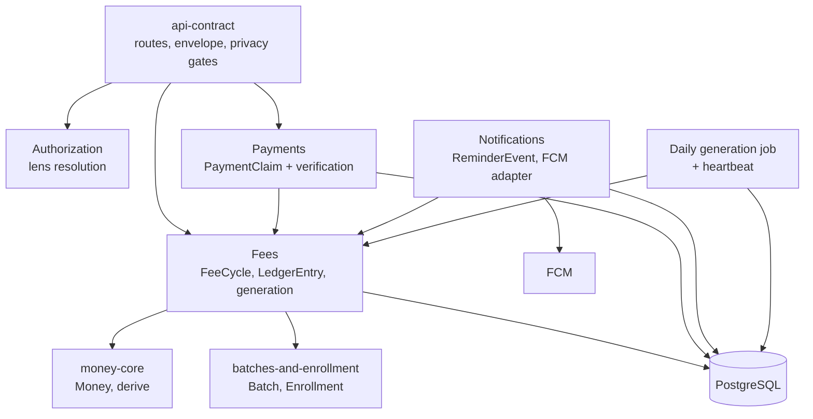

# Logical Components — D3 `collecting-fees`

**Stage**: nfr-design (3.3)
**Phase**: Construction
**Unit**: D3 `collecting-fees`
**Record**: 261022-remaining-slices

> **D3 is the first unit that adds components rather than extending them.**
> D1 and D2 added routes, columns and a lens type inside components that
> already existed. D3 instantiates **three components that domain design
> declared and nobody has built** — Fees, Payments and Notifications — plus
> the product's first scheduled job and its first shared third-party adapter
> since the SMS gateway.
>
> This file records where each NFR pattern attaches, where the failure
> domains are, and what Infrastructure Design must build against.

## Sources

- [upstream] `261016-shikhokplus-tuition-app/inception/domain-design/components.md`
  — the component catalogue: Fees (line 294), Payments (353), Notifications (399)
- [upstream] this stage's `performance-design.md`, `security-design.md`,
  `scalability-design.md`, `reliability-design.md`, `observability-design.md`
- [upstream] `construction/collecting-fees/nfr-requirements/` — NFR6.38, NFR7.6,
  NFR9.37, NFR10.15, NFR14.36, NFR19.24, NFR25.9
- [upstream] `construction/collecting-fees/functional-design/entities.md`
- [code] `app/` module layout, `app/batches/service.py`, `app/gateway/`,
  `infra/modules/app/main.tf:323-335`, read 2026-10-23

---

## 1. Component inventory

A **modular monolith**: one deployable, with module boundaries enforced by
import rules and CI gates rather than by wires.

| Component | Owns | D3's change |
|---|---|---|
| **Fees** | `FeeCycle`, `LedgerEntry`, generation, every derived quantity | **Created.** Two tables, the generation job, the fee-status derivation, the batch-wide and per-student read paths |
| **Payments** | `PaymentClaim` and its verification | **Created.** One table, submission, verification, correction |
| **Notifications** | `ReminderEvent`, the FCM adapter, device-token lifecycle | **Created.** One table plus the **shared** adapter [NFR19.24] |
| `money-core` (`app/money/`) | `Money`, the arithmetic, `derive()` | **One method added**: `Money.format(locale)`, inside the strict island |
| `batches-and-enrollment` | `Batch`, `Enrollment` | **Read only.** D3 reads `default_fee`, `fee_due_day`, `collection_number`, `fee_amount`, `inactive_from` and both decision enums. **Writes nothing** |
| `identity-and-access` | Accounts, lenses, the audit log | **Untouched.** D3 adds no authentication event, no token, no credential |
| `api-contract` | The error envelope, route enumeration, privacy invariants, the committed schema | **Two gates extended**: the collection-number allowlist [NFR14.32] and the strengthened authorization-code assertion |
| **Platform / operations** | The host, the deploy, the schedule | **The product's first scheduled job** [NFR6.38] and its heartbeat |

### Three components, not one

Fees, Payments and Notifications arrive in one unit, which invites collapsing
them. The catalogue's reason for the split holds and D3 keeps it:

**Payments is separate from Fees because the writer differs, and that
difference is the privacy boundary in table form** — students and guardians
write claims, teachers write verifications. The operative rule: **Payments
never inserts a ledger row directly; it calls Fees.** A verification produces
money movement, and money movement is Fees' to write, which is what keeps
every ledger insert inside one component's API and therefore inside one
invariant.

**Notifications is separate because its dependency is an external service with
its own failure semantics** — best-effort, post-commit, `UNREGISTERED` as a
lifecycle signal rather than an error. Those behaviours belong to the adapter,
not to the fee feature that happens to be its first caller.

### One divergence from the catalogue, recorded rather than smoothed over

The catalogue carries **`PaymentVerification` as a separate entity** of the
Payments component (components.md:353). D3's `entities.md` **folds the
verification into `PaymentClaim`**, with `previous_decision` as a `json`
column holding the superseded decision.

**This is a deliberate functional-design decision, not drift**, and its stated
reason is that one claim has at most one verification, the verification is a
decision *about* that claim, and FR9.2's requirement to retain the previous
decision is a column on the thing corrected rather than a second row. **The
component boundary is unchanged** — Payments still owns both the claim and its
verification — so this is an entity-shape decision inside a component, not a
boundary change, and it reopens no ADR. Recorded here because an unexplained
divergence between the catalogue and the built schema reads, to the next
reader, as something nobody noticed.

### What D3 does not create

**No `scheduling` component.** The job is Fees' own entry point — it generates
fee cycles, which is Fees' first responsibility in the catalogue. A scheduling
component would own one function and split generation across two modules.

**No fourth strict mypy island.** D3's authorization lives in `app.authz` and
its money in `app.money`, both already strict. A new island over orchestration
code would make the island boundary about package age rather than about what
strictness protects.

---

## 2. Where each NFR pattern attaches

| Pattern | Component | Module | Requirement |
|---|---|---|---|
| Idempotency constraint + `ON CONFLICT DO NOTHING` | Fees | the `fee_cycle` migration | NFR6.30, NFR6.31 |
| Charge-then-credit ordering, one transaction | Fees | the generation command | NFR19.15, NFR6.36 |
| Per-enrollment-period commit | Fees | the generation command | NFR19.8 |
| Non-degrading due-date clamp | Fees | a pure function of `(anchor, period)` | NFR19.11 |
| The fold | `money-core` | `app/money/_ledger.py` — **unchanged** | NFR20.12, NFR20.13 |
| Grouped fetch, constant statement count | Fees | the fee read path | NFR20.16, NFR20.17 |
| Statement-count assertion harness | test support | a shared helper, reused by D5 | NFR20.18 |
| Append-only grant + `CHECK (amount >= 0)` | Fees | the `ledger_entry` migration | NFR9.36, NFR9.37 |
| Carry written as a pair | Fees | `carry_forward()` caller | NFR19.12, NFR9.38 |
| Lens-scoped queries (no RLS policy) | Authorization + Fees | `app/authz/` + each read path | NFR14.36, NFR14.37 |
| Adversarial probes | test support | `tests/privacy/` | NFR14.38–NFR14.40 |
| Collection-number allowlist | `api-contract` | beside `app/contract/privacy.py` | NFR14.32, NFR14.33 |
| Shared-vs-descriptive refusal codes | `api-contract` | `app/errors/codes.py` + registry test | `security-design.md` § 4 |
| Declared error responses | `api-contract` | each D3 route | NFR19.17, NFR19.18 |
| Conditional-update verification guard | Payments | the verification path | NFR6.35, NFR14.45 |
| Correction history on **both** responses | Payments | the claim-detail schemas | NFR14.44 |
| Post-commit dispatch, `UNREGISTERED` deletes | Notifications | the FCM adapter | NFR19.21, NFR19.22 |
| Event written regardless of outcome | Notifications | the reminder path | NFR19.20, NFR24.12 |
| Heartbeat row and freshness query | Fees + platform | the generation command + a check command | NFR25.9, NFR26.3 |
| Governance rows for five new tables | Governance | `app/governance/dispositions.py` | NFR10.15 |

**The two rows carrying the most new risk** are the collection-number
allowlist and the refusal-code classification, because both are **new
mechanisms rather than extensions of a built one**. Every other row either
reuses a gate that already fires or sits inside a module whose invariant is
already tested.

---

## 3. Failure domains

| Domain | Contains | Blast radius if it fails |
|---|---|---|
| **The API process** | Every read and write path | Total for the API. Unchanged by D3 — one host, two workers, recreate-style deploy |
| **PostgreSQL** | All five D3 tables | **Critical, no degradation.** Every D3 path is a read of persisted rows or a write; there is nothing to fall back to |
| **The generation job** | Cycle creation, charges, credit application | **Absorbed.** A missed run is recovered by the next. The one dependency whose failure is genuinely survivable |
| **The scheduler** | The job's trigger | **Absorbed for correctness, invisible without § 4's heartbeat.** This is the domain whose failure is silent |
| **FCM** | Reminder delivery | **Best-effort.** A failed push leaves a recorded failure event; the teacher re-sends |
| **The freshness check** | The alert on absence of success | **Unmonitored.** Nothing watches the watcher; see `observability-design.md` § 1.4 |

**The last two rows are D3's genuine new blast radius**, and they compound:
the scheduler can fail silently, the heartbeat detects that, and the check
that reads the heartbeat has no monitor of its own. That is why
`observability-design.md` § 1.4 constrains the check to **not share a failure
mode with the job** — it is the only place in this chain where a design choice
can break the shared-fate.

### What D3 does not widen

| Domain | Why unchanged |
|---|---|
| The staging outbox | D3 adds no OTP path and no gateway traffic. Unchanged, and still kept out of production three independent ways |
| The unauthenticated surface | D3 adds **no public route** [NFR13.5]. `PUBLIC_ROUTES` is untouched |
| The secret inventory | D3 adds none. **FCM credentials are the one new external credential**, and they follow the built pattern: environment variable in Phase 1, SSM `SecureString` in Phase 2 — never in the repository or the image |

**The FCM credential is a real addition and is listed as such.** The team
practice names three secrets with written, exercised-once rotation runbooks;
D3 makes it four. The runbook obligation applies to the new one equally, and
nothing automated enforces that a runbook exists.

---

## 4. Shared resources and contention

| Resource | Shared by | Contention | Design |
|---|---|---|---|
| `fee_cycle` | The job's workers; every fee read | Per `(enrollment_id, period)` row | The unique constraint **is** the coordination. No lock, no leader election |
| `ledger_entry` | The job, verifications, declines; every fee read | Append-only, so writers never block each other | No `UPDATE` but `superseded_by_id`; no `DELETE` |
| `payment_claim` | Claimants write, teachers verify | Per row, on the status transition | Conditional update; the loser gets `ConflictError` |
| `job_heartbeat` | The job writes, the check reads | One row, written once per run | Upsert after the run's last commit |
| Connection pool | API workers and the job | Two workers plus the job | The job holds **one connection at a time**, released per enrollment-period commit |
| The host | API, Postgres (Phase 1), the job | CPU and 2 GB RAM | The job runs outside classroom hours [NFR20.22] |

**The connection-pool row is the one D3 could get wrong quietly.** A generation
run that opened a connection per enrollment, or held one open across the whole
run, would contend with the API on a 2 GB host at exactly the hour chosen to
avoid contention. The per-enrollment-period commit granularity [NFR19.8]
already produces the right behaviour — it is adopted for failure isolation and
has this as a second benefit.

**`ledger_entry` deserves a note on why contention is absent rather than
managed.** Append-only means two writers never update the same row, so the
only shared object is the index, and the design adds no row-level locking
anywhere. The one place where ordering matters — charge before credit — is
inside a single transaction on a single enrollment, which the constraint
already serialises across workers.

---

## 5. Component isolation: what must not erode

Three boundaries carry mechanisms, and each has an enforcing check. Listed
because a boundary with no check is a convention.

| Boundary | Mechanism | Enforced by |
|---|---|---|
| `app.money` imports no I/O, session or HTTP | The arithmetic stays pure and 100%-coverable | **Built**: Ruff banned-api on raw `decimal` outside `app/money/**`, plus a pytest AST walk. Both cover D3's new modules, because both are stated over paths |
| Payments never inserts a ledger row | Every money movement goes through Fees' API, inside one invariant | **New work.** An import or call-graph check that no Payments module writes `LedgerEntry` directly. Absent it, the rule is review-enforced |
| No feature package defines an FCM client | D4 consumes the adapter rather than copying it [NFR19.24] | **New work**, in the shape of the money module's import boundary. This is what OQ-4 exists to prevent |

**The second and third rows are new mechanisms this design asks for**, and
both are cheap: each is an import-boundary assertion in a shape this codebase
already has a working example of. Named here rather than assumed, because the
project's standing rule is that a mechanical control names the deliverable
unit that installs it — and that unit is D3 for both.

---

## 6. Hand-off to Infrastructure Design

| Needs | Does not need |
|---|---|
| **A scheduling mechanism** for the daily job — the human's choice between cron-in-`user_data` and in-process [tech-stack § 2] | A managed scheduler, a second compute target, new IAM |
| **A trigger for the freshness check** that does not share a failure mode with the job | A metrics backend, a tracing backend, a new log sink |
| **FCM credentials** delivered the way the other three secrets are | A queue, a cache tier, a read replica, an autoscaler |
| The existing staging environment for the migration rehearsal | A new environment |
| The verified `pg_dump` to S3 before the production migration | A new backup mechanism |

**The capacity property the job's safety rests on must survive an
infrastructure edit.** `infra/modules/app/main.tf:331-333` pins the group at
`min_size = max_size = desired_capacity = 1`, deliberately — "not a scaling
range that happens to start at one." At one instance neither scheduler option
fires twice. **If that capacity is ever raised, both options fire once per
instance**, and the only thing between that and double-billing is the
`(enrollment_id, period)` constraint. That is the correct safety net; it
should be a stated property rather than a happy accident, because raising
capacity would not otherwise prompt anyone to think about billing.

**If the cron option is chosen, the entry is Terraform-managed.** A hand-added
entry over SSM is wiped by the next routine deploy, which refreshes the ASG so
the new instance re-runs `user_data`. Nothing fails; the timer stops existing.

### Gaps handed forward, not closed

| Gap | State |
|---|---|
| Purge job for `rate_limit_counter` (48h) and `auth_audit_log` (12 months) | Pre-existing. Dispositions declared, **no enforcing job**. D3 adds no rows to either and adds no infrastructure |
| `reminder_event` retention | **D3 creates the table**; the retention period and purge are D6's [observability § 7] |
| The alert delivery path | Unproven until the staging rehearsal. Nothing automated verifies it |

---

## 7. Component diagram

**Text fallback.** `api-contract` fronts every route and depends on
Authorization for the lens. It reaches Fees and Payments. **Payments depends
on Fees and never writes the ledger itself.** Fees depends on `money-core` for
every quantity and reads `batches-and-enrollment` for the fee inputs.
Notifications depends on Fees (a due cycle triggers a reminder) and on FCM
externally. The daily generation job is a second entry point into Fees,
alongside the API, and writes the heartbeat. All four D3-owning components
persist to one PostgreSQL.

**The two edges that matter most**: `PAY --> FEES` is the one that keeps every
ledger insert inside one component, and `JOB --> FEES` is the one that makes
the job an entry point rather than a component — the same code path the API
reaches, invoked by a schedule instead of a request.

---

## Assumptions & Open Questions

- **Assumed**: `job_heartbeat` belongs to Fees rather than to a platform
  component, because the job that writes it is Fees' entry point. It carries a
  governance disposition like the other four tables.
- **Assumed**: the FCM adapter lives beside the SMS gateway client in
  `app/gateway/`, which is the built precedent for a third-party adapter in
  this codebase.
- **Assumed**: D3 reads `batches-and-enrollment`'s columns through that
  component's service rather than by querying its tables directly, keeping the
  boundary intact in the direction D1 established.
- **Open, and the human's**: the scheduler choice, and the freshness check's
  trigger. Both are infrastructure decisions this design constrains without
  making.
- **Open, and D6's**: `reminder_event` retention, and OQ-1 —
  whether `PaymentClaim.transaction_id` survives the claimant's deletion.
