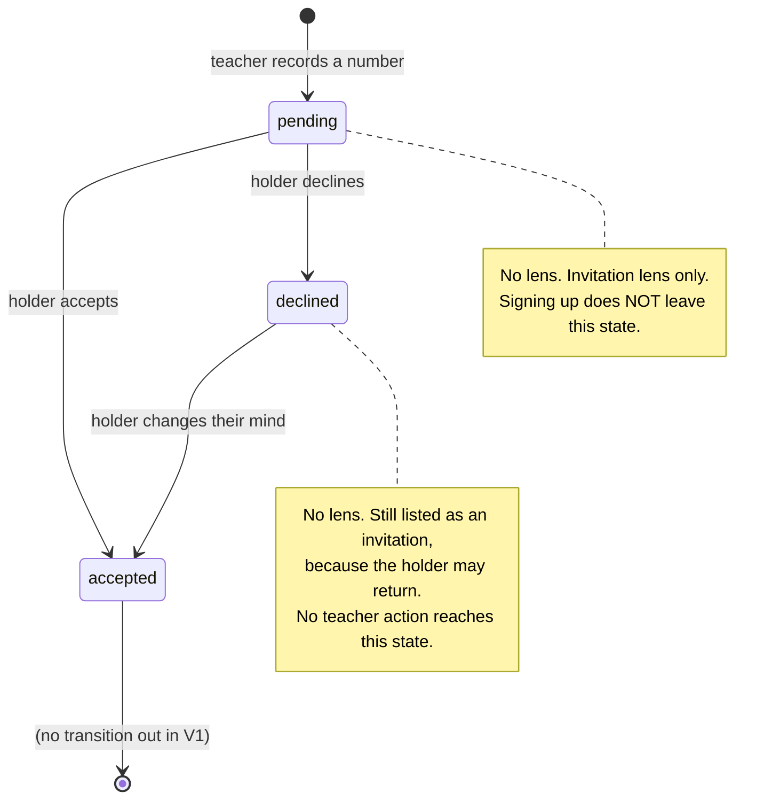
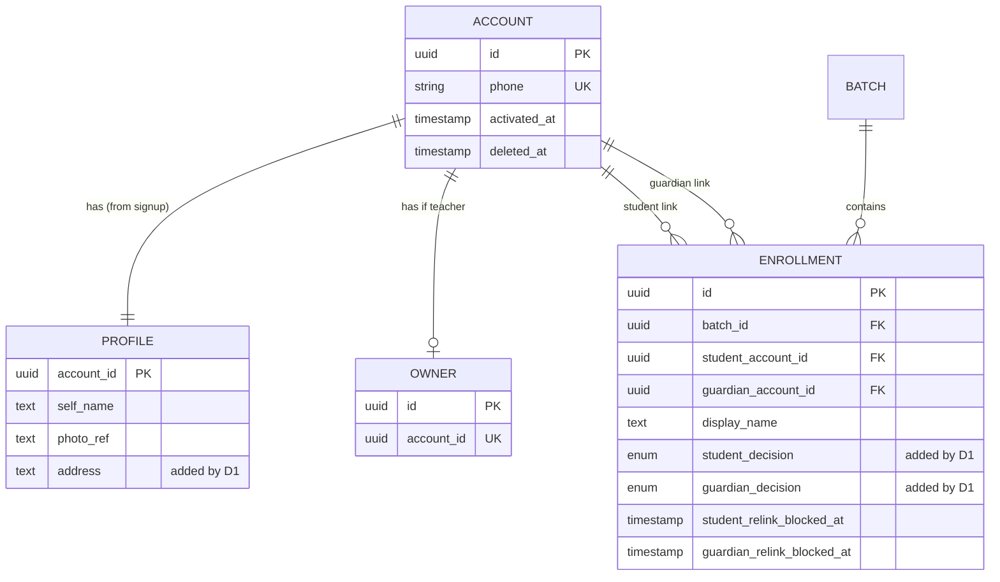

# Functional Specification — D1 `signing-up-and-joining`

**Stage**: functional-design (3.1)
**Phase**: Construction
**Unit**: D1 `signing-up-and-joining`
**Record**: 261022-remaining-slices

> **Source of truth for workflows and state machines.** The entity model lives
> in `entities.md` and the decision logic in `rules.md`; neither captures
> ordered behaviour or transitions, which is what this file owns. The
> entity-relationship diagram and the rules summary below are **derived
> views** of those two files, carried here for readability.

## Sources

- [upstream] `inception/units-generation/unit-of-work.md` — D1's scope and its
  Done-when
- [upstream] `inception/requirements-analysis/requirements.md` — FR1.7a–f,
  FR1.9a–i, FR1.16, FR1.17
- [upstream] `inception/user-stories/stories.md` — US1.10–US1.16
- [upstream] `inception/domain-design/components.md` — the component catalogue
- [upstream] `inception/refined-mockups/mockups.md` — O1–O5 and their states
- [prior] `inception/domain-design/decisions.md` — ADR-009 through ADR-014
- [code] `app/authz/`, `app/batches/service.py`, read 2026-10-23

---

## 1. The state machine this unit installs

Each **link** on a seat carries its own decision. The two links on one
enrollment move independently [BR5.2].

Text fallback: a link starts `pending` when the teacher records the number.
Its holder may move it to `accepted` or to `declined`, and may move a
`declined` link to `accepted` later. Nothing moves a link back to `pending`,
and no teacher action moves a link at all.

**Transitions that do not exist, and why each absence is deliberate:**

| Non-transition | Why |
|---|---|
| `accepted` → `pending` | Nothing resets a decision [BR6.1]. |
| `declined` → `pending` | Same. Re-adding the number does not re-prompt [BR5.4]. |
| `accepted` → `declined` | Out of V1's scope. Leaving a batch is not a capability this product has; the teacher marks the seat inactive. |
| any transition by a teacher | The holder decides. A teacher creates the seat and can remove it while nobody has accepted [BR7.1]; they cannot answer for it [BR5.4]. |

**The erasure markers are a second, independent axis.** A link carries both
facts and lens resolution reads both [BR6.2]:

| decision | erasure marker | Means | Lens? |
|---|---|---|---|
| `pending` | null | Created, not yet answered | invitation only |
| `accepted` | null | Accepted and in use | **yes** |
| `declined` | null | Refused; reversible by its holder | invitation only |
| `declined` | set | Refused, then the account was erased | no |
| `accepted` | set | Accepted, then erased | no |

---

## 2. Workflows

### W1 — Signing up with no prior seat

Covers US1.11. The root capability: today a teacher can exist only by
hand-inserting a database row.

1. The person opens the signup screen (`O1`, state 1).
2. The client calls the **already-added lookup** for the typed number.
3. The lookup finds no seat and says so, naming nothing further [BR2.3].
4. The form renders empty, with the role selectable.
5. The person supplies role, name, mobile number and address.
6. On submit the server checks the per-number and per-IP **signup** ceilings
   [BR2.1]; over either, it refuses as a conflict.
7. The server checks whether the number already has an account. If so it
   refuses and directs the person to log in [BR4.4] (`O1`, state 5).
8. In **one transaction** [BR3.3] the server creates:
   - the `Account`, keyed by the number;
   - the `Profile`, carrying `self_name` and `address` [BR3.1];
   - an `Owner` row **only if** the role chosen was Teacher [BR4.1].
9. The server triggers the existing OTP path. The account exists **before**
   the code is sent, and the submit control named the destination number
   [BR4.3].
10. The person verifies the code through the built OTP flow, unchanged
    [BR2.2].
11. On first sign-in, lens resolution runs: a Teacher reaches their own empty
    batch list [AC1.11.2]; a Student or Guardian holding no accepted seat is
    offered **no** student or guardian lens [AC1.11.3, BR1.1].

**The fork at step 11 is the unit's thesis.** One signup path produces a
working teacher and a student with no access, because access comes from
acceptance and not from existing.

### W2 — Signing up on a number a teacher already added

Covers US1.12. The path that must not quietly accept.

1. The person opens signup and types their number.
2. The already-added lookup finds a seat and returns three things: that a seat
   exists, the teacher-typed name, and the role the seat carries. **Not** the
   teacher. **Not** the batch [BR2.3].
3. The form (`O1`, state 2) pre-fills the name as **correctable** and **locks**
   the role to the seat's [BR4.5]. It states that a teacher has added this
   number, naming neither.
4. The person completes and submits. Steps 6–10 of W1 apply unchanged.
5. The server links the new account to the matching seats.
6. **Every decision column is left exactly as it was** [BR5.1]. A seat that was
   `pending` is still `pending`.
7. On first sign-in the person is offered no student or guardian lens, and
   their invitations list shows the seat.

**Step 6 is the single most important step in this unit, and it is an
absence** — nothing in a diff shows it. The test that proves it is in § 6.

**Step 5 is where this unit reaches outside its own code.** Linking the account
sets `student_account_id` while the decision stays `pending`, and every merged
reader that treats that column as *claimed* becomes wrong at that moment. Two
of them are write paths and are D1's to fix in the same unit that changes the
meaning [BR7.1, BR7.2]; the complete sweep of all seven readers is in
`rules.md`. The sharpest case: `remove_enrollment` would start refusing to
remove a seat created on a mistyped number the instant that stranger signs up,
closing the recovery path this unit exists to open.

### W3 — Accepting a seat

Covers US1.10 and the accept half of US1.2.

1. The person opens their invitations (`O4`).
2. For each seat where a link names them and its decision is `pending` or
   `declined`, an **invitation lens** is resolved for that one enrollment
   [BR1.3], by its own statement rather than by the hot-path query [ADR-011].
3. Each invitation renders **three fields**: batch name, subject, fee amount
   [BR1.4]. Nothing else about the batch, no attendance, no marks, no other
   enrollment, and no write action but accept and decline.
4. The person accepts.
5. The server sets the decision of **the link that names them** to `accepted`
   [BR5.2]. If both links on that seat name this same account, both move in
   this one action, and the seat was listed once [BR5.3].
6. The matching lens becomes available on the next resolution [BR1.1], and the
   lens-summary count rises by the same predicate [BR1.2].
7. The seat's **full history from creation** is now visible, including dues
   accrued before the acceptance [BR1.5].

### W4 — Declining, and changing your mind

Covers US1.13 and the decline half of US1.10.

1. From the same invitation list the person declines (`O4`, decline sheet —
   **a different sheet for a guardian than for a student**, because a
   guardian's decline does not stop the student's fee, and one sheet written
   once told a guardian a debt was cancelled when it was not).
2. The server sets only that link's decision to `declined` [BR5.2].
3. No lens is granted [BR1.1]. The seat **leaves the person's enrollments** and
   **stays in their invitations**, with an accept action [BR5.5, BR5.4].
4. If the teacher re-adds the same number to the same batch, the person is
   **not** re-prompted and the decline is not cleared [BR5.4]. No teacher
   action reaches it.
5. If the person later accepts, the lens becomes available exactly as if they
   had accepted first time [BR5.4] — W3 from step 5.

**The asymmetry is the design**: durable against the teacher, reversible by its
holder.

### W5 — Split decisions on one seat

Covers AC1.10.6 and AC1.10.7, where the student and the guardian are different
people.

1. The seat appears in both people's invitation lists.
2. One accepts; only their column moves. The other's stays `pending` [BR5.2].
3. The accepter holds their lens; the other holds none.
4. The other later declines; only their column moves. The accepter is
   unaffected.
5. **The teacher's roster shows the seat once, with each link's state
   separately** [AC1.10.7] — not collapsed into a single seat state. The
   roster screen is D2's; the data it reads, and the truthfulness of the
   single `is_dormant` flag until D2 lands, are D1's [BR7.2].

### W6 — Editing a profile

Covers US1.5, carried from the prior record.

1. The person opens their profile (`O5`).
2. They set a self-entered name, photo and address. All three land on `Profile`
   [BR3.1, BR3.2].
3. **No `Enrollment.display_name` changes.** Every teacher's roster shows what
   that teacher typed, unchanged [BR3.1].
4. Helper text on the screen states that this does not change what teachers see
   [AC1.5.3].

---

## 3. Derived view — entity relationships

> Derived from `entities.md`, which is the source of truth for the data shape.

Text fallback, for a reader whose renderer does not draw it: one `Account` has
exactly one `Profile` and at most one `Owner`. An `Account` may be named on
many `Enrollment` rows, through either of two independent links. A `Batch`
contains many `Enrollment` rows. D1 adds `profile.address` and the two
`enrollment.*_decision` columns and nothing else.

---

## 4. Derived view — rules summary

> Derived from `rules.md`, which is the source of truth.

| Group | Rules | The axis |
|---|---|---|
| BR1.1–BR1.5 | authorization | What a decision grants, and what it withholds |
| BR2.1–BR2.3 | abuse control | Signup's own ceilings; what the lookup may say |
| BR3.1–BR3.4 | privacy | Which name, whose address, written together, and enrolled in the gate |
| BR4.1–BR4.5 | signup | `Owner` only for Teacher; account before code |
| BR5.1–BR5.5 | acceptance | Signing up is not accepting; per link; reversible by me |
| BR6.1–BR6.2 | erasure | A decision survives; `accepted` plus erased grants nothing |
| BR7.1–BR7.2 | merged readers | Removability and dormancy read the decision, not the link |

---

## 5. The migration, as behaviour

This is the one part of D1 that runs against **live staging data** and cannot
be re-run differently afterwards.

1. Add `student_decision` and `guardian_decision`, nullable for the moment.
2. Backfill **conditionally** [ADR-013]:
   - `student_decision` = `accepted` where `student_account_id IS NOT NULL`,
     else `pending`;
   - `guardian_decision` = `accepted` where `guardian_account_id IS NOT NULL`,
     else `pending`.
3. Set both `NOT NULL`. Add **no column default**, so every future insert path
   must state the seat's initial state.
4. Add `profile.address`, nullable.

**Why conditional and not `DEFAULT 'pending'`.** `is_dormant` is computed as
`student_account_id is None` (`app/batches/service.py:172`), so a student who
has signed in holds a working lens *right now* under the superseded model. A
plain default would withdraw it — a migration that takes away working access on
a children's-data product, discovered when someone opens the app and finds
their batches gone.

**The honest consequence, recorded rather than hidden:** the backfill grants
`accepted` to people who were never asked, because under the old model nobody
was. The alternative — making every existing user re-accept — would log them
out of their own records to fix a problem they do not have.

---

## 6. Verification obligations

Test-first by the affirmed predicate: these are authorization decisions, their
correct output is knowable from the requirement without writing the code, and a
wrong answer is an authorization error [team: Testing Posture].

**The adversarial one, which fails against today's code** [ADR-014]:

> An account named **only** on `pending` or `declined` links resolves no
> student lens and no guardian lens, and the lens summary reports zero for both
> counts.

That it fails today is what makes it worth writing: it is the regression guard
for the defect this whole unit exists to prevent.

**And:**

| Obligation | Covers |
|---|---|
| Signing up on an already-added number leaves the seat `pending` | BR5.1 |
| Choosing Teacher creates an `Owner`; choosing Student does not | BR4.1 |
| A declined seat is not re-prompted on re-add, and is still acceptable by its holder | BR5.4 |
| One account holding both links accepts once and sees the seat once | BR5.3 |
| Split decisions: each person's choice moves only their own column | BR5.2 |
| An invitation response carries exactly three fields | BR1.4 |
| The lookup response names neither teacher nor batch | BR2.3 |
| `POST /v1/auth/otp` stays **byte-identical** for known and unknown numbers | BR2.2 |
| No teacher-lens response schema contains any `Profile` field, address included | BR3.2 |
| **`address` is a member of the owner-private field set the schema invariant matches on** | BR3.4 |
| A signup failure leaves neither `Account` nor `Profile` | BR3.3 |
| The conditional backfill: a seat naming an account becomes `accepted`, one naming none becomes `pending` | ADR-013 |
| **A teacher can still remove a seat after the person signs up but before they accept** | BR7.1 |
| A roster shows a seat as not claimed until some link accepts | BR7.2 |

**The removal test is the one an earlier draft was missing**, and it was that
draft's most consequential omission: without it D1 ships a migration that
silently closes the mistyped-number recovery path, which is the scenario the
unit exists for. It fails against today's `remove_enrollment` for the same
reason the lens test fails against today's `_LENS_QUERY` — the predicate reads
the link, not the decision.

**The `address` membership test is the same shape one axis over.** BR3.2 says
the privacy boundary is enforced structurally rather than per endpoint, and
that is true of the *mechanism* and not automatic for a new column: the
owner-private field set is matched by name and maintained by hand, so an
unenrolled `address` leaves the invariant passing over a field it cannot see
[BR3.4].

**The per-screen obligation** [FR0.2]: `O1`, `O4` and `O5` each need a row in
`docs/delivery/bangla-layout-check.md` covering the Bangla layout and the named
artboard before this unit is complete. A screen with no row is an incomplete
unit. `O2` and `O3` are unchanged by D1 and carry no new row.

**A performance note, not a test:** `_LENS_QUERY` runs on every authenticated
request on a 2 GB instance [NFR6.1]. Both new predicates are on columns of rows
that query already reads, so neither adds a join nor a round trip.

---

## 7. Screens

Drawn in `inception/refined-mockups/`. D1 is typed `service` because its schema
and authorization changes are the substance, not because it has no front end.

| Screen | States | What it is | Changed by D1 |
|---|---|---|---|
| `O1` Signup | 5 | Empty, already-added, validation, submitting, number-taken | new |
| `O2` OTP entry | — | Existing flow | no — BR2.2 requires it unchanged |
| `O3` Role/lens landing | — | Where a verified person arrives | no — renders whatever resolution offers |
| `O4` Invitations | 7 | List, empty, detail, accept, student decline, guardian decline, declined-with-accept | new |
| `O5` Profile | 4 | View, edit, saving, saved | profile-edit half only |

`O5`'s deletion states are **D6's**, not D1's: both deletion paths are
release-blocking deliverables with their own tests, and the mockups draw all
four states on one screen only because one screen is where they live.

---

## Assumptions & Open Questions

- **Assumed**: `O2` and `O3` need no change. The OTP screen is built and BR2.2
  requires its behaviour byte-identical; `O3` renders whatever lenses
  resolution offers, which is already the right shape.
- **Assumed**: the invitation list is its own route rather than a section of
  the home screen. The mockups draw `O4` as a screen; either satisfies the
  rules, and the route shape is Code Generation's.
- **Open, and D2's**: the roster rendering of split states [AC1.10.7]. D1
  stores the two columns, exposes them, and keeps the single `is_dormant` flag
  truthful [BR7.2]; the screen showing them side by side is D2's `T7`.
- **Open, and D3's**: every money consequence of a decline [US1.14]. There is
  no ledger table until D3 creates one, so AC1.14.2a is unsatisfiable here and
  D1 owns the decision-column transition alone.
- **Open, navigation only**: whether `O4` is reachable from the lens switcher.
  The invitation lens is deliberately not one of the three a person chooses
  between, so the switcher is the wrong home for it; no rule settles this and
  the mockups record it as open.
