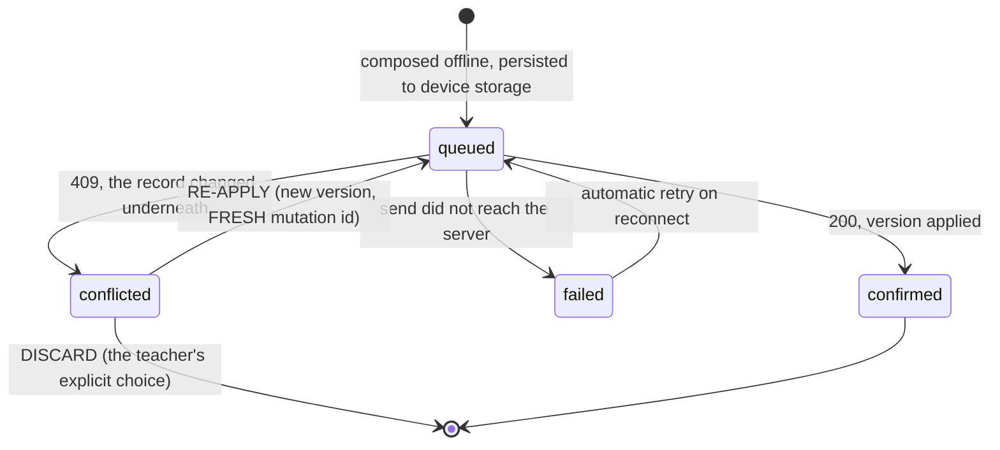
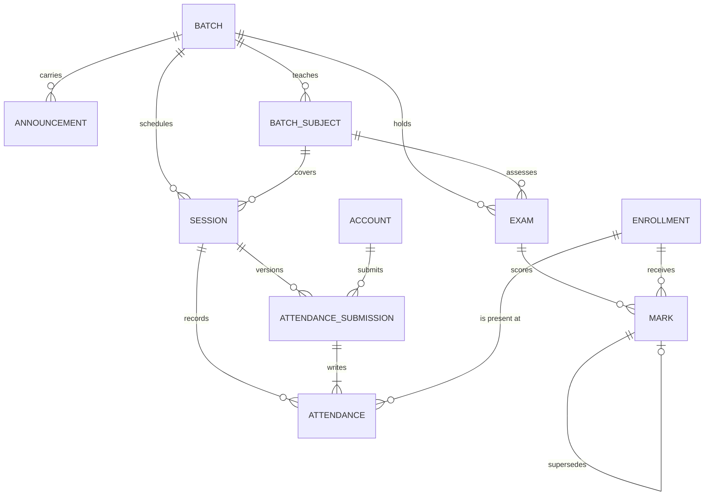

# Functional Specification — D4 `teaching-and-recording`

**Stage**: functional-design (3.1)
**Phase**: Construction
**Unit**: D4 `teaching-and-recording`
**Record**: 261022-remaining-slices

> **The unit's centre of gravity is one sentence, and it is the delivery
> plan's confidence hypothesis:**
>
> *An attendance roster composed offline against version N, submitted after
> the roster moved to N+1, is refused as `conflicted` — never `failed`, never
> silently applied — and re-applying writes, because it carries a fresh
> `client_mutation_id`.*
>
> Everything in § 3 exists to make that sentence true and testable. The rest
> of the unit — sessions, the topic log, exams, marks, the marksheet — is
> ordinary work that this one is built around.

## Sources

- [upstream] this stage's `entities.md` and `rules.md`
- [upstream] `inception/units-generation/unit-of-work.md` — D4's scope
- [upstream] `inception/units-generation/unit-of-work-story-map.md`
- [upstream] `inception/requirements-analysis/requirements.md` — FR0.1, FR0.2
- [upstream] `inception/domain-design/components.md`
- [upstream] `inception/delivery-planning/bolt-plan.md` — Bolt 4
- [prior] `261016-.../inception/contract-design/contract-summary.md` — § B.1.1,
  § B.7, **§ B.8**, § G
- [prior] `261016-.../inception/domain-design/decisions.md` — **ADR-006**
- [prior] `261016-.../inception/requirements-analysis/requirements.md` —
  FR3.x, FR4.x, FR9.2, FR11.4, FR11.5, NFR4, NFR5, NFR5.1
- [prior] `261016-.../inception/user-stories/stories.md` — AC3.0.x–AC3.5.x,
  AC4.1.x–AC4.4.x
- [code] `app/db/models.py`, `app/errors/_classes.py`, `app/errors/codes.py`,
  `app/governance/dispositions.py`, `app/contract/privacy.py`,
  `app/contract/routes.py`, `app/authz/lenses.py`, `app/fees/verification.py`,
  `tests/db/test_governance.py` — read 2026-10-24

---

## 1. What this unit delivers

| Capability | Stories | Rules |
|---|---|---|
| Sessions from weekly recurrence, plus ad-hoc | US3.0 | BR1.1–BR1.4 |
| The topic log | US3.1 | BR2.1, BR2.2 |
| The atomic roster write with optimistic concurrency | US3.1 | BR3.3–BR3.5 |
| The four-state offline queue surviving restart | US3.1 | BR3.1, BR3.2 |
| Refuse-on-conflict and its resolution screen | US3.1 | BR3.6, BR3.7 |
| Reschedule and cancel | US3.2 | BR1.6, BR1.7 |
| Announcements | US3.3 | BR7.1 |
| Student and guardian views of class and attendance | US3.4, US3.5 | BR7.2, BR7.3 |
| Exams and mark entry with correction history | US4.1 | BR4.1–BR4.5 |
| The marksheet toggle | US4.2 | BR5.4 |
| The anonymised marksheet | US4.3 | BR6.2–BR6.5 |
| Guardian progress over time | US4.4 | BR6.6 |

**What this unit does not own.** Account deletion of any kind, including the
purge of the tables it creates — D6 owns both paths, and this unit's
contribution is the governance manifest rows [BR6.1] that D6's generated
privacy policy is written from. Push notification delivery: the FCM adapter's
ownership is assigned by § G of the prior `contract-summary.md` to both this
unit and D3, **and D3 built it**, so D4 reuses it and builds no second adapter.
No Macrobenchmark harness [BR7.4].

---

## 2. Sessions — the workflow

### 2.1 Generation

1. The daily job — the same scheduler D3 built for fee cycles — walks every
   active batch.
2. For each `ScheduleSlot`, it computes the occurrence dates within the
   horizon (**the current calendar month plus the next**; see § 8).
3. For each occurrence it inserts a `Session` with `origin: recurrence` and
   `ON CONFLICT (batch_id, date, start_time) DO NOTHING` [BR1.3].
4. It never deletes, never updates and never considers rows with
   `origin: ad_hoc` [BR1.4].

A conflict is the success path. The job is safe to run any number of times on
any number of days, and a missed day self-heals, because step 3 inserts only
what is absent.

### 2.2 Session state machine

```mermaid
stateDiagram-v2
    [*] --> scheduled: generated or created ad-hoc
    scheduled --> held: the teacher records a topic or a roster
    scheduled --> cancelled: the teacher cancels
    scheduled --> scheduled: reschedule (date/time change, identity kept)
    held --> held: correction (new roster or topic; version increments)
    held --> cancelled: the teacher cancels after recording
    cancelled --> [*]
```



Three facts the diagram carries that the enum alone does not:

- **A reschedule is a self-transition, not a new row** [BR1.7]. The identity,
  the topic and every attendance row survive it.
- **`held` is reached by recording, not by the clock passing.** A class whose
  time has passed and which nobody recorded stays `scheduled`, which is what
  makes an unrecorded class visible rather than silently historical.
- **`cancelled` is terminal for writes and not for reads** [BR1.6]. The row
  and its history remain readable; only new attendance and topic writes are
  refused.

---

## 3. The offline queue — the unit's core

### 3.1 Why there is a queue at all, given the standing rule

`project.md` carries **"NEVER accept a write without connectivity in V1; there
is no local write queue, and a failed write surfaces an explicit retry prompt
rather than queueing silently"** [TC-8, D-9]. This unit builds a queue. The
reconciliation is BR3.1's and is repeated here because a reader reaches this
section without having read the rules file.

**The rule's own source is narrower than the rule.** NFR5 reads: *"Offline
writes — **Permitted for the mid-class path only** — the topic log and
attendance [FR3.2, FR3.5] queue locally and sync when connectivity returns.
Every other write requires connectivity and fails with an explicit retry
prompt that preserves what was typed."* FR3.6 says the same and adds that the
teacher is told the entry is saved on the phone and not yet sent, and that it
is **never rendered as confirmed until it syncs**. The requirement was always
scoped to two paths; the `project.md` restatement dropped the scope.

**What the NEVER protects is a queue that looks like success**, and the
distinction is mechanical rather than a matter of intent:

| | A silent queue | This queue |
|---|---|---|
| States | one, rendered as saved | four, all distinct and all visible |
| Unsent write | looks confirmed | shows as on-the-phone, not sent |
| Server refusal | invisible; retried or dropped | `conflicted`, with the current state shown |
| Stale write | silently applied | refused; the teacher decides |
| Which writes | all of them | exactly two, named |

**Nothing in this design ever renders an unsent write as confirmed**, and
BR3.1's violation behaviour is the test that proves it in both directions —
that a `queued` item is not the confirmed state and the server holds no row,
and that a write to any third endpoint fails with a retry prompt when offline
rather than enqueuing.

**Open item for a later learnings gate** (§ 8): the `project.md` wording should
be amended to say what it protects, because as written it contradicts NFR5,
which it cites. This design does not edit memory.

### 3.2 The four states



- **`queued`** — on the phone, not sent, and never rendered as saved
  [AC3.1.3]. Survives app restart, because it is persisted and not held in
  memory [BR3.2, AC3.1.9].
- **`failed`** — the send did not succeed. Retry is the right response and
  happens automatically on reconnect.
- **`conflicted`** — the send *reached* the server, which refused it. Retrying
  as-is is **wrong**. This is the fourth state NFR5.1 added, and it is
  visually distinct from `failed` [AC3.1.10] precisely because `failed` means
  "try again" and this one means "look at what changed".
- **`confirmed`** — the server applied it.

**Sync is automatic; resolving a conflict is not**, because it needs the
teacher's decision [NFR5.1].

### 3.3 The roster write — the mechanism, named concretely

"Optimistic concurrency" is a policy. What is implemented is this:

1. The client composes a roster against the session's current
   `attendance_version`, call it **V**, and persists the write with
   `base_attendance_version: V` and a freshly generated `client_mutation_id`.
   The version travels **in the request body, not an `If-Match` header**
   [§ B.8] — a queued write is serialized into the device's queue and replayed
   hours later by a sync worker, and a body field survives that naturally
   where a header is a second thing the queue must remember and the first
   thing a retry wrapper drops.
2. On reaching the server, the handler resolves a lens [BR5.1]. **If the lens
   does not reach the session, the request is refused here with the shared
   `NOT_AVAILABLE`** — before any version is compared [BR3.10].
3. Replay check: if `(account_id, client_mutation_id)` already exists on
   `AttendanceSubmission`, return that submission's original result with
   `200`, write nothing, increment nothing [BR3.8].
4. **The guarded write, in one statement:**

   ```
   UPDATE session
      SET attendance_version = :base + 1
    WHERE id = :session_id
      AND attendance_version = :base
   ```

   **Zero rows affected means someone else won.** The check and the write are
   one statement, so no window exists between them and no lock is needed.
5. On one row affected, in the **same transaction** [BR3.5]: insert the
   `AttendanceSubmission` row, upsert one `Attendance` row per roster entry on
   `(session_id, enrollment_id)`, and return `200` with the new version.
6. On zero rows affected: write nothing and raise `ConflictError` with code
   `ATTENDANCE_VERSION_CONFLICT`, carrying `expected_version`,
   `current_version` and `current_state`.

**This is the product's first optimistic path.** Verified by reading the code
rather than assumed: `app/db/models.py` has no version column on any of its
eighteen tables, and the only concurrency primitives in the backend are
`SELECT ... FOR UPDATE` in three places — `app/auth/otp.py:170`,
`app/auth/tokens.py:234`, and D3's `app/fees/verification.py:117`. A
pessimistic lock is the wrong tool for this path specifically: the contender is
not a concurrent request but a *stale* one, composed hours earlier, and there
is no transaction to hold open across that gap.

**No new error class.** `ConflictError` is built, and its docstring already
states this semantic exactly: *"Valid request; current state forbids it.
Refetch and decide. Retrying as-is is wrong."* `retryable: false` follows from
the class and is read in one place — a raise site cannot set it. The
descriptive code is permitted because step 2 already happened: the oracle rule
in `app/errors/codes.py` forbids a code pair that distinguishes "does not
exist" from "you may not reach this", and `ATTENDANCE_VERSION_CONFLICT`
creates no such pair, because it is unreachable without authorization.

### 3.4 What the version choice costs

Granularity is **session-level** — `session.attendance_version` — and this is
inherited from ADR-006 and § B.8 rather than chosen here. The consequence is
worth stating plainly rather than discovering in the pilot:

**Two devices marking different students in the same session do conflict**, and
the second is refused. That is not a defect of the choice; it is the choice.
The alternatives are worse in ways that matter more. A **batch-level** version
would conflict two teachers working on entirely unrelated sessions. An
**enrollment-level** version would destroy AC3.1.5's atomic roster, because
per-seat versions are exactly the field granularity a roster deliberately does
not have — and ADR-006 rejected per-field last-write-wins for that reason.
V1 has no co-teaching (a batch has one `owner_id`), so the conflicting case is
one teacher on two devices, which is the case ADR-006 was written about.

### 3.5 What a sequential test cannot prove

**A roster write guarded by a version check passes every sequential test
against an implementation with no guard at all**, because nothing ever
contends. The guard is invisible to a test that never races.

This is the exact shape of the worst defect D3 shipped: a double-crediting race
on a path the database constraint did not cover, because the row had no natural
key to conflict on, and every test that existed called the service once. Two
things in this design answer it:

- **A natural key exists.** `AttendanceSubmission` carries
  `UNIQUE (submitted_by_account_id, client_mutation_id)` for the replay
  guarantee and `UNIQUE (session_id, resulting_version)` for the increment.
  The second is what makes the guarantee survive somebody later rewriting the
  conditional update into a read-then-write.
- **The test is concurrent, and it asserts the outcome** [BR3.4]. N threads
  released together from a barrier, against real PostgreSQL via testcontainers,
  each submitting a roster against version V. Assert **exactly one `200` and
  N-1 `409`s**; assert `attendance_version` is **V+1 and not V+N**; assert the
  stored roster is byte-identical to the one that won. Never two applied,
  never a silent overwrite.

The project's affirmed posture already mandates this shape for fee-cycle
idempotency — "overlapping concurrent generations, never sequential calls" —
and the reasoning transfers without modification.

### 3.6 The conflict-resolution screen, and the fresh mutation id

On `conflicted`, the teacher is shown what they recorded offline against what
the record now says, and offered **re-apply** or **discard**. Their offline
entry is preserved until they choose [FR11.5]. Nothing is merged — merging
would mean inventing a rule for a student the two rosters disagree about, which
no layer is authorized to invent [ADR-006].

**Re-apply composes a NEW write: the current version, and a FRESH
`client_mutation_id`** [BR3.7].

This is the non-obvious consequence, and the default implementation gets it
wrong. The obvious code reuses the queued item's existing id. But that id
carries a unique constraint, and § B.7 makes a duplicate **return the original
stored result with 200 and write nothing** — so re-apply would report success
and change nothing at all. The teacher would see a confirmation and the record
would still hold the other device's roster. Re-apply is a **new decision by the
teacher**, not a replay of the old one, and the id has to say so.

```mermaid
sequenceDiagram
    participant T as Teacher's phone
    participant Q as Device queue
    participant S as Server
    T->>Q: compose roster, base_version=7, cmid=A
    Note over Q: state: queued (shown as not sent)
    Note over S: another device applies a roster; version 7 -> 8
    Q->>S: POST attendance {base:7, cmid:A}
    S->>S: lens OK; cmid A unseen; UPDATE ... WHERE version=7 -> 0 rows
    S-->>Q: 409 ATTENDANCE_VERSION_CONFLICT {expected:7, current:8, state}
    Note over Q: state: conflicted (NOT failed); entry preserved
    T->>Q: re-apply
    Q->>S: POST attendance {base:8, cmid:B}
    S->>S: UPDATE ... WHERE version=8 -> 1 row; version -> 9
    S-->>Q: 200 {attendance_version: 9}
    Note over Q: state: confirmed
```

### 3.7 The queue states never reach the wire

`queued | confirmed | failed | conflicted` are **client-side vocabulary**
[BR3.9]. They appear in no response schema, because the server cannot know
whether an item is queued on a device it has never heard from. The server
returns `200` or `409`; the client derives the state. Stating this prevents
someone adding a `queue_state` field the server would have to invent a value
for.

---

## 4. Exams, marks and the marksheet

### 4.1 Mark state machine

```mermaid
stateDiagram-v2
    [*] --> not_entered: the seat is on the roster, nothing recorded
    [*] --> joined_after: joined_on is after the exam date
    not_entered --> marked: a number 0..total is entered
    not_entered --> absent: the teacher records non-attendance
    marked --> marked: correction (new row; old row superseded)
    marked --> absent: correction
    absent --> marked: correction
```



**`not_entered` and `joined_after` are derived, not typed** [BR4.3]. A seat
with no live `Mark` row is `joined_after` when the enrollment's `joined_on` is
after the exam's date, and `not_entered` otherwise. The teacher never selects
either; they are facts about the data.

**A zero is `marked` with `marks = 0`** and is never `absent`. The database
CHECK is the biconditional `(result_state = 'marked') = (marks IS NOT NULL)`,
so the conflation FR4.3 forbids cannot be stored at all.

**Every correction appends** [BR4.4]. The old row's `superseded_by_id` is set
in the same transaction; no mark is ever updated in place or deleted. A partial
unique index keeps exactly one live row per `(exam_id, enrollment_id)`
[BR4.5] — without it, a correction that fails to set the pointer leaves two
live marks and the marksheet counts one student twice, shifting every rank and
skewing the average with nothing on screen to show it.

### 4.2 The marksheet computation

Given an exam whose batch has `marksheet_visible` true:

1. Collect the live `Mark` rows for the exam.
2. **If fewer than five are `marked`, or any roster seat is `not_entered`,
   return the viewer's own mark only** — no rank, no average, no highest, no
   bands [BR6.4]. The two conditions are separate, and one can hold while the
   other does not.
3. Otherwise, over the `marked` results only [BR6.5]:
   - the viewer's own mark, named;
   - their rank;
   - the average;
   - the highest;
   - the banded distribution, with any band under three merged into its
     neighbour until every published band holds at least three [BR6.3].
4. Nothing attributable to another student is ever returned [BR6.2].

**Worked example, computed by running the merge rather than reasoning about
it.** Nine marked results out of a total of 100:
`[92, 88, 81, 74, 71, 68, 55, 41, 12]`, over five fixed bands of width 20.

| Band | Raw count | After merging |
|---|---|---|
| 80–100 | 3 | **3** |
| 60–79 | 3 | **3** |
| 40–59 | 2 | merged down |
| 20–39 | 0 | merged down |
| 0–19 | 1 | merged down |
| 0–59 | — | **3** |

**Published: three bands, holding 3, 3 and 3 — nine results, which is all of
them.** For the same data the average is **64.67** and the highest is **92**;
the mark 74 ranks **4th of 9**.

Why this replaces a row list: in a batch of 8 to 20 students who sit together
and compare marks, twelve unattributed numbers are deanonymised by inference
within a day, so "anonymised" would over-claim for a product under a Families
declaration. A rank and a band are also decisions the *server* makes, where a
row list invites the client to sort — which [TC-9, D-31] forbid.

### 4.3 The toggle

`Batch.marksheet_visible` is **already built**, already non-null, at
`app/db/models.py:589`, and its own docstring reads *"U6's toggle; U4 only
creates the column"* in the prior record's unit numbering, where that later
unit is this one. So:

- D4 ships **no migration** for it and **no default** — AC4.2.1's "defaults to
  on" is satisfied by the existing batch-creation path, which D2 owns.
- D4 adds **one route** that writes it [BR5.4].
- When off, **no marksheet is returned at all** to any student or guardian
  lens — not an empty one, not one with marks hidden, because an empty
  marksheet still discloses that exams exist and how many.

---

## 5. Authorization

Every route in this unit resolves a lens [BR5.1], and the built
route-enumeration test — which walks `route.dependant` recursively and matches
on the dependency's return annotation being a `Lens` subtype — turns a route
that forgets into a red `make check` rather than a review finding.

**The six new readers that must filter on the enrollment decision columns**
are named individually [BR5.2], because this project recorded on 2026-10-22
that adding a column is not adding a behaviour and that the queries which must
start reading it have to be named:

| Reader | Lens | Predicate |
|---|---|---|
| Session roster | Teacher | BR1.5's full predicate |
| Session detail | Teacher | batch owner matches `owner_id` |
| Student attendance history | Student | `student_decision = accepted` |
| Guardian attendance history | Guardian | `guardian_decision = accepted` |
| Batch marksheet | Student, Guardian | the respective decision column |
| Guardian progress over time | Guardian | `guardian_decision = accepted` |

Each gets an IDOR probe. The guardian cases matter most: a guardian requesting
a non-child enrollment id must receive `NOT_AVAILABLE`, byte-identical to the
response for an invented id.

**No teacher-facing response carries an owner-private profile field or a
global account identifier** [BR5.3]. A roster is the most natural place in the
whole product to leak a student's self-authored name or photo to a teacher,
because it is literally a list of people. The built gate in
`app/contract/privacy.py` iterates the generated OpenAPI document and reads the
lens from the route, so a violating schema fails CI without anyone remembering
a per-endpoint test.

---

## 6. Entity relationships (derived view)

> Derived from `entities.md`, which is the source of truth.



`BATCH`, `BATCH_SUBJECT`, `ENROLLMENT` and `ACCOUNT` are built and are shown
for context; this unit creates the other six.

---

## 7. Rules summary (derived view)

> Derived from `rules.md`, which is the source of truth. Forty-one rules in
> seven groups: sessions (BR1.x), the topic log (BR2.x), **the queue and the
> concurrency guarantee (BR3.x)**, exams and marks (BR4.x), authorization
> (BR5.x), the marksheet and governance (BR6.x), and the reads and obligations
> (BR7.x).

The five that carry the most weight:

| ID | Why it is load-bearing |
|---|---|
| **BR3.1** | Builds the queue, and states what makes it not the forbidden one |
| **BR3.4** | Names what a sequential test cannot prove — D3's defect shape |
| **BR3.7** | Re-apply needs a fresh mutation id, or it silently no-ops |
| **BR4.3** | Four result states; two are derived, and conflating them publishes an absence nobody recorded |
| **BR7.4** | PU-3.6 carries no V1 obligation; it was dropped at Q14.3 |

---

## 8. Definition of Done, and the obligations with named verifiers

| Obligation | Verifier | Automated |
|---|---|---|
| Sessions generate and self-heal | Concurrent barrier test on `(batch_id, date, start_time)` [BR1.3] | yes |
| The roster write is atomic | Injected mid-roster failure leaves zero rows [BR3.5] | yes |
| **One applies, N-1 conflict** | **Barrier-released concurrency test [BR3.4]** | yes |
| Replay writes nothing | Same body twice; one submission row, one increment [BR3.8] | yes |
| The queue survives restart | Enqueue, kill the process, relaunch [BR3.2] | yes |
| Re-apply carries a fresh id | Forced conflict, re-apply, assert ids differ [BR3.7] | yes |
| No `queue_state` on the wire | Iterate the generated OpenAPI document [BR3.9] | yes |
| Band merging | The computed case in § 4.2 [BR6.3] | yes |
| Six governance rows, both manifests | `tests/db/test_governance.py`, already built [BR6.1] | yes |
| Privacy: no profile field to a teacher | `app/contract/privacy.py`, already built [BR5.3] | yes |
| Per-screen Bangla layout, 7 screens | A row each in `docs/delivery/bangla-layout-check.md` [BR7.5] | no — a written per-screen check |
| **PU-3.6 mid-class latency** | **Not a Definition-of-Done item: the requirement was dropped at Q14.3 [BR7.4]** | **n/a — there is no obligation to verify** |

**On the last row, the correction that matters more than the row.** An
earlier draft of this document described PU-3.6 as discharged by a named
manual pilot check, citing a human choice of 2026-10-23 between a
Macrobenchmark and a manual check. That choice was real, but it answered a
question already closed: **Q14.3 in the prior record, answer C — "The
mid-class speed statement is dropped as a requirement... It carries no
acceptance criterion, no numeric target and no verifier, and PU-3.6 has no
performance obligation in V1."**

**AC3.1.8 exists to stop exactly this recurrence**: it "records the absence so
a developer neither invents a latency budget nor reads the gap as licence."
This record's delivery planning resurrected PU-3.6 without citing Q14.3, and
the choice was put to the human as though the obligation were live.

So D4 is **not incomplete without a timed pilot check**, and nothing here
requires one. Timing a batch during the pilot stays welcome as feedback. What
stands in place of a latency requirement is structural and testable:
AC3.1.4's default-present, so a teacher marks only exceptions, and AC3.1.5's
single atomic write, so a dropped connection loses nothing rather than half a
roster. §11 accepts that a slow path would be found by pilot feedback rather
than by a mechanism.

**Done when.** A teacher opens today's class from the schedule, marks a full
roster with no connectivity, sees it as saved-on-phone-not-yet-sent, and —
after the same session was corrected from another device — reconnects to find
the write refused as a conflict rather than silently applied, resolves it from
the conflict screen, and the re-applied roster is the one that is stored.

---

## Assumptions & Open Questions

- **For the human, and it is a contradiction in a rule file rather than a
  design gap.** `project.md`'s NEVER on local write queues is narrower in its
  own source: NFR5 reads "Permitted for the mid-class path only". **The rule
  text should be amended at a learnings gate** to say what it protects — a
  queue state that looks like success — rather than banning queues outright.
  This design does not edit memory; that is the gate's to do.
- **The traceability sensor cannot pass cleanly for this unit, and the cause
  is structural.** `aidlc-sensor-traceability.ts` resolves a functional-design
  unit's upstream set by intersecting the ACs in **this record's**
  `inception/user-stories/stories.md` with the stories the story map maps to
  the unit. D4's stories are US3.x and US4.x, which exist only in the prior
  record; this record's `stories.md` carries US1.x and US2.x. So the derivable
  set is empty and the sensor emits a `reason`, which counts as a finding
  regardless of this file's content. D3 did not hit this because US1.14 is in
  both records. `traceability.json` enumerates the real prior-record ACs
  rather than the empty derivable set, because the alternative is a file that
  satisfies a sensor and records nothing.
- **The story map's US3.x/US4.x row titles do not match the prior record's
  stories.** The map lists US3.1 as "Sessions from weekly recurrence" where
  the prior record's US3.1 is "Teacher records a session mid-class"
  (recurrence is US3.0), and lists US3.6, US4.5, US4.6 and US4.7, which exist
  in neither record — the prior record's US3 ends at US3.5 and US4 at US4.4.
  The same drift exists in D3's rows. This design traced the ACs that exist.
  Worth the human's attention, because the map is what a later reader joins by.
- **The generation horizon is this design's assumption, stated as in force.**
  I searched FR3.1, FR3.2, AC3.0.1–AC3.0.3 and the prior `contract-summary.md`
  § B and found no horizon anywhere. **The current calendar month plus the
  next** is what ships unless corrected: longer creates sessions for slots the
  teacher is about to change, which BR1.2 then freezes; shorter leaves a
  teacher unable to open tomorrow's class.
- **The band width of 20 is this design's choice.** I searched FR4.5,
  AC4.3.2–AC4.3.6 and § B of the prior `contract-summary.md`; all say "banded
  distribution" and none gives a width or a count. The merge rule makes the
  width largely immaterial — the published bands are whatever survives
  merging — but it is visible to students, so it is flagged rather than buried.
- **`Session.end_time` is carried and nothing reads it.** Searched FR3.1–FR3.9
  and AC3.0.x–AC3.5.x: an end time is required of `ScheduleSlot`, which is
  built and non-null, and of no session.
