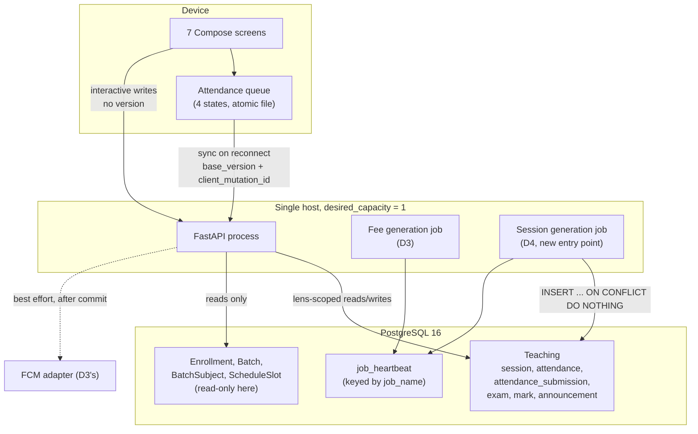

# Logical Components — D4 `teaching-and-recording`

**Stage**: nfr-design (3.3)
**Phase**: Construction
**Unit**: D4 `teaching-and-recording`
**Record**: 261022-remaining-slices

> **D4 implements ONE component from the prior catalogue — `Teaching` — and
> adds one client-side component the catalogue has no row for: the device
> queue.** That asymmetry is the document's main finding and is § 1.3.
>
> This is the bridge between the NFR designs and Infrastructure Design. Its
> job is to say **where each pattern attaches**, what the failure domains are,
> and what Infrastructure Design is being handed. **D4 hands it almost
> nothing**, which is itself the useful statement [NFR6.57].

## Sources

- [upstream] `nfr-requirements/scalability-requirements.md` — NFR6.56,
  NFR6.57, the capacity position and the `desired_capacity` dependency
- [upstream] `nfr-requirements/reliability-requirements.md` — NFR19.44,
  NFR19.47, the FCM reuse and the migration step
- [upstream] `nfr-requirements/security-requirements.md` — NFR14.52,
  NFR10.18, the boundary mechanisms that attach per component
- [upstream] `nfr-requirements/observability-requirements.md` — NFR25.23,
  NFR25.27, the job's heartbeat and the alert channel
- [upstream] `nfr-requirements/performance-requirements.md` — NFR20.30, the
  job's contention with the API on one host
- [upstream] `nfr-requirements/tech-stack-decisions.md` — NFR1.6, NFR1.7,
  NFR5.10, NFR17.4
- [upstream] `functional-design/entities.md` — the six new tables and the
  three read-only existing ones
- [upstream] `functional-design/rules.md` — BR3.1, BR3.3, BR5.2, BR6.1
- [prior] `261016-.../inception/domain-design/components.md` — the
  **`Teaching`** component, its five entities and its two dependencies
- [prior] `261016-.../inception/domain-design/decisions.md` — ADR-006,
  ADR-008 (Teaching is one component)
- [prior] `261016-.../inception/contract-design/contract-summary.md` — § B.8,
  § G
- [code] read 2026-10-24: `infra/modules/app/main.tf`, `app/db/models.py`,
  `app/fees/commands.py`, `app/notifications/fcm.py`,
  `app/governance/dispositions.py`

---

## 1. Component inventory

### 1.1 What D4 builds

| Component | Side | Status | Entities / artifacts |
|---|---|---|---|
| **Teaching** | server | the catalogue's component, **now implemented** | `Session`, `Attendance`, **`AttendanceSubmission`**, `Exam`, `Mark`, `Announcement` |
| **Session generation job** | server | a **second entry point** on D3's job mechanism | writes `Session`; writes a `JobHeartbeat` row under its own name |
| **Attendance queue** | **device** | **new, and in no catalogue** | the serialized queue file (or Room — the human's choice) |
| Seven Compose screens | device | new | roster, topic, conflict resolution, exam, marks, marksheet, announcements |

### 1.2 `Teaching` stays one component [ADR-008]

The catalogue's `Teaching` carries sessions, attendance, exams, marks and
announcements as **one** component, and D4 does not split it.

**The question is live rather than rhetorical**, because the unit contains two
visibly different concerns — the queued concurrency path and the marksheet
disclosure path — and splitting would be the reflex. **It stays one because
the optimistic-concurrency rule is the component's own stated responsibility**
("the optimistic-concurrency rule for both queued paths"), and a split would
duplicate that rule across two components, which is the exact failure
ADR-007's rejected three-component option names.

**This is a Unit boundary question answered by a component boundary**, and the
project's 2026-10-18 correction applies in reverse: a Unit boundary is a
delivery boundary, so D4 implementing one whole component is the simple case
and needs no ADR.

### 1.3 The device queue is a component the catalogue has no row for

**The finding.** The prior `components.md` is a **server-side** catalogue:
every component maps to entities in one PostgreSQL schema. **The queue is a
genuine component — it has state, a lifecycle, a persistence mechanism and
failure modes of its own — and it lives on the device**, so no catalogue row
describes it.

| Property | Value |
|---|---|
| State | four states per item [`reliability-design.md` § 3.1] |
| Persistence | a serialized file written atomically, or Room [NFR5.10] |
| Owns | nothing server-side; it is a client of `Teaching`'s two queued routes |
| Failure domain | **one device** (§ 3.1) |

**This is recorded rather than smoothed over**, because the next reader
comparing this unit's parts to the catalogue will find the queue missing and
conclude something was forgotten. It was not: the catalogue's scope is the
server.

### 1.4 What D4 does not create

| Not created | Where it lives | Why not here |
|---|---|---|
| A second FCM adapter | `app/notifications/fcm.py` | § G assigned adapter ownership to **both** D3 and this unit; **D3 built it** [NFR19.44] |
| A metrics component | nowhere — none exists | `observability-design.md` § 3.1 |
| An alerting component | `log.critical` on stdout | `observability-design.md` § 4.2 |
| A scheduler component | `user_data.sh.tftpl` cron | NFR1.6 — a second entry point, not a technology |
| A sync-service component | — | The sync worker is **inside** the queue component; a separate one would need its own state |
| An authorization component | `app/authz/*` | Built. D4 adds six readers to it, no new component |

---

## 2. Where each NFR pattern attaches

The table is the point of this document: a pattern with no named component is
a pattern nobody owns.

| Pattern | Component | Mechanism | Designed in |
|---|---|---|---|
| **Optimistic concurrency** | Teaching | conditional `UPDATE` on `session.attendance_version` | scalability § 2.3 |
| **Replay idempotency** | Teaching | `UNIQUE (submitted_by_account_id, client_mutation_id)` | scalability § 2.5 |
| **Insert idempotency** | Generation job | `ON CONFLICT DO NOTHING` on `(batch_id, date, start_time)` | scalability § 3.1 |
| **Transactional atomicity** | Teaching | one transaction per roster; one per correction | reliability § 4 |
| **Lens-scoped reads** | Teaching (via `app.authz`) | six readers filtering on decision columns | security § 2.2 |
| **Adversarial probes** | Teaching | four routes per boundary, as the restricted role | security § 2.1 |
| **Disclosure suppression** | Teaching | band merge, two independent thresholds, one batch | security § 4 |
| **Governance + grant** | the migration | `TableGovernance` entry + explicit `GRANT` | security § 6.3 |
| **Durable queue** | **device queue** | atomic temp-write + rename | reliability § 3.3 |
| **Retry with backoff** | **device queue** | bounded, jittered, reset on success | reliability § 3.4 |
| **Conflict quarantine** | **device queue** | the `conflicted` state, never auto-resolved | reliability § 3.5 |
| **Cached read + staleness** | device screens | a **server** timestamp on every read | reliability § 6.1 |
| **Freshness alert** | Generation job | `JobHeartbeat` row + a separate freshness command | observability § 4.1 |
| **Statement-count budget** | Teaching | set-based reads, no statement per seat | performance § 2.2 |

**Two patterns attach to the device and nowhere else** — durability and retry —
which is the structural reason the queue is a component rather than a detail.

---

## 3. Failure domains and blast radius

### 3.1 The domains

| Domain | Scope | A failure here affects | Recovery |
|---|---|---|---|
| **One device's queue** | one teacher's phone | that teacher's unsent writes **only** | the queue survives restart; sync on reconnect |
| **One session's version** | one session row | writes to **that session** | the teacher re-applies or discards |
| **The app process** | **every user** | all requests | restart; the queue holds the two mid-class paths |
| **The database** | **every user** | everything | `pg_dump` / snapshot; the thing that cannot be rolled back |
| **The generation job** | all batches | **nothing immediately** — it self-heals | the next run, or run it by hand |

### 3.2 The blast radius D4 deliberately narrows

**Session-level versioning narrows the conflict domain to one session.** That
is the choice ADR-006 made, and `scalability-design.md` § 2.7 states its cost:
two devices on *different students in the same session* still conflict. The
alternatives widen the radius — batch-level would make two unrelated sessions
conflict.

**Per-occurrence commits narrow the generation job's radius to one
occurrence** [NFR19.32], against the roster's deliberately opposite choice of
all-or-nothing [NFR19.29]. The two granularities are opposite **on purpose**:
a roster is one teacher's single decision; a generation run is thousands of
independent ones.

### 3.3 The one domain D4 does not narrow, and must not widen

**Everything runs in one process on one host at `desired_capacity = 1`**
[`infra/modules/app/main.tf`]. D4 adds a second cron job to that host and
nothing else.

**The property to preserve** [NFR6.56]: if that capacity is ever raised, **both
the fee job and the session job fire once per instance**, and the only thing
between that and duplicate rows is the unique constraint. **That is the correct
safety net**, which is why the guarantee is specified against the constraint
rather than against the scheduler's uniqueness — but a capacity change is an
infrastructure edit that would not otherwise prompt anyone to think about it,
so it is recorded here where Infrastructure Design will read it.

---

## 4. Shared resources and contention

| Resource | Shared by | Contention | Mitigation |
|---|---|---|---|
| **The single host's CPU** | API + fee job + **session job** | The session job's ~9,000 candidate inserts [performance § 3.1] | Run **outside classroom hours** [NFR20.30]; no automated check |
| **The connection pool** | the same three | Both jobs plus request traffic | Per-occurrence commits keep transactions short |
| **`session` rows** | roster writes + the job | The job inserts; rosters update the version | **Disjoint operations**: the job never updates [NFR19.40] |
| **`Batch`** | D2 owns it; D4 **writes `marksheet_visible`** | One column, one route | The only existing column D4 writes [BR5.4] |
| **`Enrollment`** | D1/D2 own it; D4 **reads only** | none | D4 writes nothing to it |
| **The FCM adapter** | D3 owns it; D4 **reuses** | none | Best-effort, after commit [NFR19.44] |

**The third row is worth reading twice.** The generation job and the roster
write both touch `session`, which looks like contention and is not: **the job
only ever inserts, and never updates or deletes** [NFR19.40]. A job that
*reconciled* would update the same rows rosters are versioning, and the two
would race on a path with no test covering it.

---

## 5. Component isolation: what must not erode

Five boundaries, each with the mechanism that holds it. **A boundary with no
mechanism is a preference** [`team.md`: where a rule is important, it is
mechanical].

| Boundary | Mechanism | Enforced at |
|---|---|---|
| No business rule on the client | server returns **decisions**, not inputs to decisions | review + the layer-boundary rule |
| Teaching reads Enrollment, never writes it | no write path exists in this unit | review |
| The lens is resolved per request, never cached | built route-enumeration test | `make check` |
| Money types stay out of `total_marks` / `marks` | the built money-name gate | `make check` |
| The four queue states appear in **no response schema** | **iterate the generated OpenAPI document** for a `queue_state` property | `make check` [BR3.9] |
| `result_state` stays a four-value enum | the schema-diff gate + a client decoder test | `make check` [NFR16.5, BR4.3] |

**The last row is the one specific to this unit.** A `queue_state` field on the
wire is a field **the server must invent a value for, and whatever it invents
is wrong for every device except the one that just called** [§ B.8]. The
mechanism is a document-wide assertion rather than a per-endpoint test, which
is the same shape `app/contract/privacy.py` already uses — per-endpoint tests
fail to cover the endpoint added after everyone stopped thinking about it.

**The money row is not idle.** `total_marks` and `marks` are **integer counts
of marks, not money**, and `Exam.total_marks` is exactly the kind of name that
attracts a money type by analogy with `Batch.default_fee`.

**The `result_state` row is the unit's one contract-compatibility hazard**
[NFR16.5]. `Mark.result_state` is a **four-value enum a client switches on** —
`marked`, `absent`, `not_entered`, `joined_after` — so **adding a fifth value
later is a breaking change** under § B.1.1, not an additive one. Two of the
four are **derived from facts rather than typed by the teacher** [BR4.3]:
`not_entered` is a seat not yet reached, and `joined_after` is computed by
comparing `Enrollment.joined_on` against `Exam.date`. That derivation is a
**server** decision and must not migrate to the client, which is the layer
boundary in its checkable form — a client comparing `joined_on` to a date is
computing a domain value the server should have sent.

**Verifier: the schema-diff gate, which makes an enum change a reviewable
diff, plus a client-side test asserting an unknown enum value does not crash
the decoder** [NFR16.5]. The second is what keeps an installed client alive
against a server that added a value, which is the forward-compatibility half
[D-26].

---

## 6. Hand-off to Infrastructure Design

### 6.1 What D4 asks for

**Almost nothing, and that is the statement** [NFR6.57].

| Ask | Detail |
|---|---|
| **One cron entry** | the session-generation command, installed by `user_data.sh.tftpl` — **never by hand over SSM** [NFR1.7] |
| **One migration step** | six tables, in the existing plan-then-apply deploy flow [NFR19.47] |
| **Nothing else** | no compute, no database tier, no managed service, **no change to the USD 50/month position** [OC-4] |

### 6.2 The cron constraint, with its reason

**The entry must be in Terraform.** D3 established why and it holds unchanged:
**the ASG refreshes on every deploy, so the instance is replaced and
`user_data` re-runs. A hand-added cron entry is wiped by the next routine
deploy** — and because generation self-heals, **nothing looks wrong** until a
teacher opens the app and there is no class to mark against.

That is the alert's failure mode reached by **the route a reasonable operator
would take by default**, which is why it is a constraint rather than advice.

**Verifier: the entry's presence in the Terraform template, reviewed in the
infrastructure diff.**

### 6.3 Gaps handed forward, not closed

| Gap | Why D4 does not close it |
|---|---|
| **No metrics backend** | None exists product-wide; D4 designs around it [observability § 3.1] rather than introducing one in the unit that happens to want a counter |
| **No alert delivery proof** | `log.critical` on stdout is the channel; D3's one-off staging rehearsal is what establishes it reaches a person, and D4 rides on that |
| **No screenshot harness** | Seven screens, verified by a written per-screen check [NFR17.8]. **This is not a verifier of the layout** |
| **No timing-equality verifier for the IDOR refusal** | A timing assertion on a shared host is flaky both ways [security § 2.3] |

**Each is stated with the sentence that makes it honest**, per the project's
2026-10-23 correction: naming the manual check without saying nothing automated
discharges it reads, to the next person, as a verifier.

---

## 7. Component diagram

**Three things the diagram is drawn to make visible:**

1. **The queue has exactly one server edge** — the sync path — and it carries
   both the version and the mutation id. Everything else from the device is an
   interactive write with no version [BR3.11].
2. **The generation job touches `Teaching` by INSERT only** [NFR19.40]. It has
   no edge to `Enrollment` except reading slots, and **no edge back to the
   API**.
3. **Both jobs write the same `job_heartbeat` table under different keys**
   [NFR1.8], which is what makes their freshness independently trackable
   without a second table.

---

## Assumptions & Open Questions

- **The device queue's component status is this document's framing**, not an
  upstream artifact's. I searched the prior `components.md`, its `Teaching`
  row, ADR-006 and ADR-008, and found the queue described as a **behaviour of
  the mid-class path** and never as a component with its own row. § 1.3 records
  it as a component because it has state, persistence and failure modes; a
  reader preferring to call it a client concern loses nothing in the design.
- **`AttendanceSubmission` is not in the upstream catalogue's `Teaching`
  row**, which names five entities. The sixth is added by this unit's
  functional design with its reasoning [`reliability-design.md` § 5], and the
  component boundary is unchanged — **a table added inside a component is not a
  component boundary change**, which is worth stating because the 2026-10-18
  correction records that an unstated split reads as contradicting an ADR.
- **No infrastructure diff exists to check § 6.1 against**, because D4's
  Terraform change has not been written. The ask is stated as a requirement on
  that diff rather than as a description of it.
- **I could not execute anything.** Docker is unavailable in this session, so
  every claim about built code — `desired_capacity = 1`, `JobHeartbeat`'s key,
  the FCM adapter's existence, the three `log.critical` sites — is from
  **reading the file**, cited by path so it is checkable.
