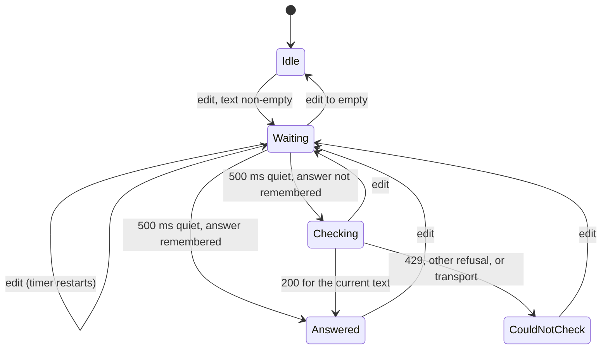
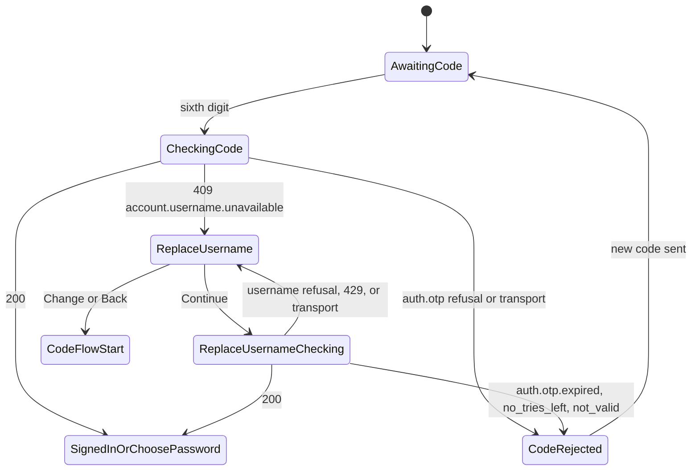
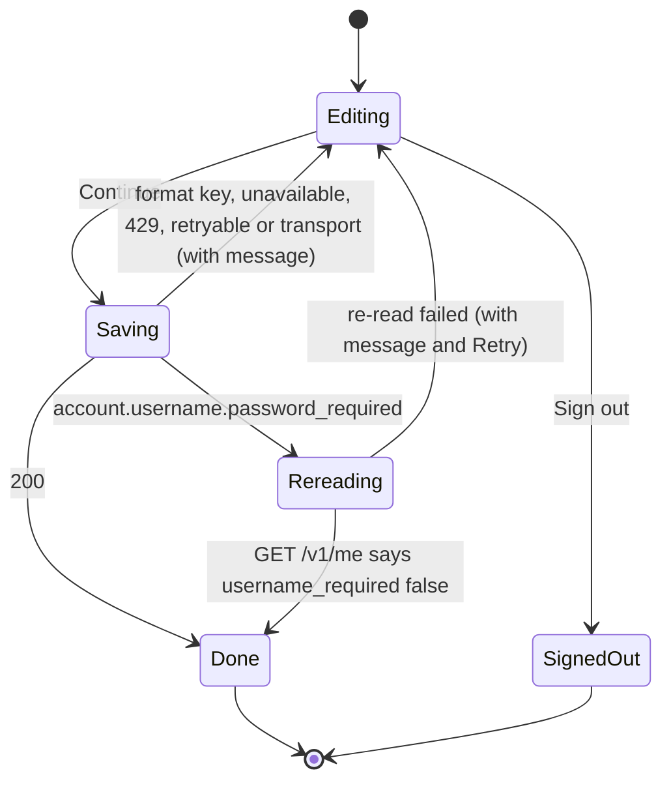
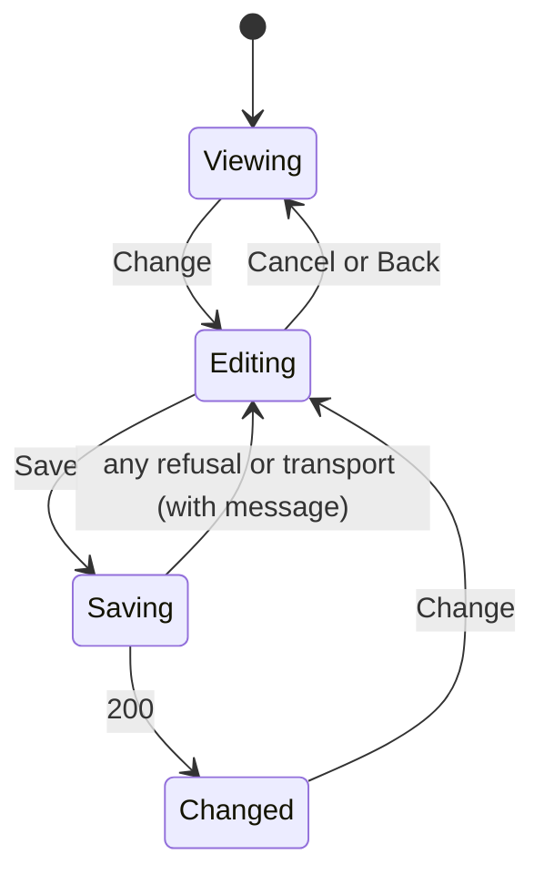
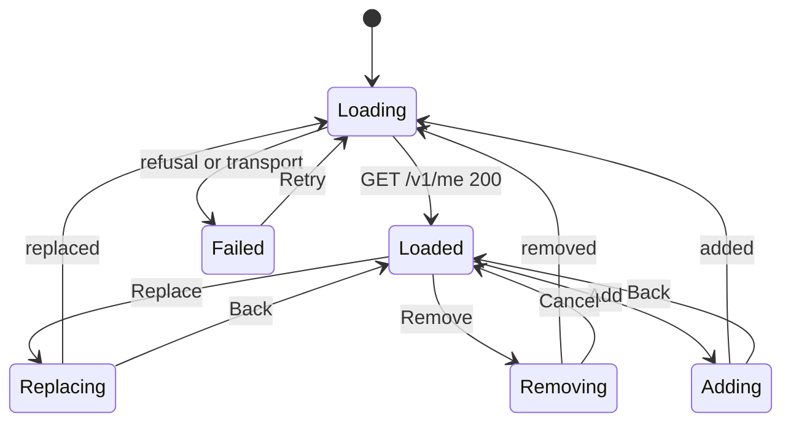
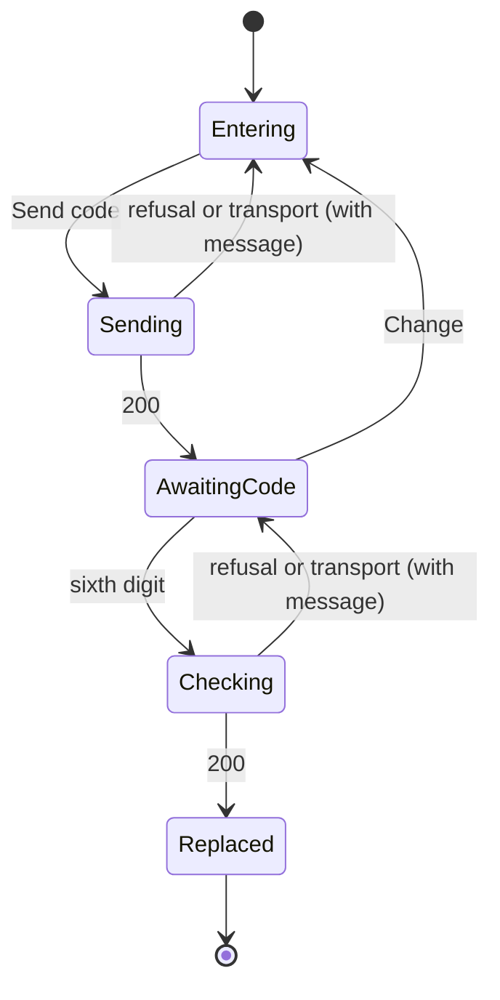
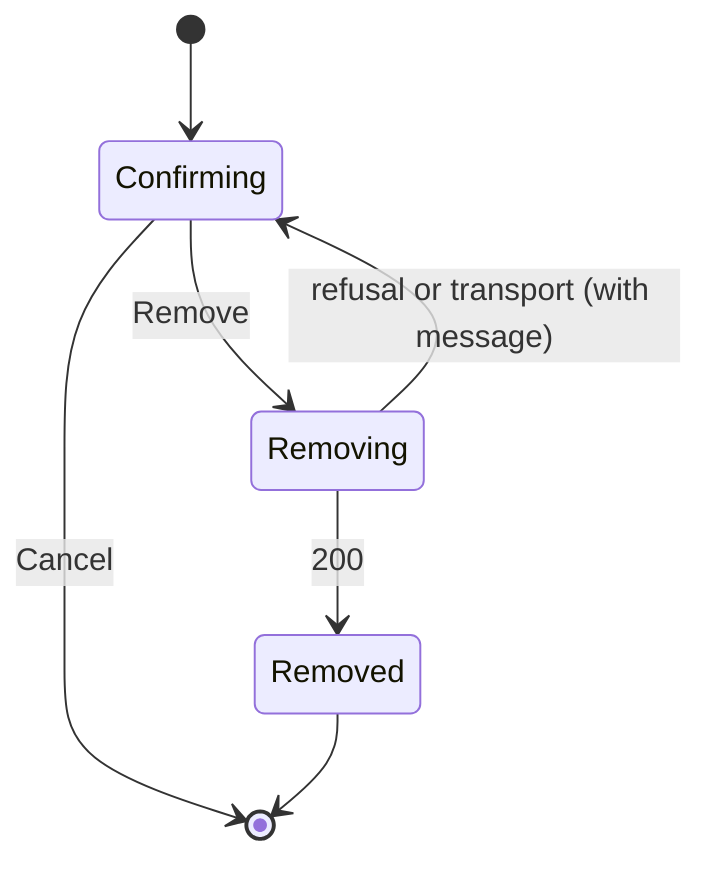

# Functional Specification — U3 android-identity

Intent `261113-unique-usernames`, unit U3 `android-identity` (kind `ui`). This
file is self-contained: it is the source of truth for the Android interaction
workflows and the screen state transitions this unit adds or changes. There is
no `entities.md` or `rules.md` for a `ui` unit; every business rule stays on
the server (TC-9, FR11.3), and this client renders what the server decided.
Component shapes, UiState classes, repository and DTO changes, navigation and
test obligations are in `frontend-components.md`.

Answers Q1–Q5 are in `functional-design-questions.md`, all taken as
recommended (A) on the person's instruction.

## 1. Grounding: the code this design changes

Read before writing (branch `ccr-7315fe9c-esalr9`, head `7df12c1`, with U1 and
U2 built). Paths are under `android/src/main/kotlin/com/shikkhokplus/app/`.

| Surface | As built today | What U3 changes |
|---|---|---|
| Sign-in (`feature/auth/ui/AuthScreen.kt` `SignInStep`) | Phone/Email toggle + `IdentifierField`; `identifierIsWellFormed` refuses a malformed value before sending; `AuthRepository.signIn(Identifier, password)` sends `PasswordSignInRequest(phone, email, password)` | One free-text field "Username, phone or email"; nothing judged on the client but non-blank; sends `login` (W3) |
| Code flow (`CodeRequestStep`, `CodeStep`) | Phone/Email toggle, unchanged by FR10.1 | Unchanged, except the code step gains the replacement-username state after a sign-up verify (W2) |
| Sign-up (`feature/auth/ui/SignupScreen.kt`, `SignupViewModel`, `SignupStateMapper`) | Role, name, phone or email, address, password; `SignupRequestDto` has no username; already-added lookup by phone only | Username field with live availability (W1); `username` sent; email lookup (W9, Q4) |
| Verify (`AuthViewModel.submitCode`) | `verify(identifier, code)`; any refusal becomes `CodeRejected` | `account.username.unavailable` becomes the replacement step; the retry sends `username` with the same code (W2) |
| Account read (`core/session/SessionViewModel.resolve`, `MainActivity.AppRoot`) | `GET /v1/me` behind the loader; lens picker returned before the graph; `MeDto` has no username fields | `MeDto.username`, `usernameRequired`; the choose-username gate returned before the lens picker (W4, Q2) |
| More (`feature/profile/ui/ProfileScreen.kt` `SignInRows`, `navigation/AccountRoutes.kt` `accountRowsFor`) | Password row; "Add phone number" / "Add email" only when missing | Username row and one "Phone and email" row (W5, W6, Q3) |
| Account screens (`feature/account/*`) | Set/change password; add a phone or email (`AddContactViewModel`) | Username screen; Contacts screen; replace and remove flows (W5, W6) |
| Student form (`feature/students/ui/AddStudentForm.kt`, `StudentDetailScreen.kt` `EditStudentDialog`, `core/network/TeacherStudentDto.kt`) | Name, student phone, guardian phone | Student email and guardian email on create and edit, shown on the detail screen and the list (W7) |
| Batch roster row (`core/network/RosterDto.kt` `RosterRowDto`) | `guardian_phone` only | Reads `student_email`, `guardian_email` (in `RosterRowResponse`) for display (W7) |
| Centre members (`core/network/CentreDto.kt`, `feature/centres/*`) | `MemberDto.phone: String` **non-null, no default**; invite by name + phone | Phone or email invite; `phone` nullable; `invited_email` read (W8) |
| Message keys (`feature/auth/MessageKeys.kt`, `MessageKeyCoverageTest`) | No mapping for 15 published keys (computed below) | All 15 mapped, with Bangla and English strings (§ 5) |

**Two defects the built backend exposes in the current client**, both closed by
this unit:

1. `MemberDto.phone` is declared `String` with no default. `MemberResponse.phone`
   is now `string | null` (C2, `openapi.json`). With kotlinx serialization a
   JSON `null` for a non-null property fails the decode, and the members list
   is decoded as one `List<MemberDto>`, so **one email-only invitation makes
   the whole members screen fail to load** for every manager of that centre.
   This is live on any build that talks to a backend with U2 merged.
2. `message-keys.json` publishes 15 keys `MessageKeys` cannot resolve:
   `account.contact.admin_locked`, `account.contact.change_limit`,
   `account.contact.last_one`, `account.contact.password_required`,
   `account.username.bad_dot`, `account.username.change_too_soon`,
   `account.username.invalid_character`,
   `account.username.must_start_with_letter`,
   `account.username.password_required`, `account.username.reserved`,
   `account.username.too_long`, `account.username.too_short`,
   `account.username.unavailable`, `auth.lookup.too_many`,
   `student.email.taken`. Computed by applying `MessageKeyCoverageTest`'s own
   regex to `message-keys.json` and diffing against the `"…" to` entries in
   `MessageKeys.kt`; on that reading the test's
   `every published key maps to a specific string` assertion fails on this
   branch until U3 lands. (Read, not executed: the Gradle suite was not run
   for this stage.)

## 2. Workflows

Numbered steps are the order the implementation follows. "Shown under the
field" means the refusal is rendered beside the field it is about and the form
keeps everything typed (FR1.6). Every write is sent only when the person acts;
nothing is queued or retried by itself (TC-8, D-9).

### W1. Sign up with a username and the live availability check

1. The sign-up form gains one field, **Username**, placed directly above the
   two password fields (the sign-in credentials together), with the help line
   "You will sign in with this. Letters, numbers, _ and ." while empty. The
   help line is guidance, not a check (FR11.3).
2. On each edit the field's availability hint is reset to "not checked" and a
   check is scheduled (Q1): 500 ms after the last keystroke, if the trimmed
   text is non-empty, `POST /v1/accounts/username-availability` with body
   `{"username": <trimmed text>}`. The text never goes in a URL (NFR3.5).
3. While a check is in flight the hint reads "Checking…". At most one request
   is in flight; an edit during one schedules the next and the earlier answer
   is applied only if its text equals the field's current trimmed text
   (latest wins). Answers are remembered per text for the screen's life.
4. The answer is rendered as the server gave it:
   - `available` → "Available" (positive tone);
   - `unavailable` → the `account.username.unavailable` string ("This
     username is not available"); the public lookup never says why (held and
     taken read alike, ADR-007);
   - `invalid` → the string for the response's `message_key` (too short, too
     long, invalid character, must start with a letter, bad dot);
   - `reserved` → the `account.username.reserved` string.
5. A refused lookup (`429 auth.lookup.too_many`) or a transport failure shows
   "Could not check right now. You can still continue." in a neutral tone.
   Neither disables Create account (FR3.2).
6. Create account is enabled by the existing conditions plus a non-blank
   username. It is **not** gated on the hint: a name the hint called
   unavailable may still be submitted, and the server's answer stands
   (FR11.3; the hint can be stale by the time of submission).
7. Submit sends `SignupRequestDto` with `username` set to the trimmed text,
   alongside the existing fields. The password is held in memory as today.
8. Outcomes of `POST /v1/accounts`:
   - 201 → as today (`CodeSent`, hand-off to the code step with the
     identifier and password).
   - 400 with an `account.username.*` format key, or 409
     `account.username.unavailable` → shown under the Username field; every
     other field keeps its value; the hint is replaced by the refusal.
   - Every other refusal → as today (banner, `signup.number.already_registered`
     beside the identifier).
   - Transport failure → as today, with an explicit retry.
9. The username is kept across rotation (`rememberSaveable`; it is not a
   secret) and is handed to the code step with the identifier, so a
   replacement (W2) can be pre-filled.

### W2. Verify a sign-up code, including the replacement username

1. The code step behaves as today: six digits, auto-submit on the sixth,
   `POST /v1/auth/verify` with `{phone|email, code}`.
2. A 200 continues as today (password sent from memory, or the choose-password
   step).
3. A **409 `account.username.unavailable`** means another account took or a
   hold now covers the name between draft and verify (FR2.2, ADR-011). The
   code was **not** consumed (C1). The code step changes to the
   **replacement** state:
   - title "Choose another username"; body "Someone took {username} while you
     were confirming. Your code still works — choose another name to finish.";
   - a Username field, empty, with the W1 availability hint on the public
     lookup;
   - Continue, and the existing Change / Back affordances.
   The six digits stay in the ViewModel's memory only (never saved state),
   because the retry must present the same code.
4. Continue sends `POST /v1/auth/verify` with `{phone|email, code, username}`
   (the same code, the trimmed replacement).
5. Outcomes of the retry:
   - 200 → as step 2 (the account now has the replacement username).
   - 400 `account.username.*` format key, or 409
     `account.username.unavailable` again → stays in the replacement state,
     shown under its field; the code still works.
   - 429 `auth.lookup.too_many` (Family C, 5 per destination per hour) →
     stays in the replacement state with that message; the code was not read
     and still works. Continue remains available; the person decides when.
   - `auth.otp.expired`, `auth.otp.no_tries_left` or `auth.otp.not_valid` →
     back to the code step's existing expired/spent handling (banner and "Send
     a new code"). A new code is requested with the existing resend; the
     draft (24 h) survives, and its stored username is still the original
     one, so the next verify may hit step 3 again. That is the server's
     design; the client does not try to carry the replacement across codes.
   - `auth.otp.wrong` → cannot happen for a code that verified once and was
     not consumed; if it arrives it is handled as the existing wrong-code
     state.
   - Transport failure → stays in the replacement state with the offline
     message and a Retry that resends the same request.
6. "Change" / Back from the replacement state forgets the held code and the
   held password and returns to the code flow's first step, as Change does
   today.

### W3. Sign in with one field

1. The sign-in step shows one text field, **"Username, phone or email"**, with
   no Phone/Email toggle, a text keyboard, and the platform autofill hint
   `Username` (a password manager can fill either a saved username or a saved
   phone/email entry). The field's value survives rotation as today.
2. The only client condition is non-blank; there is no shape check and no
   classification (FR4.1, FR11.3). Sign in is enabled when the field and the
   password are non-empty, as today.
3. Submit sends `POST /v1/auth/password` with
   `{"login": <text as typed, trimmed>, "password": …}` and no `phone` or
   `email` field.
4. Outcomes are mapped exactly as today (`AuthStateMapper.afterSignIn`):
   tokens → signed in; MFA challenge → second step; `auth.password.wrong` and
   `auth.password.too_many_attempts` → the banner with the way to the code
   flow; transport → retry.
5. The only identifier-shaped refusal left is `email.invalid` (a value holding
   `@` that is no address); it is shown under the field. `phone.invalid` is
   never emitted for a login (a non-phone is classified as a username), and
   the existing key-to-field routing keeps it harmless if it ever is.
6. Forgot password / First time with a password lead to the code flow, which
   keeps its Phone/Email toggle: recovery stays phone or email (FR10.1). The
   code flow does not copy the login field's text across, because a username
   there would be refused.

### W4. Choose a username before anything else (FR5.2)

1. After sign-in (and at every cold start that resumes a session),
   `SessionViewModel.resolve` reads `GET /v1/me` as today and now also
   publishes `usernameRequired` from `MeDto.usernameRequired`.
2. `AppRoot`, after the Resolving loader and **before** the lens picker and
   the graph, returns the choose-username gate when `signedIn` and
   `usernameRequired` are both true (Q2). Nothing else is composed: no home,
   no More, no set-password prompt, no two-step offer, no queue UI.
3. The gate shows: title "Choose your username"; body "From now on you can
   sign in with a username as well as your phone or email. Choose one to
   continue."; the Username field with the availability hint using the
   **authenticated** lookup `POST /v1/me/username-availability` (W1 steps
   2–5); Continue; and a text action "Sign out".
4. Continue sends `PUT /v1/me/username` with `{"username": …}` and no
   password (the first choice needs none, FR5.4).
5. Outcomes:
   - 200 → `SessionViewModel` publishes `usernameRequired = false` at once
     (the server's 200 is the confirmation, as `passwordSet` does for the
     password prompt); the gate is replaced by the lens picker or the home.
   - 400 format key, or 409 `account.username.unavailable` → under the field.
   - 400 `account.username.password_required` on a first choice means another
     device chose a name first (U1 W7 step 3). The gate re-reads
     `GET /v1/me`; the server now says `username_required: false` and the gate
     goes away. No password is asked for here.
   - 429 `auth.lookup.too_many` → message on the gate; Continue stays
     available.
   - 503 `error.temporarily_unavailable` (retryable) and transport failure →
     message with an explicit Retry that resends the same choice.
6. "Sign out" runs the app's one `endSession` (queue, copies, tokens, auth
   state), exactly as More's Log out does, and returns to sign-in.
7. System Back on the gate behaves as on any root screen (the activity
   finishes); the gate is not dismissed, because reopening the app resolves
   the account again and shows it again while the server says `true`.
8. If the account read fails (offline at cold start), `usernameRequired` is
   not known and is left `false`; the app proceeds as today (FR5.3: the server
   refuses nothing for a missing username). The next successful read — the
   next cold start, or a quiet re-read after accepting a seat or adding a
   contact — shows the gate. An unknown is not a "yes".

### W5. View and change the username in Settings

1. More's account section gains a **Username** row whose subtitle is the
   current username as the server stored it (display casing). With no
   username yet (unreachable in practice behind W4) the row reads "Choose a
   username". The row needs the server; offline it is greyed with "Needs a
   connection", like its neighbours.
2. The row opens the **Username** screen: the current username, read-only,
   and a Change action.
3. Change opens the form: "New username" with the availability hint using the
   authenticated lookup (so a name the person released and may reclaim reads
   available, ADR-012); "Current password"; Save. A note under the field:
   "You can change your username once every 30 days. Your old username is
   kept for you for 30 days." (FR7.2, FR7.3; copy, not a check).
4. Save sends `PUT /v1/me/username` with `{username, password}`.
5. Outcomes:
   - 200 → the screen shows the new username with "Changed. You can change it
     again on {date}." when `next_change_at` is non-null (the server's instant
     rendered by the existing `core/format/Dates.kt` `dateTimeLabel`, month in
     the phone's language, digits per the app's numeral rule); without the
     date when it is null. The profile and the More row re-read. No session ends (FR7.5).
   - 409 `account.username.change_too_soon` → "You can change your username
     again on {date}" using `details.next_change_at`; with no date in the
     envelope, the key's plain string. The form keeps what was typed.
   - 400 `account.username.password_required` → "Set a password first to
     change your username" with an action to the set-password screen.
   - 400 `auth.password.current_wrong` → under the password field.
   - 409 `auth.password.too_many_attempts` → banner, not retryable.
   - 400 format key / 409 `account.username.unavailable` → under the username.
   - 429 `auth.lookup.too_many` → banner; Save stays available.
   - 503 `error.temporarily_unavailable` (retryable) and transport failure →
     banner with Retry resending the same request.
6. The client never decides whether a rename is allowed: Change is always
   offered; `next_change_at` is shown only when the server sent it in this
   screen's life (`MeResponse` carries no `next_change_at`, so the first
   visit cannot show it before a change or a refusal).
7. The password is held in `remember` only and cleared on success and on
   leaving the screen.

### W6. Contacts in Settings: view, add, replace, remove

1. The existing "Add phone number" and "Add email" rows in More are replaced
   by one **Phone and email** row (Q3), subtitle the present contacts on one
   line (phone first). It opens the **Contacts** screen.
2. The Contacts screen reads the account (`GET /v1/me`) and shows two cards:
   - **Phone**: the number, with Replace and Remove; or "No phone number" with
     Add phone number and the existing why-it-matters line (teachers find
     students and guardians by number).
   - **Email**: the address, with Replace and Remove; or "No email" with Add
     email.
   When the server says `has_password: false`, a note sits above the cards:
   "To replace or remove a contact you need a password." with Set a password.
   The actions stay enabled (Q3; the server decides).
3. **Add** opens the existing add-contact flow unchanged (`POST /v1/me/contact`
   then `/verify`). A new phone or email can link seats (FR6.5), so on success
   the lenses are re-read quietly, as today.
4. **Replace** opens the replace flow:
   1. The entry step: "New phone number" (or "New email") and "Current
      password"; Send code.
   2. `POST /v1/me/contact` with `{phone|email, password}`.
   3. Request refusals stay on the entry step: `account.contact.password_required`
      (with Set a password), `auth.password.current_wrong` (under the
      password), `auth.password.too_many_attempts`,
      `account.contact.already_set` (under the new value),
      `account.contact.admin_locked`, `account.contact.change_limit`,
      `phone.invalid` / `email.invalid` (under the new value), the existing
      send ceilings (`auth.otp.temporarily_unavailable`), transport (Retry).
   4. 200 → the code step (as Add's), "We sent a code to the new number" (or
      address). The password is dropped from memory once the request
      succeeded; it is not needed again.
   5. `POST /v1/me/contact/verify` with `{phone|email, code}`.
   6. Verify refusals stay on the code step: the `auth.otp.*` set as today,
      `account.contact.taken`, `account.contact.admin_locked`,
      `account.contact.change_limit` (the code stays unspent), transport
      (Retry with the same code).
   7. 200 → "Replaced. We told your old number it was removed." (or address),
      the screen returns to Contacts, which re-reads the account; the lenses
      are re-read quietly (the new value may link seats).
5. **Remove** opens a confirmation sheet naming the contact: "Remove
   {number}? You will no longer be able to sign in or get codes with it.
   Classes and invitations already on your account stay." with "Current
   password", Remove (destructive tone) and Cancel.
   1. `POST /v1/me/contact/remove` with `{kind, password}`.
   2. 200 → sheet closes; Contacts re-reads; "Removed" note on the card.
   3. 409 `account.contact.last_one` → in the sheet: "You need at least one
      phone number or email on your account. Add another before removing
      this one." with an action to Add the other kind; not retryable.
   4. `auth.password.current_wrong` → under the password;
      `account.contact.password_required` → with Set a password;
      `auth.password.too_many_attempts`, `account.contact.change_limit`,
      `account.contact.admin_locked` → banner in the sheet, not retryable.
   5. Transport → banner with Retry resending the same request.
6. Whatever the server answers about which contacts exist is what the screen
   shows: after any write the screen re-reads `GET /v1/me` (or uses the
   `MeResponse` the write returned), never edits its own copy.

### W7. Teacher's student form: emails, and showing them

1. **Add student** (`AddStudentForm`) gains "Student email (optional)" and
   "Guardian email (optional)", each directly under its phone field, email
   keyboard, autofill off (these are someone else's addresses).
2. Each email field, when non-blank, is checked with the shared
   `emailIsWellFormed` (aligned to the server, Q5) and a malformed value is
   shown under that field; blank means absent. Phone fields are unchanged.
3. Create sends `student_email` and `guardian_email` (trimmed, omitted when
   blank) with the existing body.
4. Outcomes: 409 `student.email.taken` → under "Student email";
   `email.invalid` from the server (only if the shapes ever diverge again) →
   a form banner, because the envelope does not say which field; the
   existing refusals unchanged.
5. **Edit student** (`EditStudentDialog`) gains the same two fields,
   pre-filled with the stored values. The patch semantics follow C2: a field
   left unchanged is omitted; a value changed is sent; **a field emptied
   sends `null` to clear it** — unlike the phones today, where an emptied
   phone is treated as unchanged. (The phones keep their current behaviour;
   changing that is out of U3's scope.)
6. Edit outcomes add `student.email.taken`, and `student.number_accepted` /
   `student.number_erased`, which now also cover a changed email; their
   strings are reworded from "number" to "contact" (§ 5).
7. **Display**: the student detail header shows the student's phone, or the
   student's email when no phone is recorded; the guardian line shows
   "Guardian · {phone}" or "Guardian · {email}" likewise, and both when both
   are recorded. The students list row shows the same choice for its
   subtitle. The batch roster row (`RosterRowDto`) reads `student_email` and
   `guardian_email` and shows the guardian's email where it shows the
   guardian's phone today, when no phone is recorded. Which value is shown is
   decided in the state mapper, not the composable.

### W8. Centre: invite by phone or email; members without a phone

1. The members screen's invite form gains an "Email" field under "Phone" and
   a line "Invite by phone number or email" (FR6.4). Both are optional on the
   client; Invite is enabled when the name is non-blank and **at least one**
   of phone or email is non-blank (a presence check mirroring the request
   schema's shape, not a policy).
2. A non-blank email is shape-checked with `emailIsWellFormed`; phones are
   sent as typed, as today.
3. Invite sends `POST /v1/centre/members` with `display_name`, `role`, and
   `phone` and/or `email`, each omitted when blank.
4. Outcomes: 201 → as today ("Invitation sent to {name}") and the list
   re-reads; 409 `centre.member.already_invited` → banner, its string
   reworded to cover an email (§ 5); 422 (neither contact, only reachable if
   the client check is bypassed) → the generic unexpected message; existing
   refusals unchanged.
5. **Members list**: `MemberDto.phone` becomes nullable and `invited_email` is
   read. Each member card shows the phone when present, otherwise the invited
   email; this choice is made in a mapper into a `contactLine`, not in the
   card. This closes defect 1 in § 1.

### W9. The already-added lookup for an email at sign-up (Q4)

1. When the sign-up identifier is Email and the field is left holding a value
   `emailIsWellFormed` accepts, `GET /v1/accounts/already-added?email=…`
   runs, once per value, exactly as the phone lookup does today.
2. The answer is mapped by the existing `SignupStateMapper.afterLookup`: a
   seat locks the role; no seat leaves the form as it is; a seat with a role
   this app does not know is a failure. Nothing is named (C-06).
3. A refusal (`auth.lookup.too_many`, now shared by both kinds) or a
   transport failure leaves the form usable; submission is never blocked by
   the lookup.

### W10. Copy that changes meaning

`student.number_accepted`, `student.number_erased` and
`centre.member.already_invited` now cover an email as well as a phone
(U2 functional-spec § 6). Their English and Bangla strings change from
"number" to "contact" wording. The keys do not change.

## 3. Screen state machines

Each machine is the UiState of one screen; transitions are named by the event
or the server's answer. A refusal state keeps every typed value.

### 3.1 The username availability hint (shared by sign-up, the replacement step, the gate and rename)

Text fallback: the hint starts Idle. A non-empty edit moves it to Waiting;
each further edit restarts the 500 ms timer; an edit to empty returns to Idle.
After 500 ms of quiet it shows a remembered answer at once or moves to
Checking. A 200 for the text still in the field moves to Answered (available,
unavailable, invalid with its key, or reserved). A 429, any other refusal or
no answer moves to CouldNotCheck. Any edit leaves Answered or CouldNotCheck
for Waiting. An answer for a text no longer in the field is dropped. No state
blocks submission.

### 3.2 Sign-up form (additions to `SignupUiState`)

The existing states (Empty, CheckingNumber, AlreadyAdded, Invalid,
Submitting, CodeSent, Failed) are unchanged. Additions: `Invalid.fieldKeys`
may hold `signup.username.required` (client: blank username); a `Failed`
whose `messageKey` is an `account.username.*` key is rendered under the
Username field instead of as a banner (the same key-to-field routing the
identifier already uses). The availability hint is a separate state (3.1)
held beside the form state, because it changes independently of it.

### 3.3 Code step with the replacement (additions to `AuthUiState`)

Text fallback: from the code check, a 409 `account.username.unavailable`
moves to ReplaceUsername (code held in memory, field empty). Continue moves to
ReplaceUsernameChecking, which ends signed in (or at choose-password) on a
200; back at ReplaceUsername with the refusal on a username refusal, a 429 or
no answer; at CodeRejected on a spent or expired code, from which "Send a new
code" returns to AwaitingCode. Change or Back returns to the code flow's
first step and forgets the held code and password. In the component model
ReplaceUsername and ReplaceUsernameChecking are one `ReplaceUsername` state
with `checking`.

### 3.4 Choose-username gate

Text fallback: the gate starts Editing. Continue moves to Saving. A 200 ends
at Done, which lifts the gate. A format refusal, `unavailable`, a 429, a
retryable refusal or no answer return to Editing with the message (Retry
offered only for the retryable ones and transport). A
`password_required` answer moves to Rereading, which ends at Done when the
server says no username is required any more, or returns to Editing with a
retry if the read fails. Sign out ends the session from Editing.

### 3.5 Username screen (Settings)

Text fallback: Viewing shows the stored username. Change opens Editing; Cancel
or Back returns to Viewing and clears the password. Save moves to Saving; a
200 moves to Changed (the new username and, when sent, `next_change_at`); any
refusal or no answer returns to Editing with the message routed to its field
or a banner, Retry only where retryable or transport. Changed may start
another Change, which the server will usually refuse with `change_too_soon`
and its date.

### 3.6 Contacts screen and its two flows

Text fallback: the screen loads the account; a failure offers Retry. From
Loaded the person opens Add (the existing flow), Replace or Remove; finishing
any of them re-loads the account, and leaving any of them returns to Loaded
unchanged.

Replace flow (one screen, two steps):

Text fallback: Entering holds the new value and the password; Send code moves
to Sending; a refusal returns to Entering with the message; a 200 moves to
AwaitingCode and drops the password. The sixth digit moves to Checking; a
refusal returns to AwaitingCode with the message (tries left shown for a wrong
code); a 200 ends at Replaced. Change returns to Entering.

Remove sheet:

Text fallback: Confirming names the contact and asks for the password.
Remove moves to Removing; a refusal (the last one included) or no answer
returns to Confirming with the message; a 200 ends at Removed, which closes
the sheet. Cancel closes it with nothing sent.

### 3.7 Centre invite form

The existing `MembersUiState` gains `inviteEmail` and `inviteEmailRejected`.
`canInvite` becomes: not inviting, name non-blank, and phone or email
non-blank. The list body states (Loading, Loaded, Failed) are unchanged; each
loaded member now carries a mapped `contactLine`.

## 4. Error handling per message key

"Under X" is a field-level refusal; "banner" is a form-level one. "Retry" means
an explicit button resending the same request, offered only when the
envelope's `retryable` is true or no response arrived.

| message_key | Screens | Shown | Retry | Action offered |
|---|---|---|---|---|
| `account.username.too_short`, `.too_long`, `.invalid_character`, `.must_start_with_letter`, `.bad_dot`, `.reserved` | sign-up, replacement, gate, rename; also as lookup hints | under Username | no | — |
| `account.username.unavailable` | sign-up (409 draft), verify (409 → replacement state), replacement, gate, rename; lookup hint | under Username | no | on verify: the replacement state |
| `account.username.change_too_soon` | rename | banner with `details.next_change_at` as a date | no | — |
| `account.username.password_required` | rename; gate (first choice) | rename: banner; gate: not shown, triggers a re-read | no | rename: Set a password |
| `auth.lookup.too_many` | every availability hint; replacement retry; gate; rename; email lookup | hint: "could not check"; forms: banner | no (server says false) | the person may press Continue/Save again |
| `auth.password.wrong`, `auth.password.too_many_attempts` | sign-in | banner (existing) | as today | Get a code (existing) |
| `auth.password.current_wrong` | rename, replace, remove | under Current password | no | — |
| `auth.password.too_many_attempts` | rename, replace, remove | banner | no | — |
| `email.invalid` | sign-in (login with `@`), add/replace email, student form, invite | under the email field; student form: banner | no | — |
| `phone.invalid` | add/replace phone, invite | under the phone field | no | — |
| `account.contact.password_required` | replace, remove | banner | no | Set a password |
| `account.contact.last_one` | remove | in the sheet | no | Add the other kind |
| `account.contact.change_limit` | replace (request or verify), remove | banner | no | — |
| `account.contact.admin_locked` | replace, remove | banner | no | — |
| `account.contact.already_set` | replace | under the new value | no | — |
| `account.contact.taken` | add, replace verify | banner on the code step (existing) | no | — |
| `auth.otp.*` | verify, contact verify | existing code-step handling | existing | Send a new code |
| `student.email.taken` | add and edit student | under Student email | no | — |
| `student.number_accepted`, `student.number_erased` | edit student | banner (reworded) | no | — |
| `centre.member.already_invited` | invite | banner (reworded) | no | — |
| `error.temporarily_unavailable` | rename, gate | banner | yes (retryable true) | Retry |
| `error.network.unreachable` (client, no response) | every write and read here | banner or hint | yes | Retry |
| `error.unexpected` (undecodable, or a 422) | every screen | banner | no | — |

An unknown key falls back to the generic string, as `MessageKeys.resolve`
does today; after this unit no published key is unknown.

## 5. Strings (FR11.2)

Every string below is added to `res/values/strings.xml` and
`res/values-bn/strings.xml` together; the build already fails on a key
present in one bundle only. Exact names are in `frontend-components.md` § 7.

- **Message-key strings (15)**: the 15 keys in § 1 defect 2, each mapped in
  `MessageKeys`.
- **New UI strings**: sign-up username label and help; four availability hint
  texts (checking, available, could not check, plus the refusal keys reused);
  replacement step title and body (with the username argument); gate title,
  body, Continue, Sign out; More rows (Username, Choose a username, Phone and
  email); Username screen (title, current label, Change, new label, rule
  note, changed with date, changed without date, change-too-soon with date,
  set a password first); Contacts screen (title, phone card, email card, no
  phone, no email, Replace, Remove, password note, replace titles and bodies,
  code sent to new value, replaced notice, remove sheet title and body with
  argument, removed notice, last-one body with action); student form (two
  email labels); detail guardian email line; invite form (email label, "by
  phone or email" help); sign-in login label.
- **Reworded (keys unchanged)**: `student_number_accepted`,
  `student_number_erased`, `centre_member_already_invited`
  ("number" → "contact": e.g. "This contact has accepted, so it can no longer
  be changed."), and the sign-in headline help where it says "phone number".
- A date in a string (`next_change_at`) is formatted by the existing
  `dateTimeLabel` (month in the phone's language, Latin digits per the app's
  numeral rule); the server's instant is rendered and nothing is computed
  from it.

## 6. Loading, empty, error and retry states per screen

| Screen | Loading | Empty | Error | Retry |
|---|---|---|---|---|
| Sign-in | loader over the form (existing) | — | banner (existing) | as today |
| Sign-up username hint | "Checking…" in the hint | Idle shows the help line | "Could not check right now" | none (an edit re-checks) |
| Replacement step | loader over the step | field empty at entry | under the field or banner | transport only, same request |
| Choose-username gate | loader over the gate while saving or re-reading | field empty at entry | under the field or banner | retryable and transport |
| Username screen | the account read is the profile already held; loader while saving | "Choose a username" when none (unreachable behind the gate) | under fields or banner | retryable and transport |
| Contacts | loader while reading `GET /v1/me` | each card's "No phone number" / "No email" with Add | full-screen message with Retry | Retry re-reads |
| Replace flow | loader while sending and checking | — | under fields or banner | transport, same request |
| Remove sheet | loader in the sheet | — | in the sheet | transport, same request |
| Add/edit student | existing | — | under the field or banner | existing |
| Centre members | existing list loader | existing | existing; a list with a null phone no longer fails to decode | existing |

Stale data: the Contacts and Username screens show only what the last read or
write returned and re-read after every write; More's rows draw from the last
confirmed profile, as today, and are greyed offline.

## 7. Corner sweep (Screens and user input, and the other surfaces that apply)

Deployment shape: one person per account, many devices per account, networked;
children's data; no offline writes. Settled per condition:

- **Loading, empty, error are distinct** — § 6 table.
- **Stale data** — re-read after writes; More greys server rows offline.
- **Same fact in two places** — the username in More and on the Username
  screen both come from the last `MeResponse`/`UsernameChangeResponse`; a
  rename re-reads the profile so both update together.
- **Destructive action** — Remove asks for confirmation naming the contact and
  saying what stays. Replace removes the old contact only after the new one
  is verified, which the confirmation copy states.
- **Invalid input** — names the field and keeps everything typed (FR1.6).
- **Double submit** — every submit is ignored while its request is in flight
  (`saving`/`checking`/`sending` flags, as the existing ViewModels do). A
  username claim twice is idempotent on the server anyway (case-only and
  same-name paths).
- **Unsaved input on navigation or session expiry** — the gate and the rename
  form hold the typed username in saved state; passwords are never saved
  (L-20). A lapsed session ends through the existing renewal path; the gate is
  shown again after the next sign-in.
- **Client-side rules also enforced on the trusted side** — the client holds
  no username rule, no last-contact rule and no rename window; the email shape
  check is aligned to the server (Q5) and the server re-checks.
- **Keyboard, screen reader, contrast** — the availability hint is text, never
  colour alone; the hint is a live region so TalkBack announces "Available" /
  the refusal; the gate's Sign out is a focusable text button.
- **Older response arrives last** — latest-wins rule in 3.1.
- **Same user on two devices** — first choice on two devices: the second gets
  `password_required` and re-reads (W4 step 5). Rename on one device: the
  other shows the new name on its next read (FR7.5). Contact removed on one
  device: the other's Contacts screen re-reads on open.
- **Rate limited** — every 429 says the check or claim could not be done now
  and leaves submission to the person.
- **Version skew** — unknown response fields are ignored (`ignoreUnknownKeys`);
  `MemberDto.phone` nullable is the one tightening this unit must make.
- **Very long text** — a username is at most 20 characters by FR1 but the
  field accepts what is typed up to the schema's 64 and lets the server
  refuse; long emails (254) wrap in cards rather than truncating; Bangla
  labels are covered by § 8.
- **Text that looks equal** — a username differing only by case from the
  current one is sent and the server applies the case-only rule (W8a); the
  client never lowercases what it displays.
- **Sensitive data** — no username, password, email or phone is logged; the
  username is never put in a URL, a notification or analytics (none exists).

## 8. Bangla layout obligations (FR11.2)

The verifier is the manual check in `docs/delivery/bangla-layout-check.md`;
**nothing automated discharges this obligation** — there is no screenshot test
in this unit, and the state-machine tests in `frontend-components.md` § 8 are
correctness tests that do not measure layout. The unit is not complete until
each row below is in that table, checked at the longest Bangla string on the
screen, with its status. The longest string per screen is re-derived from
`values-bn/strings.xml` when the strings land (not estimated here).

| Unit | Screen | New or changed |
|---|---|---|
| U3 | Auth: sign-in (one login field) | changed |
| U3 | Auth: OTP entry — replacement username state | changed |
| U3 | Signup — username field and availability hint, every hint state | changed |
| U3 | Choose username (gate) | new |
| U3 | More — Username and Phone and email rows | changed |
| U3 | Username (view, change, changed with date, change-too-soon) | new |
| U3 | Contacts (both cards present; one absent; password note) | new |
| U3 | Replace contact (entry and code steps) | new |
| U3 | Remove contact sheet, including the last-one refusal | new |
| U3 | Add student — two email fields | changed |
| U3 | Edit student dialog — two email fields | changed |
| U3 | Student detail and list — email shown in place of a phone | changed |
| U3 | Roster row — guardian email | changed |
| U3 | Centre members — invite by phone or email, member with email only | changed |

## 9. Findings for the record

1. **Members list decode failure** (§ 1 defect 1): structural, live once U2 is
   deployed; closed by W8 step 5. It is the first change of this unit's code
   generation.
2. **`MessageKeyCoverageTest` reads red on this branch** (§ 1 defect 2):
   closed by § 5.
3. **Client email check stricter than the server** (Q5): `a@b.c.` and
   `a@.b.c` match the server pattern and fail `emailIsWellFormed`. Aligned in
   this unit; a test pins both.
4. **The committed `openapi.json` under-describes two C2 operations.**
   `POST /v1/me/contact` and `POST /v1/me/contact/remove` list only
   `200, 422, 500, 503`, while the built behaviour (U2 functional-spec § 6)
   answers 400 and 409 with the keys in § 4. The client switches on
   `message_key`, so nothing here depends on the status, but the contract of
   record is incomplete. It belongs to U2 (owner of C2) to declare those
   responses; recorded so it is not mistaken for a client assumption.
5. **`MeResponse` carries no `next_change_at`**, so Settings cannot say when
   the next rename is allowed until a rename or a refusal tells it. Accepted
   (W5 step 6); a server field would be U1's to add.

## Assumptions & Open Questions

- [assumption] The sign-in field trims surrounding whitespace before sending,
  as every other identifier field does; the server trims too (BR4.2), so this
  refuses nothing.
- [assumption] 500 ms is the debounce (Q1). With the Family A ceiling at 30
  per /64 per hour, a person who pauses often while typing can exhaust a
  shared carrier /24 (U1 functional-spec § 11 concern); the hint then
  degrades to "could not check" and submission is unaffected.
- [assumption] The authenticated lookup is used wherever a session exists
  (gate, rename) and the public one elsewhere (sign-up, replacement), so a
  person's own released name reads available only where they could reclaim
  it.
- [assumption] An account read that fails at cold start does not show the
  gate (W4 step 8); FR5.3 makes that safe.
- [assumption] The phone fields on the student edit dialog keep their current
  "emptied means unchanged" behaviour; only the new email fields send `null`
  to clear.
- [assumption] No new third-party dependency is needed (debounce uses
  coroutines already on the classpath), so no SDK admission note is due.
- Open questions: None.

## Sources

- Unit and map: `inception/units-generation/unit-of-work.md` § U3;
  `unit-of-work-story-map.md` rows FR5.2, FR11, FR11.1, FR11.2 (U3) and FR11.3.
- Requirements: `inception/requirements-analysis/requirements.md` FR1–FR11,
  NFR1, NFR6, NFR8, A4, A5.
- Contracts: `inception/contract-design/contract-summary.md` C1 (amended at
  U1 code generation) and C2; the committed `openapi.json` (schemas
  `SignupRequest`, `VerifyRequest`, `PasswordSignInRequest`,
  `UsernameAvailabilityRequest/Response`, `UsernameChangeRequest/Response`,
  `MeResponse`, `ContactRequest`, `ContactRemoveRequest`,
  `StudentCreate/Update/Response`, `RosterRowResponse`, `MemberInviteRequest`,
  `MemberResponse`; paths for each operation above), read on this branch.
- Backend behaviour and keys: `construction/usernames-backend/functional-design/functional-spec.md`
  §§ 2, 6, 11; `construction/contacts-and-invites-backend/functional-design/functional-spec.md`
  §§ 2, 6; `message-keys.json`.
- Code read: the files named in § 1, plus `MainActivity.kt` `AppRoot`,
  `core/session/SessionViewModel.kt`, `core/model/Identifier.kt`,
  `app/accounts/identifier.py:50`, `MessageKeyCoverageTest.kt`,
  `docs/delivery/bangla-layout-check.md`.
- Team and project rules: `aidlc/spaces/default/memory/team.md` (Android
  conventions, Testing Posture, Layer boundaries), `project.md` (Forbidden and
  Mandated, Corrections 2026-10-23).
- Answers: `functional-design-questions.md` Q1–Q5 [Q1]–[Q5].
