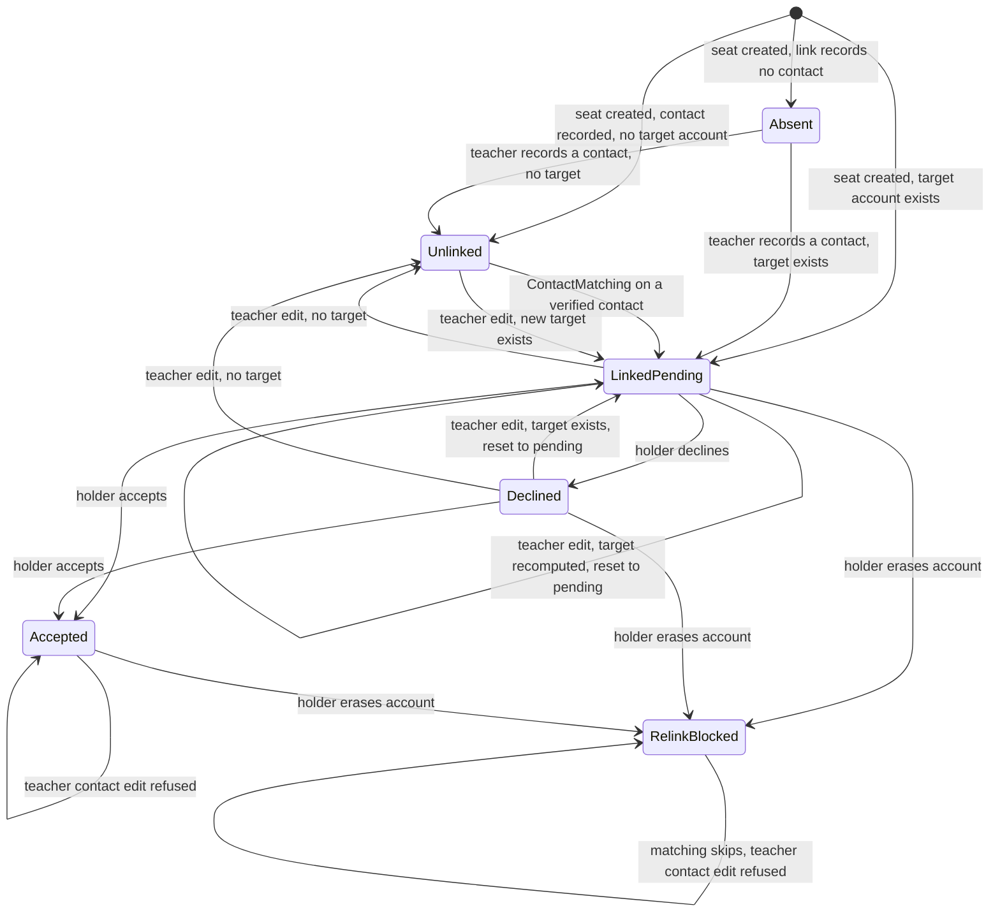
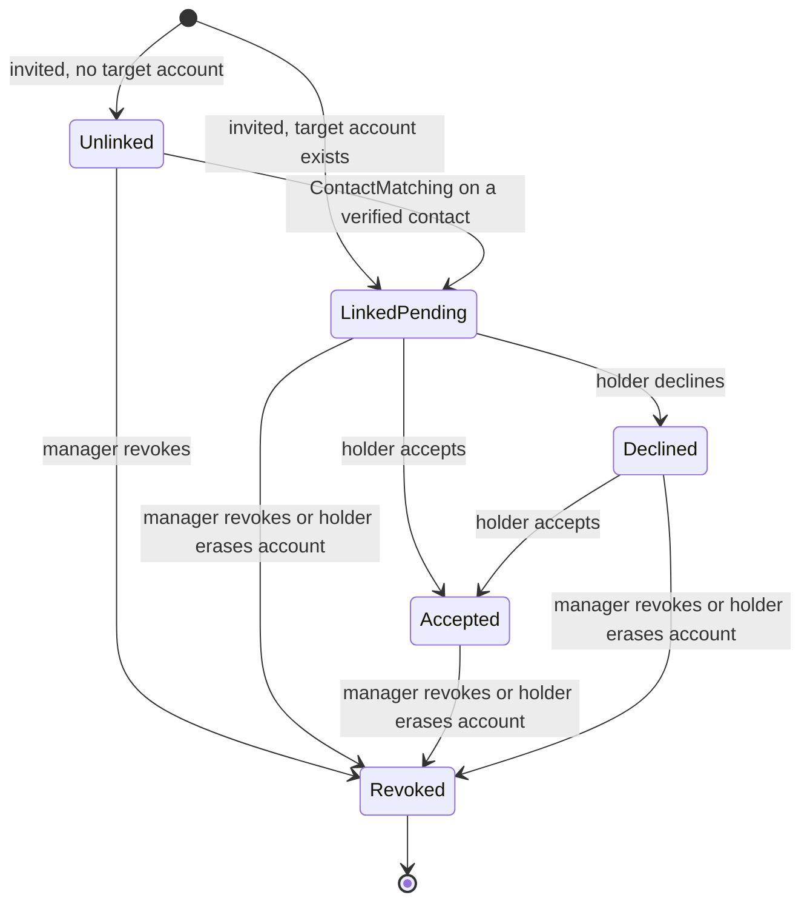
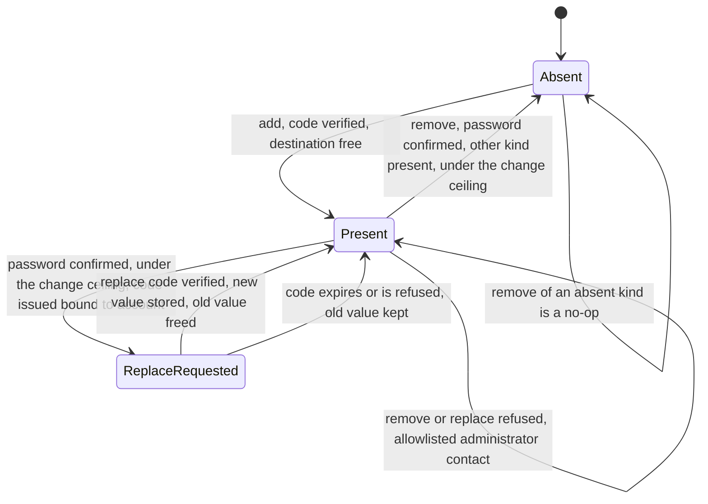
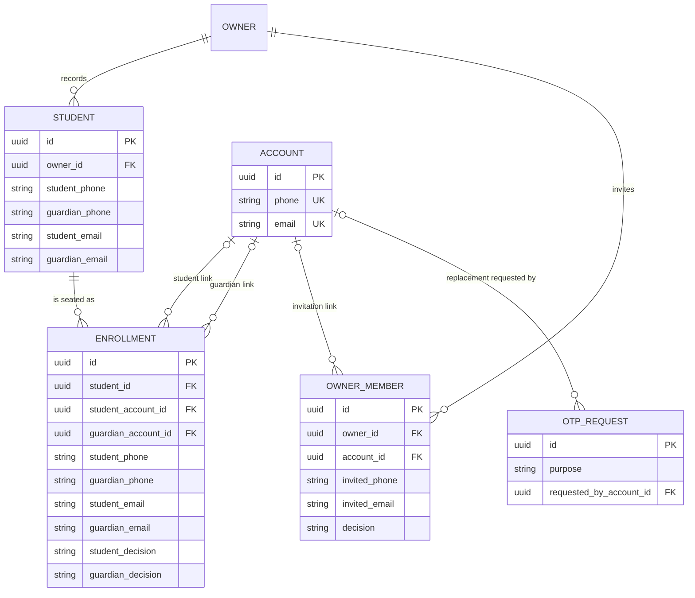

# Functional Specification — contacts-and-invites-backend (U2)

Intent `261113-unique-usernames`, unit U2 (kind: service). This file is the
source of truth for this unit's workflows and state machines. The data shape is
in `entities.md` and the decision logic in `rules.md` (both YAML sources of
truth); the ER diagram and the rules summary below are derived from them.

Scope: recording people by email as well as phone (teacher roster, centre
invitations), matching an account to those records whenever one of its
contacts is verified, the already-added lookup by email, and replacing or
removing a contact. Out of this unit: everything about usernames, holds,
sign-in and availability (U1), and every screen (U3, U4).

Construction autonomy: autonomous. Questions Q1 to Q6 were answered with the
recommended option, on the person's instruction "don't wait for my approval. Go
with your recommendations." (`functional-design-questions.md`).

## 1. Grounding: the code this design changes

Read before writing; every claim below was checked against the file named.

### 1.1 The C3 call sites (review R-07)

| # | Where | Today | After U2 | Edited by |
|---|---|---|---|---|
| 1 | `app/accounts/service.py` `create_account_rows`, line 484-485 | `if phone is not None: link_phone_seats(session, account_id=account.id, phone=phone)` | `match_contact(session, account_id=account.id, contact=<the contact the account was created with>)`, phone or email | U2 only. U1 adds its `username` argument to the same function and does not edit this line (C3) |
| 2 | `app/accounts/contact.py` `attach`, line 135-136 | `if identifier.is_phone: link_phone_seats(...)` (email adds match nothing) | `match_contact(session, account_id=..., contact=identifier)` for every add, and for the new value of a replacement | U2 |
| 3 | `app/accounts/service.py` `link_phone_seats`, `_link_existing_seats`, `_LINK_GUARDIAN_SEATS`, `_LINK_STUDENT_SEATS` (lines 187-208, 490-536) | Phone-only seat statements living in AccountDirectory's module | Contact-generic seat link statements owned by StudentRoster (BR3.2, BR3.3, BR3.7); `link_phone_seats` is removed once callers 1 and 2 no longer use it (C3 allowed it as a thin wrapper only until then) | U2 |
| 4 | `app/centres/memberships.py` `link_memberships(session, *, account_id, phone)` and `_LINK` (lines 125-146) | Phone-only | `link_memberships(session, *, account_id, contact)`: phone matches `invited_phone`; email matches `invited_email` only where `invited_phone` is absent (BR3.3); unrevoked only | U2 |
| 5 | `app/accounts/service.py` `already_added(session, phone)` and `_LOOKUP_QUERY` (lines 157-229); route `app/api/accounts.py:252-295` | Phone-only | `already_added(session, contact)`; the email branch per BR4.3; route takes exactly one of `phone` or `email` | U2 |

The matcher signature U2 owns: `match_contact(session, *, account_id, contact)`,
where `contact` is the existing `Identifier` value. It adds to the caller's
transaction and never commits.

### 1.2 Queries that must start reading the new columns

Adding a column is not adding a behaviour (team correction, 2026-10-22). Each
query below reads a recorded phone today and must read the email too, or the
email columns would be stored and ignored:

| Query or function | File | Change |
|---|---|---|
| `_guardian_state` (roster) | `app/batches/service.py:195-223` | `absent` only when `guardian_phone`, `guardian_email` and the account are all absent (BR1.6) |
| `has_guardian` in `_rows` (student list) | `app/students/service.py:293` | Same predicate (BR1.6) |
| `_account_for(session, phone)` | `app/batches/service.py:878` | Replaced, at the link-writing call sites, by the BR2.1 target resolver over a link's phone and email |
| `seat_for` | `app/students/service.py:460-546` | Copies both emails; resolves each link by BR2.1; BR2.5 refusal |
| `_refuse_second_seat` | `app/batches/service.py:896-935` | Also refuses on the same student email in the batch (BR2.5) |
| `_phone_taken` / `_refuse_taken` / `find_or_create_student` | `app/students/service.py:549-642` | An email twin under BR1.2 and the identification order of BR1.7 |
| `_apply_identity` / `_refuse_relink` / `update_student` | `app/students/service.py:816-941` | Email changes relink and reset like phone (BR2.3), are refused when accepted or erased (BR2.4), and check BR2.5 |
| `add_invitation` live check | `app/centres/service.py:212-273` | Live duplicate by phone or email (BR1.8); link target by BR2.1 |
| `create_centre` manager row | `app/centres/service.py:139-151` | Writes no phone (null, not `""`) when the account has none, and writes its email (BR1.9, Q3) |
| `list_members` | `app/centres/service.py:276-306` | `phone` null for an email-only or legacy `""` row; adds `invited_email` (BR1.9) |
| `RosterRow` and the function that builds it | `app/batches/service.py` (the `guardian_phone` field at lines 141 and 274, and its builder) | Carries `student_email` and `guardian_email` from the seat (BR1.11) |
| `RosterRowResponse` | `app/schemas/batches.py:274` | Adds `student_email` and `guardian_email`, nullable, teacher-written (BR1.11, BR1.4) |
| `_roster_row_response` mapper | `app/api/batches.py:160` | Maps the two new fields (BR1.11) |
| `_consume` (ceiling cascade) | `app/auth/ceilings.py:1060-1107` | Unchanged for every existing scope. It commits after each scope's upsert (line 1089), so `contact_chg_day` uses a new non-committing consume instead (BR5.6) |
| `consume_code` | `app/auth/otp.py:238-300` | Row selection gains the requester for purpose `contact_replace` (BR5.3) |
| `_SET_DECISION` (accept and decline) | `app/accounts/decisions.py:104-124` | No change needed: it is an update conditioned on the link naming the holder, so it takes the seat row lock and re-checks after a teacher edit (BR2.6). A test pins this |

Not changed, recorded so it is not mistaken for an omission: the roster search
(`list_students`, phone and name only), the fee queue's submitter contact
(`app/fees/queue.py:279-297`, phone only; see § 10 Concerns), the batch
add-seat route's request (BR1.10), and the phone form of the already-added
lookup, account half included (BR4.3).

## 2. Workflows

Each workflow is numbered steps. Rule IDs name the rule that decides a step.

### W1. Record a student with emails (`POST /v1/students`)

1. Resolve the teacher lens (unchanged). Validate the request: phones
   canonical, emails canonical (BR1.1). An email field sent empty is absent.
2. Replay check on `client_mutation_id` (unchanged).
3. Identify the student (BR1.7): by `student_phone` first (active: refuse
   `student.phone_taken`; archived: revive). Then, if a `student_email` is
   given and belongs to a different student of this owner, refuse
   `student.email.taken`. With no phone, the `student_email` identifies by the
   same active/archived rule.
4. A new student is written with both phones and both emails. A revived student
   takes the typed name and guardian contacts through the edit rules (W2,
   steps 4-6).
5. Before resolving any link target, take the contact advisory lock for each
   distinct recorded contact, in ascending key order (BR2.7); then lock the
   student's existing seat rows in ascending id order (BR2.6; none for a new
   student).
6. For each requested batch, create the seat: copy the four contacts (BR1.5);
   carry relink-blocked markers from sibling seats (unchanged); resolve each
   link's target by BR2.1 unless blocked; refuse a second student seat in the
   batch (BR2.5); state each decision (BR2.2).
7. A concurrent duplicate reaching the `(owner, student_email)` uniqueness
   rule is mapped to `student.email.taken` (BR1.2). Any refusal rolls back the
   whole create: no student is left behind (unchanged all-or-nothing).
8. Commit, releasing both kinds of lock. Respond with `StudentResponse`, now
   carrying `student_email` and `guardian_email`; the guardian state reads the
   email (BR1.6).

The same two locks are taken, in the same order, by every other seat-creation
path (`enroll_student`, `add_students_to_batch`, the batch add-seat route),
because all of them create seats through `seat_for`.

### W2. Edit a student's contacts (`PATCH /v1/students/{student_id}`)

1. Load the teacher's own student (unchanged).
2. For each request field: absent leaves the value; null clears it; a value
   replaces it. A field equal to the stored value is no change.
3. Take the contact advisory locks for every contact the edited links will
   resolve after the change, in ascending key order (BR2.7). Then lock all of
   the student's seat rows for update, in ascending seat id order, and read
   them under that lock (BR2.6). A holder's accept or decline, an erasure, or
   a match on those seats now waits for this transaction, or has already
   committed and is visible here.
4. For each link (student: `student_phone`, `student_email`; guardian:
   `guardian_phone`, `guardian_email`) with at least one changed contact:
   refuse when that link is accepted on any seat, or relink-blocked on any
   seat (BR2.4). Checked on the locked rows, before anything is written.
5. Uniqueness: a new `student_email` held by another student of this owner is
   refused `student.email.taken` (BR1.2); the phone keeps its existing check.
6. For each changed link, compute the new target from the link's contacts after
   the change (BR2.1). For the student link, refuse when that account is
   already the student of another seat in any batch this student sits in
   (BR2.5).
7. Write the new values on the student and every seat, set each changed link to
   its target (possibly none) and reset its decision to pending (BR2.3).
8. Commit, releasing the locks. Respond with `StudentResponse`.

### W3. Invite a centre member by email (`POST /v1/centre/members`)

1. Resolve the manager's lens and the centre (unchanged).
2. Validate: at least one of `phone` or `email`; each canonical (BR1.8, BR1.1).
3. Refuse when a live invitation of this centre has the phone, or has the email
   (BR1.8).
4. Take the contact advisory lock for each given contact, in ascending key
   order (BR2.7). Resolve the target by BR2.1: the phone's account if a phone
   is given, otherwise the email's account, otherwise none.
5. Insert the pending invitation inside a savepoint; a violation of either live
   uniqueness rule is mapped to `centre.member.already_invited` (BR1.8).
6. Commit. Respond with `MemberResponse`: `phone` nullable, `invited_email`
   present when recorded (BR1.9).

### W4. Match at account creation (inside the verify transaction)

1. The verify transaction runs as today [C-07]; U1's username logic runs inside
   `create_account_rows` before the account row exists.
2. `create_account_rows` creates the account with its one contact (phone or
   email), its profile and, for a teacher, its owner row.
3. `match_contact(account_id, contact)` runs in the same transaction (BR3.1),
   replacing the phone-only line (§ 1.1 row 1). Its first act is to take the
   contact advisory lock (BR2.7), held to the verify's commit, so a teacher
   save for the same contact waits for it or has already committed.
4. StudentRoster links seats: a phone by BR3.2, an email by BR3.3, skipping
   blocked links (BR3.6), already-linked links (BR3.5) and a second student
   link in one batch (BR3.7). No decision is written (BR3.4).
5. CentreMembership links unrevoked invitations by the same contact rules.
6. The transaction commits with the code consumed and the draft removed, or
   rolls back entirely; a rollback (for example U1's username-unavailable
   outcome) undoes the links too, and the retried verify links again.

### W5. Match on phone add (`POST /v1/me/contact/verify`, account has no phone)

1. Verify ceilings checked (unchanged).
2. Lock the account row. The account holds no phone, so this is an add
   (BR5.1): spend the latest `contact` code for the number.
3. A number held by another account is refused `account.contact.taken` after
   the code (unchanged, commits the spent code).
4. Store the number; `match_contact(account_id, phone)` (BR3.1); discard any
   sign-up draft for the number; audit `CONTACT_ADDED`; commit.
5. Respond with `MeResponse`; lenses may have changed.

### W6. Match on email add (`POST /v1/me/contact/verify`, account has no email)

Identical to W5 with an email, except that step 4 now calls the matcher for the
email, which it never did before (§ 1.1 row 2). The email links only records
whose link records no phone (BR3.3).

### W7. Replace a contact

Request step (`POST /v1/me/contact` with `password`):

1. Authenticated, lens-exempt (unchanged). The body names one phone or email.
2. The account already holds a contact of that kind, so this is a replacement:
   - the account must have a password and the body must carry it, else
     `account.contact.password_required` (BR5.2);
   - the password is checked under the per-account password ceilings; wrong is
     recorded, committed and refused `auth.password.current_wrong` (BR5.2);
   - a current value on the platform-administrator allowlist is refused
     `account.contact.admin_locked` (BR5.13);
   - a destination equal to the current value is refused
     `account.contact.already_set` (BR5.4);
   - the change ceiling is read, not incremented; at 5 the request is refused
     `account.contact.change_limit` before any code is sent (BR5.6).
3. The existing send ceilings for the destination and the network apply
   (unchanged).
4. Issue a code with purpose `contact_replace`, recording this account as the
   requester (BR5.3, Q1); deliver it; commit; answer the contentless
   acknowledgement, the same whether or not another account holds the
   destination.

Verify step (`POST /v1/me/contact/verify`, request shape unchanged):

5. Verify ceilings checked (unchanged).
6. Lock the account row. It holds a contact of this kind, so this is a
   replacement. The lock is held to step 11's commit; nothing between here
   and there commits.
7. Select and lock the latest unexpired `contact_replace` code for the
   destination **requested by this account** (BR5.3); the requester is part of
   the selection, so another account's code for the same destination is never
   read, attempted or spent. No such code, or a wrong code, is a code
   refusal: a wrong code records its attempt against this account's row only,
   that attempt is committed and the request ends (unchanged accounting).
8. A destination held by another account is refused `account.contact.taken`
   after the code (BR5.4); the spent code is committed and the request ends.
9. The current value is re-checked against the administrator allowlist; on the
   list, refused `account.contact.admin_locked` and the transaction is rolled
   back, so the code stays unspent (BR5.13).
10. Capture the old value. Consume one `contact_chg_day` with the
    non-committing consume (BR5.6); at the limit, refused
    `account.contact.change_limit` and the transaction is rolled back, so the
    code stays unspent and nothing is counted.
11. Set the column to the new value (the old is gone); `match_contact` for the
    new value (taking its advisory lock, BR2.7); discard sign-up drafts for
    the new value; audit `CONTACT_REPLACED` (BR5.11); then the one commit,
    which makes the spent code, the counter increment and the change durable
    together (BR5.4, BR5.6). Any failure after step 7 succeeds and before
    this commit rolls all three back.
12. After commit, send the notice to the old value (BR5.9). Nothing linked
    through the old value is unlinked (BR5.7). No device is signed out (BR5.10).
13. Respond with `MeResponse`.

### W8. Remove a contact (`POST /v1/me/contact/remove`)

1. Authenticated, lens-exempt; body `{kind, password}`.
2. Lock the account row.
3. Password (BR5.2): absent on the account → `account.contact.password_required`;
   wrong → recorded, committed, `auth.password.current_wrong`.
4. The account holds no contact of `kind` → answer the current `MeResponse`;
   nothing counted, audited or sent (BR5.12).
5. The value is on the administrator allowlist → refuse
   `account.contact.admin_locked` (BR5.13).
6. The account holds no contact of the other kind → refuse
   `account.contact.last_one` (BR5.5).
7. Consume one `contact_chg_day` with the non-committing consume; at the limit
   refuse `account.contact.change_limit`, rolling the transaction back
   (BR5.6).
8. Capture the value, clear the column, audit `CONTACT_REMOVED` (BR5.11),
   then the one commit, which makes the counter and the removal durable
   together and releases the account row lock taken in step 2. A
   check-constraint violation reaching the database rolls back both and maps
   to `account.contact.last_one` (BR5.5 backstop).
9. After commit, send the notice to the removed value (BR5.9).
10. Respond with `MeResponse`. Every seat and invitation stays linked (BR5.7);
    the removed value is free for another account (BR5.8).

The only commit before step 8 is the one a wrong password makes in step 3,
which ends the request; so between steps 2 and 8 the account row lock is held
and two removals on one account cannot interleave.

### W9. Already-added lookup by email (`GET /v1/accounts/already-added?email=`)

1. Public route, already in the public-route allowlist (no allowlist change).
2. Exactly one of `phone` or `email` (BR4.1); the email is canonicalised
   (BR1.1). Both happen before any ceiling is counted.
3. Consume the lookup cascade keyed on the contact's `rate_key` (`e:` form for
   an email), then network and coarse network, then the global alert; a refusal
   answers HTTP 429 `auth.lookup.too_many` for both kinds (BR4.4, Q2). This
   happens before anything is read, so the refusal does not depend on whether a
   seat exists.
4. Find the seat by BR4.3: a seat link that records this email, records no
   phone for that link, and is not relink-blocked; student link preferred
   over guardian, oldest first. No account is consulted: there is no "linked
   account holds this email" half, so an email held by an account that is
   linked to a seat but recorded on no seat answers false. Centre invitations
   are not consulted (as for the phone form).
5. Answer `already_added`, `display_name` (`""` when a seat exists, else null)
   and `role` only (BR4.2). Never account existence, never a name.

The phone form is unchanged, its account half included (out of scope).

## 3. State machines

### 3.1 A seat link (one per role: the student link and the guardian link of a seat)

Text fallback:

| From | Event | To | Rule |
|---|---|---|---|
| (new seat) | No contact recorded for this link | Absent (guardian only reports `absent`; the student link reports `pending`) | BR1.6 |
| (new seat) | Contact recorded, no BR2.1 target | Unlinked (decision `pending`) | BR2.2 |
| (new seat) | BR2.1 target exists | LinkedPending, or Accepted when the same account accepted another seat of this student (carried decision, unchanged) | BR2.2 |
| Absent / Unlinked | Teacher records or edits a contact | LinkedPending if a target exists, else Unlinked | BR2.3 |
| Unlinked | An account verifies the recorded phone, or the recorded email when no phone is recorded | LinkedPending | BR3.2, BR3.3 |
| LinkedPending / Declined | Teacher changes any contact of the link | LinkedPending on the new target, or Unlinked | BR2.3 |
| LinkedPending | Holder accepts or declines (D1, not this unit) | Accepted / Declined | — |
| Accepted | Teacher changes any contact of the link | Refused, unchanged | BR2.4 |
| any linked | Holder erases the account (D6, unchanged) | RelinkBlocked | — |
| RelinkBlocked | Matching, or teacher contact edit | Unchanged (skipped, or refused) | BR3.6, BR2.4 |
| LinkedPending | Holder accepts while a teacher contact edit is in flight | Whichever commits first wins on the locked seat row: accept first leaves Accepted and the edit is refused; edit first relinks, and the accept then changes nothing | BR2.6 |
| any linked | The linked account removes or replaces the contact that linked it | Unchanged | BR5.7 |
| any linked | Another account verifies a contact the link records | Unchanged | BR3.5 |

Linking (into LinkedPending) never writes the decision: a link that reaches
LinkedPending from Unlinked keeps the `pending` it already held (BR3.4).

### 3.2 A centre invitation link

Text fallback: an invitation is created Unlinked or LinkedPending by BR2.1 (a
phone, if recorded, decides; the email only when no phone is recorded).
ContactMatching moves Unlinked to LinkedPending without writing the decision
(BR3.4). The holder accepts or declines (unchanged). A manager's revocation, or
the holder's account deletion (which revokes every unrevoked membership,
`app/governance/deletion.py:295`), ends it; a revoked invitation is never linked
again (BR3.6). There is no edit path for an invitation's contacts.

### 3.3 A contact of one kind on an account (phone, or email)

Text fallback:

| From | Event | Guard | To | Side effects |
|---|---|---|---|---|
| Absent | Add verified | Code of purpose `contact`; destination free | Present | Match; drafts discarded; `CONTACT_ADDED` |
| Present | Replacement requested | Password; not equal to current; change ceiling not reached | ReplaceRequested (a code exists, bound to this account) | Code sent |
| ReplaceRequested | Replacement verified | Latest `contact_replace` code, requester is this account; destination free; ceiling consumed | Present (new value) | Match on new; drafts discarded; `CONTACT_REPLACED`; notice to old after commit |
| ReplaceRequested | Code expires, is refused, or destination is taken | — | Present (old value) | Refusal; the spent or failed code is recorded as today |
| Present | Remove | Password; the other kind is Present; ceiling consumed | Absent | `CONTACT_REMOVED`; notice after commit; links unchanged; value freed |
| Present | Remove | The other kind is Absent | Present | `account.contact.last_one` |
| Present / ReplaceRequested | Remove, replacement request or replacement verify | The value is on the administrator allowlist | Unchanged | `account.contact.admin_locked`; nothing counted, code unspent |
| Absent | Remove | Password | Absent | None |

ReplaceRequested is not stored on the account; it is the existence of a live
bound code. The account's two kinds move independently, except that both may
never be Absent at once (BR5.5, `ck_account_has_identifier`).

## 4. Entity-relationship view (derived from `entities.md`)

Text fallback: an Owner records many Students; a Student is seated as many
Enrollments; each Enrollment has at most one student-link Account and at most
one guardian-link Account; an Owner (centre) invites many OwnerMembers, each
linked to at most one Account; an OtpRequest of purpose `contact_replace`
names the Account that requested it. New columns: `student.student_email`,
`student.guardian_email`, `enrollment.student_email`,
`enrollment.guardian_email`, `owner_member.invited_email`,
`otp_request.requested_by_account_id`; changed: `owner_member.invited_phone`
becomes nullable under a CHECK that phone or email is present.

## 5. Rules summary (derived from `rules.md`)

| Group | Rules | What they settle |
|---|---|---|
| Recording emails | BR1.1-BR1.10 | Canonical form; student email unique per teacher, guardian email not; distinct teacher-written names; seats carry copies; email-only guardian is pending; identification order; centre invites by email with per-centre live uniqueness; nullable member phone; routes that stay phone-only |
| Link target on save | BR2.1-BR2.5 | The one precedence rule; link at save; contact change relinks and resets; refused when accepted or erased; no second student link in a batch |
| ContactMatching | BR3.1-BR3.9 | Three moments, one matcher; phone and email statements; never a decision, never a relink, never a blocked or revoked record; batch-collision skip; idempotent; who edits the call lines |
| Already-added lookup | BR4.1-BR4.4 | One of phone or email; only existence and role; email reaches only email-linkable seats; shared ceilings answering 429 |
| Contact changes | BR5.1-BR5.13 | Add unchanged and matching; password; replacement code selected by requester; one-transaction replace; last contact refused; 5 per day through a non-committing consume; links survive; contact freed; notice; no sign-out; audit by id; no-op remove; allowlisted administrator contact locked |

(BR1.11 roster emails, BR2.6 seat-row locking and BR2.7 contact advisory lock
sit in the first two groups.)

Test-first (team predicate holds; written before the code): BR2.1, BR2.3,
BR2.4, BR2.6, BR3.2, BR3.3, BR3.4, BR3.5, BR3.6, BR4.2, BR4.3, BR5.2, BR5.3,
BR5.5, BR5.7, BR5.13.

Named tests the review required (each asserts an outcome, not a call):

| Test | Rule | Test-first | Asserts |
|---|---|---|---|
| Failure after the change-ceiling consume | BR5.6 | no | Force a failure after the non-committing consume and before the commit (for example the account write or the match raising): afterwards the `contact_chg_day` count is unchanged, the `contact_replace` code is still unconsumed and still verifies, and the old contact is still on the account |
| Ceiling breach on verify | BR5.6 | no | At 5 completed changes, a valid replacement verify is refused `account.contact.change_limit`, the code stays unconsumed, the count stays 5 |
| Teacher edit versus holder accept | BR2.6 | yes | Two transactions on one seat. Accept commits first: the edit is refused `student.number_accepted` and the seat stays accepted on the holder. Edit commits first: the seat is relinked and pending, and the accept leaves it unchanged. Run both orders by holding the first transaction open |
| Email held by a linked account, recorded on no seat | BR4.3 | yes | An account with email E is linked to a seat that records only a phone; `already-added?email=E` answers `already_added: false`, `role: null` |
| Email recorded alongside a phone | BR4.3 | yes | A seat records phone P and email E on the guardian link; `already-added?email=E` answers false |
| Two accounts, one destination | BR5.3 | yes | Accounts A and B each request a replacement to destination D (A first, then B). A verifies with A's code: succeeds, B's code untouched. B's verify with A's code is refused and records no attempt on A's row; with B's own code it succeeds unless D is now taken |
| Save racing a match | BR2.7 | no | Hold a match transaction for contact C open, save a seat recording C, commit the match: the seat ends linked to the matched account. Reverse the order: the match links the saved seat |
| Allowlisted administrator contact | BR5.13 | yes | With C on the allowlist, removal of C and a replacement of C are refused `account.contact.admin_locked` at request and at verify; nothing counted; C stays |
The unit definition's named cases map to them: an email never links a record
that records a phone (BR3.3); the phone's owner signing up after the email's
owner still takes the seat (BR2.1 at save, BR3.2 at match); a recycled contact
links only unlinked records (BR3.5); links are pending, never accepted (BR3.4);
removing the last contact is refused (BR5.5). These are integration tests
against PostgreSQL as the restricted application role (team.md).

## 6. Error catalogue

Status follows the error class through the one handler
(`app/errors/handler.py:72-82`): ValidationError 400, AuthorizationError
401/403/404, ConflictError 409; request-shape validation 422. `retryable` is
false for every entry.

| message_key | code | Class / status | Raised by | New? |
|---|---|---|---|---|
| `email.invalid` | `EMAIL_INVALID` | ValidationError / 400 | BR1.1 | existing |
| `student.email.taken` | `STUDENT_EMAIL_TAKEN` | ConflictError / 409 | BR1.2, BR1.7 | new (C2) |
| `student.phone_taken` | `STUDENT_PHONE_TAKEN` | ConflictError / 409 | BR1.7 | existing |
| `student.number_accepted` | `STUDENT_NUMBER_ACCEPTED` | ConflictError / 409 | BR2.4, now for email too | existing |
| `student.number_erased` | `STUDENT_NUMBER_ERASED` | ConflictError / 409 | BR2.4, now for email too | existing |
| `enrollment.student_already_in_batch` | `ENROLLMENT_STUDENT_ALREADY_SEATED` | ConflictError / 409 | BR2.5 | existing |
| `centre.member.already_invited` | `MEMBER_ALREADY_INVITED` | ConflictError / 409 | BR1.8, now for email too | existing |
| (request validation) | — | 422 | BR1.8 neither contact; BR4.1 neither or both | existing mechanism |
| `auth.lookup.too_many` | shared with U1 | lookup-ceiling refusal / 429 | BR4.4, both kinds | new (C1 and C2; whichever of U1, U2 merges first adds it) |
| `account.contact.password_required` | `CONTACT_PASSWORD_REQUIRED` | ValidationError / 400 | BR5.2 | new (C2) |
| `auth.password.current_wrong` | `PASSWORD_NOT_VALID` | ValidationError / 400 | BR5.2 | existing |
| `auth.password.too_many_attempts` | `TEMPORARILY_UNAVAILABLE` | ConflictError / 409 | BR5.2 (password ceiling) | existing |
| `account.contact.already_set` | `CONTACT_ALREADY_SET` | ConflictError / 409 | BR5.4 (same value) | existing |
| `account.contact.taken` | `CONTACT_TAKEN` | ConflictError / 409 | BR5.1, BR5.4 | existing |
| `account.contact.last_one` | `CONTACT_LAST_ONE` | ConflictError / 409 | BR5.5 | new (C2) |
| `account.contact.change_limit` | `CONTACT_CHANGE_LIMIT` | ConflictError / 409 | BR5.6 | new (C2) |
| `account.contact.admin_locked` | `CONTACT_ADMIN_LOCKED` | ConflictError / 409 | BR5.13 | new (this design; add to C2's key list) |
| existing code refusals (`auth.otp.*`) | existing | as today | BR5.3 | existing |

New keys go into `message-keys.json` and both clients' bundles in the same
change (contract rule). `student.number_accepted` and `student.number_erased`
now also cover an email; their English and Bangla text should say "contact"
rather than "number" (U3, U4 strings).

## 7. Concurrency and failure

- **Matching and account creation**: one transaction with the code; all or
  nothing (W4 step 6).
- **Two removals at once** (phone and email on one account): the account row
  lock serialises them; the second sees the first's result and is refused
  `account.contact.last_one`; the CHECK is the backstop (BR5.5).
- **Replacement racing another account's add of the same destination**: the
  unique column refuses one; it is mapped to `account.contact.taken` after the
  code, as today.
- **Concurrent duplicate student email or invited email**: uniqueness rules,
  mapped to the business refusal inside a savepoint (BR1.2, BR1.8).
- **A teacher save racing a match**: closed by BR2.7. Both take a
  transaction-scoped advisory lock keyed on a hash of the contact's kind and
  canonical value before resolving targets or linking, so the later one sees
  the earlier one's committed result. A save takes its locks in ascending key
  order, so two saves cannot deadlock on each other.
- **A teacher edit racing a holder's accept, decline or erasure** (BR2.6): the
  edit locks the student's seat rows (ascending id) before checking BR2.4;
  the accept, decline and erasure writes and the match statements are updates
  conditioned on the link's current state, so they take the same row locks and
  re-evaluate after the edit commits. Accept first: the edit is refused. Edit
  first: the accept matches no row and changes nothing. Test-first.
- **Lock order**: contact advisory locks first (ascending key), then seat rows
  (ascending id), in every path that takes both; accept, decline and erasure
  take only row locks, and a match takes one advisory lock then row locks. No
  path takes them in the opposite order, so no cycle can form.
- **Notice failure**: logged, not retried, not surfaced (BR5.9).
- **Change ceiling** (BR5.6): the existing cascade consume commits after each
  scope (`app/auth/ceilings.py:1089`), which would commit a spent code,
  release the account row lock and make the count survive a later failure. So
  `contact_chg_day` is consumed by a non-committing variant inside the
  change's own transaction; the counter, the spent code and the change commit
  in one commit or roll back together, and the account row lock is held from
  acquisition to that commit. The read at the replacement request step is a
  read only.
- **Replacement codes of two accounts for one destination** (BR5.3): each
  verify selects only its own account's code, so neither shadows, spends nor
  attempts the other's.

## 8. Schema change (described; the migration is code generation's)

Forward-only, one migration, no existing row rewritten (NFR7):
`student.student_email`, `student.guardian_email`, `enrollment.student_email`,
`enrollment.guardian_email` (nullable text, at most 254); a uniqueness rule on
`(student.owner_id, student.student_email)` where present;
`owner_member.invited_email` (nullable), `invited_phone` relaxed to nullable, a
CHECK that one of the two is present (existing rows all hold a phone or `""`,
so it holds), and a live-email uniqueness rule on `(owner_id, invited_email)`
where unrevoked and present; `otp_request.requested_by_account_id` (nullable,
references the account, set to absent on account deletion). The models and the
migration change together so the schema-parity test holds.

## 9. Issues

1. **Directory name.** The unit table names the construction directory
   `u2-contacts-and-invites-backend`; this stage was dispatched to write
   `construction/contacts-and-invites-backend/functional-design/`. The artifacts
   are where the dispatch put them; whichever the engine resolves should be
   used consistently from here.
2. **HTTP 429 is new to the error taxonomy.** No class maps to 429 today
   (`app/errors/handler.py`), and `CeilingBreach`'s own docstring argues
   against a 429 because it "carries a retry-after convention that invites"
   retrying. The contract (C1, and C2 by review R-06) fixes 429. This design
   reconciles the two: the lookup-ceiling refusal is 429 with
   `retryable: false` and no retry-after hint, introduced once and shared with
   U1's availability lookup. Whichever unit merges first adds it.
3. **C3 amendment.** Question 1 adds one column to `otp_request`, a table not in
   C3's `u2_adds`. It is U2's alone (U1 adds nothing to that table), so it
   creates no conflict, but C3's list should name it.
4. **Statuses in C2.** C2 lists `auth.password.current_wrong` and
   `account.contact.password_required` under 422; the built handler maps
   ValidationError to 400 and `change_password` already raises it that way.
   This design keeps the built status (400); the committed `openapi.json` is
   the contract of record.
5. **Review iteration 1 decisions.** Review `reviews/review-01.md` R-01 to R-07
   were resolved by the orchestrator under the person's instruction "Go with
   your recommendations": a non-committing ceiling consume (BR5.6), seat-row
   locking (BR2.6), no account half on the email lookup (BR4.3), a contact
   advisory lock (BR2.7), the administrator contact lock with the new key
   `account.contact.admin_locked` (BR5.13, which also belongs in C2's key
   list), requester-scoped code selection (BR5.3), and roster emails (BR1.11).
   On R-03 the direction mentioned "(or live invitation)"; centre invitations
   are not consulted by either form of the lookup, because its role lock has
   no centre value and the phone form does not consult them either.

## 10. Concerns

1. **Fee queue contact for an email-only payer.** The payment queue shows the
   teacher "the number the teacher holds" for the submitter
   (`app/fees/queue.py:279-297`); for a seat recorded only by email it shows
   nothing. Not in U2's requirements; recorded so it is not taken for an
   oversight.

## Assumptions & Open Questions

- [assumption] Every stored account contact is verified, because no write path
  stores one without a spent code; "at least one verified contact" is therefore
  "at least one stored contact".
- [assumption] The notice text is one fixed server template; its exact
  English and Bangla wording is written at code generation under BR5.9's
  content limits.
- [assumption] The SMS notice counts against the existing daily SMS send budget
  that contact codes use; no new budget is added.
- Open questions: None.

## Sources

- Unit and map: `inception/units-generation/unit-of-work.md` § U2,
  `unit-of-work-story-map.md` (FR2.5, FR6, FR6.1-FR6.7, FR8, FR8.1-FR8.4).
- Requirements: `inception/requirements-analysis/requirements.md`.
- Domain design: `inception/domain-design/components.md` (ContactMatching,
  StudentRoster, CentreMembership, AccountSettings, RateCeilings, AuthAudit),
  `decisions.md` ADR-004, ADR-005, ADR-006, ADR-009, ADR-010.
- Contracts: `inception/contract-design/contract-summary.md` C2, C3 and the
  2026-11-14 direction; review `reviews/review-01.md` R-06, R-07.
- Code read: `app/accounts/service.py`, `app/accounts/contact.py`,
  `app/accounts/identifier.py`, `app/accounts/passwords.py`,
  `app/centres/memberships.py`, `app/centres/service.py`,
  `app/students/service.py`, `app/batches/service.py`, `app/db/models.py`,
  `app/auth/ceilings.py`, `app/auth/otp.py`, `app/schemas/students.py`,
  `app/api/accounts.py`, `app/api/credentials.py`, `app/audit/log.py`,
  `app/authz/admin.py`, `app/errors/handler.py`, `app/governance/deletion.py`,
  `app/fees/queue.py`.
- Rules: `aidlc/spaces/default/memory/team.md` (Testing Posture, Way of
  Working, Corrections), `project.md`, `phases/construction.md`.
- Answers Q1-Q6: `functional-design-questions.md` [Q1]-[Q6].
