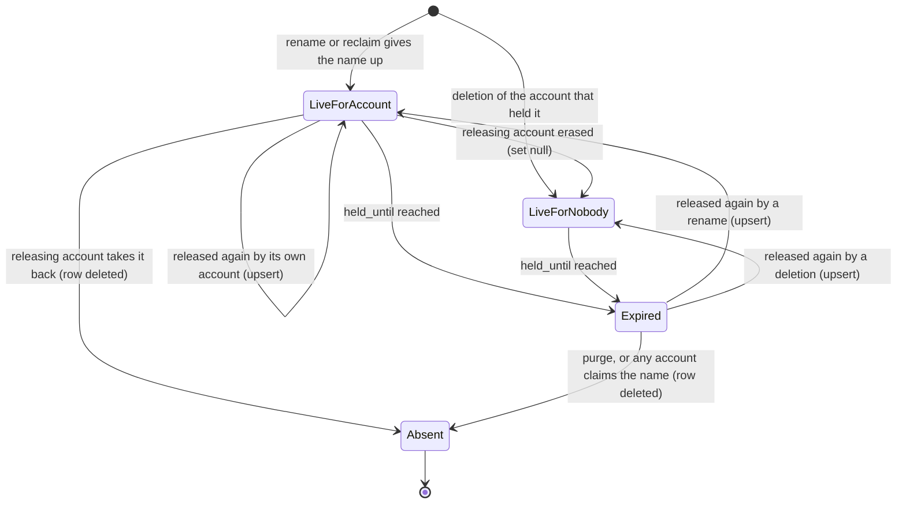
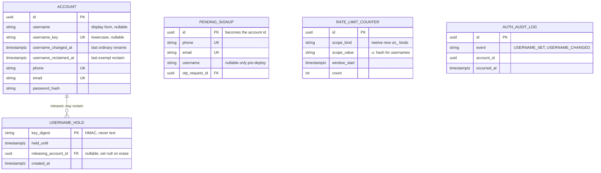

# Functional Specification — usernames-backend (U1)

Intent `261113-unique-usernames`, unit U1 (kind `service`). This file is the
source of truth for U1's workflows and state machines. Data shape is in
`entities.md` and decision logic in `rules.md` (both YAML sources of truth);
the entity-relationship diagram and the rules summary below are derived views
of them. Upstream: `unit-of-work.md` (U1), `unit-of-work-story-map.md` (the 40
rows mapped to U1), `requirements.md` (FR1, FR2.1–FR2.4, FR3, FR4, FR5.1,
FR5.3, FR5.4, FR7, FR9, FR10), `components.md` and `decisions.md` (ADR-001 to
ADR-012), `contract-summary.md` (C1, C3), and the answers Q1–Q5 in
`functional-design-questions.md`.

U2 (`contacts-and-invites-backend`) is built and merged on this branch. U1
builds on it and redoes none of it: the matcher (`app/accounts/matching.py`),
the advisory-lock helper (`app/db/advisory.py`), the bounded retry
(`app/db/retry.py`), contact replace and remove, and the relink markers at
deletion stay exactly as U2 left them, apart from the one namespace this unit
appends to the lock order (§7).

## 1. Grounding: the code this design changes

Every claim below was checked against the code at commit `108489a`.

### 1.1 Call sites that change

| Where | Today | U1 change |
|---|---|---|
| `app/schemas/accounts.py` `SignupRequest` (60) | inherits `IdentifierFields`; no username | gains a required `username` (max 64 at the schema; FR1 judged on the server, BR2.1) |
| `app/api/accounts.py` `sign_up` (145) | consumes signup ceilings (194), saves the draft (208), issues the code (229) | between the ceilings and `save_draft`: judge the candidate (BR1) and its availability (BR2.2) |
| `app/auth/pending.py` `SignupDraft`, `_UPSERT_SQL` (92), `save_draft`, `take_bound_draft` (200) | no username column in the insert, the conflict update or the select | carry `username` in all three; add one statement that replaces the bound draft's username inside the verify transaction (BR2.5) |
| `app/schemas/auth.py` `VerifyRequest` (61) | phone or email, and the code | gains optional `username` (the replacement, BR2.5) |
| `app/api/auth.py` `verify_code` (227) | failed-verify ceiling check (265), then `otp.verify` with the `complete` closure (288) | after the ceiling check and before `otp.verify`: judge a replacement (BR1) and consume the availability ceilings for it (BR2.6); pass the replacement into `complete` |
| `app/accounts/service.py` `complete_signup` (297) | takes the bound draft and calls `create_account_rows` | applies a replacement to the draft, passes `username` on, writes `USERNAME_SET` (BR2.8) |
| `app/accounts/service.py` `create_account_rows` (357) | locks contact keys (423), checks contact clashes, inserts the account | gains a `username` keyword argument and nothing else (C3); takes the username key in the SAME `lock_keys` call as the contact keys, runs the claim rule (BR6.9), writes `username` and `username_key`. The `match_contact` loop at 501 is U2's and is not edited (C3 `u1_may_assume`) |
| `app/schemas/auth.py` `PasswordSignInRequest` (148) | inherits `IdentifierFields` (exactly one of phone, email) | gains optional `login`; its own validator requires exactly one of `login`, `phone`, `email` (BR4.1). `IdentifierFields` itself is not widened (ADR-003) |
| `app/api/auth.py` `sign_in_with_password` (312) | passes `body.identifier` to `sign_in` | passes the classified subject (BR4.2) |
| `app/accounts/passwords.py` `sign_in` (170) | `Identifier` only; `check_password_allowed(identifier.rate_key, ...)`, `account_for(session, identifier)` | accepts a `LoginSubject`; a phone or email subject takes today's path unchanged; a username subject uses the username ceilings (BR4.5) and the account lookup by `username_key`, with the same `verify_nothing` / `verify_password` work and the same commit-then-raise (BR4.4) |
| `app/auth/otp.py` `account_for` (556) | phone or email column | unchanged; the username lookup is AccountDirectory's own function, because `otp.py` must know nothing about accounts beyond its two contact columns |
| `app/auth/ceilings.py` `ScopeKind` (329) | 26 members, `CONTACT_CHANGE_DAILY` last | twelve new members in four families (entities.md, as amended by security-requirements.md NFR2); a committing cascade method per Family A, B and C, and peek and record methods for Family D |
| `app/auth/ceilings.py` `CeilingBreach.__init__` (520) | `_LOOKUP_SCOPES` holds three `lk_*` scopes; only `PASSWORD_FAIL_ID_HOURLY` maps to `auth.password.too_many_attempts`; anything unlisted falls through to `auth.otp.temporarily_unavailable` | every Family A, B and C scope (and `un_lk_global_hr`) joins `_LOOKUP_SCOPES` (429 `auth.lookup.too_many`); the four Family D scopes map to `auth.password.too_many_attempts` by a literal key (BR4.6, NFR2.6). Without this, the new scopes would answer with the OTP path's text |
| `app/auth/ceilings.py` `_ALERTING_SCOPES` (409) | seven global scopes | gains `un_lk_global_hr` |
| `app/api/me.py` `MeResponse` (51), `_me` (156) | no username fields | gains `username` and `username_required` (BR5.1); `_me` reads them from the account row it already loads |
| `app/api/me.py` (new routes) | — | `POST /v1/me/username-availability` (candidate in a JSON body, NFR3.5), `PUT /v1/me/username` |
| `app/api/accounts.py` (new route) | — | `POST /v1/accounts/username-availability` (candidate in a JSON body, NFR3.5) |
| `app/accounts/usernames.py` (new) | — | the Usernames component: candidate judgement, key, reserved list, hold digest, place/check/clear hold. Lands inside `app.accounts`, which is already a mypy strict island and already in the `make test` coverage list, so no new package and no coverage-list change are needed |
| `app/db/advisory.py` `_NAMESPACE_ORDER` (31) | `("student", "account", "contact")`; an unknown namespace raises in the sort | `"username"` appended last, plus a `username_key(key)` helper (BR10.1) |
| `app/governance/deletion.py` `_HELD_CONTACTS` (308), `delete_account` (325) | re-reads `id, phone, email` under the account key; locks contact keys (394); deletes the account row last (470) | the re-read adds `username_key`; the username key joins the contact-key `lock_keys` call; the deletion hold is upserted before the account row is deleted (BR7.5) |
| `app/governance/dispositions.py` `RetentionClass` (72), `DISPOSITIONS` (98) | five retention classes; no `username_hold`; `account` basis silent on usernames | a new finite class for "until expiry"; a `username_hold` entry; the `account` basis names the username (BR7.7) |
| `app/governance/commands.py` `_CLASS_AGE` (92), `_AGE_COLUMN` (108) | no entry for the new class or table | the new class's window is zero; `username_hold`'s age column is `held_until` (BR7.6). A missing entry is a `KeyError` at import, which is the guard |
| `scripts/generate_privacy_policy.py` retention text (117) | five retention phrases | a phrase for the new class; `docs/legal/PRIVACY.md` regenerated |
| `app/contract/routes.py` `PUBLIC_ROUTES` (79), its comment (34) | fourteen entries, comment "Exactly fourteen" | fifteen; comment and its history line updated (BR3.5) |
| count assertions | `tests/contract/test_route_lenses.py:78` and `:114`, `tests/contract/test_analytics_contract.py:122`, `tests/governance/test_deletion_paths.py:156` all assert 14 | all four move to 15 in the same change |
| `app/contract/routes.py` `LENS_EXEMPT_AUTHENTICATED` (124) | `/v1/me` family | gains the two new `/v1/me/username*` routes, each with its reason |
| `app/contract/privacy.py` `OWNER_PRIVATE_FIELDS` (75), `OWN_ACCOUNT_FIELDS` (123) | profile fields; one pair `("MeResponse", "email")` | `username`, `username_key` join the first; two pairs join the second; a new every-route account-private walk (BR8.2) |
| `tests/contract/test_admin_contract.py` `FORBIDDEN_TOKENS` (38) | 14 tokens | gains `"username"` |
| `app/audit/log.py` `AuthEvent` | ends with the contact events | gains `USERNAME_SET`, `USERNAME_CHANGED` |
| `message-keys.json` (and the web copy under `web/src/i18n/generated/`) | — | the keys in §6 |
| `deploy/README.md` variable table (67) | `SHIKKHOKPLUS_OTP_HMAC_KEY`: "not recoverable; keep a copy" | adds: rotating it releases every live username hold early (ADR-002) |

### 1.2 Queries and responses that must start reading the new columns

Adding a column is not adding a behaviour (team.md, Corrections 2026-10-22).
These are the reads that must change, or the columns would exist unread:

1. **The availability read** (new): account by `username_key`, then the hold
   by digest — used by both lookups, by `sign_up` (BR2.2) and by the claim
   (BR6.9).
2. **The sign-in read** (new): account id and password hash by `username_key`
   (BR4.4). The existing phone and email reads stay.
3. **`take_bound_draft`**: must select `username`, or every verify-first
   sign-up would create an account with no username and every new user would
   land on the choose-username screen.
4. **`_me`**: must read `username`; `username_required` is derived from it.
5. **`_HELD_CONTACTS` in deletion**: must read `username_key`, or a deletion
   leaves no hold and the name is free the moment the row goes (FR10.2).
6. **The retention purge's window table**: must include `username_hold`, or
   expired holds accumulate (they would still read as free, BR6.9).

### 1.3 The stale "dormant account" prose (FR8.4, second half)

No account is ever created dormant: verify-first sign-up creates the account
only when its code is verified (requirements, premise correction; finding U3).
Three passages say otherwise and are corrected in this unit, which already
edits both files:

- `app/db/models.py:454-456` (`Account` docstring: "Created dormant when a
  teacher records a number, activated on first successful sign-in"): an
  account is created by verify-first sign-up; a teacher's record is a contact
  on a seat that links to an account once one exists.
- `app/db/models.py:474-475` (`created_at` "dormant or otherwise",
  `activated_at` "null while dormant"): `activated_at` is stamped by the first
  successful verify.
- `app/auth/otp.py:535-536` ("Activate if dormant. This is what lets a student
  or guardian claim a record a teacher created"): the statement stamps the
  first successful verify; seats are reached by linking, not by claiming an
  account. The statement itself is unchanged.

The `dormant` seat status in `app/api/batches.py` and `app/schemas/batches.py`
is a different, current concept (a seat nobody has accepted) and is not
touched.

## 2. Workflows

Numbered steps are the order the implementation follows. "Refuse" means raise
the named refusal; the route then commits nothing on a 4xx (`app/main.py`
middleware), so only writes a step says are committed survive.

### W1. Sign up with a username (`POST /v1/accounts`)

1. The schema requires `username` and exactly one of phone or email (422
   otherwise).
2. Consume the existing signup ceilings, as today (committed; a breach writes
   `SIGNUP_CEILING_BREACHED` and refuses).
3. Judge the candidate by BR1 (trim, characters, length, first letter, dots,
   reserved, in BR1.6's order). Refuse with the one key (400).
4. Availability by key (BR2.2): on an account, or under any live hold → refuse
   `account.username.unavailable` (409). Drafts are not consulted (BR2.3).
   Nothing in steps 3–4 reads the contact (BR2.9).
5. Save the draft with the candidate's text, as today otherwise.
6. Issue and send the code, write `SIGNUP_REQUESTED`, answer 201 with a fresh
   draft id — unchanged.

### W2. Verify, including the race and the replacement (`POST /v1/auth/verify`)

1. Check the failed-verify ceilings, as today (read only).
2. If the body carries `username`: judge it by BR1; refuse with its key (400).
   Nothing has been counted or read yet.
3. If the body carries `username`: consume Family C, `un_rp_dest_hour`
   (5 per destination) and `un_rp_ip_hour` (20 per /64), through the
   committing cascade and count `un_lk_global_hr` (BR2.6, NFR2.3). This MUST precede step 4: the cascade commits,
   and at this point the session holds nothing else. A breach refuses 429
   `auth.lookup.too_many`; the code is untouched.
4. `otp.verify`: lock and check the code (`consume_code`). A wrong, expired or
   spent code commits its attempt and is refused as today, counted against
   the failed-verify ceilings.
5. If an account already holds the destination: sign it in as today and
   discard the draft; any replacement is ignored (BR2.5).
6. Else `complete_signup`: take the bound draft (locked). None bound → the
   existing refusal. If a replacement was sent, set the draft's username to it
   (inside this transaction).
7. `create_account_rows(..., username=draft username)`: take the contact keys
   and the username key in one call (BR10.1); the existing contact clash check;
   the claim rule (BR6.9) for the username. A failed claim refuses
   `account.username.unavailable` (409). A null username (pre-deploy draft)
   skips the claim (BR2.7).
8. Insert the account with `username` and `username_key`, the profile, owner,
   centre, matching — all unchanged; delete any hold row on the claimed digest
   (it can only be expired, since a live one refused at step 7).
9. Discard the draft; write `ACCOUNT_CREATED` and, with a username,
   `USERNAME_SET` (BR2.8).
10. Stamp `activated_at`, write `VERIFY_SUCCEEDED`, grant the password-setup
    token, commit, answer 200 as today.

On the 409 at step 7, the route commits nothing: the consumed mark and the
successful attempt row from step 4, the draft update from step 6 and the rows
from step 7 are all discarded. The person sends the same call with the same
code and a replacement `username`, which goes through steps 2–3 again. The
code's five-minute expiry and five-attempt ceiling still apply, so a code that
runs out sends the person back to request a new one; the draft (24 hours)
survives that.

Two drafts on one name: the first verify takes `username:<key>` at step 7 and
commits; the second waits on that key, then sees the key on an account and is
refused at step 7 (BR2.3, BR2.4).

### W3. One-field sign-in (`POST /v1/auth/password`)

1. Schema: exactly one of `login`, `phone`, `email` (BR4.1).
2. Classify (BR4.2). Interface-level sketch of the decision:

   ```text
   classify(raw):
     text = trim(raw)
     if "@" in text:            return Email(canonical_email(text))   # may refuse email.invalid
     if parses_as_bd_mobile(text): return Phone(canonical_phone(text))
     return Username(lowercase(text))                                # never FR1-judged
   ```

3. Phone or email subject: today's path, unchanged (BR4.3).
4. Username subject: peek Family D -- `un_fail_net_hour` (key and /64) ≥ 10,
   `un_fail_ip_hour` (/64) ≥ 20, `un_fail_ip48_hr` (/48) ≥ 60, and
   `un_fail_hour` (key) ≥ 20 only when this network has failed the name 3
   times (NFR2.4 as amended) -- and refuse at the first match with
   `auth.password.too_many_attempts`, writing `PASSWORD_CEILING_BREACHED`
   and committing (BR4.6). The `vf_*` scopes and `pw_fail_id_hour` are not
   read.
5. Find the account and its password hash by `username_key`, in one
   statement. A key that is not a valid FR1 username (NUL, a lone surrogate,
   anything the database cannot store) is looked up as the empty key, which
   no account holds: an unknown name, never a server error (review-01).
6. No account, or no password → one no-op scrypt; else verify (BR4.4).
7. Failure → increment the four Family D scopes and the alert-only
   `pwf_global_hour`; write `PASSWORD_SIGN_IN_FAILED`; commit; refuse
   `auth.password.wrong`.
8. Success → rehash if needed, `PASSWORD_SIGN_IN_SUCCEEDED`, then the MFA
   challenge or the token pair, as today (BR4.8).

### W4. Public availability (`POST /v1/accounts/username-availability`, body `{"username": ...}`)

1. Schema: `UsernameAvailabilityRequest`, `username` required, at most 64
   characters (422 otherwise). In a JSON body, never the URL (NFR3.5).
2. Consume Family A (`un_lk_ip_hour` 30, `un_lk_ip48_hour` 100), then count
   `un_lk_global_hr` (BR3.3); breach → 429.
3. Judge by BR1.1–BR1.5 → `invalid` with the key; BR1.8 → `reserved`.
4. Key on an account or under a live hold → `unavailable`; else `available`
   (BR3.1). Read-only: no lock, no write besides the counters.

### W5. Authenticated availability (`POST /v1/me/username-availability`, body `{"username": ...}`)

As W4, with the caller's account id: a key held live for the caller, or the
caller's own current key, answers `available` (BR3.2). Counted against the
same ceilings by network.

### W6. `username_required` and the choose-username flow

1. `GET /v1/me` (and every route that answers `MeResponse`) returns
   `username` and `username_required = (username is null)` (BR5.1).
2. A client that sees `true` shows the choose-username screen before anything
   else (U3, U4; FR5.2). The server refuses nothing for it (BR5.2).
3. The screen may call W5 while the person types, then W7.
4. After W7 succeeds, every later `MeResponse` carries `false`.

### W7. First choice (`PUT /v1/me/username`, account has no username)

1. Judge by BR1 (400).
2. Consume Family B (`un_cl_acct_hour` 10, `un_cl_ip_hour` 30,
   `un_cl_ip48_hr` 100), committed, then count `un_lk_global_hr`; breach →
   429 (NFR1.6, NFR2.2). Any password sent is ignored.
3. Unit of work (bounded retry): take `account:<id>`; re-read the account
   row for update; then take `username:<key>` in a second call (NFR4.2). If
   a username appeared meanwhile (another device chose first), the request
   is a rename without a confirmed password and is refused
   `account.username.password_required`.
4. Claim rule (BR6.9) → 409 on failure.
5. Set `username`, `username_key`; no hold; `username_changed_at` and
   `username_reclaimed_at` stay null; delete any (expired) hold row on the
   digest; write `USERNAME_SET`; commit.
6. Answer `{username, next_change_at: null}` (BR5.3).

### W8. Rename (`PUT /v1/me/username`, account has a username)

1. Judge the candidate by BR1 (400).
2. Consume Family B, committed, as W7 step 2 (NFR1.6 (a)); breach → 429.
3. Password confirmation (BR6.1), before any lock, committing its own
   failure: no password set or none sent → 400
   `account.username.password_required`; ceiling full → 409; wrong → 400
   `auth.password.current_wrong`.
4. Unit of work (bounded retry): take `account:<id>`; re-read the account
   row for update (username, key, `username_changed_at`,
   `username_reclaimed_at`); then take `username:<new key>` and
   `username:<old key>`, the old key from that locked re-read, in a second
   call (NFR4.2, R-06).
5. Same key as the current one → W8a (case-only, BR6.7).
6. **Window before availability** (NFR1.6 (b)): with the window closed, only
   an exempt reclaim (target held live for this account, allowance unused)
   proceeds; every other target is refused
   `account.username.change_too_soon` (409, `details.next_change_at`)
   without reading whether anyone else has it. With the window open, the
   claim rule (BR6.9) → 409 `account.username.unavailable`.
7. Apply the effects in the table; write `USERNAME_CHANGED`; commit.
8. Answer `{username, next_change_at}`. No session is ended (BR6.8).

| Target | Window (BR6.2) | Reclaim allowance | Outcome | `username_changed_at` | `username_reclaimed_at` | Holds | `next_change_at` |
|---|---|---|---|---|---|---|---|
| free | open | any | ordinary rename (BR6.3) | now | unchanged | old key held for self; any expired row on new key deleted | now + 30 d |
| free | closed | any | refused (BR6.2) | — | — | — | (in error) changed_at + 30 d |
| held live for self | open | any | ordinary rename (BR6.6) | now | unchanged | target row deleted; old key held for self | now + 30 d |
| held live for self | closed | unused | exempt reclaim (BR6.4) | unchanged | now | target row deleted; old key held for self | changed_at + 30 d |
| held live for self | closed | used | refused (BR6.5) | — | — | — | (in error) changed_at + 30 d |
| on another account, or held live for another or for nobody | any | any | refused (BR6.9) | — | — | — | — |

"Unused" means `username_reclaimed_at` is null or earlier than
`username_changed_at`.

Worked check of R-10, computed rather than asserted: rename `rahim_math` →
`rahim_m` on day 0 (`changed_at` = d0; `rahim_math` held for self until d30).
Day 3, rename back to `rahim_math`: held for self, window closed (d3 < d30),
allowance unused (reclaimed_at null) → exempt reclaim; `reclaimed_at` = d3;
`rahim_m` held for self until d33; answer `next_change_at` = d30. Day 5,
rename to `rahim_m`: held for self, window closed (d5 < d30), allowance used
(d3 ≥ d0) → refused, `next_change_at` = d30. Day 30, rename to `rahim_m`:
window open (d30 ≥ d30) → ordinary rename (held for self until d33, row
deleted); `changed_at` = d30; `reclaimed_at` d3 < d30 so a reclaim is
available again in the new window. This also satisfies FR7.3's acceptance
criteria: another person trying `rahim_math` within the 30 days is refused as
unavailable, and its owner is accepted.

### W8a. Case-only change (same key)

After W8 steps 1–3: identical text → answer success, no write, no audit.
Otherwise set `username` only, write `USERNAME_CHANGED`, no hold, no window
movement; answer with BR6.2's current `next_change_at` (null while open).

### W9. Deletion hold (both deletion paths)

1. `delete_account` as today: read the account by the named contact; take
   `account:<id>`; re-read `id, phone, email, username_key` under it.
2. Take the contact keys and, when the re-read found a username,
   `username:<key>`, in one call.
3. Destination-scoped deletes, relink blocking, batch retirement, membership
   ending, account-scoped deletes — unchanged.
4. If the account has a username: upsert the hold on its digest with
   `held_until` = now + 30 days and no releasing account (BR7.5).
5. Delete the account row; the database clears `releasing_account_id` on
   every hold that named it (BR7.4).
6. Commit once, as today. A failure anywhere leaves no hold and no deletion.

### W10. Hold purge (the existing daily retention purge)

1. `WINDOWS` now includes `username_hold` with age column `held_until` and a
   zero window.
2. Each run deletes, in chunks of `CHUNK_SIZE` committed one by one, rows
   whose `held_until` is strictly earlier than the run's moment, then stamps
   the job heartbeat (BR7.6). Re-running is harmless.

## 3. State machines

### 3.1 An account's username

States: **None** (`username_required` true), **Named · window open**,
**Named · window closed · reclaim unused**, **Named · window closed · reclaim
used**, **Erased**.

```mermaid
stateDiagram-v2
    [*] --> None: account created from a pre-deploy draft
    [*] --> Open: sign-up completes with a username
    None --> Open: first choice (no password, no limit, no hold)
    Open --> ClosedUnused: ordinary rename (old name held for self)
    Open --> Open: case-only change
    ClosedUnused --> ClosedUsed: reclaim own-held name (exempt)
    ClosedUnused --> ClosedUnused: case-only change
    ClosedUsed --> ClosedUsed: case-only change
    ClosedUnused --> Open: 30 days pass since the ordinary rename
    ClosedUsed --> Open: 30 days pass since the ordinary rename
    None --> Erased: account deleted (no hold)
    Open --> Erased: account deleted (name held for nobody)
    ClosedUnused --> Erased: account deleted
    ClosedUsed --> Erased: account deleted
    Erased --> [*]
```



Text fallback: an account starts in None (pre-deploy draft) or Open (sign-up
with a username). None moves to Open by the first choice. Open moves to
ClosedUnused by an ordinary rename. ClosedUnused moves to ClosedUsed by one
exempt reclaim. Both Closed states return to Open when 30 days have passed
since the ordinary rename. A case-only change keeps every state. Any state
moves to Erased by deletion, which holds the current name for nobody. Refused
transitions (not drawn): any rename from ClosedUnused to a name not held for
self, and any rename from ClosedUsed, are refused as
`account.username.change_too_soon`; any claim of a name taken or held for
someone else is refused as `account.username.unavailable`. Open is entered
with `username_changed_at` null after sign-up or first choice, which is why
the first ordinary rename is allowed at once.

### 3.2 A username hold (one per digest)



Text fallback: a hold is created live for an account (by a rename or
reclaim) or live for nobody (by a deletion). Erasing the releasing account
turns live-for-account into live-for-nobody. Only the releasing account can
end a live hold early, by taking the name back, which deletes the row. A
later release of the same name replaces the row's expiry and releasing
account (latest release wins). At `held_until` a hold becomes expired:
nobody is blocked, and the row is deleted by the purge or by the next
successful claim. A live-for-nobody hold is never released again before it
expires, because nobody can take the name to release it. A
live-for-account hold can be "released again" only by its own account (the
one that may take it back), so the upsert there keeps the same releasing
account and moves the expiry.

## 4. Entity-relationship view (derived from `entities.md`)



Text fallback: one Account has zero or more UsernameHolds, linked through the
hold's nullable `releasing_account_id`, which the database sets to null when
the account is erased. PendingSignup has no reference to Account: its `id`
becomes the account's id when the draft is completed. RateLimitCounter and
AuthAuditLog are existing tables with new values; the audit log's
`account_id` is not a foreign key today and is not made one.

## 5. Rules summary (derived from `rules.md`)

| Group | What it decides | Rules | Test-first |
|---|---|---|---|
| BR1 What a username is | trim, characters, length 3–20, first letter, dots, one refusal by precedence, lowercase key, reserved list, database backstop | BR1.1–BR1.9 | BR1.7 |
| BR2 Sign-up | required at the draft; availability before the draft, independent of the contact; drafts never reserve; the verify rollback; the replacement and its authorization; replacements on the committed lookup ceilings; pre-deploy drafts; `USERNAME_SET` | BR2.1–BR2.9 | BR2.2–BR2.6, BR2.9 |
| BR3 Availability | four public answers, held reads unavailable; own holds available when signed in; ceilings; never blocks the form; allowlists and counts | BR3.1–BR3.5 | BR3.1, BR3.2, BR3.5 |
| BR4 Sign-in | exactly one field; classification; phone and email permanent; uniform refusal; username counters; ceiling wording; no cross-network lockout; success unchanged | BR4.1–BR4.8 | BR4.3–BR4.7 |
| BR5 `username_required` | computed flag; nothing refused for it; first choice free | BR5.1–BR5.3 | BR5.1, BR5.3 |
| BR6 Rename and reclaim | password; 30-day limit; ordinary rename; first reclaim exempt; second refused; own-held while open; case-only; no sign-out; the one claim rule | BR6.1–BR6.9 | all but BR6.7, BR6.8 |
| BR7 Holds | keyed digest; 30 days exclusive; upsert; releasing account and set-null; deletion hold; purge; disposition, policy, rotation note | BR7.1–BR7.7 | BR7.1, BR7.2, BR7.4, BR7.5 |
| BR8 Privacy | owner-only schemas and routes; every-route gate; column membership test; nothing in logs, audit, errors, messages | BR8.1–BR8.4 | all |
| BR9 Recovery | recovery and deletion stay phone-or-email | BR9.1 | — |
| BR10 Concurrency | username keys last in the lock order; duplicate maps to unavailable; rename re-runnable, verify not | BR10.1–BR10.3 | BR10.1 |

## 6. Error catalogue

Statuses as rendered by `app/errors/handler.py`. Every refusal carries
`code`, `retryable` and `message_key`; none carries the username.

| message_key | Class → HTTP | code | Where | New? |
|---|---|---|---|---|
| `account.username.invalid_character` | ValidationError → 400 | `USERNAME_INVALID` | sign-up, verify replacement, first choice, rename (BR1.1, BR1.2) | C1 |
| `account.username.too_short` | ValidationError → 400 | `USERNAME_INVALID` | as above (BR1.3) | C1 |
| `account.username.too_long` | ValidationError → 400 | `USERNAME_INVALID` | as above (BR1.3) | C1 |
| `account.username.must_start_with_letter` | ValidationError → 400 | `USERNAME_INVALID` | as above (BR1.4) | C1 |
| `account.username.bad_dot` | ValidationError → 400 | `USERNAME_INVALID` | as above (BR1.5) | C1 |
| `account.username.reserved` | ValidationError → 400 | `USERNAME_INVALID` | as above (BR1.8) | C1 |
| `account.username.unavailable` | ConflictError → 409 | `USERNAME_UNAVAILABLE` | sign-up draft (BR2.2), verify (BR2.4), first choice and rename (BR6.9) | C1 |
| `account.username.change_too_soon` | ConflictError → 409, `details.next_change_at` ISO 8601 UTC | `USERNAME_CHANGE_TOO_SOON` | rename, second reclaim (BR6.2, BR6.5) | C1 |
| `account.username.password_required` | ValidationError → 400 | `USERNAME_PASSWORD_REQUIRED` | rename without a password, or by an account with none (BR6.1) | **added here** (contract review R-05) |
| `auth.password.current_wrong` | ValidationError → 400 | `PASSWORD_NOT_VALID` | rename with a wrong password (BR6.1) | existing |
| `auth.password.wrong` | ValidationError → 400 | `PASSWORD_NOT_VALID` | every failed sign-in (BR4.4) | existing |
| `auth.password.too_many_attempts` | ConflictError → 409 | `TEMPORARILY_UNAVAILABLE` | username failure ceilings (BR4.6), rename password ceiling (BR6.1) | existing key, new scopes |
| `auth.lookup.too_many` | ConflictError → 429 | `TEMPORARILY_UNAVAILABLE` | both availability lookups (BR3.3), verify replacement (BR2.6) | C1 (existing key) |
| `email.invalid` | ValidationError → 400 | `EMAIL_INVALID` | a `login` with `@` that is not an address (BR4.2); a username in a recovery or deletion email field (BR9.1) | existing |
| `error.temporarily_unavailable` | TransientError → 503, retryable true | `SERVICE_UNAVAILABLE` | rename retries exhausted (BR10.3) | existing |
| (schema) | 422 | — | missing `username` at sign-up; none or several of `login`/`phone`/`email`; a value over its `maxLength` | — |

Removed from C1: `account.username.retry_limit` (Q1; never emitted, so it is
not added to `message-keys.json` or to either client bundle).

## 7. Concurrency and failure

**Lock order.** `app/db/advisory.py` orders keys by namespace, then by 64-bit
hash within a namespace; this unit appends `username` after `contact`
(BR10.1). Every path takes all its username keys in the same `lock_keys`
call as its other keys, or in a call after all its other keys. As built,
first choice and rename use the second form (reliability NFR4.2):

| Path | Keys, in order taken |
|---|---|
| Sign-up completion (W2 step 7) | `contact:*` and `username:<key>`, one call |
| First choice, rename, reclaim (W7, W8) | `account:<id>`; re-read `FOR UPDATE`; then `username:<new>` and `username:<old>` (from the re-read), a second call (NFR4.2) |
| Deletion (W9) | `account:<id>`; then `contact:*` and `username:<key>`, one call |
| U2 contact add, replace, remove | `account:<id>`, `contact:*` (unchanged) |
| U2 matching, teacher saves | `student:*`, `contact:*` (unchanged) |

No path takes a username key and then an account, contact or student key, so
no two paths can wait on each other in a cycle.

**Two accounts claiming one username.** Both take `username:<key>`; the second
waits, then reads the key on the first's committed row and is refused
`account.username.unavailable`. The unique constraint on `username_key` is the
backstop for any writer that skipped the key, and its violation is mapped to
the same refusal (BR10.2).

**A rename releasing a name while someone claims it.** Without the key, the
claimer's two reads (account, then hold) could straddle the rename's commit
and see the name neither taken nor held. With both paths on `username:<old>`,
the claimer either runs wholly before the rename (the name is still the
renamer's: refused) or wholly after it (held for the renamer: refused).

**A rename racing an availability lookup.** Lookups take no lock. A lookup may
answer "available" for a name claimed a moment later; the claim at submission
is authoritative (BR3.4).

**The sign-up race.** W2, last paragraph. The rollback is what keeps C-07's
all-or-nothing guarantee; the committed ceiling count at W2 step 3 is the only
write that survives it, by design (BR2.6).

**Two devices choosing the first username at once.** Both take the account
key; the second re-reads and finds a username, and is judged as a rename (W7
step 3), which needs a password it did not send → `password_required`. That
refusal is correct: the account now has a username, and the client shows it
on its next `GET /v1/me`.

**Rename racing account deletion.** Both take the account key first. If the
deletion wins, the rename's re-read finds no row and the route answers as for
a deleted account (the existing 401 on the next authenticated request; within
this request, the unit finds nothing to update and is refused as
unauthorized). If the rename wins, the deletion's re-read reads the new key and
holds it.

**Bounded retry.** Rename and first choice run under `run_with_retry`
(40001/40P01, at most two re-runs), because their unit sends nothing before
its commit. The password confirmation runs before it and is not re-run. The
verify path is not wrapped (BR10.3).

**Killed mid-work.** Every write in W1, W2, W7–W9 commits once or not at all;
the only intermediate commits are counters and refusal records, which are
designed to survive. The purge commits per chunk and resumes on re-run.

## 8. Schema change (described; the migration is Code Generation's)

One forward-only migration after `0034_contacts_and_email_invites`, run as its
own logged step (NFR7):

1. `account`: add `username`, `username_key`, `username_changed_at`,
   `username_reclaimed_at`, all nullable; uniqueness on `username_key`; the
   both-or-neither-and-equal check and the shape check (BR1.9). No row is
   rewritten.
2. `pending_signup`: add nullable `username`.
3. `username_hold`, after step 1: `key_digest` primary key, `held_until`,
   `releasing_account_id` referencing `account.id` with set-null on delete,
   `created_at`.

C3 is updated in the same change: `u1_adds.account` gains
`username_reclaimed_at`; `u1_adds.pending_signup` loses
`username_replacements`. U2 is unaffected (C3 `neither_reads_the_others_columns`).

## 9. Review points settled here

- **Domain Design R-09 / Contract Design R-03 (the replacement cap).** Q1 = A:
  replacement attempts are counted on the availability lookup's committing
  ceilings at the start of the verify route, before the code is read, so no
  rollback reaches them (BR2.6). The per-draft cap, its column and the
  `account.username.retry_limit` key are dropped. Justification: the threat
  was a correct code enumerating names outside every lookup ceiling; counting
  each attempt as a lookup closes exactly that, with one mechanism the public
  lookup already uses. A committed per-draft counter (option B) would add a
  second scope and a second refusal to bound something the lookup ceiling
  already bounds more tightly per network, and the per-draft number would be
  invented. The 409's `retryable` is **false** (ConflictError); the remedy is
  a new request with a replacement username, not a resend (BR2.4).
- **Domain Design R-10 / Contract Design R-04 (repeated reclaims).** Q2 = A:
  only the first reclaim inside a window is exempt, recorded in
  `username_reclaimed_at`; a second is an ordinary rename and is refused
  (BR6.4, BR6.5). After a reclaim, `next_change_at` is the unchanged
  `username_changed_at` + 30 days, never null. The worked check in W8 is
  computed step by step.
- **Contract Design R-05 (password and details).** `account.username.password_required`
  is added (400) for a rename without a password; a wrong one is
  `auth.password.current_wrong`. `next_change_at` travels in
  `ErrorBody.details` as an ISO 8601 UTC string with a `Z` suffix, because
  `details` is `dict[str, str]` (BR6.2).

## 10. Issues

1. **C1 labels taxonomy refusals 422; the built handler renders them 400.**
   `app/errors/handler.py` maps `ValidationError` to 400, and the existing
   `auth.password.wrong` already answers 400 although C1 lists it under 422.
   Schema-level refusals are 422. This design uses the built statuses (§6);
   C1's prose is corrected in the same change, and the committed
   `openapi.json` records the real ones. Clients switch on `message_key`, so
   nothing a client does changes.
2. **C1 lists no 409 for `POST /v1/accounts`.** Draft-time unavailability
   (BR2.2) is a ConflictError like the verify-time one, so the route gains a
   409 `account.username.unavailable`. U1 owns C1; the addition lands with the
   code.
3. **C1 and C3 changes from Q1 and Q2**: `account.username.retry_limit` and
   `pending_signup.username_replacements` removed; `account.username_reclaimed_at`
   and `account.username.password_required` added. None is built yet and no
   client depends on them.
4. **The privacy gate as described in ADR-010 would not have covered
   non-teacher lenses.** `forbidden_fields` walks teacher-facing routes only
   (`is_teacher_facing`, privacy.py 240), and `OWN_ACCOUNT_FIELDS` is consulted
   only by the staff-field walk. Adding `username` to `OWNER_PRIVATE_FIELDS`
   alone would let a guardian-lens or student-lens response carry a child's
   username with CI green. BR8.2 adds the every-route walk that FR9.1 needs,
   and ties the exemption to the route set as well as the schema pair, so
   `MeResponse` reused on a non-owner route would still fail.
5. **The CHECK in ADR-001 is incomplete as worded.** "username_key =
   lower(username)" passes when either side is null, so a row with a key and
   no name (or the reverse) would be accepted. BR1.9 writes the
   both-or-neither condition out.
6. **New ceiling scopes would answer with the OTP text.** `CeilingBreach`
   falls through to `auth.otp.temporarily_unavailable` for any scope it does
   not list; §1.1 lists the four mappings that must be added.

## 11. Concerns

- **Lookup ceilings on shared carrier addresses (for NFR Requirements).** The
  availability check runs while a person types, and on IPv4 the "/64" scope is
  a /24, which a mobile carrier's NAT shares among many subscribers. Copying
  the already-added lookup's 30 per hour per prefix could exhaust a shared
  /24 within minutes of normal use, and BR2.6 makes sign-up replacements draw
  on the same budget. FR3.2 keeps submission working when the check is
  refused, so the failure is degraded hints rather than blocked sign-ups, but
  OQ3 should size these scopes from that case, and the clients should debounce.
- **Counter keys for usernames are an unkeyed hash.** ADR-007 chose SHA-256
  for `u:` scope values, mirroring the email form. Usernames are low-entropy,
  so a counter row is reversible by dictionary for the 48 hours it lives. The
  hold ledger uses a keyed digest for exactly this reason (ADR-002). Keying the
  counter values with the same secret under a different purpose prefix would
  cost nothing; it is left as decided (it is an accepted ADR, the rows are
  short-lived and `NOT_PERSONAL`) and raised here as a structural point for
  the NFR security pass to confirm or change.
- **The `rate_limit_counter` disposition basis states a stale count.**
  `app/governance/dispositions.py` says "for two of the seven scopes a phone
  number"; `ScopeKind` has 26 members before this unit (counted at `108489a`) and 31
  after. The
  project rule forbids a comment, and therefore a published policy sentence,
  stating a number nothing checks. This unit edits that basis's neighbour and
  regenerates the policy, so it should restate the sentence without a count
  (for example "for some scopes a phone number, or a one-way hash of an email
  address or username").
- **There is no written rotation runbook for `SHIKKHOKPLUS_OTP_HMAC_KEY`.**
  team.md asks for an exercised-once runbook per named secret; the only
  operational note is one line in `deploy/README.md`. The ADR-002 line goes
  there (§1.1). Writing the runbook itself is outside this unit.

## Assumptions & Open Questions

- [assumption] A reserved name is matched by exact key only, so `admin_1` is
  allowed (FR1.5 says "compared without regard to case", not "contains").
- [assumption] The draft-time availability check does not draw on the
  availability ceilings, because the signup ceilings consumed first (3 per
  contact per day, 10 per /64 per hour) are tighter.
- [assumption] At verify, any reason the draft's username can no longer be
  claimed — taken, held, or reserved or reshaped by a rule change since the
  draft — answers `account.username.unavailable`, so the client has one
  remedy: ask for another name.
- [assumption] The per-network failure counter keys on the /64 (IPv4 /24),
  per Q5.
- [assumption] "30 days" is an exact duration of 30 × 24 hours between UTC
  instants, not a calendar month; the limit opens at exactly
  `username_changed_at` + 30 days and a hold ends at exactly `held_until`.
- [assumption] The username module lives at `app/accounts/usernames.py`,
  inside the existing strict island and coverage list.
- Open: the three `un_lk_*` limits (OQ3) belong to NFR Requirements; this
  design fixes only that they are no looser than the `lk_*` values and that
  sign-up replacements share them.

## Sources

- Unit and map: `inception/units-generation/unit-of-work.md` § U1;
  `unit-of-work-story-map.md` rows FR1–FR10 for U1.
- Requirements: `inception/requirements-analysis/requirements.md` FR1–FR5,
  FR7, FR9, FR10, NFR1–NFR9, A1–A6.
- Domain design: `inception/domain-design/components.md`, `decisions.md`
  (ADR-001, ADR-002, ADR-003, ADR-007, ADR-008, ADR-010, ADR-011, ADR-012),
  `reviews/review-02.md` (R-09, R-10).
- Contracts: `inception/contract-design/contract-summary.md` (C1, C3) and
  `reviews/review-01.md` (R-03, R-04, R-05).
- Answers: `functional-design-questions.md` Q1–Q5 [Q1]–[Q5], chosen as
  recommended on the person's instruction.
- Code read for this design: `app/accounts/service.py`, `passwords.py`,
  `identifier.py`, `matching.py`, `contact.py`; `app/auth/otp.py`,
  `pending.py`, `ceilings.py`, `hashing.py`; `app/schemas/auth.py`,
  `accounts.py`, `identifier.py`; `app/api/auth.py`, `accounts.py`, `me.py`;
  `app/contract/privacy.py`, `routes.py`; `tests/contract/test_admin_contract.py`;
  `app/governance/deletion.py`, `dispositions.py`, `commands.py`;
  `scripts/generate_privacy_policy.py`; `app/db/advisory.py`, `retry.py`,
  `models.py`, `session.py`; `app/errors/handler.py`, `_classes.py`;
  `app/main.py`; `app/audit/log.py`; `deploy/README.md`; `pyproject.toml`.
- Rules: `aidlc/spaces/default/memory/team.md` (Testing Posture, Code Style,
  Corrections), `project.md` (Forbidden, Mandated), `phases/construction.md`.
