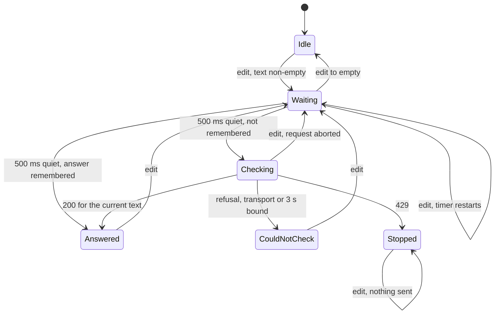
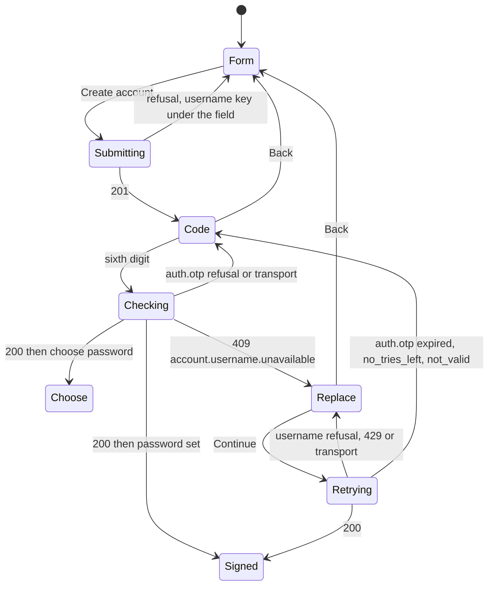
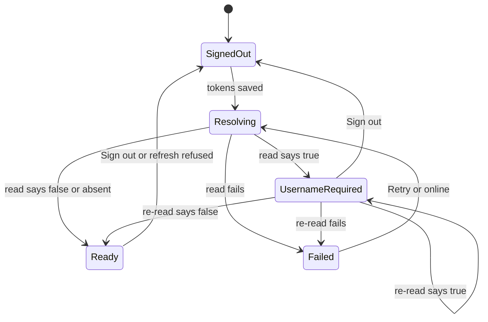
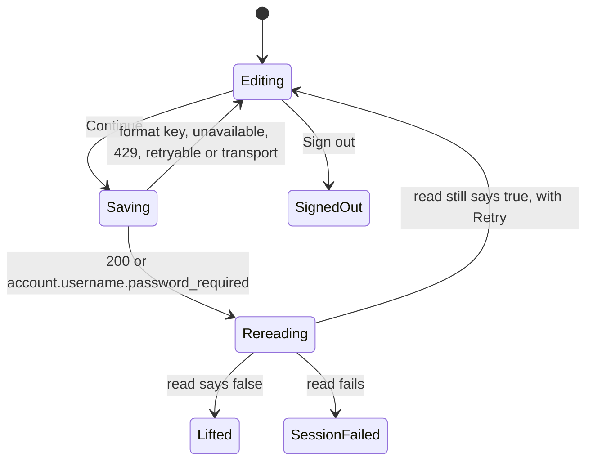
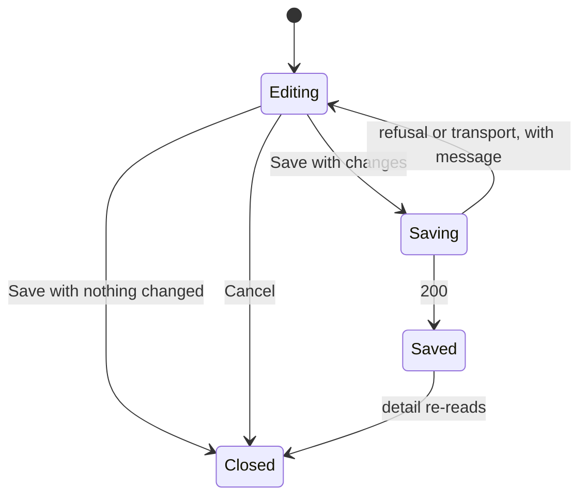

# Functional Specification — U4 web-identity

Intent `261113-unique-usernames`, unit U4 `web-identity` (kind `ui`). This
file is self-contained. It is the source of truth for the web client's
interaction workflows and the screen state transitions this unit adds or
changes. There is no `entities.md` or `rules.md` for a `ui` unit. Every
business rule stays on the server (TC-9, FR11.3); this client renders what the
server decided. Component shapes, state types, API functions, routes and test
obligations are in `frontend-components.md`.

U4 is "the web app's equivalents of U3". U3 (`construction/android-identity/`)
is designed, built and reviewed, and it is the reference here. Where this file
says "as U3", it means U3's functional-spec workflow of the same number,
behaviour for behaviour. Every place the web deliberately differs is listed in
§ 9 with its reason.

Answers Q1–Q6 are in `functional-design-questions.md`. All were taken as
recommended (A), on the person's instruction.

## 1. Grounding: the code this design changes

Read before writing, on the current branch (head `9a4b62a`, with U1, U2 and
U3 merged). Paths are under `web/src/`.

| Surface | As built today | What U4 changes |
|---|---|---|
| Generated API types (`api/schema.d.ts`) | Generated from an `openapi.json` older than U1 and U2. It has no `username`, `login`, `invited_email`, `student_email` or `guardian_email`. `MemberResponse.phone` is typed `string`. | Regenerated (`npm run gen:api`) as the first change. This is what turns the defects below into `tsc` errors. |
| Generated strings (`i18n/generated/*`) | Generated from Android bundles that predate U3 | Regenerated (`npm run gen:strings`). It brings in U3's strings and message-key mappings (§ 5). |
| Sign-in (`features/auth/SignIn.tsx`) | Phone/Email toggle plus one identifier field. `readIdentifier` refuses a malformed value before sending. `signInWithPassword(identifier, password)` sends `{phone|email, password}`. Hands `{kind, typed}` to the code flow as route state. | One field, "Username, phone or email". Nothing is judged on the client except non-blank. Sends `login`. No route state is handed over (W3). |
| Sign-up (`features/auth/SignUp.tsx`) | Role, name, phone or email, address, password. No username. The already-added lookup is phone only. The phone/email field is named `username` for password managers. | Username field with live availability (W1); `username` sent; the email lookup (W9, Q5); autofill tokens moved to the real username field (§ 7). |
| Verify (`SignUp.tsx` `verify`, `PasswordCode.tsx`, `parts.tsx` `CodeEntry`) | `verifyCode(identifier, code)`. Any refusal is shown under the code field, and the field is cleared. | `account.username.unavailable` becomes a replacement step. The retry sends `username` with the same code. The step is shared by sign-up and the code flow (W2). |
| Session (`session/session.tsx`, `App.tsx`) | `GET /v1/me` sets `ready` or `failed`. `failed` renders a blocking error card. `App` returns `LensPicker` before `<Routes>` when choosing. | New state `username-required`. The gate is returned before the lens picker and before any route (W4, Q2). |
| Settings → Account (`features/account/security/AccountEntries.tsx`) | Password row. "Add phone number" or "Add email" only when one is missing. | Username row and one "Phone and email" row (W5, W6, Q3) |
| Account screens (`features/account/security/*`) | Set or change the password; add a phone or email (`AddContact.tsx`) | Username screen, Contacts screen, Replace flow, Remove sheet (W5, W6) |
| Teacher's student record (`features/teacher/people/NewStudent.tsx`, `StudentDetail.tsx`, `StudentsList.tsx`, `mappers.ts`) | Create form with name, student phone and guardian phone. `updateStudent` is defined in `api.ts` and called by no screen. | Two email fields on create; a new Edit sheet (Q4); emails shown where phones are (W7) |
| Batch roster (`features/teacher/students/mappers.ts` `mapSeats`, `StudentsTab.tsx`, `AddStudent.tsx`) | Reads `guardian_phone` only. The quick-add requires a student phone. | Reads `student_email` and `guardian_email` for display. The quick-add gains a "Record by email instead" link (W7, Q6). |
| Centre members (`features/teacher/centre/Members.tsx`) | `inviteBody` requires a valid phone. Each card renders `formatPhone(m.phone)`. | Invite by phone or email; a member card with no phone shows the invited email (W8) |
| Email shape (`features/auth/identifier.ts` `readIdentifier`) | Same pattern as the server; length counted in UTF-16 units | Length counted in code points (defect 4) |
| Fetch layer (`api/client.ts`, `api/tokens.ts`) | Renewal is serialised under a Web Lock and shared in flight. `send()` rethrows a reason-less `AbortError` and turns every other rejection into `error.network.unreachable`. | Renewal unchanged, pinned by a new test (defect 5). `send()` rethrows whenever the caller's signal is aborted (§ 9, item 6). |

### Built defects found

Each was computed or read, as stated. Nothing here was run as an
end-to-end flow.

1. **The web gate is red on this branch.** Two parts of `npm run check` fail
   before U4 writes a line.
   - `check:generated`: `schema.d.ts` no longer matches `../openapi.json`; in
     particular `grep username web/src/api/schema.d.ts` finds no schema field.
     The generated string bundles also no longer match what
     `scripts/sync-strings.mjs` produces from the Android resources.
   - The i18n test `server message keys` (`i18n/i18n.test.ts`) reads the
     committed `../message-keys.json` and fails for each key the web cannot
     resolve.
   Computed by running the script's own `generate()` against the committed
   files: the regenerated English and Bangla bundles each gain 68 strings and
   change 3 (`centre_member_already_invited`, `student_number_accepted`,
   `student_number_erased`). The message-key map gains 16 mappings: the 15
   server keys U3 listed in its § 1, plus the client key
   `signup.username.required`. The typecheck was not run, but the gate cannot
   pass until both generators are re-run.
2. **One email-only invitation blanks the whole web app for a centre
   manager.** `MemberResponse.phone` is `string | null` in `openapi.json`
   (C2). `Members.tsx` renders `formatPhone(m.phone)`, and `formatPhone`
   calls `toLatinDigits(raw).replace(...)`, which throws on `null`. No React
   error boundary exists anywhere in `web/src` (searched for
   `ErrorBoundary`, `componentDidCatch` and `errorElement`). An error thrown
   during render therefore unmounts the root, and the page goes blank. This
   is live on any deploy with U2 merged. It is worse than U3's version of the
   defect, which failed only the members screen. The regenerated types make
   the call a compile error. W8 step 5 fixes the rendering. § 10 item 2
   records the missing boundary.
3. **Sign-up does not send a username, and `SignupRequest.username` is
   required** (C1, 2026-11-14 direction). Every web sign-up against the
   current backend is a 422. The regenerated type makes the omission a
   compile error. W1 closes it.
4. **The client email check is stricter than the server's for some
   addresses.** Both use the same pattern. `readIdentifier` uses
   `^[^\s@]+@[^\s@]+\.[^\s@]+$` after trim and lowercase. The server's
   `canonical_email` uses `[^@\s]+@[^@\s]+\.[^@\s]+` full-match, after trim,
   lowercase and an `isprintable()` check (`app/accounts/identifier.py:50,
   179-197`). Computed over every whitespace code point JavaScript's `\s`
   matches in the Basic Multilingual Plane: none is refused by the web and
   accepted by the server, so the shape is never stricter. U3's Q5 corner
   does not exist on the web. The length is the difference. The web compares
   `email.length` (UTF-16 code units) with 254, while the server compares
   `len(text)` (code points). An address of 130 `😀` plus `@b.cd` has 135
   code points and a JavaScript length of 265. The server's three conditions
   accept it (read, not executed, because the backend's dependencies are not
   installed here). The web refuses it. FR11.3 forbids that. Fixed by
   counting code points, as `passwordLengthProblem` already does in the same
   file.
5. **Token renewal does not lose a rotated pair when a caller is aborted.**
   This was verified by reading, and it is the U3 review-round defect
   checked on the web. `renew()` (`api/tokens.ts`) takes no `AbortSignal`.
   Its fetch to `/v1/auth/refresh` is independent of the caller. It runs once
   per tab in a shared promise, under a cross-tab Web Lock. `saveTokens`
   runs inside that promise whatever happens to the callers. A lookup
   aborted while `request()` awaits renewal therefore cannot cancel the save.
   The structure is correct today and nothing pins it. U4 adds a test
   (frontend-components § 8). One limit remains, as for U3's cold-start
   redeemer: a tab closed between the server's rotation and `saveTokens`
   loses the pair. No client code can close that.
6. **The sign-in screen hands the typed identifier to the code flow in route
   state.** It passes `<Link state={{ kind, typed }}>`. React Router stores
   route state in `history.state`, which the browser keeps for the tab's
   session history across reloads. Today that value is the person's phone or
   email. With one login field it would be a username in persisted browser
   state, and the code flow would pre-fill it into a field that refuses a
   username. W3 step 6 removes the hand-over.

## 2. Workflows

Numbered steps are the order the implementation follows. "Under the field"
means the refusal is rendered in that field's `Field` error slot. Each such
slot has `role="alert"` and is tied by `aria-describedby`. The form keeps
everything typed except passwords (FR1.6). Every write is sent only when the
person acts, and nothing is queued or retried by itself (TC-8, D-9). Every
outcome is recognised by `ApiError.messageKey`, never by the HTTP status.
`openapi.json` under-declares statuses on four operations (U3 § 9 item 4,
unchanged).

### W1. Sign up with a username and the live availability check

As U3 W1, with these web specifics.

1. The sign-up form gains a **Username** field, directly above the two
   password fields. Its help line is `signup_username_help`, which is
   guidance, not a check (FR11.3). The input has `autocomplete="username"`,
   `autocapitalize="none"` and `spellcheck="false"`. The phone or email field
   above it loses `name="username"` and `autocomplete="username"` and takes
   the `tel` or `email` tokens (§ 7, password managers).
2. Input is capped so that the **trimmed** value is at most 64 code points.
   That is the schema's `maxLength` on every request that carries a
   username. The cap is applied in the change handler, not with the HTML
   `maxlength` attribute, because the attribute counts UTF-16 units of the
   untrimmed text. The cap is not applied while an IME composition is in
   progress (`isComposing`), so a composing keyboard is never cut mid-word.
   FR1's 20 is not applied on the client.
3. Each edit resets the hint and schedules a check (Q1). After 500 ms with no
   edit, if the trimmed text is non-empty, the form sends
   `POST /v1/accounts/username-availability` with `{"username": <trimmed>}`.
   The text never goes in a URL (U1 NFR3.5).
4. The hint follows the machine in § 3.1. Answers render as in U3 W1 step 4:
   `available` → `username_available`; `unavailable` →
   `account_username_unavailable` (held and taken read alike, ADR-007);
   `invalid` → the string for the response's `message_key`; `reserved` →
   `account_username_reserved`.
5. A 429, any other refusal, a transport failure or the 3 s bound shows
   `username_could_not_check`. None of them disables Create account (FR3.2).
   After a 429 the form sends no further lookups.
6. Create account is enabled by the existing conditions. The client-side
   validation adds one rule: a blank username shows
   `signup_username_required` under the field. Submission is **not** gated
   on the hint.
7. Submit sends `signUp({... , username: <trimmed>})`. The password is moved
   to the in-memory ref, as today.
8. Outcomes of `POST /v1/accounts`:
   - 201 → as today: the code step.
   - `account.username.*` (400) or `account.username.unavailable` (409) →
     under Username; every other field keeps its value; the hint is replaced
     by the refusal.
   - Every other refusal → the form banner, as today.
9. The trimmed username is carried into the code step's state, so W2 can name
   it. It lives in React state only. Nothing about sign-up is written to
   storage or route state.

### W2. Verify a code, including the replacement username

As U3 W2. The web adds one thing: the step is shared by both places that call
`POST /v1/auth/verify`.

1. Sign-up's code step and the code flow (`PasswordCode.tsx`, "Forgot
   password" and "first password") both verify through `CodeEntry`. U1 W2
   step 6 completes a pending sign-up draft for the destination whichever
   screen sent the code. So both can receive
   `409 account.username.unavailable`, and both hand it to the same
   replacement step.
2. A 200 continues as today.
3. On `account.username.unavailable`, the six digits just tried are kept in a
   ref (memory only, never state that a reload or route restores). The step
   changes to **Replace**. It shows `auth_replace_username_title`, and
   `auth_replace_username_body` filled with the username the person typed in
   W1. In the code flow, where no username was typed, it fills the body with
   the title's wording alone (frontend-components § 7). The step has a
   Username field with the W1 hint on the **public** lookup, and Continue
   and Back. Nothing from the response is shown beyond the key (U3 NFR1.4).
4. Continue sends `verifyCode(identifier, code, username)`, with the same
   code and the trimmed replacement.
5. Outcomes, as U3 W2 step 5:
   - 200 → step 2.
   - `account.username.*` or `.unavailable` again → stays on Replace, under
     the field.
   - `auth.lookup.too_many` → stays on Replace, with that message in the
     banner. Continue stays available.
   - `auth.otp.expired`, `.no_tries_left` or `.not_valid` → back to the code
     step's existing handling, with the held code forgotten.
   - Transport → stays on Replace with the offline message and Retry, which
     resends the same request.
6. Back forgets the held code (and, in sign-up, the held password) and
   returns to the form, as `backToForm` does today.

### W3. Sign in with one field

As U3 W3.

1. One text field labelled `auth_login_label`, with no Phone/Email toggle.
   It has `type="text"`, `autocomplete="username"`, `autocapitalize="none"`
   and `spellcheck="false"`.
2. The only client condition is non-blank. There is no shape check and no
   classification (FR4.1, FR11.3).
3. Submit sends `POST /v1/auth/password` with
   `{"login": <trimmed>, "password": …}` and no `phone` or `email` key.
4. Outcomes are mapped as today. Tokens → `signIn`. An MFA challenge → the
   second step. `auth.password.wrong` and `.too_many_attempts` → the banner
   with the link to the code flow. Transport → the banner.
5. `email.invalid` (a login containing `@` that is no address) is shown
   under the field. Every other refusal goes in the banner.
6. "Forgot password", "first password" and the pointer after a wrong password
   link to `/signin/code` **without route state**. The code flow keeps its
   Phone/Email toggle (FR10.1) and starts empty (defect 6). `CodeFlowEntry`
   and the `entry` read in `PasswordCode.tsx` are removed.

### W4. Choose a username before anything else (FR5.2)

Q2. The web differs from U3 in how the gate is reached and how it lifts.

1. The session provider maps each successful `GET /v1/me`. If
   `username_required` is `true`, it publishes
   `{ state: 'username-required', me }`. Otherwise it publishes `ready` as
   today. An absent flag (an older server) reads as `false`. This is one
   `setSession` call, so no render shows the lens picker or a route before
   the gate.
2. `App` checks this state directly after `failed` and before `choosing`, and
   returns the full-page gate. No `<Routes>`, no `AppShell`, no prompts and no
   lens picker are mounted. A typed URL, browser Back and Forward, and a deep
   link all render the gate, because the gate is not a route. The URL is left
   as it was, so the person lands where they were going once the gate lifts.
3. The provider's refresh keeps the gate on screen while it re-reads. Today
   the effect keeps `ready` and otherwise publishes `resolving`. It must keep
   `username-required` the same way, so a re-read never flashes the loader.
4. The gate shows `choose_username_title`, `choose_username_body`, the
   Username field with the W1 hint on the **authenticated** lookup
   (`POST /v1/me/username-availability`), Continue, and the text button
   `choose_username_sign_out`.
5. Continue sends `PUT /v1/me/username` with `{"username": …}` and no
   password (FR5.4).
6. Outcomes:
   - 200 → the gate stays in `Saving` and calls the session's `refresh()`.
     The gate lifts **only** when that read says `username_required: false`
     (Q2, U3 review-round finding). If the read still says `true`, the gate
     returns to Editing with `error_unexpected` and Retry, which re-reads
     rather than resending the choice. If the read fails, the session goes
     to the existing blocking error card. That is fail-closed, and its Retry
     re-reads.
   - `account.username.*` or `.unavailable` → under the field.
   - `account.username.password_required` → another tab or device chose
     first (U1 W7 step 3). The gate re-reads at once and lifts when the read
     says false. No password is asked for.
   - `auth.lookup.too_many` → banner; Continue stays available.
   - `error.temporarily_unavailable` (retryable) and transport → banner with
     Retry, which resends the same choice.
7. Sign out calls the session's one `signOut()`. That clears the tokens,
   revokes the family best-effort, forgets the lens and the workspace, and
   (through `onTokensChanged`) resets the two-step status store. The app
   returns to `/signin`.
8. While the gate shows, a `visibilitychange` to `visible` triggers one quiet
   re-read. So a name chosen in another tab, or on Android, lifts this tab's
   gate when the person returns to it.
9. **No unknown-flag window.** U3 had to bound a window in which a failed
   read routed into the app (its W4 step 8). On the web a failed read already
   renders only the error card, and its `online` listener retries. No screen
   of the app is reachable while the flag is unknown. U4 therefore adds no
   periodic re-check (§ 9, item 2).

### W5. View and change the username in Settings

As U3 W5, placed in Settings rather than More (Q3).

1. Settings → Account gains a **Username** row. Its subtitle is
   `session.me.username` as stored (display casing). With no username (not
   reachable behind the gate), the row reads `more_username_choose`. Offline,
   the row is greyed with `more_needs_connection`, like its neighbours.
2. The row opens `/settings/username`. That screen shows the current username
   read-only, and Change.
3. Change opens the form. It has `username_new_label` with the hint on the
   **authenticated** lookup (so a name the person released reads available,
   ADR-012), the current password (`autocomplete="current-password"`),
   `username_rule_note`, and Save.
4. Save sends `PUT /v1/me/username` with `{username, password}`.
5. Outcomes:
   - 200 → the screen shows the new name. When `next_change_at` is non-null
     it shows `username_changed_on`, with the instant rendered by
     `formatDateTime(iso, lang)`; otherwise `username_changed`. The session
     re-reads (`refresh()`), so the Settings row updates. No session ends
     (FR7.5).
   - `account.username.change_too_soon` → `account_username_change_too_soon_on`
     with `details.next_change_at` formatted the same way. Without the
     detail it shows the key's plain string. The date is formatted on the
     screen. It is deliberately **not** added to `MESSAGE_ARGS`
     (`i18n/i18n.tsx`), which would insert the raw ISO text.
   - `account.username.password_required` → banner with a link to the
     password screen.
   - `auth.password.current_wrong` → under the password, which is cleared.
   - `auth.password.too_many_attempts` → banner, not retryable.
   - `account.username.*` or `.unavailable` → under the username.
   - `auth.lookup.too_many` → banner; Save stays available.
   - `error.temporarily_unavailable` and transport → banner with Retry.
6. Change is always offered. The client never decides whether a rename is
   allowed (FR11.3). `MeResponse` carries no `next_change_at`, so the date is
   shown only after a change or a refusal (U3 § 9 item 5).
7. The password lives in component state, is cleared on every answer, and is
   dropped when the screen unmounts.

### W6. Contacts in Settings: view, add, replace, remove

As U3 W6, on web routes (Q3).

1. Settings → Account replaces the two Add rows with one **Phone and email**
   row (`more_contacts`). Its subtitle is the present contacts, phone first,
   or `more_contacts_sub_none`. The row opens `/settings/contacts`.
2. The Contacts screen renders from `session.me`, the last read. It has two
   cards. Phone shows the number with Replace and Remove, or
   `contacts_no_phone` with Add (the existing `AddContact` route). Email
   shows the address with Replace and Remove, or `contacts_no_email` with
   Add. When `has_password` is `false`, `contacts_password_note` and a link
   to set a password sit above the cards. The actions stay enabled.
3. **Add** is the existing flow, unchanged. On success it re-reads the session
   (seats may link, FR6.5) and returns to Contacts with the existing notice,
   instead of returning to Settings.
4. **Replace** is `/settings/contact/{kind}/replace`:
   1. The entry step has the new value (`contacts_new_phone_label` or
      `contacts_new_email_label`) and the current password.
   2. It sends `POST /v1/me/contact` with `{phone|email, password}`.
   3. Refusals stay on the entry step, routed as in U3 W6 step 4.3.
   4. On 200 the code step reads `contacts_code_sent_new_*`, and the
      password is dropped from state.
   5. `POST /v1/me/contact/verify` with `{phone|email, code}` through
      `CodeEntry`.
   6. Its refusals stay on the code step, as U3.
   7. On 200 the session re-reads, and the screen returns to Contacts with
      `contacts_replaced_*` as its notice.
5. **Remove** is a `Sheet` on the Contacts screen (U3 used a sheet too). It
   shows `contacts_remove_title`, and `contacts_remove_body` filled with the
   formatted contact. It has the current password, Remove (danger style) and
   Cancel. The sheet is `dirty` while a password is typed, so closing asks
   first.
   1. It sends `POST /v1/me/contact/remove` with `{kind, password}`.
   2. On 200 the sheet closes, the session re-reads, and the card shows
      `contacts_removed`.
   3. `account.contact.last_one` → in the sheet, with `contacts_add_other`
      linking to Add for the other kind. Not retryable.
   4. The other refusals and transport are handled as in U3 W6 step 5.
6. After every write the screen renders the session's re-read account. It
   never edits its own copy.

### W7. Teacher's student record: emails on create and edit, and showing them

As U3 W7, plus the Edit sheet the web lacks (Q4) and the quick-add link (Q6).

1. **New student** (`people/NewStudent.tsx`) gains
   `student_add_student_email` and `student_add_guardian_email`, each
   directly under its phone field. They use `type="email"` and
   `autocomplete="off"`, because these are someone else's addresses and the
   browser must not offer the teacher's own.
2. A non-blank email is checked with the shared email check (defect 4
   fixed). A malformed value is shown under its field and disables Save, the
   same way a malformed phone does today. Blank means absent.
3. Create sends `student_email` and `guardian_email`, trimmed, and omits
   each when blank.
4. Outcomes: `student.email.taken` → under the student email.
   `email.invalid` from the server (reachable only if the shapes diverge
   again) → the form banner, because the envelope does not name the field.
   Existing refusals are unchanged.
5. **Edit** (new, Q4) is a `Sheet` opened from an Edit button on the
   student detail screen. It is pre-filled with the stored name, both phones
   and both emails, and it uses U3's patch semantics:
   - unchanged → omitted;
   - changed → sent;
   - an emptied email → `null`, which clears it;
   - an emptied phone → treated as unchanged, as on Android.
   An edit with nothing changed sends nothing and closes the sheet.
6. Edit outcomes:
   - 200 → the detail re-reads.
   - `student.email.taken` → under the student email.
   - `student.number_accepted` and `student.number_erased` → the sheet
     banner, in their reworded "contact" strings (W10).
   - `student.phone_taken` and the existing refusals → banner.
   - Transport → banner with Retry, which resends the same patch.
7. **Display.** The mappers make every choice, and no component makes one:
   - Student detail header: the student phone, else the student email.
   - Guardian line: `student_detail_guardian_link · {phone}`, else `· {email}`.
     Both are shown when both are recorded.
   - Students list (`PhoneCell`): a contact cell shows the phone, else the
     email, else `web_students_no_phone` (reworded in § 5).
   - Batch roster: `mapSeats` also reads `student_email` and
     `guardian_email`. Where the roster shows the guardian's phone today (a
     declined seat's label), it shows the guardian's email when there is no
     phone.
8. **Batch quick-add** (`students/AddStudent.tsx`, Q6). The request shape and
   the required fields are unchanged; `EnrollmentCreateRequest` has no email
   field. A link, `web_students_add_by_email`, opens
   `paths.studentNew(batchId)` (`/students/new?batch=…`), the existing New
   student form with this batch preselected.

### W8. Centre: invite by phone or email; members without a phone

As U3 W8.

1. The invite form gains `centre_invite_email_label` under the phone field,
   and the help line `centre_invite_by_help`.
2. Invite is enabled when the name is non-blank, **at least one** of phone or
   email is non-blank, and each non-blank value passes its format check. The
   at-least-one condition is a presence check mirroring the schema's shape,
   not a policy.
3. `inviteBody(name, phone, email, role)` returns
   `{display_name, role, phone?, email?}`. A blank value is omitted.
4. Outcomes are as today. `centre.member.already_invited` now covers an email
   too, with its reworded string.
5. **Members list.** A pure mapper produces each card's `contactLine`: the
   formatted phone when non-null, else `invited_email`, else nothing. The card
   renders the line it is given. `formatPhone` is never called with `null`.
   That closes defect 2.

### W9. The already-added lookup for an email at sign-up (Q5)

As U3 W9.

1. When the identifier kind is Email and the field is left holding an address
   the shared check accepts, the form calls
   `lookupAlreadyAdded({ email })`, once per value. This is the phone path's
   exact behaviour: the answer is remembered per value; a late answer for a
   changed value is dropped; a seat locks the role; nothing is named (C-06).
2. A refusal or a transport failure shows nothing and never blocks Send code.
3. `lookupAlreadyAdded` takes `{phone} | {email}`. C2 defines the route as
   `GET` with a query parameter, so the person's own typed contact appears
   in the URL here. That exception is U2's route and U2's to change (U3
   NFR3.1). U4 makes no claim for it. `SignUp.tsx`'s header comment is
   corrected.

### W10. Copy that changes meaning

`student_number_accepted`, `student_number_erased` and
`centre_member_already_invited` now cover an email as well. Their reworded
strings arrive by regeneration from U3's bundles (§ 5). Four web-only strings
also say "number" or "phone" where an email is now possible. They are
reworded in `i18n/web/*.json` (§ 5).

## 3. Screen state machines

### 3.1 The username availability hint (sign-up, Replace, gate, rename)

Text fallback: the hint starts Idle. A non-empty edit moves it to Waiting.
Each further edit restarts the 500 ms timer, and an edit to empty returns to
Idle. After 500 ms of quiet it shows a remembered answer at once, or moves to
Checking and sends one request. An edit while Checking aborts that request and
returns to Waiting. A 200 for the text still in the field moves to Answered.
A refusal other than 429, a transport failure or the 3 s bound moves to
CouldNotCheck. A 429 moves to Stopped: it shows the could-not-check text, and
no further request is sent for the life of the form. An aborted request
produces no transition, because the checker records why it aborted before it
aborts. No state blocks submission.

### 3.2 Sign-up and the code step

Text fallback: the form submits and either returns with a refusal (a username
key under the field) or reaches Code on a 201. The sixth digit checks the
code. A 200 ends signed in, or at Choose (choose a password) when the held
password is gone or two-step is required. An OTP refusal returns to Code. A
409 `account.username.unavailable` moves to Replace, with the code held in
memory. Continue retries with the replacement. A 200 ends signed in. A
username refusal, a 429 or no answer returns to Replace. A spent or expired
code returns to Code with the held code forgotten. Back from Replace or Code
returns to the form and forgets the held code and password. The code flow
(`PasswordCode.tsx`) uses the same Code → Replace → Retrying segment, without
the form states.

### 3.3 Session and the gate

Text fallback: saved tokens start a read. A read that says the flag is true
publishes UsernameRequired. A read that says false, or carries no flag,
publishes Ready. A failed read publishes Failed, which shows only the blocking
error card. From UsernameRequired, a re-read keeps the gate while the flag is
true, publishes Ready when it is false, and publishes Failed when the read
fails. A re-read is triggered by the gate after a choice, by a
`password_required` answer, or by the tab becoming visible. Sign out returns
to SignedOut from any signed-in state.

### 3.4 Choose-username gate

Text fallback: Continue moves Editing to Saving. A 200 or a
`password_required` answer moves to Rereading. Every other answer returns to
Editing with its message, and Retry is offered only for retryable answers and
transport. Rereading lifts the gate when the read says false. It returns to
Editing with a re-read Retry when the read still says true. A failed read
leaves the gate for the session's blocking error card. Sign out ends the
session from Editing.

### 3.5 Username screen

As U3 § 3.5: Viewing, Editing, Saving, Changed. Cancel and leaving the screen
clear the password.

### 3.6 Contacts, Replace and Remove

As U3 § 3.6, with one difference. The Contacts screen has no Loading or
Failed state of its own: it renders `session.me`, which the session holds
whenever a signed-in screen is mounted, and every write re-reads through the
session. Replace is Entering → Sending → AwaitingCode → Checking → Replaced,
and Change returns AwaitingCode to Entering. Remove is Confirming → Removing →
Removed, and any refusal or transport failure returns to Confirming.

### 3.7 Student Edit sheet

Text fallback: Save with nothing changed closes the sheet with no request.
Save with changes sends the patch. A 200 closes the sheet and re-reads the
detail. A refusal or no answer returns to Editing with the message under its
field or in the banner. Cancel closes the sheet, asking first if anything was
typed.

## 4. Error handling per message key

U3 § 4's table applies unchanged, with the web placements below. "Under X" is
a field's error slot. "Banner" is the form's `banner error` with
`role="alert"`. "Retry" resends the same request and is offered only when
`ApiError.retryable` is true or `offline` is true.

| message_key | Web screens | Shown |
|---|---|---|
| `account.username.too_short`, `.too_long`, `.invalid_character`, `.must_start_with_letter`, `.bad_dot`, `.reserved`, `.unavailable` | Sign-up, Replace, gate, rename; also as hint text | Under Username |
| `account.username.change_too_soon` | Rename | Banner, with the formatted `details.next_change_at` |
| `account.username.password_required` | Rename (banner and a link to set a password); gate (not shown; re-read) | as stated |
| `auth.lookup.too_many` | Every hint (could not check, then stop); Replace, gate, rename, contact replace (banner) | as stated |
| `auth.password.wrong`, `.too_many_attempts` | Sign-in | Banner with the code-flow link (existing) |
| `auth.password.current_wrong` | Rename, Replace, Remove | Under the password, which is cleared |
| `auth.password.too_many_attempts` | Rename, Replace, Remove | Banner |
| `email.invalid` | Sign-in (under the field), add or replace email (under the field), student forms (banner), invite (banner) | as stated |
| `phone.invalid` | Add or replace phone, invite | Under the field or banner |
| `account.contact.password_required` | Replace, Remove | Banner with a link to set a password |
| `account.contact.last_one` | Remove | In the sheet, with Add another |
| `account.contact.change_limit`, `.admin_locked` | Replace (request or verify), Remove | Banner |
| `account.contact.already_set` | Replace | Under the new value |
| `account.contact.taken` | Add, Replace verify | Under the code (existing) |
| `auth.otp.*` | Verify, contact verify | `CodeEntry`'s existing handling |
| `student.email.taken` | New student, Edit | Under student email |
| `student.number_accepted`, `.number_erased` | Edit | Sheet banner (reworded) |
| `centre.member.already_invited` | Invite | Banner (reworded) |
| `error.temporarily_unavailable` | Rename, gate | Banner with Retry |
| `error.network.unreachable` | Every write and read here | Banner or hint, with Retry where a write |
| `error.unexpected` | Every screen | Banner |

An unknown key falls back to `error_unexpected`, as `translateMessage` does
today. After regeneration no published key is unknown, and the existing i18n
test asserts that.

## 5. Strings (FR11.2)

- **Generated from Android, not hand-copied.** The web's bundles are generated
  from `android/src/main/res/values{,-bn}/strings.xml`, and its message-key
  map from `MessageKeys.kt` (`scripts/sync-strings.mjs`). U3's reviewed
  Bangla and English strings therefore arrive by running
  `npm run gen:strings`, and `check:generated` fails CI if they are stale.
  That covers every message-key string, every username, contact, gate and
  Replace string, the student and invite email labels, and the three
  rewordings (§ 1 defect 1 has the computed counts).
- **Web-only strings** go in `i18n/web/account.{en,bn}.json`,
  `students.{en,bn}.json` and `auth.{en,bn}.json`, with the `web_` prefix
  and both languages together. The existing tests `has every string in both
  languages` and `keeps web-only keys out of the Android namespace` cover
  them. The new keys are `web_students_add_by_email` and
  `web_student_edit_title`, plus the edit sheet's save and saved strings.
  The exact list is in frontend-components § 7.
- **Web-only strings reworded.** Four strings say "number" or "phone" where
  a username or an email now applies:
  - `web_auth_signin_body`;
  - `web_auth_signup_phone_help`;
  - `web_students_no_phone`, which becomes "No contact";
  - `web_students_col_phone`, which becomes "Student's contact".
  Each is reworded in both languages. The keys do not change.
- A date in a string is formatted by `formatDateTime`. Nothing is computed
  from the server's instant.

## 6. Loading, empty, error and retry states per screen

| Screen | Loading | Empty | Error | Retry |
|---|---|---|---|---|
| Sign-in | button label `web_auth_signing_in` (existing) | — | banner (existing) | resubmit |
| Username hint | `username_checking` | Idle shows the help line | `username_could_not_check` | none; an edit re-checks, except after a 429 |
| Replace step | button busy | field empty at entry | under the field or banner | transport, same request |
| Gate | button busy while saving or re-reading | field empty at entry | under the field or banner | retryable and transport |
| Username screen | button busy while saving | `more_username_choose` (not reachable behind the gate) | under the fields or banner | retryable and transport |
| Contacts | none (renders the session's account) | `contacts_no_phone` or `contacts_no_email` with Add | — | — |
| Replace flow | button busy | — | under the fields or banner | transport, same request |
| Remove sheet | button busy | — | in the sheet | transport, same request |
| New student and Edit | existing | — | under the field or banner | Edit: transport, same patch |
| Centre members | existing list loader | existing | existing; a null phone no longer crashes the page | existing |

## 7. Corner sweep

Deployment shape: one person per account, several tabs and devices per
account, networked; children's data; no offline writes. Each condition:

- **Loading, empty and error are distinct**: § 6.
- **Stale data**: Contacts and Settings render the session's last read and
  re-read after every write. Other open tabs show their own last read until
  they re-read; the gate re-reads on visibility (W4 step 8).
- **Same fact in two places**: the Settings row and the Username screen both
  read `session.me.username`, so one re-read updates both.
- **Destructive action**: Remove confirms, names the contact, and says what
  stays. Replace removes the old contact only after the new one verifies.
- **Invalid input**: named under its field; everything typed is kept except
  passwords (FR1.6).
- **Double submit**: every submit button is disabled while its request is in
  flight, as today.
- **Unsaved input on navigation**: sheets ask before discarding (`dirty`).
  Full-page forms lose typed input on navigation, as every web form does
  today. Nothing typed is persisted to survive a reload.
- **Client rules re-checked by the server**: the client holds no username
  rule, no last-contact rule and no rename window. The email check is the
  server's pattern, now with code-point length (defect 4).
- **Keyboard, screen reader and contrast**: the hint is text, never colour
  alone, in a `role="status"` live region that is always present, so
  "Available" or a refusal is announced. The gate's Sign out is a focusable
  button. Focus moves to the first field when the gate, Replace step or a
  sheet opens.
- **Older response arrives last**: latest-wins, plus abort (§ 3.1).
- **Same user in two tabs or devices**:
  - First choice in both → the second gets `password_required` and re-reads
    (W4).
  - Rename → the other tab shows the new name on its next session read.
  - Contact removed elsewhere → this tab's Contacts reflects it after the
    session's next read. A write against a stale view gets the server's
    refusal.
- **Rate limited**: every 429 says the check or claim could not be done now,
  and leaves submission to the person.
- **Version skew**: the web ignores unknown response fields. It reads
  `username_required` defensively (absent = false) and `MemberResponse.phone`
  as nullable.
- **Very long text**: the username field takes up to 64 trimmed code points
  and lets the server refuse. Emails up to 254 wrap in cards and list cells;
  they are not truncated.
- **Text that looks equal**: a case-only change is sent. The server applies
  its case-only rule. The client never lowercases a username it displays.
- **Password managers**: `autocomplete="username"` sits on the real username
  field at sign-up, the login field, the gate and the rename field.
  `HiddenUsername` in `ChoosePassword` carries the chosen username after a
  sign-up, and the phone or email in the code flow. In `Password.tsx` it
  carries `me.username ?? me.phone ?? me.email`. The browser files the
  credential under the name the person now signs in with. Teacher-recorded
  emails use `autocomplete="off"`.
- **Sensitive data**:
  - No username, login, phone, email, password or code is written to
    `console`, `localStorage`, `sessionStorage`, IndexedDB, route state or a
    URL. The one URL exception is U2's already-added query (W9 step 3).
  - The PWA caches no API response (`runtimeCaching: []`, unchanged).
  - The username never appears in `document.title`.
  - The six digits held for Replace are in a ref, cleared on Back, on
    sign-out and on unmount.

## 8. Bangla layout obligations (FR11.2)

The verifier is the manual check in `docs/delivery/bangla-layout-check.md`.
**Nothing automated discharges this obligation.** There is no screenshot test
in the web client, and the tests in frontend-components § 8 are correctness
tests that do not measure layout. The unit is not complete until each row
below is in that table, checked at the longest Bangla string on the screen,
with its status. The longest string per screen is re-derived from the
generated `strings.bn.json` and the web bundles when the strings land, not
estimated here.

The table's method is written for a device. For the web, each row is checked
in a browser with the app's language set to বাংলা. It is checked at a
360 CSS px viewport and again at the wide layout (`useWide`), at the default
text size. Each row's Artboard column records `web`.

| Unit | Screen | New or changed |
|---|---|---|
| U4 (web) | Sign-in: one login field | changed |
| U4 (web) | Sign-up: username field and every hint state | changed |
| U4 (web) | Code step: Replace username state (sign-up and code flow) | new |
| U4 (web) | Choose username (gate) | new |
| U4 (web) | Settings → Account: Username and Phone and email rows | changed |
| U4 (web) | Username: view, change, changed with date, change too soon | new |
| U4 (web) | Contacts: both present; one absent; password note | new |
| U4 (web) | Replace contact: entry and code steps | new |
| U4 (web) | Remove contact sheet, including the last-one refusal | new |
| U4 (web) | New student: two email fields | changed |
| U4 (web) | Student Edit sheet | new |
| U4 (web) | Student detail and list: email in place of a phone | changed |
| U4 (web) | Batch roster: guardian email; quick-add link | changed |
| U4 (web) | Centre members: invite by phone or email; member with email only | changed |

## 9. Where the web deliberately differs from U3

1. **Gate placement.** U3 adds a `SessionUiState` branch in `AppRoot`. The
   web adds a session state checked in `App` before `<Routes>`. The effect is
   the same: nothing else is composed. On the web it also means no route,
   typed URL or history entry can reach a screen.
2. **No unknown-flag window and no periodic re-check.** U3 keeps its built
   routing of a failed read into the lens-free graph, and bounds the window
   with a 30 s foreground re-check. The web's built routing of a failed read
   is a blocking error card, so the window does not exist. Adding a timer
   would add cost and close nothing.
3. **The gate lifts only on a read** (Q2). U3 publishes its held state on the
   200, and its review fixed the re-read path only. The web makes the read
   the only exit. The server's flag is then the one signal, and a dead Done
   screen cannot arise.
4. **Placement in Settings.** The web keeps sign-in settings in Settings →
   Account, not in More. The rows go where the web's equivalents already are.
5. **Edit student is new on the web** (Q4). U3 extended an existing dialog.
6. **Cancellation.** U3 had to stop its `call {}` helpers swallowing
   `CancellationException`, and to make its renewal non-cancellable. On the
   web the renewal is already independent of callers (§ 1 defect 5). The one
   hardening the checker needs is in `send()`: today it rethrows only a
   reason-less `AbortError` and maps any other rejection, including an abort
   with a reason or an `AbortSignal.timeout()`, to
   `error.network.unreachable`. U4 changes `send()` to rethrow whenever
   `options.signal?.aborted` is true. A superseded or timed-out lookup is
   then never mistaken for being offline, whoever wrote the abort. The
   checker still decides from its own flags (Q1).
7. **Email shape.** U3 had to align its pattern (its Q5). The web's pattern
   was already aligned; only the length unit changes (defect 4).
8. **Strings are generated, not authored.** U3 wrote the strings; U4
   regenerates them and writes only the web-only ones (§ 5).
9. **Persistence.** U3 keeps the typed username across rotation
   (`rememberSaveable`). The web keeps nothing across a reload. React state
   only, with no identifier in route state, is the web's equivalent of
   "nothing secret in saved state".
10. **Bangla check medium**: a browser at two widths instead of a device
    (§ 8).

## 10. Structural concerns

Raised here as the team's practice requires (structural, not naming).

1. **The web gate is red on `main` today** (§ 1 defect 1). U4's first change
   regenerates both generated sets. Until then no web PR can pass
   `make web`. The cause is process, not code. U1, U2 and U3 each changed a
   source that `check:generated` watches, and none ran the web check,
   because each unit's CI job is path-split. It is recorded so the next
   contract change regenerates `web/` in the same PR. The practice to adopt
   is the owner's call; U4 does not change CI.
2. **The web has no error boundary.** Defect 2 blanks the whole app because
   any render-time throw unmounts the root. U4 fixes the null phone. It also
   recommends, and frontend-components § 5 includes, one root boundary in
   `App`. The boundary renders `ErrorCard` with a reload action, so a future
   null in some other field fails one page and not the app. It is small, but
   it is a structural guard, not a feature, so it is named here rather than
   absorbed quietly.
3. **The contract has no email on the batch quick-add** (Q6).
   `EnrollmentCreateRequest` carries `student_phone` and `guardian_phone`
   only. Teachers who add from a roster cannot record an email there on
   either client. The web links to the form that can. The gap is U2's (C2)
   to close or to declare intended.
4. **`openapi.json` under-declares four operations' statuses.** This is
   unchanged from U3 § 9 item 4. The web switches on `messageKey`, so
   nothing depends on it; it is carried forward, not re-reported.
5. **No web coverage figure exists.** `vitest` runs without coverage, and
   no practice assigns a web ratchet. The obligations here are named tests
   (frontend-components § 8). Nothing measures web coverage, and this design
   does not claim it.
6. **`console.error` is not linted.** Two sites log non-`ApiError`
   exceptions (`core/useResource.ts:104`, `family/pay/PayScreen.tsx:79`).
   Neither logs an identifier today, and nothing would stop a later one. A
   mechanical guard, such as an ESLint `no-console` rule with those two
   sites annotated, belongs to this unit's NFR stage. It is named here so it
   is decided there rather than forgotten.

## Assumptions & Open Questions

- [assumption] 500 ms debounce, 3 s bound and stop-after-429 are U3's values
  (U3 NFR8.1–8.3, NFR2.1), kept so U1's Family A sizing assumption holds for
  both clients.
- [assumption] An absent `username_required` reads as `false`.
  `MeResponse` lists no required fields in `openapi.json`, so the generated
  type is optional; the backend always sends it.
- [assumption] The code flow's Replace body has no typed name to show, so it
  uses wording without the `{1}` argument (frontend-components § 7). No new
  server behaviour is assumed.
- [assumption] The Bangla check on the web uses a 360 CSS px viewport and the
  wide layout at default text size. The table's device method has no web
  wording of its own.
- [assumption] No new npm dependency is needed. Debounce, abort and timers
  use the platform, and tests use the installed vitest and Testing Library.
- Open questions: None.

## Sources

- Unit and map: `inception/units-generation/unit-of-work.md` § U4 (and § U3,
  which U4 mirrors); `unit-of-work-story-map.md` rows FR5.2, FR11, FR11.1,
  FR11.2 and FR11.3.
- Requirements: `inception/requirements-analysis/requirements.md` FR1–FR11,
  NFR1, NFR6, NFR8, A4, A5.
- Components: `inception/domain-design/components.md` WebIdentityScreens and
  AndroidIdentityScreens.
- Contracts: `inception/contract-design/contract-summary.md` C1 (as amended
  at U1 code generation) and C2. The committed `openapi.json` schemas
  `SignupRequest`, `VerifyRequest`, `PasswordSignInRequest`,
  `UsernameAvailabilityResponse`, `UsernameChangeRequest/Response`,
  `MeResponse`, `ContactRequest`, `ContactRemoveRequest`,
  `StudentCreate/Update/Response`, `EnrollmentCreateRequest`,
  `RosterRowResponse`, `MemberInviteRequest` and `MemberResponse`, and the
  declared responses of each path above, read on this branch.
- U3 reference: `construction/android-identity/functional-design/{functional-spec,frontend-components,functional-design-questions}.md`,
  `nfr-requirements/{security,performance}-requirements.md`,
  `code-generation/code-summary.md` (review round 1 fixes).
- U1 behaviour: `construction/usernames-backend/functional-design/functional-spec.md`
  W2 (verify completes a draft from either screen).
- Code read: `web/package.json`, `web/scripts/{sync-strings,check-generated}.mjs`,
  `web/src/api/{client,tokens,errors,endpoints}.ts`,
  `web/src/session/session.tsx`, `web/src/App.tsx`, `web/src/main.tsx`,
  `web/src/i18n/{i18n.tsx,i18n.test.ts}`,
  `web/src/features/auth/{SignIn,SignUp,PasswordCode,ChoosePassword,parts,identifier}.tsx|ts`,
  `web/src/features/account/{Settings,More}.tsx`,
  `web/src/features/account/security/{AccountEntries,AddContact,Password,index,paths,status}.tsx|ts`,
  `web/src/features/teacher/centre/Members.tsx`,
  `web/src/features/teacher/people/{api,NewStudent,mappers,StudentsList,StudentDetail}.ts|tsx`,
  `web/src/features/teacher/students/{AddStudent,StudentsTab,mappers,api}.tsx|ts`,
  `web/src/core/{format,money,useResource}.ts`, `web/src/ui/components.tsx`,
  `web/eslint.config.js`, `web/vite.config.ts`, `app/accounts/identifier.py`,
  `docs/delivery/bangla-layout-check.md`, `Makefile` (`web` target).
- Team and project rules: `aidlc/spaces/default/memory/team.md` (Testing
  Posture, Layer boundaries, Corrections 2026-10-22 on reading code first)
  and `project.md` (Forbidden, Mandated, Corrections 2026-10-23).
- Answers: `functional-design-questions.md` Q1–Q6 [Q1]–[Q6].
