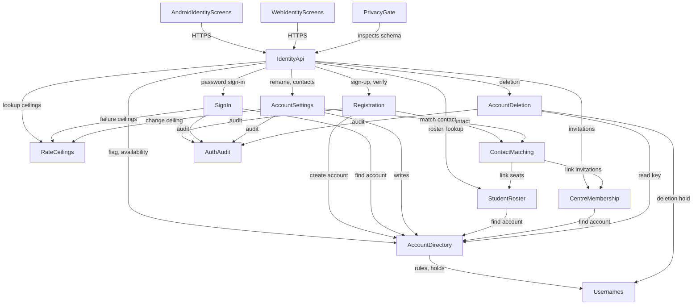

# Components — Unique usernames

Domain design for intent `261113-unique-usernames`. Brownfield: most building
blocks below already exist and are named after the code that holds them today
(`aidlc/spaces/default/codekb/shikkhok-plus/component-inventory.md`); two are
new (**Usernames**, **ContactMatching**). Each component lists only the
responsibilities and entities this change touches or relies on. Entities are
captured at ownership-and-shape level; types, constraints and cardinality
belong to Functional Design. Decisions are recorded in `decisions.md`
(ADR-001 to ADR-012). ADR-007 amends FR3.1 and FR1.6: a held name reads as
"unavailable" on the public surface, with no separate "held" answer.

Source requirements: `inception/requirements-analysis/requirements.md`
(FR1–FR11, NFR1–NFR9) and the six review findings R-01 to R-06 accepted at
that gate, which are settled here.

```yaml
components:
  - name: Usernames
    summary: The rules for what a username is, and the ledger of released usernames that nobody else may take yet.
    behaviour: >
      Pure rules plus one small ledger. Validates a candidate (3-20 characters;
      Latin letters, digits, underscore, dot; starts with a letter; no trailing
      dot; no two dots in a row; whitespace trimmed at the ends and refused
      inside) and returns the reason it fails. Derives the canonical key (the
      lowercase form) used for uniqueness, sign-in and holds. Holds the reserved
      list in one place and compares against it by key. Records a hold when a
      username is released by rename or by account deletion: a keyed digest
      (HMAC-SHA256 under SHIKKHOKPLUS_OTP_HMAC_KEY of the fixed purpose prefix
      "username-hold:v1:" followed by the key, so it can never equal an OTP
      digest), the expiry (released + 30 days) and, while the account exists,
      the releasing account's id so that account may reclaim it. One row per
      digest: releasing a name that already has a hold replaces its expiry and
      releasing account (the latest release wins). Never stores username text
      in a hold. Answers "is this key held, and by which account" and purges
      expired holds. Has no I/O beyond its own ledger table. (ADR-002)
    responsibilities:
      - Username format validation and refusal reasons (FR1.1, FR1.2, FR1.4, FR1.6)
      - Canonical key derivation (FR1.3)
      - Reserved-name list (FR1.5)
      - Hold ledger - place, check, reclaim, purge (FR7.3, FR7.4, FR10.2)
    depends_on: []
    dependents:
      - component: AccountDirectory
        interaction: validates and keys a username before assigning it; checks holds; places a hold on rename
        style: sync
      - component: AccountDeletion
        interaction: places a hold with no account id when an account is erased
        style: sync
    external_dependencies:
      - name: PostgreSQL
        kind: database
        purpose: the username hold ledger
      - name: Server-held HMAC key (environment)
        kind: other
        purpose: keys the hold digest so a database copy alone cannot reverse it
    entities:
      - name: UsernameHold
        identifier: key_digest
        attributes: [key_digest, held_until, releasing_account_id, created_at]
        references:
          - entity: Account
            owned_by: AccountDirectory
            relationship: a hold left by a rename names the account that may reclaim it (a nullable link set to null when that account is erased); a hold left by deletion names none. The ledger is created in the same migration as, and after, the new account columns

  - name: AccountDirectory
    summary: The one writer of the account row - who an account is, how it is found, and the invariants on its username and contacts.
    behaviour: >
      Owns the account record. Finds an account by username key, canonical
      phone or lowercase email. Assigns a first username or renames one inside
      one transaction that checks the format (Usernames), uniqueness on the
      canonical key, holds, the reserved list and the 30-day rename limit,
      and places a hold on the released name. Two renames are exempt from the
      limit: choosing the first username, and taking back a name this account
      released whose hold is still live (a reclaim). A reclaim clears that
      name's hold, places an ordinary hold on the name being given up, and does
      not move `username_changed_at`, so it neither starts nor extends the
      limit (ADR-012). Sets, replaces and removes a phone or email under the
      rule that at least one verified contact remains; the database check
      stays as the backstop. Computes `username_required` (true while the
      account has no username). Answers availability as available /
      unavailable / invalid / reserved; a held name is unavailable on the
      public lookup, and on the authenticated check the account that released
      it sees it as available to reclaim (ADR-007). Never logs a username.
    responsibilities:
      - Account lookup by username key, phone, or email (FR4.1, FR4.2)
      - Username assignment and rename with uniqueness, holds, reserved names and the rename limit (FR1.3, FR2.2, FR5.4, FR7.1, FR7.2, FR7.3)
      - Contact set, replace, remove with the at-least-one rule (FR8.1, FR8.2, FR8.4)
      - The username_required flag (FR5.1, FR5.3)
      - Availability answers (FR3.1)
    depends_on:
      - component: Usernames
        interaction: validate, key, check holds, place a hold on rename
        style: sync
    dependents:
      - component: Registration
        interaction: creates the account with its username and first contact
      - component: SignIn
        interaction: finds the account for a username, phone or email
      - component: AccountSettings
        interaction: renames, and sets, replaces or removes contacts
      - component: StudentRoster
        interaction: finds the account a recorded phone or email belongs to
      - component: CentreMembership
        interaction: finds the account an invited phone or email belongs to
      - component: AccountDeletion
        interaction: reads the username before the account row is erased
      - component: IdentityApi
        interaction: the username_required flag and the availability answer
    external_dependencies:
      - name: PostgreSQL
        kind: database
        purpose: the account table
    entities:
      - name: Account
        identifier: id
        attributes: [id, username, username_key, username_changed_at, phone, email, password_hash, created_at, activated_at]

  - name: Registration
    summary: Verify-first sign-up, now carrying a username, ending in an account linked to whatever was recorded for its contact.
    behaviour: >
      Stores a sign-up draft with the username, one contact, the role and the
      profile fields, and sends a code; the draft response is identical whether
      or not the contact has an account. A draft does not reserve its username.
      When the code verifies, creates the account through AccountDirectory,
      which re-checks the username, all inside the existing verify transaction
      [C-07]. If the username was taken meanwhile, the whole transaction rolls
      back: the code is not consumed, its attempt count does not move, and the
      draft is untouched; the person receives a username-unavailable refusal.
      They retry the same verify call with the same code and a replacement
      username, which replaces the draft's username inside that transaction;
      holding the draft's live code is the authorization. A retry with a wrong
      code counts as an ordinary verify failure; at most 3 replacements per
      draft, after which the draft must be started again. The code's own
      5-minute expiry still applies (ADR-011). Then hands the verified contact
      to ContactMatching. Records the username set event by account id only.
    responsibilities:
      - Sign-up draft with username (FR2.1, FR2.3, FR2.4)
      - Account creation with the race outcome - rollback, then retry with a replacement username (FR2.2)
      - Matching at account creation (FR2.5)
    depends_on:
      - component: AccountDirectory
        interaction: create the account and assign its first username
        style: sync
      - component: ContactMatching
        interaction: link seats and invitations recorded against the verified contact
        style: sync
      - component: AuthAudit
        interaction: record the username-set event
        style: sync
    dependents:
      - component: IdentityApi
        interaction: sign-up and verify routes
    external_dependencies:
      - name: SMS gateway and Amazon SES
        kind: third-party-api
        purpose: send the sign-up code, as today
    entities:
      - name: PendingSignup
        identifier: id
        attributes: [id, phone, email, username, username_replacements, role, self_name, address_parts, expires_at]

  - name: SignIn
    summary: Password sign-in from one field that may hold a username, a phone or an email.
    behaviour: >
      Classifies the field: contains "@" means email; parses as a Bangladeshi
      mobile number in any accepted spelling means phone; anything else is a
      username key. Accepts the existing phone and email fields unchanged.
      Finds the account through AccountDirectory, checks the password, and
      returns one refusal for unknown, password-less and wrong, with the same
      timing behaviour as today. Counts failures per username and network
      prefix (10 per hour) and per username across networks (30 per hour), on
      keys that cannot collide with phone or email keys; phone and email keep
      their existing per-identifier counter. Second step, setup and refresh are
      unchanged.
    responsibilities:
      - Single-field classification (FR4.1)
      - Identifier sign-in kept permanently (FR4.2, FR4.6)
      - Uniform refusal (FR4.3, NFR1)
      - Failure ceilings that a stranger cannot use to lock the owner out (FR4.4, NFR2)
      - Unchanged second step (FR4.5)
    depends_on:
      - component: AccountDirectory
        interaction: find the account for the classified value
        style: sync
      - component: RateCeilings
        interaction: count and enforce failure ceilings
        style: sync
      - component: AuthAudit
        interaction: record sign-in outcomes, as today
        style: sync
    dependents:
      - component: IdentityApi
        interaction: the password sign-in route
    external_dependencies: []
    entities: []

  - name: AccountSettings
    summary: What an owner changes about their own identity after sign-up - username and contacts.
    behaviour: >
      Rename after password confirmation, through AccountDirectory. Add a phone
      or email after a code, as today. Replace (verify the new contact, then
      the old one is removed in the same transaction) or remove a contact after
      password confirmation, refused when it would leave no verified contact.
      At most 5 contact changes per account per day. After commit, sends a
      short best-effort notice to the removed contact (not retried, failure
      logged and not surfaced); other devices stay signed in. Every newly
      verified contact goes to ContactMatching. Linked seats and memberships
      are never unlinked by a removal. Audit events carry the account id only.
    responsibilities:
      - Rename (FR7.1, FR7.5)
      - Add, replace, remove a contact (FR8.1, FR8.2, FR8.3, FR8.4)
      - Contact-change protections (R-01)
      - Matching on a newly verified contact (FR6.5)
    depends_on:
      - component: AccountDirectory
        interaction: rename and contact writes under the account invariants
        style: sync
      - component: ContactMatching
        interaction: link what was recorded against a newly verified contact
        style: sync
      - component: RateCeilings
        interaction: the contact-change ceiling
        style: sync
      - component: AuthAudit
        interaction: record username-changed, contact-replaced and contact-removed events
        style: sync
    dependents:
      - component: IdentityApi
        interaction: Settings routes
    external_dependencies:
      - name: SMS gateway and Amazon SES
        kind: third-party-api
        purpose: contact verification codes, and the notice to a removed contact
    entities: []

  - name: ContactMatching
    summary: One matcher that links an account to everything recorded against a phone or email it has just verified.
    behaviour: >
      Takes an account id and one verified contact (phone or email) and asks
      StudentRoster and CentreMembership to link their unlinked, not
      relink-blocked records that carry that contact. A phone links a record
      that records that phone. An email links a record only when that record
      records no phone for the same link: when a link records a phone, only
      that phone's account may ever take it (ADR-005). Sets links and never
      decisions: every link it makes is pending. Never re-links a record
      already linked to another account. Runs inside the caller's transaction.
    responsibilities:
      - Matching at sign-up, phone add and email add (FR2.5, FR6.5)
      - Links, never decisions (FR6.6)
    depends_on:
      - component: StudentRoster
        interaction: link student and guardian seats recorded with the contact
        style: sync
      - component: CentreMembership
        interaction: link centre invitations recorded with the contact
        style: sync
    dependents:
      - component: Registration
        interaction: match at account creation
      - component: AccountSettings
        interaction: match when a contact is added or replaces another
    external_dependencies: []
    entities: []

  - name: StudentRoster
    summary: A teacher's list of students and their seats, now recorded with phone, email or both.
    behaviour: >
      Records student and guardian emails beside the phones, on the student and
      on every seat, lowercased. A student email is unique among one teacher's
      students; a guardian email is not (one guardian, many children). When a
      teacher records or edits a contact, the seat's link goes to the account
      that holds it under one rule used on every path that writes a link: when
      the link records a phone, only that phone's account may take it (now or
      later); the email is used only when the link records no phone. Changing
      a recorded contact resets that link to pending,
      and is refused when the link is accepted or erased (existing rule, now for
      email too). Exposes link statements for ContactMatching that match on
      phone or on email. Teacher-recorded emails are teacher-written and shown
      to that teacher under distinct names (student_email, guardian_email).
    responsibilities:
      - Recording emails on students and seats (FR6.1, FR6.2, FR6.3)
      - Link-target rule when both contacts are recorded (R-02)
      - Teacher edits on linked seats (R-02)
      - Link statements by phone or email (FR6.5, FR6.6)
      - Already-added lookup by phone or email (FR6.7)
    depends_on:
      - component: AccountDirectory
        interaction: find the account a recorded contact belongs to
        style: sync
    dependents:
      - component: ContactMatching
        interaction: link seats recorded with a newly verified contact
      - component: IdentityApi
        interaction: teacher roster routes and the already-added lookup
    external_dependencies:
      - name: PostgreSQL
        kind: database
        purpose: student and enrollment tables
    entities:
      - name: Student
        identifier: id
        attributes: [id, teacher_owner_id, display_name, student_phone, guardian_phone, student_email, guardian_email]
        references:
          - entity: Account
            owned_by: AccountDirectory
            relationship: none directly; seats carry the links
      - name: Enrollment
        identifier: id
        attributes: [id, student_id, batch_id, student_phone, guardian_phone, student_email, guardian_email, student_account_id, guardian_account_id, student_decision, guardian_decision, student_relink_blocked_at, guardian_relink_blocked_at]
        references:
          - entity: Account
            owned_by: AccountDirectory
            relationship: each seat links at most one student account and one guardian account

  - name: CentreMembership
    summary: Coaching-centre invitations to member teachers, now by phone or email.
    behaviour: >
      An invitation names a phone, an email or both (at least one). A live
      invitation's phone is unique per centre, as today, and so is its email.
      Links an invitation under the same rule as seats: when it records a
      phone, only that phone's account may take it; the email is used only
      when it records no phone. Exposes a link statement by phone or email for
      ContactMatching. Linking is never acceptance.
    responsibilities:
      - Invitations by email (FR6.4)
      - Link statements by phone or email (FR6.5, FR6.6)
    depends_on:
      - component: AccountDirectory
        interaction: find the account an invited contact belongs to
        style: sync
    dependents:
      - component: ContactMatching
        interaction: link invitations recorded with a newly verified contact
      - component: IdentityApi
        interaction: centre invitation routes
    external_dependencies:
      - name: PostgreSQL
        kind: database
        purpose: the owner_member table
    entities:
      - name: OwnerMember
        identifier: id
        attributes: [id, owner_id, account_id, invited_phone, invited_email, display_name, role, decision, revoked_at]
        references:
          - entity: Account
            owned_by: AccountDirectory
            relationship: each invitation links at most one account

  - name: RateCeilings
    summary: The rate-limit counters and cascades every public identity route is bounded by.
    behaviour: >
      Adds six scopes, each name within the 16-character scope_kind column:
      un_fail_net_hour (16; username failures per username and network prefix,
      10 per hour), un_fail_hour (12; per username across networks, 30 per
      hour), un_lk_ip_hour (13), un_lk_ip48_hour (15) and un_lk_global_hr (15)
      for the availability lookup (values no looser than the already-added
      lookup's), and contact_chg_day (15; contact changes per account, 5 per
      day). No username is stored plain in a counter: a username scope_value is
      "u:" plus the first 62 hex characters of SHA-256 over the username key
      (or over the key, a "|" separator and the network prefix for the
      per-network scope), mirroring the email form and fitting the 64-character
      scope_value column. contact_chg_day keys on the account id (36).
      (ADR-007)
    responsibilities:
      - New ceilings (NFR2, FR3.2, FR4.4, R-01, R-04)
    depends_on: []
    dependents:
      - component: SignIn
        interaction: failure ceilings
      - component: AccountSettings
        interaction: contact-change ceiling
      - component: IdentityApi
        interaction: availability and already-added lookup ceilings
    external_dependencies:
      - name: PostgreSQL
        kind: database
        purpose: the rate_limit_counter table
    entities:
      - name: RateLimitCounter
        identifier: id
        attributes: [id, scope_kind, scope_value, window_start, count]

  - name: AuthAudit
    summary: The append-only authentication audit log.
    behaviour: >
      Adds closed events for username set, username changed, contact replaced
      and contact removed. Rows carry the account id and never a username,
      phone, email, code or token.
    responsibilities:
      - Identity-change audit events (FR9.3)
    depends_on: []
    dependents:
      - component: Registration
        interaction: username-set event
      - component: SignIn
        interaction: sign-in outcome events
      - component: AccountSettings
        interaction: username-changed and contact events
      - component: AccountDeletion
        interaction: deletion events, as today
    external_dependencies:
      - name: PostgreSQL
        kind: database
        purpose: the auth_audit_log table
    entities:
      - name: AuthAuditLog
        identifier: id
        attributes: [id, event, account_id, occurred_at]

  - name: AccountDeletion
    summary: Both account-deletion paths, now also leaving a digest-only hold on the deleted username.
    behaviour: >
      Unchanged entry points (phone or email plus a code, externally; typed
      confirmation in-app). Before the account row is erased, reads its
      username key and places a 30-day hold with no account id. The deletion
      disposition table and the generated privacy policy gain the hold ledger:
      what it stores (a keyed digest and an expiry), why, and its purge.
    responsibilities:
      - Hold on deletion (FR10.2, FR7.4)
      - Recovery and deletion stay phone-or-email only (FR10.1)
    depends_on:
      - component: AccountDirectory
        interaction: read the username key before erasure
        style: sync
      - component: Usernames
        interaction: place the deletion hold
        style: sync
      - component: AuthAudit
        interaction: deletion events
        style: sync
    dependents:
      - component: IdentityApi
        interaction: deletion routes
    external_dependencies: []
    entities: []

  - name: IdentityApi
    summary: The /v1 routes for sign-up, sign-in, availability, Settings, the teacher roster and centre invitations.
    behaviour: >
      Thin handlers: resolve a lens, call the owning component, map to a
      schema. Additive only: existing request shapes and fields keep working.
      Carries username_required on GET /v1/me and on the sign-in success
      response. The availability lookup is public and allowlisted. The
      username appears only in responses to its owner. Exact shapes are
      Contract Design's.
    responsibilities:
      - Route surface for FR2-FR8, FR10 (NFR6, NFR9)
    depends_on:
      - component: Registration
        interaction: sign-up and verify
        style: sync
      - component: SignIn
        interaction: password sign-in
        style: sync
      - component: AccountSettings
        interaction: rename and contact routes
        style: sync
      - component: AccountDirectory
        interaction: username_required and availability
        style: sync
      - component: StudentRoster
        interaction: roster routes and already-added lookup
        style: sync
      - component: CentreMembership
        interaction: invitation routes
        style: sync
      - component: RateCeilings
        interaction: public lookup ceilings
        style: sync
      - component: AccountDeletion
        interaction: deletion routes
        style: sync
    dependents:
      - component: PrivacyGate
        interaction: the generated OpenAPI document it inspects
      - component: AndroidIdentityScreens
        interaction: HTTPS JSON calls
      - component: WebIdentityScreens
        interaction: HTTPS JSON calls
    external_dependencies: []
    entities: []

  - name: PrivacyGate
    summary: The CI gates that keep owner-private and admin-forbidden fields out of other lenses' responses.
    behaviour: >
      Adds username and username_key to OWNER_PRIVATE_FIELDS
      (app/contract/privacy.py) and "username" to FORBIDDEN_TOKENS
      (tests/contract/test_admin_contract.py). The username is served only to
      its owner, on two response schemas: MeResponse.username and the rename
      response's username; each is added pair by pair to OWN_ACCOUNT_FIELDS,
      the way ("MeResponse", "email") is, so the name reaching any other schema
      still fails. The sign-in success response carries only
      username_required, never the username. Keeps student_email and
      guardian_email as teacher-written fields, and adds a test that names the
      account username columns and fails if either is missing from both sets.
      Updates the public-route allowlist and its count. (ADR-010)
    responsibilities:
      - Username privacy, mechanically (FR9.1, FR9.2, NFR3)
      - Public-route allowlist (FR3.3)
    depends_on:
      - component: IdentityApi
        interaction: inspects the generated OpenAPI document and registered routes
        style: sync
    dependents: []
    external_dependencies: []
    entities: []

  - name: AndroidIdentityScreens
    summary: Android sign-up, sign-in, choose-username, Settings, roster email and centre invite screens.
    behaviour: >
      Renders what the server decides: username refusals by message_key,
      availability answers, the username_required screen (not dismissible
      except by choosing or signing out), the contact list with replace and
      remove, and the teacher and centre email fields. Format hints never
      refuse what the server would accept. Bangla and English strings; each
      new or changed screen entered in the manual Bangla layout table.
    responsibilities:
      - Android half of FR11 (FR11.1, FR11.2, FR11.3)
    depends_on:
      - component: IdentityApi
        interaction: every identity call
        style: sync
    dependents: []
    external_dependencies: []
    entities: []

  - name: WebIdentityScreens
    summary: The web app's equivalents of the Android identity screens.
    behaviour: >
      Same behaviour as AndroidIdentityScreens on the web client.
    responsibilities:
      - Web half of FR11 (FR11.1, FR11.2, FR11.3)
    depends_on:
      - component: IdentityApi
        interaction: every identity call
        style: sync
    dependents: []
    external_dependencies: []
    entities: []
```

## Component Diagram



Text fallback: the two clients call IdentityApi, which the PrivacyGate inspects.
IdentityApi calls Registration, SignIn, AccountSettings, AccountDirectory,
StudentRoster, CentreMembership, RateCeilings and AccountDeletion. Registration
and AccountSettings call ContactMatching, which calls StudentRoster and
CentreMembership; those two call AccountDirectory, which calls Usernames.
AccountDeletion calls AccountDirectory and Usernames. Registration, SignIn,
AccountSettings and AccountDeletion record to AuthAudit; SignIn and
AccountSettings use RateCeilings. The graph is acyclic.

## Component Summary

| Component | Purpose | Depends On | Dependents | Entities Owned |
|---|---|---|---|---|
| Usernames *(new)* | Username rules and the hold ledger | — | AccountDirectory, AccountDeletion | UsernameHold |
| AccountDirectory | The one writer of the account row | Usernames | Registration, SignIn, AccountSettings, StudentRoster, CentreMembership, AccountDeletion, IdentityApi | Account |
| Registration | Verify-first sign-up with a username | AccountDirectory, ContactMatching, AuthAudit | IdentityApi | PendingSignup |
| SignIn | One-field password sign-in | AccountDirectory, RateCeilings, AuthAudit | IdentityApi | — |
| AccountSettings | Rename and contact changes | AccountDirectory, ContactMatching, RateCeilings, AuthAudit | IdentityApi | — |
| ContactMatching *(new)* | Link records to a newly verified contact | StudentRoster, CentreMembership | Registration, AccountSettings | — |
| StudentRoster | Students and seats with phone or email | AccountDirectory | ContactMatching, IdentityApi | Student, Enrollment |
| CentreMembership | Centre invitations by phone or email | AccountDirectory | ContactMatching, IdentityApi | OwnerMember |
| RateCeilings | Rate-limit counters | — | SignIn, AccountSettings, IdentityApi | RateLimitCounter |
| AuthAudit | Append-only auth audit log | — | Registration, SignIn, AccountSettings, AccountDeletion | AuthAuditLog |
| AccountDeletion | Deletion paths plus the deletion hold | AccountDirectory, Usernames, AuthAudit | IdentityApi | — |
| IdentityApi | /v1 routes | Registration, SignIn, AccountSettings, AccountDirectory, StudentRoster, CentreMembership, RateCeilings, AccountDeletion | PrivacyGate, AndroidIdentityScreens, WebIdentityScreens | — |
| PrivacyGate | CI privacy and route gates | IdentityApi | — | — |
| AndroidIdentityScreens | Android identity UI | IdentityApi | — | — |
| WebIdentityScreens | Web identity UI | IdentityApi | — | — |

## Entity Ownership

| Entity | Owning Component | Identifier | Attributes | References |
|---|---|---|---|---|
| Account | AccountDirectory | id | id, username, username_key, username_changed_at, phone, email, password_hash, created_at, activated_at | — |
| UsernameHold *(new)* | Usernames | key_digest | key_digest, held_until, releasing_account_id, created_at | Account (rename holds only) |
| PendingSignup | Registration | id | id, phone, email, username, username_replacements, role, self_name, address_parts, expires_at | — |
| Student | StudentRoster | id | id, teacher_owner_id, display_name, student_phone, guardian_phone, student_email, guardian_email | — |
| Enrollment | StudentRoster | id | id, student_id, batch_id, student_phone, guardian_phone, student_email, guardian_email, student_account_id, guardian_account_id, student_decision, guardian_decision, student_relink_blocked_at, guardian_relink_blocked_at | Account (student and guardian links) |
| OwnerMember | CentreMembership | id | id, owner_id, account_id, invited_phone, invited_email, display_name, role, decision, revoked_at | Account (linked member) |
| RateLimitCounter | RateCeilings | id | id, scope_kind, scope_value, window_start, count | — |
| AuthAuditLog | AuthAudit | id | id, event, account_id, occurred_at | — |

New or changed attributes: `Account.username`, `Account.username_key`,
`Account.username_changed_at`; `PendingSignup.username`;
`Student.student_email`, `Student.guardian_email`; `Enrollment.student_email`,
`Enrollment.guardian_email`; `OwnerMember.invited_email` (and
`invited_phone` becomes optional, with at least one of the two required); the
whole of `UsernameHold`; `PendingSignup.username_replacements`.

## External Dependencies

| Component | Dependency | Kind | Purpose |
|---|---|---|---|
| Usernames | PostgreSQL | database | Hold ledger |
| Usernames | Server-held HMAC key | other | Keys the hold digest |
| AccountDirectory | PostgreSQL | database | Account table |
| Registration | SMS gateway, Amazon SES | third-party-api | Sign-up codes |
| AccountSettings | SMS gateway, Amazon SES | third-party-api | Contact codes; removed-contact notice |
| StudentRoster | PostgreSQL | database | Student and enrollment tables |
| CentreMembership | PostgreSQL | database | owner_member table |
| RateCeilings | PostgreSQL | database | rate_limit_counter table |
| AuthAudit | PostgreSQL | database | auth_audit_log table |

## Rationale

| Component | Why it is its own building block |
|---|---|
| Usernames | Distinct concern and change rate: the format rules, reserved list and hold policy change together and independently of how accounts are stored. Pure rules make them testable without a database, and the hold ledger is the only data whose retention is governed by deletion policy. |
| AccountDirectory | Single writer of `account`: every invariant on the row (one username per key, the rename limit, at least one verified contact) is enforced in one place, so no other component can break them. |
| Registration | Distinct lifecycle: a draft that becomes an account. Owns the race between draft and creation. |
| SignIn | Distinct security surface with its own counters and its uniform-refusal rule. |
| AccountSettings | Distinct actor and authorization: only the owner, after password confirmation, changes their identity. |
| ContactMatching | One place for "a contact became verified, link what was recorded for it", replacing phone-only logic spread across three modules; it owns no data, so the records stay with their owners. |
| StudentRoster, CentreMembership | Existing owners of the records being matched; they keep their link statements so the rules that govern their own rows (relink blocks, decisions) stay with them. |
| RateCeilings, AuthAudit | Existing shared infrastructure code with their own tables; extended, not reshaped. |
| AccountDeletion | Existing release-blocking deletion paths; the only new obligation is the deletion hold. |
| IdentityApi | The thin route layer the code already has; it keeps decisions out of the clients. |
| PrivacyGate | A CI mechanism rather than runtime code, kept separate because it inspects everything and must not be bypassed by any single route. |
| AndroidIdentityScreens, WebIdentityScreens | Two clients with their own toolchains and release cadence. |

### Alternatives rejected

- **A username on `profile`.** Rejected: forced row-level security on `profile`
  blocks the lookup sign-in and availability must do before authentication
  (ADR-001).
- **A separate "Identity" component that also does matching.** Rejected: it
  would make AccountDirectory call StudentRoster and CentreMembership while
  they call it back, a cycle; splitting out ContactMatching keeps the graph
  acyclic (ADR-004).
- **Folding Usernames into AccountDirectory.** Viable, but the hold ledger has
  its own retention and is also written by AccountDeletion; a separate block
  keeps one owner for it.
