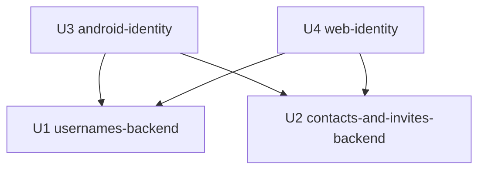

# Unit Dependencies — Unique usernames

Topology only. This file states which unit depends on which; it does not pick
a build order or a critical path.

## Dependency DAG



Text fallback: U3 depends on U1 and U2. U4 depends on U1 and U2. U1 and U2
depend on nothing in this intent. No cycles.

| Unit | Depends on | Why |
|---|---|---|
| U1 usernames-backend | — | Extends the existing backend only |
| U2 contacts-and-invites-backend | — | Extends the existing backend only; touches no U1 table or route |
| U3 android-identity | U1, U2 | Its screens call the routes and fields U1 and U2 add |
| U4 web-identity | U1, U2 | Same as U3 |

## Integration points

| Between | Mechanism | What crosses |
|---|---|---|
| U1 ↔ U3, U4 | Committed `/v1` OpenAPI contract (Contract Design) | Sign-up username and retry field, one-field sign-in, availability lookup, `username_required`, rename and reclaim, refusal `message_key`s |
| U2 ↔ U3, U4 | Committed `/v1` OpenAPI contract (Contract Design) | Teacher and centre email fields, already-added lookup by email, contact replace and remove |
| U1 ↔ U2 | Shared PostgreSQL schema and the in-process `app.accounts` package | Both add columns to tables in one database through forward-only migrations; Registration (U1 edits it for usernames) calls ContactMatching (U2) at account creation, through the existing `link_phone_seats` call site that U2 generalises |

The U1 ↔ U2 integration is not a dependency edge: each unit works against the
backend as it exists, and whichever merges second rebases its migration onto
the first's revision (one Alembic chain). The one shared call site, account
creation in Registration, keeps its existing signature in both units.

## Parallel development

- U1 and U2 have no edge between them and can be built in either order or in
  parallel.
- U3 and U4 have no edge between them and can be built in either order or in
  parallel once U1 and U2 exist.
- Valid orderings include U1, U2, U3, U4 and U2, U1, U4, U3; choosing among
  them is a delivery decision, not a topology one.

## Machine-readable edges

```yaml
units:
  - name: usernames-backend
    kind: service
    depends_on: []
  - name: contacts-and-invites-backend
    kind: service
    depends_on: []
  - name: android-identity
    kind: ui
    depends_on: [usernames-backend, contacts-and-invites-backend]
  - name: web-identity
    kind: ui
    depends_on: [usernames-backend, contacts-and-invites-backend]
```
