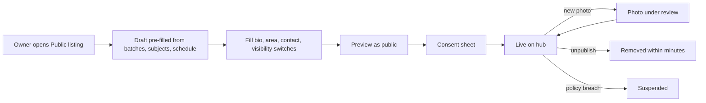
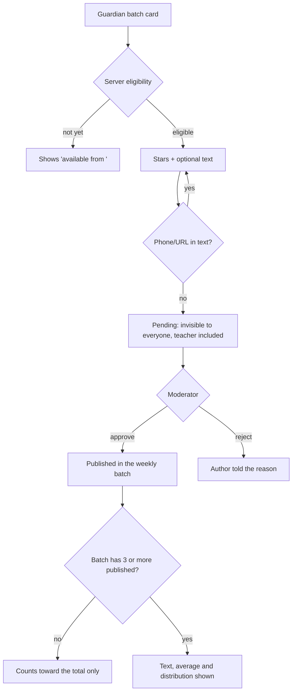
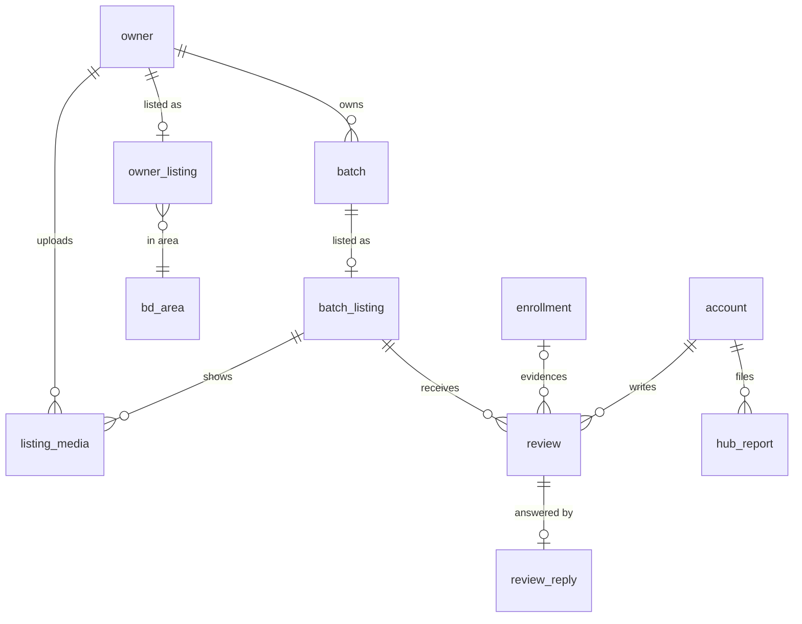

# ShikkhokPlus Public Hub — finalized team report

**Date:** 2026-11-14 · **Team:** CEO, Product Manager, Product Designer, Developer/Architect
**Status:** Advisory. Not yet an AI-DLC intent. Nothing in the application changed.
**Inputs:** [CEO memo](01-ceo-memo.md) · [Product requirements](02-product-requirements.md) ·
[Design spec](03-design-spec.md) · [Technical design](04-technical-design.md) ·
Mockups: `docs/reviews/2026-11-14-public-hub/mockups.html`

Where a team input disagrees with this report, **this report is the reconciled
position**. The inputs are kept as the record of how each role argued.

---

## 1. Verdict

**Build it, in three releases, with five changes to the proposal.** A public hub
turns ShikkhokPlus from a free bookkeeping tool into something that brings
tutors students. That is the strongest retention lever available to a product
that charges nobody. It also creates the one thing competitors (Facebook groups,
classifieds) cannot copy: reviews from people we *know* held a seat.

As proposed, the hub would break three binding project rules (D-5, D-6 and the
Play Families / COPPA / GDPR-K commitments RC-1..RC-3). It would also publish
every existing user without consent. The five changes below fix that and keep
the intent.

| # | Proposal says | Team decision | Why |
|---|---|---|---|
| 1 | All tutors and centres are listed | **Opt-in.** Every owner gets a ready-made *draft* listing and publishes with one tap. Each batch is published separately. A teacher at a centre is named only after that teacher agrees. | Everyone signed up under "your batches stay yours". Publishing their name, area and timetable without asking breaks that promise and the privacy policy. |
| 2 | Students rate and comment | **Verified reviews only.** The reviewer must hold an accepted seat for at least 30 days with at least 4 attended classes. **V1 opens reviews to guardians only.** Student reviews follow once the app records age. *(Owner decision D2)* | Most students are minors, and the app records no age. Public text written by a child triggers Families policy, COPPA and GDPR-K. Guardians are adults and are usually the ones paying. |
| 3 | "Any batch" can be reviewed | **A batch must be published to be reviewed.** Reviews stay hidden until the batch has ≥ 3 published reviews. Dates show the month only, reviews are published weekly, and no name is ever shown. | The teacher being reviewed also marks the child. In a batch of 8, a lone "anonymous" review is not anonymous. |
| 4 | Photos *and documents* on listings | **Photos yes (checked before they go public). PDFs come later.** Syllabus, routine and materials become structured text fields. | Rendering PDFs safely is the riskiest surface, and result sheets with children's names are the likeliest leak. Text is also searchable and works in both Bangla and English. |
| 5 | One launch | **Release 1 is a directory**, Release 2 adds photos, Release 3 adds reviews. Reviews ship only after the rule amendments and a legal check. | The search value arrives early, and the two hardest privacy surfaces wait for the policy work. |

---

## 2. Owner decisions

**Approved 2026-11-14: the owner approved every recommended default below
(D1–D10).** They are decisions, not open questions. The rule changes in D3 and
D4 are still written into `project.md` through the learnings ritual, which asks
for one confirmation each.

| ID | Decision | Approved | Blocks |
|---|---|---|---|
| **D1** | Opt-in listing instead of "everyone is listed" | Opt-in, with an auto-created draft and in-app nudges | H1 |
| **D2** | Who may review in V1 | Guardians only. Students later, once the app records age (for example 13+ with guardian approval, or 18+ self-declared at HSC/admission level). | H4 |
| **D3** | Amend **D-5** ("nothing a student/guardian writes reaches a teacher") — wording in §8 | Approve, through the learnings ritual, before H4 starts | H4 |
| **D4** | Amend **D-6** ("admin sees subscriber info only") — wording in §8 | Approve before H3 (photo moderation is the admin's first look at user content) | H3 |
| **D5** | Raise `PUBLIC_ROUTES` from 14 to 18 | Approve | H2 |
| **D6** | Positioning change: update the site copy, Data Safety form, privacy policy and Families user-generated-content declaration | Approve. These block release under RC-4/RC-5. | R1 |
| **D7** | Who moderates, and on what timetable | You (solo). 48 h for reviews and photos, 24 h for child-safety reports. Reviews are published weekly. If that is too much, launch in one city first. | H3 |
| **D8** | Local legal review of the review policy (Bangladesh defamation exposure) | Required before free-text reviews go live | R3 |
| **D9** | Demand gate before reviews (CEO) | Yes: start H4 only if Release 1 meets the day-90 "continue" bar in §10 | H4 |
| **D10** | PDFs deferred | Yes. Revisit after R3, on a separate download domain with malware scanning. | — |

---

## 3. Scope by release

| Release | Contents | Units | Effort (solo + AI) |
|---|---|---|---|
| **R1 Directory** | Owner (tutor or centre) profile and batch listings: name, headline and bio in Bangla and English, qualifications, area, subjects, class levels, curriculum, mode, schedule (optional), fee (optional), admissions open/waitlist/closed, syllabus and routine text, a public contact the owner chooses to show. Public Bangla and English pages without JavaScript, search and filters, sitemap. Signed-in users can report a listing. Admins can suspend a listing. A computed "Runs classes on ShikkhokPlus" badge. | H0, H1, H2 | 18–23 days |
| **R2 Photos** | Up to 12 owner photos and 8 per batch. Each is checked and cleaned before it is stored: location data stripped, re-encoded as WebP. An admin approves each photo before it goes public. | H3 | 8–10 days |
| **R3 Reviews** | Verified-guardian star ratings with optional text. One public reply from the owner. Reports and a moderation queue. Notifications. Deletion carries through to everything a review touches. | H4 | 9–11 days |
| **Later** | Join requests through the app (H5, 5–6 days). Student reviews. Ratings on separate aspects. PDFs. A native hub screen in the app. Manual credential badges. Clearly labelled promotion that never affects how reviews are ordered. | — | — |

**Out of scope everywhere:** booking or payment through the hub, ads, paid
ranking, third-party analytics or scripts on hub pages, messaging between
strangers, and any student's name, photo, marks, attendance or enrollment date on
a public page.

---

## 4. Design

The full spec is in [team/design-spec.md](03-design-spec.md). The mockups in
`docs/reviews/2026-11-14-public-hub/mockups.html` are six phone screens in light and dark, drawn with
the product's own `web/src/styles/tokens.css`. They have been updated to match
the decisions in this report.

**Visual stance.** The hub adds no new colour tokens:
- stars and rating bars are ink;
- "Verified" uses `--primary-container`;
- "Under review" reuses the dashed `--verifying-*` treatment;
- "Accepting students" uses `--paid-container`;
- "Suspended" uses `--error-container`.

### 4.1 Surfaces

```
PUBLIC WEB  (apex domain, server-rendered, no JS, EN + BN twins, in sitemap)
/hub/{en|bn}                         search + filters (subject, class, area, mode, fee, open)
/hub/{en|bn}/t/{owner}               tutor / centre profile
/hub/{en|bn}/t/{owner}/{batch}       batch listing (+ reviews from R3)
/hub/sitemap.xml

IN-APP  (Android + PWA, owner lens, under "More")
Public listing → Profile editor · Batch listings · Preview as public · Publish (consent)
Reviews inbox (R3) → New / Replied / Reported → Reply · Report

IN-APP  (guardian lens, R3)
Batch card → "Review this batch" (shown only when the server says eligible) · My reviews

ADMIN APP
Hub moderation queue: photos · reviews · reports · listing suspension
```

### 4.2 Key flows


Text fallback: the owner edits a pre-filled draft, previews it, consents, and the
listing goes live. A new photo waits for review. Unpublishing removes the listing
within minutes. A policy breach suspends it.


Text fallback: the server decides eligibility. Text containing a phone number or
URL is refused. A submitted review is invisible until a moderator approves it, is
published in the weekly batch, and becomes visible only once its batch has at
least three published reviews.

### 4.3 Trust and safety rules

| Rule | Final value |
|---|---|
| Reviewer label | "Verified guardian · enrolled under 6 months / 6–12 months / over 1 year". Never a name, initials, photo, class in a small batch, or exact date. |
| Display threshold | The text, average and distribution appear only once a batch has **3 or more published reviews**. The count always shows. *(CEO and Designer argued for 5. The team settled on 3 because, with month-only dates, weekly publication and no class shown, 3 is enough. Revisit if teachers report identifying a reviewer.)* |
| Dates | Month only ("Nov 2026"). Reviews are published in a weekly batch. |
| Owner powers | One public reply per review, of at most 1,000 characters. The owner can report a review but never hide or delete it. |
| Author powers | Edit within 30 days, which sends the review back to moderation. Delete at any time, and the deletion is total. |
| Child safety | No identifiable student in any photo; this is checked at upload and in moderation. A report citing *personal information* or *a child* hides the item at once, and the admin decides within 24 h. |
| Location | District and upazila for everyone. A street address only for a **centre's** premises, never for a solo tutor. |
| Fee | Off by default and turned on per batch. Shown as a server-formatted money string. **`collection_number` (the tutor's personal bKash or Nagad number) never appears.** |
| Contact | Only a number the owner types into the hub, never copied from their account. Off by default. The hub collects no data from visitors. |
| Badge | "Runs classes on ShikkhokPlus" is computed: at least 5 accepted enrollments and attendance taken in the last 30 days. It never implies teaching quality. |
| Bangla | Every string ships in Bangla and English. Text is never machine-translated; a note says "Written in Bangla". Titles wrap and are never cut off. The layout is checked with the longest Bangla string. |

---

## 5. Architecture

**The API renders HTML with no JavaScript. The pages are served at the apex
domain through the marketing site's CloudFront distribution, on a cached,
GET-only `/hub/*` path that forwards no cookies and no `Authorization`.** A
cached page therefore can never be an authenticated one. The API's own hostname
answers 404 on `/hub*`, so no uncached copy exists for crawlers. Search engines
get real HTML. One renderer serves both the pages and dynamic search. Edits
reach visitors within the 10-minute cache. Takedowns go through a
`cdn_invalidation` outbox drained by a cron job; the first 1,000 paths a month
are free.

| Module | Owns | Boundary (mechanical) |
|---|---|---|
| `app/hub/listings` | Owner and batch listings, slugs, area vocabulary, publish state | Imports no fees, marks, students or guardians code |
| `app/hub/public` | Search, page view models, Jinja2 templates, sitemap | **Import gate:** imports nothing from `app.*` except its allowlist. Every query runs as the **`shikkhok_hub_reader`** database role, which can `SELECT` only 4 views and `bd_area`. |
| `app/hub/media` | Upload sessions, presigned S3 POST, the invalidation outbox | Pillow lives only in the Lambda |
| `app/reviews` | Eligibility, `ReviewerLens`, review lifecycle, replies, rating arithmetic | Never imported by `app/hub/public` |
| `app/moderation` | Admin queues, decisions, `hub_moderation_event` | Behind the existing `admin_gate` |

**Search** runs in Postgres alone. Structured filters (district, upazila,
subject tags, class levels) use B-tree and GIN indexes, and free text uses a
`pg_trgm` index on a generated `search_text` column. Postgres has no Bangla
stemmer, so search stores an owner-entered Latin transliteration beside the
Bangla. A test asserts the index is used on a Bangla corpus.

**Photo pipeline:**
1. The client sends a presigned **POST**, which enforces ≤ 8 MB and the content
   type, straight to S3 under `quarantine/`. The bytes never touch the API.
2. A Lambda with no database access and no VPC checks the magic bytes, decodes
   the image with a pixel cap, and re-encodes it as WebP at 320, 960 and 1600
   pixels. Re-encoding strips EXIF and GPS data by construction.
3. The result goes to `staged/`.
4. An admin approves it, and it is copied to `public/{opaque}`, the only prefix
   CloudFront serves. It is served as `nosniff` with a `sandbox` CSP.
5. Lifecycle rules expire anything abandoned.

**Cost:** under USD 0.50 a month on top of today's bill. CloudFront and the
Lambda stay in the free tier, and the media bucket holds about 1.5 GB at 500
owners. Add `media` and `image_lambda` lines to `cost_breakdown`, and check
`terraform output monthly_cost_estimate` before H3, because the current spend
already sits near the USD 50 ceiling.

---

## 6. Data model (migrations 0034–0037)

| Table | Key columns | Notes |
|---|---|---|
| `bd_area` (0034) | `code` PK, `kind` division/district/upazila, `parent_code`, `name_en`, `name_bn` | Seeded vocabulary of about 570 rows. Filters use codes, never free text. |
| `owner_listing` (0034) | `owner_id` PK→owner, `slug` UNIQUE, `status` draft/published/hidden/suspended (default **draft**), `public_name` NOT NULL, `headline_en/bn`, `bio_en/bn`, `qualifications`, `teaching_mode[]`, `district_code`, `upazila_code`, `street_address` (centres only, enforced by trigger), `public_contact_phone` (opt-in, never prefilled), `consent_version/at/by`, `published_at`, `suspended_at`, `suspension_reason_code`, generated `search_text` | **Collects its own `public_name`.** A solo tutor has no public name anywhere today: `owner.name` is set only for centres, and `profile.self_name` is behind row-level security. |
| `batch_listing` (0034) | `batch_id` PK→batch, `owner_id`, `slug` (unique per owner), `status`, `description_en/bn`, `syllabus_en/bn`, `class_levels[]`, `curriculum`, `subject_tags[]`, `mode`, `admissions` open/waitlist/closed, `show_fee` and `show_schedule` (NOT NULL, **no default**), `venue_override` | `POST/PATCH /v1/batches` are unchanged. A listing is a separate resource. An inactive batch is unpublished automatically. |
| `listing_media` (0035) | `id`, `owner_id`, `batch_id` NULL, `kind` image, `status` awaiting_upload→processing→pending_review→approved/rejected/withdrawn, `quarantine_key`, `public_key` (set only when approved, enforced by CHECK), `sha256`, `width`, `height`, `alt_en/bn`, `position`, `rejection_code` | |
| `cdn_invalidation` (0035) | `id`, `path`, `requested_at`, `sent_at`, `aws_id` | Transactional outbox |
| `review` (0036) | `id`, `batch_id`, `author_account_id` (**never in a response**), `enrollment_id` (evidence only, **never in a response**), `author_role` guardian/student (V1 guardian), `rating` 1–5, `body` ≤ 1,000, `status` pending/published/rejected/removed, `tenure_bucket` (frozen at submit), `published_month`, `edited_at`, `decided_at` | UNIQUE `(batch_id, author_account_id)`: one review per guardian per batch |
| `review_reply` (0036) | `review_id` PK, `body` ≤ 1,000, `status`, `written_by_account_id` | One per review |
| `hub_report` (0036) | `id`, `target_kind` listing/media/review/reply, `target_id`, `reporter_account_id`, `reason` personal_info/child_safety/abusive/fake/misleading/other, `status` open/upheld/dismissed | UNIQUE `(target_kind, target_id, reporter_account_id)`. Replaces the developer draft's review-only report table, so R1 can report listings. |
| `hub_moderation_event` (0036) | `event`, `target_kind`, `target_id`, `actor_admin_account_id`, `decision_code`, `correlation_id`, `at` | Append-only. Closed enums with no free text. |
| `listing_enquiry` (0037, optional) | `id`, `owner_id`, `enquirer_account_id`, `body`, `share_contact` (no default), `status` | Only if H5 ships |

**No `rating_aggregate` table.** The SQL computes the average as
`round(10*sum(rating)::numeric/count(*))::int` and sends it as **integer
tenths** (43 means 4.3). This uses no float and no Python `decimal`, both of
which are banned. "Sort by rating" uses a Bayesian score (prior 3.5, weight 5),
also computed on the server.

**Views read by the public role:** `hub_public_owner`, `hub_public_batch`,
`hub_public_media`, `hub_public_review`. The review view exposes only `id`,
`batch_id`, `rating`, `body`, `tenure_bucket`, `author_role`, `published_month`
and the reply. Teachers read reviews **through the same view**, so a review can
never be joined to a seat.


Text fallback: `owner` 1–0..1 `owner_listing` (in a `bd_area`); a `batch` 1–0..1
`batch_listing`; listings hold `listing_media`; `batch_listing` 1–n `review`,
each written by one `account` and evidenced by one `enrollment`; `review` 1–0..1
`review_reply`; any account files `hub_report` rows against listings, media,
reviews or replies.

**Deletion dispositions** (each is added in the same migration, or the
governance test fails):
- listings and media are hard-deleted with a solo owner's account, S3 objects
  included, via the outbox;
- a centre's listing survives a manager's deletion;
- reviews and reports are hard-deleted with their author, and the aggregates
  follow automatically;
- moderation events are not personal data and are kept 12 months;
- invalidations are kept 7 days.

**Review eligibility** grants a new `ReviewerLens`. One SQL statement checks
all of these, and the tests are written first:
1. the account is the enrollment's guardian, with `guardian_decision='accepted'`;
2. the guardian is not relink-blocked;
3. the batch listing is published;
4. `joined_on` is at least 30 days ago;
5. the enrollment has at least 4 attended, non-cancelled sessions;
6. `inactive_from` is unset or within the last 180 days.

If 1–3 fail, the answer is an identical `NOT_AVAILABLE`, so it reveals nothing
about who exists. If 4–6 fail, the answer is `REVIEW_NOT_YET_ELIGIBLE` with an
`eligible_from` date.

---

## 7. API changes

All new routes are additive under `/v1`, plus the public `/hub` pages. Every
public HTML route renders through a registered Pydantic view model, so the
privacy gate can walk it (§8).

### 7.1 Public (added to `PUBLIC_ROUTES`: 14 → **18**)

| # | Route | Returns | Release |
|---|---|---|---|
| P1 | `GET /hub/{locale}` | Search and landing page (`HubSearchPage`), 20 per page | R1 |
| P2 | `GET /hub/{locale}/t/{owner_slug}` | Profile (`HubOwnerPage`). A draft, hidden, suspended or missing listing gets a **byte-identical** 404. | R1 |
| P3 | `GET /hub/{locale}/t/{owner_slug}/{batch_slug}` | Batch (`HubBatchPage`), with `?rpage=` for reviews | R1 |
| P4 | `GET /hub/sitemap.xml` | Published listings in both locales, with hreflang | R1 |

Each route is safe for five reasons:
- it accepts GET only;
- its dependency tree contains no auth dependency, which a new asserted
  `PUBLIC_CACHEABLE_ROUTES` gate checks;
- it runs as `shikkhok_hub_reader`;
- the edge forwards no headers or cookies, and only an allowlist of query
  parameters;
- each IP is limited to 120 requests a minute at the origin.

### 7.2 Owner listing (`TeacherLens`: a solo owner or an accepted centre manager)

| Route | Body → Response | Release |
|---|---|---|
| `GET /v1/hub/listing` | → `OwnerListingResponse`, including the server's `checklist[]` and `publishable` | R1 |
| `PUT /v1/hub/listing` | `OwnerListingUpdate` → `OwnerListingResponse` | R1 |
| `POST /v1/hub/listing/publish` | `{consent_version}` → `OwnerListingResponse` | R1 |
| `POST /v1/hub/listing/unpublish` | → `OwnerListingResponse` | R1 |
| `GET /v1/hub/slugs/{slug}` | → `SlugAvailability` | R1 |
| `GET /v1/hub/batch-listings` | → `list[BatchListingResponse]` | R1 |
| `PUT /v1/batches/{batch_id}/listing` | `BatchListingUpdate` → `BatchListingResponse` | R1 |
| `POST /v1/batches/{batch_id}/listing/publish` | → `BatchListingResponse` | R1 |
| `POST /v1/batches/{batch_id}/listing/unpublish` | → `BatchListingResponse` | R1 |

The centre-member name consent reuses the invitation pattern:
`PUT /v1/centres/{centre_id}/members/me/public-name-consent` (`TeacherLens`)
in R1.

### 7.3 Media (`TeacherLens`, R2)

| Route | Body → Response |
|---|---|
| `POST /v1/hub/media/uploads` | `{batch_id?, content_type, byte_size, sha256}` → `{media_id, url, fields, expires_at}` (presigned POST) |
| `POST /v1/hub/media/{media_id}/complete` | → `MediaResponse` |
| `GET /v1/hub/media` | → `list[MediaResponse]` |
| `PATCH /v1/hub/media/{media_id}` | `{alt_en, alt_bn}` → `MediaResponse` |
| `PUT /v1/hub/media/order` | `{batch_id?, ids[]}` → `list[MediaResponse]` |
| `DELETE /v1/hub/media/{media_id}` | → 204 |

### 7.4 Reviews and reports

| Route | Auth | Body → Response | Release |
|---|---|---|---|
| `POST /v1/hub/reports` | lens-exempt authenticated | `{target_kind, target_id, reason, note?}` → 202 | **R1** |
| `GET /v1/hub/reviewable` | lens-exempt authenticated | → `list[ReviewableBatch{batch_id, batch_name, owner_public_name, state, eligible_from?}]` | R3 |
| `GET /v1/hub/batches/{batch_id}/my-review` | `ReviewerLens` | → `MyReviewResponse` | R3 |
| `PUT /v1/hub/batches/{batch_id}/my-review` | `ReviewerLens` | `{rating, body, client_mutation_id}` → `MyReviewResponse` (an edit goes back to pending) | R3 |
| `DELETE /v1/hub/batches/{batch_id}/my-review` | `ReviewerLens` | → 204 (hard delete) | R3 |
| `GET /v1/hub/reviews` | `TeacherLens` | → `list[HubReview]`: published only, read from the public view | R3 |
| `PUT /v1/hub/reviews/{review_id}/reply` | `TeacherLens` | `{body}` → `HubReview` | R3 |
| `DELETE /v1/hub/reviews/{review_id}/reply` | `TeacherLens` | → 204 | R3 |

### 7.5 Admin moderation (`PlatformAdminLens`, behind `admin_gate`)

| Route | Release |
|---|---|
| `PUT /v1/admin/hub/owners/{owner_id}/suspension` | R1 |
| `GET /v1/admin/hub/queue?kind=media\|review\|report\|listing` | R1 (reports), R2 (media), R3 (reviews) |
| `POST /v1/admin/hub/reports/{id}/decision` | R1 |
| `GET /v1/admin/hub/media/{id}` · `POST /v1/admin/hub/media/{id}/decision` | R2 |
| `GET /v1/admin/hub/reviews/{id}` · `POST /v1/admin/hub/reviews/{id}/decision` | R3 |

### 7.6 Optional enquiries (H5)

- `POST /v1/hub/owners/{owner_slug}/enquiries` (exempt, authenticated)
- `GET /v1/hub/enquiries` (`TeacherLens`)
- `POST /v1/hub/enquiries/{id}/close` (`TeacherLens`)
- `GET /v1/me/hub/enquiries` (exempt, authenticated)

**Totals:**

| Group | Routes |
|---|---|
| Public pages | 4 |
| Listing | 10 |
| Media | 6 |
| Reviews and reports | 8 |
| Admin | 7 |
| **Required** | **35** |
| Optional enquiries | 4 |

`LENS_EXEMPT_AUTHENTICATED` gains 2 (4 with enquiries). A new asserted
`REVIEWER_ROUTES` set gets 3.

### 7.7 Key schemas

```python
class RatingSummary(BaseModel):
    state: Literal["below_threshold", "shown"]    # server decides
    count: int
    average_tenths: int | None                    # 43 == 4.3; None below threshold
    distribution: list[int] | None                # 5 ints, 1..5 stars

class HubReview(BaseModel):                       # public AND teacher response
    id: UUID
    rating: int = Field(ge=1, le=5)
    body: str
    author_label: Literal["guardian"]
    tenure: Literal["lt_6m", "6_12m", "gt_1y"]
    published_month: str                          # "2026-11"
    reply: HubReply | None

class HubBatchCard(BaseModel):
    slug: str; name: str; subjects: list[str]; class_levels: list[ClassLevel]
    admissions: Literal["open", "waitlist", "closed"]
    fee: Money | None                             # JSON string, only if show_fee
    schedule: list[PublicSlot] | None             # only if show_schedule
    rating: RatingSummary
```

### 7.8 New error codes

Each goes through the five-class hierarchy and is added to `message-keys.json`
and to the Android and web bundles.

| Code | Status |
|---|---|
| `HUB_SLUG_TAKEN` | 409 |
| `HUB_LISTING_INCOMPLETE` | 400 |
| `HUB_LISTING_SUSPENDED` | 409 |
| `REVIEW_NOT_YET_ELIGIBLE` | 409 |
| `REVIEW_CONTAINS_CONTACT` | 400 |
| `HUB_WRITE_CEILING` | 409 |
| `MEDIA_TYPE_NOT_ALLOWED` | 400 |
| `MEDIA_TOO_LARGE` | 400 |
| `MEDIA_LIMIT_REACHED` | 409 |
| `MEDIA_NOT_UPLOADED` | 409 |
| `MEDIA_UNREADABLE` | 400 |
| `REPORT_ALREADY_FILED` | 409 |

---

## 8. Privacy, rules and the gate gap

**The most important engineering finding.** The privacy gate
(`forbidden_fields` in `app/contract/privacy.py`) checks only teacher-facing
JSON schemas. A public route resolves no lens, and an HTML page has no schema.
**As built, a hub page could print a child's name and every gate would pass.**
H0 closes this before any public route exists:

1. **A public-facing audience in `forbidden_fields`.** Its forbidden set covers
   the owner-private fields, account ids, every phone field,
   `collection_number`, `display_name`, `enrollment_id` and `student_id`.
2. **An HTML view-model registry.** A public handler may render only a
   registered model, and the gate walks those models' schemas.
3. **A canary probe.** Seed unique strings into `profile.self_name`, phones,
   `collection_number`, student names and enrollment ids. Render every hub page
   in both locales, plus the sitemap, and assert that no canary appears
   anywhere.
4. **A `hub_reader` meta-test.** Under that role, `SELECT` on `profile`,
   `enrollment`, `review` (the base table) and `payment_method` must raise an
   error.
5. **IDOR probes:**
   - one teacher editing or replying on another's listing or review;
   - a pending, declined or relink-blocked guardian obtaining a `ReviewerLens`;
   - a class teacher editing the centre listing;
   - a draft slug that does not 404 identically to a missing one;
   - pending reviews leaking to the teacher.
6. **The k-threshold test.** With 2 published reviews, nothing about the batch's
   reviews is exposed.

**Proposed amendment to D-5 / TC-13** (decision D3):

> NEVER expose anything a student or guardian writes to any teacher, **except a
> hub review its author explicitly submitted for public display**. Such a review
> reaches anyone, the teacher included, only after moderation, only once its
> batch holds at least three published reviews, only through the public review
> view, and never with a name, phone number, seat, enrollment id, submission time
> finer than a month, or any other field joinable to a record the teacher keeps.
> Its author may delete it at any time, and deletion is total.

**Proposed amendment to D-6 / TC-14** (decision D4):

> NEVER expose student or guardian data to a platform administrator, whose
> visibility is limited to subscriber information **and to content a person
> submitted for publication on the hub (listing text, images, reviews, replies
> and reports), shown with an opaque author reference and role and never with a
> name, phone number, profile field, seat or any record a teacher keeps.**

**New rules proposed:**

> **FORBIDDEN:**
> - NEVER put a student's name, photo, marks, attendance or enrollment date on
>   any public surface.
> - NEVER render a public page from anything but a registered public view model
>   read through the `shikkhok_hub_reader` role.
> - NEVER list an owner, batch or centre member without that person's recorded
>   consent.
>
> **MANDATED:**
> - ALWAYS pre-moderate hub images and reviews before they are public.

**Families, COPPA and GDPR-K.** V1 reviews are written by guardians only. Every
photo and review is checked before it goes public, and the app has in-app
reporting. Hub pages set no cookies, load no scripts and collect nothing from
visitors.

**Data Safety and privacy policy.** Both are updated through the existing
generator from the new deletion dispositions. They newly declare:
- user-generated content shared publicly;
- photos;
- approximate location (area) for teachers;
- reviews for guardians.

**Abuse limits** (all `rate_limit_counter`):

| Action | Limit |
|---|---|
| Review writes | 5 per day per account |
| Reports | 10 per day per account |
| Listing updates | 50 per day per owner |
| Uploads | 30 per day per owner |
| Enquiries | 5 per day per account, 1 open per owner |
| Public reads | 120 per minute per IP at the origin |

Review text matching a Bangladeshi phone number (`01[3-9]\d{8}`, after
normalising Bangla digits) or a URL is refused.

---

## 9. Work units

Each unit is a short-lived branch, squash-merged, and names the controls it
installs. Under the team rule, a unit is not done while a control assigned to
it is missing.

| Unit | Goal | Scope and controls installed | Depends on | Effort | Done when |
|---|---|---|---|---|---|
| **H0 Policy and guardrails** | Make the hub lawful under our own rules before any public code exists | D-5 and D-6 amendments and the new rules via the learnings ritual. Consent text v1 (publish, centre member name, review notice). Privacy policy and Data Safety drafts. `shikkhok_hub_reader` role and meta-test. Public-facing privacy audience. `PUBLIC_CACHEABLE_ROUTES` gate. | — | 3–4 d | The amended rules are in `project.md` with your affirmation; the gates exist and fail on a planted violation |
| **H1 Listings** | Owners can author and publish | Migration 0034 (`bd_area`, listings, views, `pg_trgm`). Listing APIs (§7.2) and member consent. Slugs. Server checklist and computed badge. Report intake (`hub_report`) and the admin suspension route. Android `feature/hublisting` and web `features/hub` editors with preview. Notifications on suspension. | H0 | 7–9 d | Test-first state transitions; opt-in test (an unpublished owner appears nowhere); inactive batch auto-unpublishes; no listing response carries a student, enrollment or profile field; Bangla layout check |
| **H2 Public pages and search** | Families and search engines find listings | Jinja2 server-rendered pages P1–P4 with EN/BN twins, CSP and no JS. View-model registry and **canary probe**. Site CloudFront `/hub/*` behaviour, query-allowlist function and `hub-block` on the API host. Invalidation outbox and cron. `pg_trgm` search with the Bangla `EXPLAIN` test. Sitemap. Rewrite the site module's "no API behind it" comment. | H1 | 8–10 d | Canary probe green; `PUBLIC_ROUTES` = 18 asserted; unpublish → 404 and out of the sitemap within 10 minutes; Lighthouse mobile LCP ≤ 2.5 s on a seeded page |
| **→ R1 Directory ships** | | Site copy, Data Safety and privacy policy updates published | | | |
| **H3 Photos** | Rich listings, safely | Migration 0035. Media bucket and lifecycle rules. Image-sanitiser Lambda with its own lockfile in the CVE gate and the SBOM. Presigned POST. Media moderation queue. Deletion wiring. Cost lines. Android Photo Picker (no storage permission). | H1, D4 | 8–10 d | Lambda suite passes (decompression bomb, polyglot, GPS stripped, truncated file); unapproved media is never served; account deletion removes every object |
| **→ R2 Photos ships** | | | | | |
| **H4 Reviews** | Trustworthy ratings | Migration 0036. `ReviewerLens` and eligibility, test-first. Review, reply and report flows. k-threshold. Integer-tenths aggregate. Weekly publication job. Review moderation queue. Notifications (eligible once, outcome, new review or reply). Deletion cascades. Android `feature/reviews`, web `features/family/reviews`. | H2, D2, D3, D8, D9 | 9–11 d | Eligibility boundaries (day 29/30, 3 vs 4 sessions, inactive 180 vs 181 days); k-threshold; no author identifier in any lens's schema; rating cases such as `[5,4,4] → 43` |
| **→ R3 Reviews ship** | | | | | |
| **H5 Enquiries** (optional) | Turn visitors into leads | Migration 0037. Consented contact sharing. Lead inbox; accepting a lead pre-fills the add-student flow. | H2 | 5–6 d | Phone never shared without consent; rate limits |

**Total:** 35–44 working days for H0–H4, plus 5–6 for H5. A directory can ship
in about 4 weeks.

---

## 10. Success metrics (CEO)

Measured on R1 at day 90:

| Area | Target |
|---|---|
| **Supply** | ≥ 25% of active owners publish; ≥ 70% of published listings complete |
| **Demand** | ≥ 500 search sessions a month (server-side counts only); ≥ 20% of listings get a contact click |
| **Value** | ≥ 15% of publishing teachers answer yes to "Did the hub bring you a student?" |
| **Guardrails** (any breach stops rollout) | Zero child data on a public page; no rise in account deletion or teacher churn; hub cost ≤ USD 10 a month |

| Gate | Condition |
|---|---|
| **Continue to reviews** | Opt-in ≥ 20% **and** contact rate ≥ 20% |
| **Freeze** | Opt-in < 10% **or** < 150 search sessions a month. Listings stay up; reviews are not built. |
| **Pull reviews** | > 5% of reviews reported in a quarter, or teachers leaving noticeably after low ratings |

---

## 11. Risks

| Risk | Mitigation |
|---|---|
| A child's data reaches a public page | Hub reader role, import gate, view-model registry, canary probe, no student fields in any view |
| Teacher retaliates against a reviewer's child | Guardian-only, k ≥ 3, month dates, weekly publication, pending reviews invisible, total delete |
| Fake or defamatory reviews | Verified seat with ≥ 4 attended sessions, pre-moderation, owner reply, reports, legal review (D8) |
| Schedule plus address reveals where children are and when | Area-only location for tutors; schedule is opt-in; street address only for centres |
| Solo moderation capacity | Only photos and reviews are pre-moderated; listings are post-moderated; weekly cadence; option to launch in one city |
| Crawlers overloading the 2 GB host | Edge cache, query allowlist, origin rate limit |
| Image-decoder CVEs | Decoding isolated in a Lambda with no data access; Pillow locked and CVE-gated |
| Teachers hostile to ratings | Opt-in listing, replies, reports, aggregate hidden below 3 reviews, the pull-reviews gate |
| Bangla search quality | Transliteration field and an index-use test; revisit at p95 > 200 ms on 5,000 listings |

---

## 12. Open questions

1. A hostname for the hub: apex `/hub` (recommended) or a `hub.` subdomain.
2. Whether owners who never take attendance can ever receive reviews. Recommended:
   no. The attendance condition is what stops a fake seat from producing a review.
3. Whether centre-level aggregate ratings are shown in R3 or later. Recommended:
   batch-level only in R3.
4. Whether a slug is reserved for 90 days after unpublishing. Recommended: yes.
5. How student reviews are age-gated once D2 opens them: date of birth on the
   profile, or a guardian co-sign.

## 13. Next step

Once you settle the decisions in §2, start the work as an AI-DLC intent:

```bash
/aidlc Public Hub — opt-in directory, photos and verified guardian reviews (see docs/reviews/2026-11-14-public-hub/REPORT.md)
```

The intent should use this report as its initial description. Requirements,
stories and contract design can then formalise §3–§9 at the usual approval
gates.
