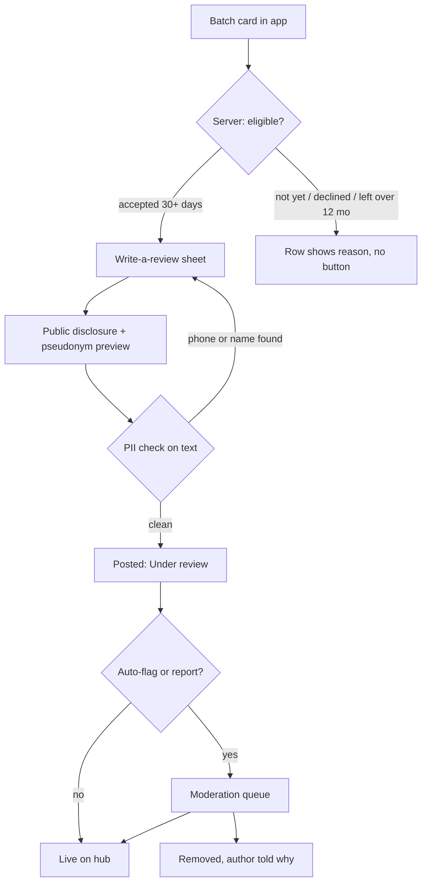
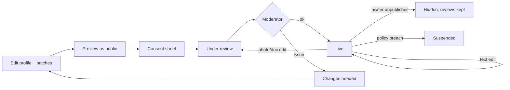
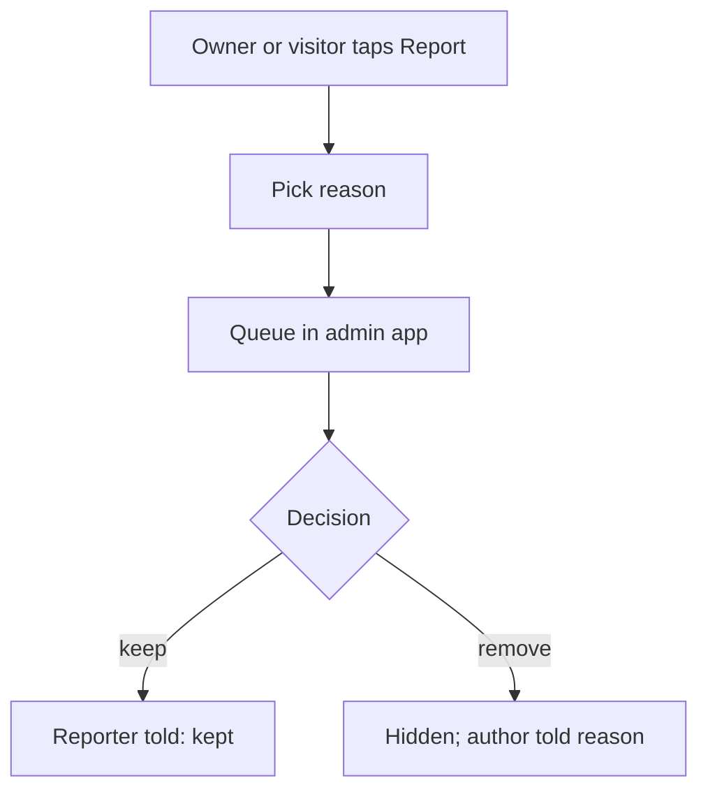

# Public Hub — Product Design analysis

Product Designer view. Advisory only; nothing here is an AI-DLC artifact. Mockups: `../mockups.html`.

**Design stance in one line:** the hub reuses the product's existing language unchanged ("one blue for actions, everything else is ink, until money is involved"). It adds **no new colour tokens**: stars and rating bars are ink, "Verified" is `primary-container`, "Under review" reuses the dashed `verifying-*` treatment (it already means "not yet confirmed"), and "Suspended" uses `error-container`.

---

## 1. Information architecture

### 1.1 Sitemap

```
PUBLIC WEB (server-rendered HTML, works with no JS — matches site/ CSP posture)
hub/                         Hub home = search (subject, class level, area, mode)
├─ hub/search?q=&class=&area=   Results list (owners + batches mixed, owner-grouped)
├─ hub/o/<owner-slug>        Owner profile (tutor or coaching centre)
│   ├─ …/batches             All public batches of this owner
│   └─ …/reviews             All reviews across the owner's batches
├─ hub/b/<batch-slug>        Batch listing (schedule, subjects, fee, docs, rating)
│   └─ …/reviews?page=       Full review list, sort: newest / lowest / highest
├─ hub/about-reviews         "How reviews work" (who can review, verification, reporting)
└─ hub/report/<id>           Report form (no-JS POST)
   EN + BN twin of every page (site/ rule), hreflang pair, in sitemap.

IN-APP (Android + PWA), under existing "More"
Owner lens (teacher / centre manager)
├─ Public listing ─┬─ Profile editor (completeness, photos, docs, visibility)
│                  ├─ Batch listings (one editor per batch; inherits profile)
│                  ├─ Preview as public
│                  └─ Publish / Unpublish (consent sheet)
├─ Reviews inbox ──┬─ New · Replied · Reported tabs
│                  └─ Review detail: reply, report
└─ Enquiries ─────── list + mark handled (lands in existing notification inbox)
Student / guardian lens
├─ Batch card → "Write a review" (eligibility-gated)
└─ My reviews (edit within 30 days, delete any time)
Platform admin (existing admin app)
└─ Hub moderation queue (modelled on help-centre tickets)
```

### 1.2 Key flows (numbered)

**F1 — Owner publishes a listing**
1. More → Public listing. First run shows an explainer card: what becomes public, what never does (students, fees collected, attendance, marks).
2. Profile editor opens pre-filled from existing data (owner name, batch names, subjects, schedule). Completeness meter shows what is missing.
3. Owner adds about text (BN and/or EN), area, photos (photo guidance sheet appears before first upload), optional PDFs.
4. Owner sets per-field visibility (fee, phone, exact address → area only by default).
5. Owner opens one or more batch listings, toggles "Show on hub" per batch.
6. Preview as public → renders the exact public page.
7. Publish → consent sheet (checkboxes: "no identifiable children in photos", "I can share these documents", "reviews from verified students/guardians will appear and I cannot delete them"). Confirm.
8. State becomes **Under review** (first publish and any photo/doc change) → **Live**, or **Changes needed** with the reason.

**F2 — Guardian/student writes a review** (eligibility is server-computed; the client only renders the decision, per TC-9)
1. Enrollment accepted ≥ 30 days and not more than 12 months after `inactive_from` → "Write a review" appears on the batch card. Otherwise the row shows why ("Available after 30 days in the batch").
2. Sheet: star rating (required), 3 optional aspect chips (Explains clearly / Regular classes / Good materials), text 0–600 chars.
3. Disclosure block, unmissable, above the button: "Public. Your teacher will read it. Your name is not shown — you appear as *Verified guardian · Class 10 · 8 months*."
4. Live check: if text contains a phone number or a name pattern, inline warning "Remove phone numbers and names".
5. Post → "Under review" for the first 24h (auto-publish if no automated flag) → Live. Author can edit (30 days) or delete (always).

**F3 — Owner handles a review**
1. Notification "New review on এইচএসসি পদার্থবিজ্ঞান · Batch A".
2. Reviews inbox → review detail.
3. Reply (one public reply, editable for 24h; tone hint above the field) **or** Report (reason list) — never Delete.
4. Reported reviews stay visible until the moderator decides; owner sees status in the Reported tab.

**F4 — Visitor enquiry**
1. On a batch page, "Ask about this batch" (primary, bottom bar).
2. No-JS form: name, phone, class, message; **or** visible call/WhatsApp only if owner made phone public.
3. Phone verified by OTP only if the owner requires it (SMS cost: default off, rate-limited per IP/number as for auth).
4. Owner receives it in the notification inbox; "Mark handled". Visitor sees "Sent. ShikkhokPlus Centre usually replies within 1 day" (server-computed from history, hidden until ≥ 5 enquiries).

### 1.3 Mermaid


Text fallback: card → server eligibility → sheet → disclosure → PII check (loop back on hit) → under review → live, or moderation → live/removed.


Text fallback: edit → preview → consent → under review → live or changes-needed; live photo/doc edits re-enter review; text edits go live directly; unpublish hides but keeps reviews; breach → suspended.


Text fallback: report → reason → admin queue → keep (reporter informed) or remove (author informed).

---

## 2. Screen specs

Shared rules for every screen: 360dp baseline; 16 margin, 12 between list items, 24 between sections; touch ≥ 48dp, fee/enquiry primary 56dp full width; caption 13sp floor; line height ≥ 1.53× (Bangla conjuncts); 130% font scale must not clip; Latin numerals for app-generated numbers, typed text untouched; `overflow-wrap:anywhere`; static grey skeletons, no shimmer; no shadows except sheets.

| # | Screen | Hierarchy (top → bottom) | Components | States |
|---|---|---|---|---|
| W1 | Hub search | Search field → filter chips (class, subject, area, online/offline) → result count → result cards | `field`, `chip-filter`, `card` | Loading (skeleton cards same height); Empty ("No batches for HSC Physics in Mirpur yet. Try nearby areas" + chip to widen area); Error (banner + retry; GET form works without JS) |
| W2 | Owner profile | Cover band (CSS tone, optional photo) → name, kind chip, Verified badge, area → rating summary (owner-level) → About (BN/EN toggle) → Batches list → Photos → Documents → Reviews preview → enquiry bar | `hero`-like header, `chip`, `card`, `row` | Unpublished/suspended → 404-style "This listing is not available" (never says why publicly); no batches public → "No open batches right now" |
| W3 | Batch listing | Batch name (title 21) → owner line → status chip (Accepting / Full / Starts 1 Dec) → key facts kv (class, subjects, schedule, fee if shown, mode, seats) → rating summary → reviews (3) → documents → photos → bottom bar "Ask about this batch" | `kv`, histogram, review card, `action-bar` | Fewer than 5 reviews: no average, "3 reviews — average shown after 5"; 0 reviews: "No reviews yet. Only enrolled students and guardians can review." |
| W4 | Review list | Summary + sort segmented (Newest / Lowest / Highest) → paged list (20) | `segmented`, review card | Paged with "Load more" link (no infinite scroll; works no-JS) |
| A1 | Listing editor (profile) | Status banner → completeness meter → sections: Basics, About, Photos, Documents, Contact & visibility, Batches → sticky bar Preview / Publish | `progress-bar`, `field`, `choice`, switch rows | Draft · Under review · Live · Changes needed (reason + field link) · Suspended (read-only, appeal via help ticket) · Offline (edits blocked, explicit retry — no write queue, TC-8) |
| A2 | Batch listing editor | Inherits profile; batch-only fields: description, level, seats, start date, fee visibility, docs | same | "Show on hub" off → card greyed with "Hidden" chip |
| A3 | Publish consent sheet | Summary of what goes public → 3 required checkboxes → Publish (56dp) | `sheet`, `choice` | Disabled until all checked |
| A4 | Reviews inbox | Tabs New / Replied / Reported → review cards with Reply / Report | `tabs`, review card, `field` | Empty: "No reviews yet. They appear when students who have been enrolled 30 days write one." |
| A5 | Write-a-review sheet | Batch name → stars → aspect chips → text (counter) → disclosure → Post | `sheet`, star radio group, `chip-filter`, `field` | Not eligible (reason, no form); Posting; Error (retry, text kept in memory only); Under review after post |
| A6 | Enquiries | List of enquiries → detail → Call / Mark handled | `row`, `btn` | Empty, loading, error as house standard |

**Bangla long text:** names like "জ্যোতির্ময় কোচিং সেন্টার, মিরপুর-১০ শাখা" wrap to two lines in titles, never ellipsis on title; ellipsis allowed only in result-card about-snippets (3 lines, `line-clamp`) with full text on detail. Chips wrap (`flex-wrap`), never scroll horizontally. Buttons hold two short words max in BN ("প্রকাশ করুন"); labels are tested at their longest variant.

**Accessibility:** Star rating input is a radio group (`role="radiogroup"`, each star `aria-label="4 of 5 stars"`); display stars carry text ("4.6 out of 5, 23 reviews") and are never colour-only. Histogram rows are a `<table>` or `<dl>` with visible counts. Status states differ by colour + border style + icon + word (house greyscale rule). Focus ring 3px `--primary`. Contrast I computed from the token hex values: `on-surface-variant` on `surface-container` 7.9:1 light / 8.5:1 dark; `on-verifying-container` on `verifying-container` 7.5 / 9.0; `on-primary-container` on `primary-container` 12.0 / 8.2; `on-error-container` on `error-container` 10.1 / 10.2. All text pairs used stay ≥ 7:1, matching the house AAA policy.

**Low-bandwidth images:** server produces WebP at 3 widths (240, 480, 960) with `srcset`; listing pages ship at most one 480w image above the fold (≤ ~40 KB target) and the rest `loading="lazy"`; when the `Save-Data` header is present, galleries render as tappable tiles showing "Photo · 38 KB" instead of the image. EXIF stripped server-side (location). Hub pages carry no fonts beyond the two Noto files already used by `site/`.

---

## 3. Trust & safety UX

- **Reviewer identity:** never a name, initials, avatar or photo. Server-composed label: **"Verified guardian · Class 10 student · enrolled 8 months"** / **"যাচাইকৃত অভিভাবক · দশম শ্রেণি · 8 মাস"** (the tenure is app-generated, so it stays Latin per the house numeral rule). Generic icon (shield-person glyph) in `surface-container-high`. Small batches (< 8 enrolled) drop the class and tenure fields to prevent re-identification.
- **Recommendation for V1 Families compliance:** guardian-authored reviews only; student-authored later behind an age gate. This also narrows the D-5 collision to adults choosing to publish. (Flag: D-5 / D-6 still need explicit amendment — design cannot make this compliant alone.)
- **Rating display:** count always shown; average hidden until ≥ 5 reviews; distribution histogram (5→1, bars in ink on `surface-container-high` track, counts at row end); recency line "Most recent: 3 weeks ago · 18 of 23 in the last 12 months". Reviews older than 24 months collapse under "Older reviews". Sort default Newest, not "Most helpful" (no voting in V1 — avoids brigading UI).
- **Owner reply:** indented under the review on `surface-container`, labelled with owner name + "Owner reply" chip, date. One reply per review. Tone hint in editor: "Replies are public. Do not mention the student or their fees."
- **Report flow:** "Report" text button (48dp) on every review and listing → sheet with reasons (Personal information · Not a real student · Abusive · Spam/advert · Photo shows a child · Other) → optional note → "Report sent. We review within 2 days." Reporter can't report the same item twice; no counts shown publicly.
- **"Verified on ShikkhokPlus" badge:** `primary-container` chip with tick. Means exactly: *this owner runs these batches on ShikkhokPlus with ≥ N accepted enrollments and identity checked by OTP.* Tapping opens a one-paragraph explanation; it never implies teaching quality. Batch-level "Reviews from enrolled students only" line under every rating summary.
- **Photo guidance:** shown as a sheet before first upload: Do — classroom empty or from behind, building front, board work, books/notes. Don't — faces of students, name lists, result sheets with names, uniforms with school badges. Each upload has a checkbox "No student can be recognised". All photos enter Under review. Crop tool offers 16:9 cover and 1:1 gallery presets.
- **Document preview:** PDFs (≤ 5 MB, ≤ 20 pages) show a server-rendered first-page thumbnail, title, page count and size ("Syllabus · 4 pages · 1.2 MB"); open in the system viewer. Owner sees a warning if the PDF text contains phone numbers or "রোল"/"Roll" patterns (result sheets).

---

## 4. Listing editor UX

- **Completeness meter:** a `progress-bar` with a percentage and a checklist of 7 items (name, area, about ≥ 150 chars, ≥ 1 photo, subjects, schedule, at least one public batch). Weighting is server-computed. Items are tappable and scroll to the field. Publishing allowed at ≥ 60%; below that the Publish button is disabled with the missing items listed — preventing thin listings rather than warning afterwards.
- **Images:** grid of up to 8; first slot is "Cover". Reorder with drag handle **and** "Move left/right" buttons in an overflow menu (drag is not keyboard/TalkBack accessible alone). Upload shows per-file progress and size; failure keeps the slot with Retry.
- **Documents:** up to 5 PDFs, each with editable public title, thumbnail, Replace/Remove.
- **Preview as public:** renders the real public page in a full-screen view with a persistent banner "Preview — not public yet" and a BN/EN switch; one tap back to editor.
- **Per-field visibility:** switch rows with plain consequences — "Show monthly fee (৳1,200)" · "Show phone number" (off by default; enquiries come to the app instead) · "Address: area only / full address" (area only default) · "Show seats left". Money shown via server-formatted string; editor never re-computes fees.
- **Bangla/English:** each free-text field has BN and EN tabs; one is required, the other optional. Public page shows the visitor's language and falls back with a small "Written in Bangla" note — never machine-translates.
- **Saving:** explicit Save per section with snackbar; no autosave queue offline (TC-8) — offline shows the house offline banner and disables Save.

---

## 5. Open design questions for the team

1. D-5/D-6 amendment wording (Product/Compliance) — the review UI assumes reviews are deliberately public content authored by an adult.
2. Public web hosting: SSR from the API (adds public routes to `PUBLIC_ROUTES`) vs static regeneration into `site/` (no-JS fits CSP; search needs a server).
3. N for showing averages (proposed 5) and minimum batch size for showing class/tenure (proposed 8).
4. Moderator staffing for photo and review queues on a solo team — the "Under review" state is only honest if someone reviews within the promised 2 days.
