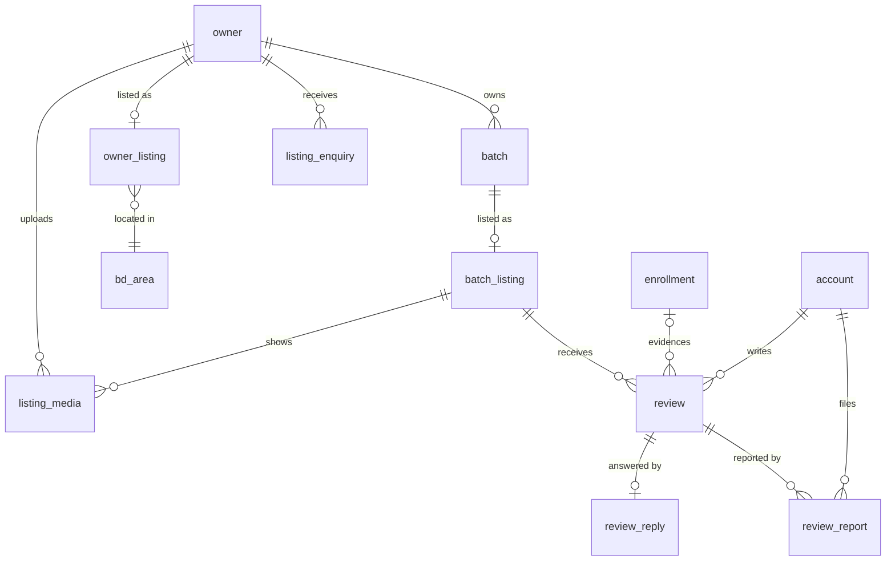

# Public Hub — technical design (Developer / Architect)

> Standalone advisory analysis. Nothing here is an AI-DLC artifact and nothing in
> the repository was changed. Every claim about built code below was checked
> against the file named next to it.

## 0. What the code says before any design

Six facts from the code shape everything below. Most of them are things the
proposal assumes and the codebase does not provide.

1. **A solo teacher has no public name anywhere we may read.** `owner.name` is
   required only for `kind = 'organisation'` (`ck_owner_organisation_is_named`)
   and is NULL for a solo tutor. The tutor's own name is `profile.self_name`,
   which sits behind `FORCE ROW LEVEL SECURITY` with an owner-only policy
   (`0001`). The admin console already works around the same gap by taking the
   name from `batch.teacher_display_name` (`app/admin/teachers.py:66`). **So the
   hub has to collect its own `public_name`.** It must never read `profile`.
2. **The privacy gate does not look at public routes.** `forbidden_fields()` in
   `app/contract/privacy.py` checks only routes where `is_teacher_facing()`
   holds. A route in `PUBLIC_ROUTES` resolves no lens, so the gate skips it. It
   also walks only `response_model` JSON schemas, and an HTML page has none. As
   built, **a server-rendered hub page could carry a child's name and every gate
   would pass.** This is the most important finding in this document.
3. **`batch.collection_number` is the teacher's personal bKash or Nagad
   number**, and so it is a phone number. It sits on the same row as every field
   a batch page wants to show. The public view has to exclude it by
   construction, not by someone remembering to leave it out.
4. **The `PUBLIC_ROUTES` count is asserted at fourteen** (`app/contract/routes.py`).
   The CDN comment records the reasoning: "a cached authenticated response is a
   cross-teacher data leak". The API distribution caches nothing (`CachingDisabled`
   on the default behaviour). The site distribution caches for a year on the
   stated premise "there is no API behind it to leak" (`infra/modules/site/main.tf`).
5. **No upload infrastructure exists.** `python-multipart` is deliberately
   absent, there is no image library, and the instance IAM role can reach only
   the config bucket, SSM, ECR, Route53 and CloudWatch (`infra/modules/app/main.tf`).
   There is a Lambda precedent in `modules/seeder` (Python runtime,
   `app/seed/lambda_runtime.py`), and it is billed at USD 0.00.
6. **Raw `decimal` is banned outside `app/money/**`** (Ruff banned-api, gate 2 in
   `tests/gates/test_import_gates.py`). A rating average therefore cannot be
   computed in Python with `Decimal`, and the no-float rule makes `float` the
   wrong choice too. The arithmetic has to be done in SQL `numeric` and sent to
   clients as integer tenths.

## 1. Architecture

### 1.1 Modules in the monolith

| Module | Owns | May import | May NOT import |
|---|---|---|---|
| `app/hub/listings/` | owner and batch listings, slugs, area vocabulary, publish state | `app.db`, `app.errors`, `app.money.wire`, `app.schemas.hub` | `app.fees`, `app.marks`, `app.students`, `app.guardians`, `app.accounts` |
| `app/hub/public/` | read side: search, the page view models, HTML rendering, sitemap | `app.hub.views` (SQL views only), `app.schemas.hub_public`, `app.money.wire` | **everything else in `app.*`**, including `app.db.models` |
| `app/hub/media/` | upload sessions, S3 presigning, processing reconciliation, CDN invalidation outbox | `app.hub.listings`, `boto3` client wrapper | image libraries (Pillow lives only in the Lambda) |
| `app/reviews/` | eligibility, review lifecycle, replies, reports, rating arithmetic | `app.db`, `app.authz`, `app.errors` | `app.hub.public` |
| `app/moderation/` | admin queues, decisions, `hub_moderation_event` | `app.hub.*`, `app.reviews`, `app.help.identity` (opaque requester ref) | — |

Two new mechanical boundaries, following the rule that an important rule must
be mechanical:

- **An import gate** added to `test_import_gates.py`: `app.hub.public` imports
  nothing from `app.` except its allowlist. Without this, a convenient
  `from app.db.models import Enrollment` in a page builder is how a child's name
  reaches HTML.
- **A database role, `shikkhok_hub_reader`**, with `SELECT` granted only on four
  views (`hub_public_owner`, `hub_public_batch`, `hub_public_media`,
  `hub_public_review`) and on `bd_area`. Every public handler runs
  `SET LOCAL ROLE shikkhok_hub_reader` inside its transaction, and
  `shikkhok_app` is granted membership. A public query that strays into
  `enrollment`, `profile` or `payment_method` then fails at the database,
  whatever the Python says. This uses the same "restricted role, asserted"
  pattern as `shikkhok_app` and the RLS meta-test.

### 1.2 Where the public hub is rendered

| Option | SEO | Fits constraints | Verdict |
|---|---|---|---|
| A. JSON API consumed by the PWA and Android | Poor. The PWA is a client-rendered SPA under `/ui/` and Android pages are not indexable | Doubles the UI work: a native hub plus a web hub | Rejected for public browsing |
| B. Prerender job writing static HTML into the site bucket | Excellent | Static pages cannot do search. Needs `s3:PutObject` on the site bucket from the instance. Every edit becomes a build-and-invalidate cycle | Rejected. Search forces a dynamic path anyway, so B adds a second rendering pipeline |
| **C. Server-rendered HTML from the API, served through the site distribution with a cached `/hub/*` behaviour** | Excellent: real HTML on the apex domain, hreflang, sitemap | One renderer, dynamic search, cache absorbs crawlers, nothing new to host | **Chosen** |

How C is built:

- **The site distribution** (`infra/modules/site`) gains a second origin, the
  API origin by its `origin.` name with the same `X-Origin-Secret` custom
  header, and one ordered behaviour for `/hub/*`. That behaviour allows `GET`
  and `HEAD` only. Its origin request policy forwards **no headers and no
  cookies**: no `Authorization`, so a cached response cannot be an
  authenticated one, because the origin never sees a credential. It forwards
  query strings from an allowlist only (`q`, `district`, `upazila`, `subject`,
  `level`, `page`, `rpage`). A viewer-request CloudFront Function lowercases and
  sorts those parameters and returns a 400 for any other, so cache-busting
  query strings cannot reach the 2 GB origin.
- **The API distribution** gains a `hub-block` function on `/hub*`, the same
  shape as `admin_block`, which answers 404 there. Hub pages are then reachable
  only through the cached path, and there is no uncached duplicate for crawlers
  to index.
- The site module's header comment, "there is no API behind it to leak", has to
  be rewritten to say "only the credential-less, GET-only `/hub/*` slice of the
  API, which receives no headers" (team rule: a comment's claims are claims).
- Rendering uses Jinja2 with autoescape on, or the hand-escaped `html` module
  approach already used by `app/api/deletion.py`. I recommend **Jinja2**,
  pinned and locked, because there will be about eight templates. Every page
  keeps the site's posture: **no JavaScript**, a CSP of
  `default-src 'none'; style-src 'self'; img-src 'self'; font-src 'self'; form-action 'self'; base-uri 'none'; frame-ancestors 'none'`,
  served by an extended `html_response()`. The search form is a plain
  `GET <form>`. The hub looks native to the site because the site's
  content-hashed stylesheet is referenced by URL from the same apex origin.

### 1.3 Caching and invalidation

| Object | Cache-Control set by origin | Invalidation |
|---|---|---|
| Owner and batch pages | `public, max-age=60, s-maxage=600` | Edits: none; the 10-minute TTL covers them. **Takedowns** (suspend, review removed, media rejected or deleted, unpublish, account deletion): an explicit invalidation, `/hub/*/t/{slug}*`, one path |
| Search and landing | `public, max-age=60, s-maxage=300` | Never |
| `sitemap.xml` | `public, s-maxage=3600` | Never |
| Media `/m/*` (S3 via OAC) | `public, max-age=31536000, immutable`; every object key is a fresh opaque id | Path invalidation only when an approved image is withdrawn |
| 404 for draft, suspended or missing | `public, s-maxage=60` | — |

Invalidations go through a **transactional outbox** (`cdn_invalidation` table).
Request middleware commits only successful responses, so a takedown and its
invalidation request commit together. A cron job on the host, the existing
compose-cron pattern, drains the outbox with `cloudfront:CreateInvalidation`.
That is a new IAM grant scoped to the site distribution ARN. CloudFront's
first 1,000 invalidation paths each month are free, and only takedowns use
them.

**Cost.** CloudFront and CloudFront Functions stay in the free tier (1 TB and
10M requests). The media bucket at 500 owners × 12 images × 3 variants × about
80 KB is about 1.5 GB, roughly USD 0.04/month. The Lambda stays in the free
tier. Invalidations cost USD 0. **The total change is under USD 0.50/month**,
but it must appear as new `cost_breakdown` lines (`media`, `image_lambda`) so
the `budget_guard` precondition stays honest. Run
`terraform output monthly_cost_estimate` before H3, because two hosts plus RDS
already sit near the ceiling.

## 2. Data model

### 2.1 Tables (migrations 0034–0037)

**`bd_area`** (0034): a seeded, read-only vocabulary.
`code VARCHAR(8) PK`, `kind ENUM(division,district,upazila)`,
`parent_code FK self`, `name_en TEXT`, `name_bn TEXT`. About 570 rows. Filters
use codes, never free text.

**`owner_listing`** (0034), 1:1 with `owner`:

| Column | Type | Notes |
|---|---|---|
| `owner_id` | UUID PK, FK `owner` ON DELETE CASCADE | |
| `slug` | `VARCHAR(60)` UNIQUE, CHECK `^[a-z0-9-]{3,60}$` | Latin. Bangla names are transliterated by the owner, and slugs are reserved for 90 days after release |
| `status` | ENUM `draft, published, hidden, suspended` | Default `draft`. **Nobody is listed without acting.** The proposal's "all … will be listed" is rejected; see §5 |
| `public_name` | `VARCHAR(120)` NOT NULL | Collected here. Never derived from `profile` |
| `headline_en`, `headline_bn` | `VARCHAR(140)` | |
| `bio_en`, `bio_bn` | `TEXT`, CHECK length ≤ 4000 | |
| `qualifications` | `TEXT` ≤ 1000 | |
| `teaching_mode` | ENUM[] `in_person, home_visit, online` | |
| `district_code`, `upazila_code` | FK `bd_area` | Area level only for solo tutors |
| `street_address` | `VARCHAR(200)` NULL | CHECK `owner.kind='organisation'` enforced by trigger. Only a centre's business premises may be public |
| `public_contact_phone` | `VARCHAR(20)` NULL | Optional opt-in. **Not** `account.phone` and never prefilled from it |
| `consent_version`, `consented_at`, `consented_by_account_id` | | Recorded at first publish. The consent text is versioned |
| `published_at`, `suspended_at`, `suspension_reason_code`, `updated_at`, `created_at` | | |
| `search_text` | `TEXT GENERATED ALWAYS AS (...) STORED` | `public_name`, headlines and subject names, lowercased |

**`batch_listing`** (0034), 1:1 with `batch`:
`batch_id PK FK batch ON DELETE CASCADE`, `slug VARCHAR(60)` (UNIQUE per owner
via `(owner_id, slug)`, with `owner_id` denormalised and covered by a
CHECK-trigger), `status ENUM(draft,published,hidden,suspended)`,
`description_en/bn TEXT ≤ 4000`, `class_levels ENUM[]`
(`class_1…class_12, ssc, hsc, admission, other`), `subject_tags VARCHAR(40)[]`
(a controlled list), `admissions ENUM(open,waitlist,closed)`,
`show_fee BOOL`, `show_schedule BOOL`, both NOT NULL with **no default**, on the
`student_decision` reasoning (ADR-013: every insert states the choice),
`venue_override` (centre room label only), timestamps.

**`listing_media`** (0035):
`id UUID PK`, `owner_id FK`, `batch_id FK NULL` (NULL means owner-level),
`kind ENUM(image)` (**PDF is not in V1**, §3), `status ENUM(awaiting_upload,
processing, pending_review, approved, rejected, withdrawn)`, `quarantine_key`,
`public_key` (an opaque id, set only on approval), `byte_size INT`,
`sha256 BYTEA`, `width/height SMALLINT`, `alt_en/alt_bn VARCHAR(200)`,
`position SMALLINT`, `rejection_code`, `created_at`, `decided_at`.
UNIQUE `(owner_id, batch_id, position) WHERE status='approved'`. A CHECK
requires `public_key IS NOT NULL` exactly when the status is `approved`.

**`review`** (0036):

| Column | Type | Notes |
|---|---|---|
| `id` | UUID PK | |
| `batch_id` | FK `batch_listing` ON DELETE CASCADE | |
| `author_account_id` | FK `account` ON DELETE CASCADE | Hard-deleted with the author. **Never in any response** |
| `enrollment_id` | FK `enrollment` ON DELETE SET NULL | The eligibility evidence. **Never in any response** |
| `author_role` | ENUM `guardian, student` | V1 accepts `guardian` only (§5) |
| `rating` | `SMALLINT` CHECK 1–5 | |
| `body` | `TEXT` CHECK length 0–1500 | |
| `status` | ENUM `pending, published, rejected, removed` | |
| `tenure_bucket` | ENUM `lt_6m, 6_12m, gt_1y` | Computed and frozen at submit. This is the only "who" a reader ever sees |
| `submitted_at`, `published_month DATE` (first of month), `edited_at`, `decided_at` | | Month granularity on purpose |

UNIQUE `(batch_id, author_account_id)`, so a guardian with two children in one
batch writes one review. Partial index `(batch_id) WHERE status='published'`.

**`review_reply`** (0036): `review_id PK FK CASCADE`, `body ≤ 1000`,
`status (published, removed)`, `written_by_account_id FK SET NULL`, timestamps.

**`review_report`** (0036): `id`, `review_id FK CASCADE`,
`reporter_account_id FK CASCADE`, `reason ENUM(personal_info, abusive, fake,
off_topic, child_safety, other)`, `status (open, upheld, dismissed)`,
timestamps. UNIQUE `(review_id, reporter_account_id)`.

**`hub_moderation_event`** (0036): append-only, with a closed event enum and no
free-text column, the `auth_audit_log` principle. Columns: `event`,
`target_kind`, `target_id`, `actor_admin_account_id`, `decision_code`,
`correlation_id`, `at`.

**`cdn_invalidation`** (0035): `id`, `path`, `requested_at`, `sent_at`, `aws_id`.

**`listing_enquiry`** (0037, **optional unit H6**): `id`, `owner_id`,
`enquirer_account_id FK CASCADE`, `body ≤ 1000`, `share_contact BOOL` (no
default), `status (open, closed)`, timestamps.

**No `rating_aggregate` table.** Published reviews per batch number in the
tens. The aggregate is a `GROUP BY` inside `hub_public_batch`, and the result
is cached at the edge for 10 minutes. A materialised counter would be a second
source of truth that the state machine has to keep in step.

### 2.2 ER diagram



Text fallback: `owner` 1–0..1 `owner_listing` (FK to `bd_area`); `batch` 1–0..1
`batch_listing`; `owner` 1–n `listing_media`, with an optional FK to
`batch_listing`; `batch_listing` 1–n `review`; `review` n–1 `account` (author)
and n–0..1 `enrollment` (evidence); `review` 1–0..1 `review_reply`; `review`
1–n `review_report` n–1 `account`; `owner` 1–n `listing_enquiry`.

### 2.3 Migration sequencing

- **0034:** `CREATE EXTENSION pg_trgm`. It is a trusted extension, so the RDS
  owner role can install it. Then `bd_area` plus its seed, `owner_listing`,
  `batch_listing`, role `shikkhok_hub_reader`, and views `hub_public_owner` and
  `hub_public_batch`. Last, a GIN index on
  `owner_listing.search_text gin_trgm_ops`.
- **0035:** `listing_media`, `cdn_invalidation`, view `hub_public_media`.
- **0036:** `review`, `review_reply`, `review_report`, `hub_moderation_event`,
  view `hub_public_review`.
- **0037:** `listing_enquiry` (only if H6 ships).

Each downgrade refuses while rows exist, following the 0033 convention. Each
table gets a `DISPOSITIONS` entry in the same migration's unit, because the
governance test fails otherwise:

| Table | Disposition | Retention |
|---|---|---|
| `owner_listing`, `batch_listing`, `listing_media` | `HARD_DELETE` when the solo owner's account is deleted (S3 objects too, via the outbox); a centre's listing survives a manager's deletion | `LIFE_OF_ACCOUNT` |
| `review`, `review_report` | `HARD_DELETE` with the author | `LIFE_OF_ACCOUNT` |
| `review_reply` | Cascades with its review | `LIFE_OF_ACCOUNT` |
| `hub_moderation_event` | `NOT_PERSONAL` (ids only) | `MONTHS_12` |
| `cdn_invalidation` | `NOT_PERSONAL` | `DAYS_7` |

### 2.4 Review eligibility (server-side, test-first)

Eligibility decides whether an account gets a write lens, so a wrong answer is
an authorization error. The team predicate therefore holds and these tests are
written first. A new **`ReviewerLens(account_id, batch_id, enrollment_id)`**
is resolved from the path by its own statement, never by `_LENS_QUERY`, for the
same reason `InvitationLens` has its own statement: the grant is a set. It is
granted when **all** of these hold in one SQL statement:

1. `enrollment.batch_id = :batch_id`, `guardian_account_id = :account` and
   `guardian_decision = 'accepted'`. V1 is guardian-only.
2. `guardian_relink_blocked_at IS NULL`.
3. `batch_listing.status = 'published'`. A draft batch cannot be reviewed.
4. **Tenure.** `COALESCE(joined_on, created_at::date) <= today - 30 days`.
5. **Engagement.** At least 4 `session` rows of that batch that are not
   cancelled and have an `attendance` row for this enrollment. This proves the
   seat was real rather than created for a review.
6. **Recency.** `inactive_from IS NULL` or `inactive_from >= today - 180 days`,
   so former students can review for six months.

Conditions 1–3 failing answer `NOT_AVAILABLE`/403, the same as a nonexistent
batch, to avoid an existence oracle. Conditions 4–6 failing for a holder of a
real seat answer `REVIEW_NOT_YET_ELIGIBLE`/409, carrying a server-computed
`eligible_from` date. That reveals nothing the guardian does not already know.

### 2.5 Reviews must not become a D-5 channel

- **Structural.** `hub_public_review` exposes only `id, batch_id, rating, body,
  tenure_bucket, author_role, published_month, reply_body, reply_month`. It has
  no `enrollment_id`, no author id, no `display_name`, no `submitted_at`.
  Teachers read reviews **through the same view** as the public, under
  `hub_reader`, so the teacher API cannot join a review to a seat even by
  mistake.
- **k-anonymity.** Review text, the average and the distribution for a batch
  are shown only when it has **at least 3 published reviews**. Below that the
  page shows "New listing — fewer than 3 reviews". A one-review batch of eight
  children is otherwise a de-anonymised message to the teacher.
- **Timing.** Pending reviews are invisible to the teacher; only published ones
  appear. The publish date is shown by month, and moderation runs on a weekly
  cadence, so publication timing does not point at a seat.
- **Content.** Moderation rejects any review naming a child, a phone number or
  a personal detail (`personal_info`), and there is a server-side check that
  refuses bodies matching a Bangladeshi phone pattern (`01[3-9]\d{8}`, with
  Bangla digits normalised first).
- **No RLS on `review`.** RLS on `profile` exists because one table has one
  owner-reader. Here the boundary is the role and view separation, which is
  the right mechanism for a multi-reader table, plus the `hub_reader` grants.

### 2.6 Search

Search uses Postgres only: no OpenSearch, which would cost USD 345 or more a
month. Structured filters (`district_code`, `upazila_code`, `subject_tags &&`,
`class_levels &&`) carry most of the work, on B-tree and GIN array indexes.
Free text uses `search_text ILIKE '%' || q || '%'` on the `gin_trgm_ops` index,
ordered by `similarity()`.

**Bangla caveat.** Postgres has no Bangla dictionary or stemmer, so
`to_tsvector` would be worse than useless. pg_trgm splits words on
non-alphanumerics, and Bangla vowel signs (matras, Unicode Mn/Mc) may count as
separators under the database's `LC_CTYPE`. That would fragment trigrams.
Correctness is safe, because the index recheck applies the real `ILIKE`, but
selectivity may degrade. Two mitigations: a test runs `EXPLAIN` over a seeded
Bangla corpus and asserts index use, and `search_text` stores both the Bangla
text and an owner-entered Latin transliteration of `public_name`. Revisit only
if p95 exceeds 200 ms on 5,000 listings.

## 3. Media pipeline

```
client --POST /v1/hub/media/uploads--> API (TeacherLens): validates type/size/quota,
   inserts listing_media(awaiting_upload), returns presigned POST
client --multipart POST--> S3 media bucket  quarantine/{media_id}
S3 ObjectCreated --> Lambda "image-sanitiser" (arm64, 1024 MB, no VPC, no DB creds)
   magic-byte check -> Pillow decode with MAX_IMAGE_PIXELS=40M -> re-encode WebP
   (strips EXIF/GPS/ICC by construction) -> staged/{media_id}/{320,960,1600}.webp
   -> staged/{media_id}/result.json {ok|unreadable, w, h} -> delete quarantine object
client --POST /v1/hub/media/{id}/complete--> API reads result.json -> pending_review
admin approve --> API copies staged/* to public/{opaque}/ (only prefix CloudFront serves)
```

- **Presigned POST, not PUT.** A POST policy can enforce
  `content-length-range` (≤ 8 MB) and an exact `Content-Type` (`image/jpeg`,
  `image/png`, `image/webp`). A presigned PUT cannot bound size. No
  `python-multipart`: the bytes never touch the API.
- **Decoding runs in Lambda, not on the API host.** Image decoders are a
  classic RCE surface: Pillow has a steady CVE history. Untrusted decoding
  belongs in a throwaway sandbox holding no database credentials and no
  children's data. The 2 GB host is also memory-bound, and a decompression
  bomb there takes down attendance mid-class. Cost: a few hundred GB-seconds
  a month, inside the free tier. Pillow is pinned in a **separate Lambda
  lockfile**, which must join the CVE gate (`deploy/cve_gate.py`) and the
  release SBOM.
- **The Lambda's IAM** allows `s3:GetObject`/`DeleteObject` on `quarantine/*`
  and `s3:PutObject` on `staged/*`, and nothing else. **The instance role**
  gains `s3:PutObject` presign rights scoped to `quarantine/*` (the policy
  conditions are enforced by S3), `s3:GetObject` on `staged/*`,
  `s3:CopyObject`/`PutObject`/`DeleteObject` on `public/*`, and
  `cloudfront:CreateInvalidation` on the site distribution.
- **Lifecycle rules:** `quarantine/` expires after 1 day and `staged/` after
  30 days, as a backstop for abandoned or rejected uploads.
- **Moderation gate.** Only `public/` is served, via OAC on a `/m/*` behaviour
  of the site distribution. The response headers policy sets
  `Content-Type: image/webp`, `X-Content-Type-Options: nosniff` and
  `Content-Security-Policy: default-src 'none'; sandbox`. Admins preview
  `staged/` objects through 5-minute presigned GETs. The moderation checklist
  includes **"no identifiable student in the photo"**: a classroom photo is a
  minor's image.
- **PDFs are not in V1.** Rendering a PDF safely needs poppler or ghostscript
  in Lambda, which is a large, CVE-heavy attack surface. Malware scanning
  (GuardDuty Malware Protection for S3) bills per object and per GB; it is
  small at this volume but not zero, and the price needs verifying. And a PDF
  can carry phishing links that moderation would have to read. What owners
  want a PDF for (syllabus, routine, fees) is better as structured text fields,
  which are searchable, bilingual and accessible. If PDFs are later required:
  serve them from a **separate hostname** with
  `Content-Disposition: attachment` and a `sandbox` CSP, behind GuardDuty
  scanning plus pre-moderation.
- **Deletion.** Account deletion (`app/governance/deletion.py`) and media
  `DELETE` enqueue S3 deletes for `public/` and `staged/` plus a CDN
  invalidation in the same transaction. A test asserts that no `listing_media`
  row survives an owner's account deletion and that every key was enqueued.
- **Quotas:** 12 owner images, 8 per batch, 30 uploads per owner per day, all
  through `rate_limit_counter`.

## 4. API changes

### 4.1 Endpoint table

**Public HTML** (PUBLIC_ROUTES, GET-only, no auth dependency, cached):

| # | Method and path | Response | Notes |
|---|---|---|---|
| P1 | `GET /hub/{locale}` | HTML from `HubSearchPage` | `locale ∈ {en,bn}`. Landing page plus search; paginated, 20 per page |
| P2 | `GET /hub/{locale}/t/{owner_slug}` | HTML from `HubOwnerPage` | 404 for draft, hidden, suspended or missing, all identical |
| P3 | `GET /hub/{locale}/t/{owner_slug}/{batch_slug}` | HTML from `HubBatchPage` | `?rpage=` paginates reviews |
| P4 | `GET /hub/sitemap.xml` | XML | Published listings only, with both locales and hreflang |

**Owner listing management** (`TeacherLens`, meaning a solo owner or a centre
manager; a `ClassTeacherLens` reaches none of these):

| Method and path | Request → Response |
|---|---|
| `GET /v1/hub/listing` | → `OwnerListingResponse` (includes a server-computed `checklist[]` and `publishable: bool`) |
| `PUT /v1/hub/listing` | `OwnerListingUpdate` → `OwnerListingResponse` |
| `POST /v1/hub/listing/publish` | `PublishRequest{consent_version}` → `OwnerListingResponse` |
| `POST /v1/hub/listing/unpublish` | → `OwnerListingResponse` |
| `GET /v1/hub/slugs/{slug}` | → `SlugAvailability` |
| `GET /v1/hub/batch-listings` | → `list[BatchListingResponse]` |
| `PUT /v1/batches/{batch_id}/listing` | `BatchListingUpdate` → `BatchListingResponse` |
| `POST /v1/batches/{batch_id}/listing/publish` and `/unpublish` | → `BatchListingResponse` |

The existing `POST`/`PATCH /v1/batches` are **unchanged**. Listing data is a
separate resource, so the batch schemas, the roster and the fee paths are not
touched.

**Media** (`TeacherLens`):

| Method and path | Request → Response |
|---|---|
| `POST /v1/hub/media/uploads` | `MediaUploadInit{batch_id?, content_type, byte_size, sha256}` → `MediaUploadTicket{media_id, url, fields, expires_at}` |
| `POST /v1/hub/media/{media_id}/complete` | → `MediaResponse` |
| `GET /v1/hub/media` | → `list[MediaResponse]` |
| `PATCH /v1/hub/media/{media_id}` | `MediaUpdate{alt_en, alt_bn}` → `MediaResponse` |
| `PUT /v1/hub/media/order` | `MediaOrder{batch_id?, ids[]}` → `list[MediaResponse]` |
| `DELETE /v1/hub/media/{media_id}` | → 204 |

**Reviews:**

| Method and path | Auth | Request → Response |
|---|---|---|
| `GET /v1/hub/reviewable` | LENS_EXEMPT_AUTHENTICATED (reports which reviewer lenses exist, on the `/v1/invitations` reasoning) | → `list[ReviewableBatch{batch_id, batch_name, owner_public_name, state: eligible \| not_yet \| reviewed, eligible_from?}]` |
| `GET /v1/hub/batches/{batch_id}/my-review` | ReviewerLens | → `MyReviewResponse` |
| `PUT /v1/hub/batches/{batch_id}/my-review` | ReviewerLens | `ReviewWrite{rating, body, client_mutation_id}` → `MyReviewResponse` (an edit returns the review to `pending`) |
| `DELETE /v1/hub/batches/{batch_id}/my-review` | ReviewerLens | → 204 (hard delete) |
| `GET /v1/hub/reviews` | TeacherLens | → `list[HubReview]` (published only, read from the public view) |
| `PUT /v1/hub/reviews/{review_id}/reply` | TeacherLens | `ReplyWrite` → `HubReview` |
| `DELETE /v1/hub/reviews/{review_id}/reply` | TeacherLens | → 204 |
| `POST /v1/hub/reviews/{review_id}/reports` | LENS_EXEMPT_AUTHENTICATED | `ReportWrite{reason}` → 202 |

Reporting is authenticated but lens-free. Any account may report a published
review, which is public, so no lens would narrow it. Leaving it public would be
an unauthenticated write, which only signup has ever justified.

**Admin moderation** (`PlatformAdminLens`, added to `PLATFORM_ADMIN_ROUTES`,
already behind `admin_block` and `admin_gate`):

`GET /v1/admin/hub/queue?kind=media|review|report|listing`,
`GET /v1/admin/hub/media/{id}`,
`POST /v1/admin/hub/media/{id}/decision`,
`GET /v1/admin/hub/reviews/{id}`,
`POST /v1/admin/hub/reviews/{id}/decision`,
`POST /v1/admin/hub/reports/{id}/decision`,
`PUT /v1/admin/hub/owners/{owner_id}/suspension`.

**Enquiries** (H6, optional):
`POST /v1/hub/owners/{owner_slug}/enquiries` (exempt, authenticated),
`GET /v1/hub/enquiries` (TeacherLens),
`POST /v1/hub/enquiries/{id}/close` (TeacherLens),
`GET /v1/me/hub/enquiries` (exempt).

**Counts.** 4 public, 9 listing, 6 media, 8 reviews, 7 admin, plus 4 optional
enquiry routes: 34 required and 38 with H6.
`LENS_EXEMPT_AUTHENTICATED` gains 2, or 4 with H6.

### 4.2 PUBLIC_ROUTES: 14 → 18

Why each new public route is safe:

- `GET` only. No dependency tree contains `authenticated_account` or
  `token_subject`, and a new gate asserts this for the set
  `PUBLIC_CACHEABLE_ROUTES ⊂ PUBLIC_ROUTES`.
- The handler sets `SET LOCAL ROLE shikkhok_hub_reader`, so it can read only
  the four views.
- The edge forwards no `Authorization` header and no cookies, and the 404 for a
  draft listing and a missing one is byte-identical, so slugs cannot be
  enumerated.
- At the origin, uncached requests are bounded by a per-IP `rate_limit_counter`
  scope (`hub_read`, 120 per minute) using `app.auth.client_address`.

Locale is a path parameter, so the EN and BN twins count as one route each.
The comment above the frozenset must state 18 and why, in the same commit.

### 4.3 Errors and message keys

New codes, all through the closed five-class hierarchy:

| Code | Status | Error class | message_key |
|---|---|---|---|
| `HUB_SLUG_TAKEN` | 409 | ConflictError | `hub.slug.taken` |
| `HUB_LISTING_INCOMPLETE` | 400 | ValidationError | `hub.listing.incomplete` |
| `HUB_LISTING_SUSPENDED` | 409 | ConflictError | `hub.listing.suspended` |
| `REVIEW_NOT_YET_ELIGIBLE` | 409 | ConflictError | `hub.review.not_yet_eligible` |
| `REVIEW_CONTAINS_CONTACT` | 400 | ValidationError | `hub.review.contains_contact` |
| `HUB_WRITE_CEILING` | 409 | ConflictError | `hub.write.ceiling` |
| `MEDIA_TYPE_NOT_ALLOWED` | 400 | ValidationError | `hub.media.type_not_allowed` |
| `MEDIA_TOO_LARGE` | 400 | ValidationError | `hub.media.too_large` |
| `MEDIA_LIMIT_REACHED` | 409 | ConflictError | `hub.media.limit_reached` |
| `MEDIA_NOT_UPLOADED` | 409 | ConflictError | `hub.media.not_uploaded` |
| `MEDIA_UNREADABLE` | 400 | ValidationError | `hub.media.unreadable` |
| `REPORT_ALREADY_FILED` | 409 | ConflictError | `hub.report.already_filed` |

`HUB_WRITE_CEILING` is a ConflictError, not a TransientError, on the SMS
ceiling precedent. All new keys are added to `message-keys.json` and to both
Android string bundles and the web bundle, or `MessageKeyCoverageTest` fails.

### 4.4 Schema sketches

```python
class RatingSummary(BaseModel):
    state: Literal["below_threshold", "shown"]   # server decides; client renders
    count: int                                   # published reviews
    average_tenths: int | None                   # 43 == 4.3; None below threshold
    distribution: list[int] | None               # 5 ints, 1★..5★; None below threshold

class HubReview(BaseModel):            # also the TeacherLens response
    id: UUID
    rating: int = Field(ge=1, le=5)
    body: str
    author_label: Literal["guardian"]  # rendered "Verified guardian"
    tenure: Literal["lt_6m", "6_12m", "gt_1y"]
    published_month: str               # "2026-11"
    reply: HubReply | None

class HubBatchCard(BaseModel):
    slug: str
    name: str
    subjects: list[str]
    class_levels: list[ClassLevel]
    admissions: Literal["open", "waitlist", "closed"]
    fee: Money | None                  # JSON string, only when show_fee
    fee_period: Literal["monthly"] | None
    schedule: list[PublicSlot] | None  # weekday + HH:MM, only when show_schedule
    rating: RatingSummary

class HubBatchPage(BaseModel):
    owner: HubOwnerCard                # public_name, kind, area names, slug
    batch: HubBatchCard
    description: str | None            # resolved for the requested locale
    media: list[HubImage]              # public URLs, alt text
    reviews: list[HubReview]; reviews_page: int; reviews_pages: int
```

`average_tenths` is computed in SQL as
`round(10 * sum(rating)::numeric / count(*))::int` (half-up, `numeric`). It uses
no float and no Python `decimal`, so the banned-api rule holds.

## 5. Authorization and privacy

### 5.1 Lenses

The design reuses `TeacherLens` for owner management (solo owner or accepted
manager, already resolved this way), `PlatformAdminLens` for moderation, and
lens-exempt authenticated routes for the reviewable list and for reports. It
adds one new lens, **`ReviewerLens`**, a `Lens` subtype so the route gate sees
it. It is listed in a new asserted set, `REVIEWER_ROUTES`, on the pattern of
`CLASS_TEACHER_ROUTES`.

### 5.2 Rule collisions and proposed amendments

**D-5 / TC-13** reads "NEVER expose anything a student or guardian writes to
any teacher." A public review is, by definition, shown to the teacher. Proposed
wording:

> NEVER expose anything a student or guardian writes to any teacher, **except a
> hub review its author explicitly submitted for public display**. Such a review
> reaches anyone, the teacher included, only after moderation, only once its
> batch holds at least three published reviews, only through the public review
> view, and never with a name, phone number, seat, enrollment id, submission
> time finer than a month, or any other field joinable to a record the teacher
> keeps. A review's author may delete it at any time, and deletion is total.

**D-6 / TC-14** reads that an administrator sees subscriber information only.
Moderating reviews means reading guardian-written text. Precedent already
exists: `PlatformAdminLens`'s docstring admits "what people wrote to support",
under an opaque requester label (`app/help/identity.py`). Proposed wording:

> NEVER expose student or guardian data to a platform administrator, whose
> visibility is limited to subscriber information and **to content a person
> submitted for publication on the hub (listing text, images, reviews, replies
> and reports), shown with an opaque author reference and the author's role and
> never with a name, phone number, profile field, seat or any record a teacher
> keeps.**

**A third, unstated collision: Families policy and child UGC.** Students are
mostly minors and the app records no age. Public text by a minor is personal
data made public under COPPA and GDPR-K, and Play Families requires UGC
moderation. **Recommendation: V1 reviews are guardian-only.** The `author_role`
enum keeps `student` so this does not need a migration if a product and legal
decision later admits students. This is a product call and should be put to
the human, not settled by engineering.

**Opt-in, not auto-listing.** Listing every user as the proposal says would
publish adults' names and areas without consent and change every teacher's
Data Safety declaration retroactively. `status` therefore defaults to `draft`,
and a versioned consent is recorded at first publish.

**Data Safety and privacy policy** (RC-4, RC-5) are release-blocking for H1.
They newly declare: user-generated content shared publicly, photos, and
approximate location (area) for teachers; reviews for guardians. The generated
policy picks this up from the new `DISPOSITIONS` entries.

### 5.3 Privacy tests to add

1. **Extend `forbidden_fields`** with a third audience, *public-facing*: routes
   in `PUBLIC_ROUTES`, plus the `HubReview*` components wherever they are
   returned. The forbidden set for this audience is the union of
   owner-private, account-id and staff-private fields plus `phone`,
   `student_phone`, `guardian_phone`, `invited_phone`, `collection_number`,
   `display_name`, `enrollment_id` and `student_id`.
2. **HTML view-model registry.** HTML routes have no `response_model`, so each
   hub handler must render through `render(view: HubPage)`, where `HubPage` is
   a union of registered Pydantic view models. A gate asserts that each
   public route's handler annotation is one of them, then walks their JSON
   schemas with the public forbidden set.
3. **A canary probe**, the adversarial half. Seed a teacher whose
   `profile.self_name`, `account.phone`, `collection_number`, student
   `display_name`, guardian phone and enrollment ids are unique canary strings.
   Render every hub page in both locales, plus `sitemap.xml`, and assert that no
   canary appears in any byte. This is the only test that sees what the HTML
   actually contains.
4. **Role meta-test.** Under `shikkhok_hub_reader`, `SELECT` from `profile`,
   `enrollment`, `review` (the base table) and `payment_method` each raises
   `InsufficientPrivilege`. This runs before the hub suite, on the RLS
   meta-test pattern.
5. **IDOR probes:**
   - teacher A replies to, or reads replies for, teacher B's review;
   - teacher A updates B's batch listing or deletes B's media;
   - a guardian with a `pending`, `declined` or relink-blocked seat gets a
     `ReviewerLens`;
   - a `ClassTeacherLens` holder edits the centre listing;
   - draft and suspended slugs return 404s byte-identical to a nonexistent
     slug;
   - the teacher's `GET /v1/hub/reviews` never returns a `pending` review.
6. **k-threshold.** With 2 published reviews the batch page and the teacher's
   endpoint expose no body, no average and no distribution.

### 5.4 Abuse controls and audit

All counters are `rate_limit_counter` rows, checked narrowest-first:

- review writes: 5 per day per account;
- reports: 10 per day per account;
- listing updates: 50 per day per owner;
- uploads: 30 per day per owner;
- enquiries: 5 per day per account, and 1 open per owner;
- public reads: per IP at the origin only.

Bodies are length-capped and phone-pattern-checked. Every moderation decision
writes a `hub_moderation_event` row and calls the existing admin `_audit`
logger. Review submit, edit and delete write the same event table, with the
actor as an opaque ref.

## 6. Clients

- **Public browsing is web-only (SSR).** Android and the PWA link to the hub
  through `Intent.ACTION_VIEW` / `<a target>`. There is no in-app native hub in
  V1, and so no Custom Tabs dependency and no SDK admission note.
- **Android:** `feature/hublisting`, the owner editor: bilingual fields,
  area pickers fed by `GET /v1/hub/listing`'s server-supplied options, a
  checklist rendered from the server's `checklist[]`, and publish with
  consent. `feature/hubmedia` uses the **Android Photo Picker**
  (`PickVisualMedia`), which needs **no storage permission**, so the
  manifest-allowlist gate is unchanged; it uploads by multipart POST straight
  to S3 with OkHttp. `feature/reviews` covers the guardian's write flow and
  the teacher's reply flow. Each ViewModel ships state-machine tests, and
  `RatingSummary` mapping is tested against `below_threshold`. Any
  money-carrying listing model (`fee`) gets the decode-string and
  reject-number serialization test.
- **Web PWA:** `web/src/features/hub` (owner editor and media with
  `<input type=file accept="image/*">` → presigned POST) and
  `features/family/reviews`.
- **Bangla layout.** Bodies run to 4,000 characters, and the D-43 verifier
  question from team.md applies to every new screen.

## 7. Testing and CI per unit

Test-first (the team predicate holds: an authorization or wrong-visibility
error):

- eligibility conditions 1–6 and their boundaries (day 29/30, 3/4 attended
  sessions, inactive day 180/181);
- `ReviewerLens` grants;
- review and media moderation state transitions (an edit returns a published
  review to pending; a removal invalidates the CDN);
- the k-threshold.

The rating arithmetic is also written test-first because its expected values
are knowable in advance, for example `[5,4,4] → 43`, plus half-up cases.

New gates:

- the `app.hub.public` import gate;
- the `PUBLIC_CACHEABLE_ROUTES` no-auth gate;
- the public-facing privacy audience and HTML view-model registry;
- the `REVIEWER_ROUTES` set assertion;
- the `hub_reader` meta-test;
- `DISPOSITIONS` coverage, which is automatic;
- Jest tests for the CloudFront function's query normalisation, on the
  `admin-block.test.mjs` pattern;
- the Lambda's own pytest suite: decompression bomb, polyglot JPEG/HTML,
  EXIF-GPS stripped, truncated file → `unreadable`. It joins the CVE gate.

## 8. Risks, debt and effort

| Risk | Mitigation |
|---|---|
| Teacher retaliation against a reviewer's child, since the teacher holds marks and attendance | k ≥ 3, month granularity, guardian-only, pending reviews hidden, author delete is total |
| Defamation and fake reviews | Verified-seat eligibility, pre-moderation, owner reply, reports |
| Child-safety exposure: schedule plus exact address tells anyone where children are and when | Area-only location for solo tutors; schedule opt-in; street address for centres only |
| One administrator's moderation capacity | Pre-moderate media and reviews only; listings post-moderated; queue SLA stated in the policy |
| Crawler load on a 2 GB host | Edge cache, query allowlist, origin per-IP limit |
| A gate gap: HTML is invisible to schema gates | View-model registry plus canary probe, landing in H2, before any public route ships |
| Pillow and Jinja2 supply chain | Pinned and locked; Pillow isolated in Lambda; both under the CVE gate |

**Units**, each a short-lived branch, with the controls each one installs named
inside it:

| Unit | Content and controls installed | Effort, solo with AI |
|---|---|---|
| **H0** Policy and foundations | D-5 and D-6 amendments via the learnings ritual; Families and age decision; Data Safety and privacy drafts; `hub_reader` role and meta-test; public-facing privacy audience; `PUBLIC_CACHEABLE_ROUTES` gate | 3–4 days |
| **H1** Listings | 0034; owner and batch listing APIs; slugs; `bd_area`; consent; Android and web editors; suspension admin route | 7–9 days |
| **H2** Public pages | Jinja SSR (P1–P4); view-model registry; canary probe; site-distribution behaviour, CloudFront function and `hub-block`; outbox invalidation; pg_trgm search; sitemap | 8–10 days |
| **H3** Media | 0035; bucket; Lambda; presigned POST; media moderation queue; deletion wiring; cost lines | 8–10 days |
| **H4** Reviews | 0036; eligibility; `ReviewerLens`; k-threshold; replies; reports; review moderation; clients | 9–11 days |
| **H6** Enquiries (optional, defer) | 0037; consented contact sharing | 5–6 days |

The total is **35–44 working days** without H6. H1 and H2 together can launch a
reviews-free, photo-free "directory" first. That captures the SEO value early
and defers the two hardest privacy surfaces until the policy amendments are
settled.
